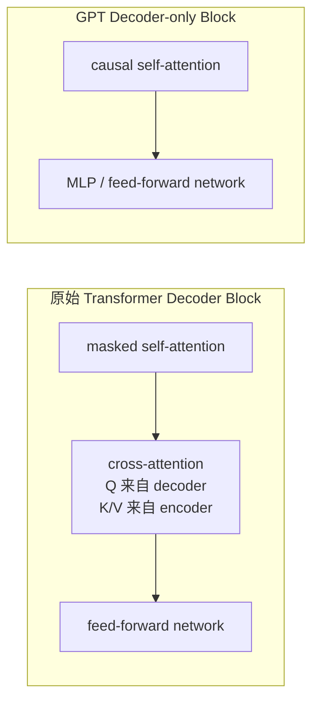
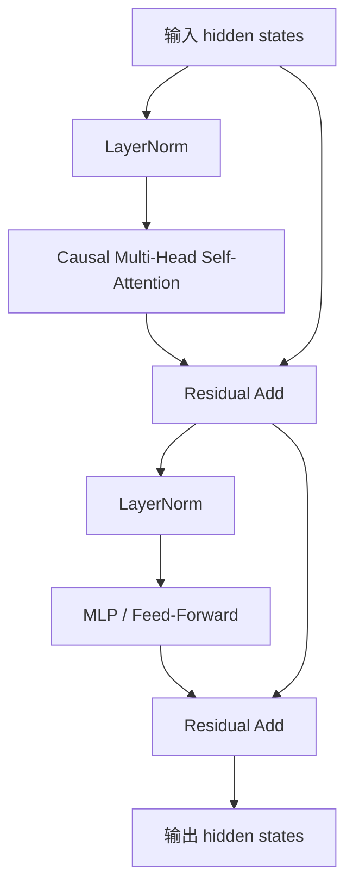
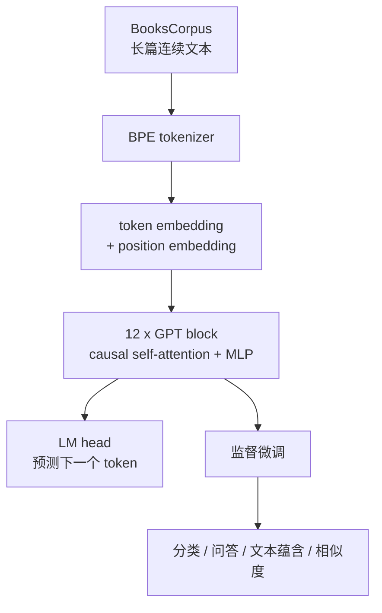
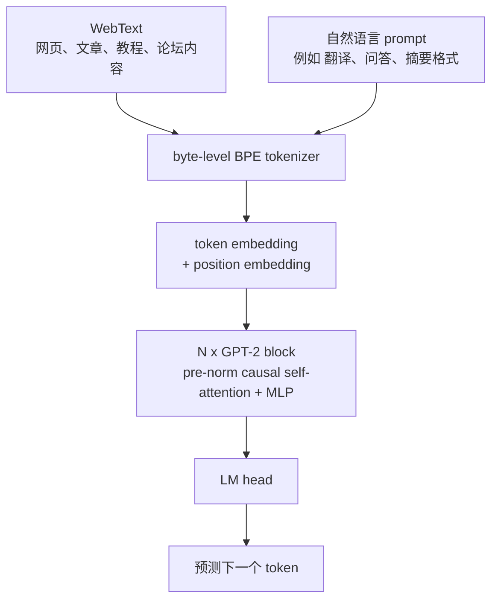
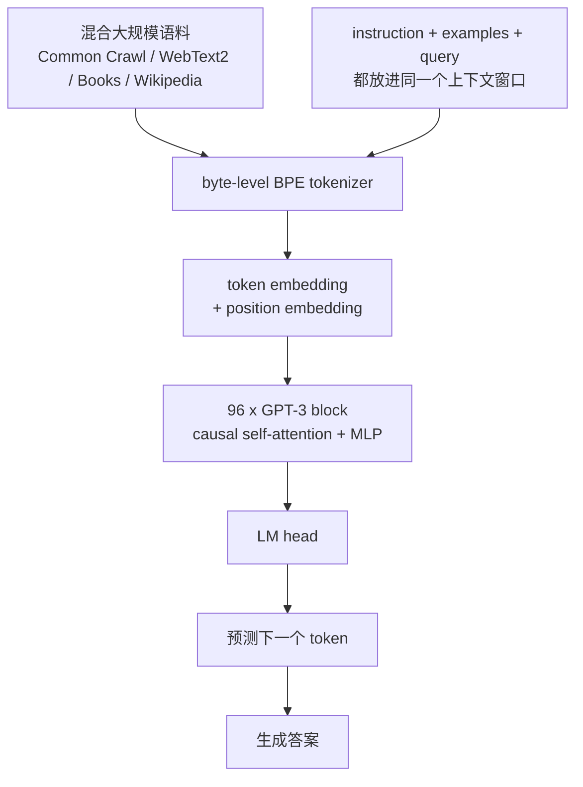
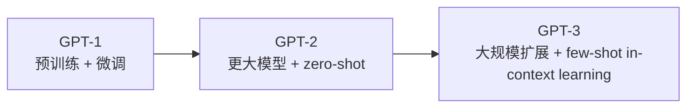

# GPT-1、GPT-2、GPT-3 学习笔记

> 整理时间：2026-06-01

这份笔记用于理解 GPT-1、GPT-2、GPT-3 的共同结构、关键差异，以及如何从 PyTorch 实现入手学习。

核心结论：

- GPT 系列使用的是 `decoder-only Transformer`。
- 这里的 `decoder` 不是原始 Transformer 机器翻译模型里的完整 decoder，而是去掉了 `encoder-decoder cross-attention` 的生成式 decoder。
- GPT 每一层的核心是 `causal self-attention + MLP`。
- 三代 GPT 的主线不是频繁更换架构，而是扩大模型、扩大数据、增加上下文，并逐渐从“微调完成任务”演进到“靠提示词和少量示例完成任务”。

## 1. 先理解 decoder-only Transformer

原始 Transformer 用于机器翻译时有两个部分：

```text
Encoder: 读入源语言句子
Decoder: 根据已生成的目标语言前缀，并结合 Encoder 输出，生成下一个词
```

原始 Transformer decoder block 一般有三块：

```text
1. Masked self-attention
2. Encoder-decoder cross-attention
3. Feed-forward network
```

GPT 没有 encoder，因此也没有 cross-attention。GPT block 更接近：

```text
1. Causal self-attention
2. MLP / feed-forward network
```

示意图：



GPT 的做法就是保留左边的自回归生成部分，去掉右边依赖 encoder 的 cross-attention。

### 1.1 什么是 causal self-attention

如果序列是：

```text
x1 x2 x3 x4
```

每个位置能看到的 token 是：

```text
x1 只能看 x1
x2 只能看 x1, x2
x3 只能看 x1, x2, x3
x4 只能看 x1, x2, x3, x4
```

注意力 mask 是一个下三角矩阵：

| query \ key | x1 | x2 | x3 | x4 |
|---|---:|---:|---:|---:|
| x1 | yes | no | no | no |
| x2 | yes | yes | no | no |
| x3 | yes | yes | yes | no |
| x4 | yes | yes | yes | yes |

这就是“因果”的含义：当前位置只能依赖过去和自己，不能偷看未来。

### 1.2 一个 GPT block 的抽象结构

不同论文和实现中 LayerNorm 的位置略有差异。GPT-2 和 GPT-3 更接近 pre-norm，也就是先做 LayerNorm，再进入 attention 或 MLP。



整个 GPT 模型就是把这个 block 堆叠 N 次：

```text
token ids
  -> token embedding + position embedding
  -> GPT block x N
  -> final layer norm
  -> language modeling head
  -> next-token probabilities
```

训练目标始终是预测下一个 token：

```text
P(x_t | x_1, x_2, ..., x_{t-1})
```

## 2. GPT-1：预训练加微调

论文：Improving Language Understanding by Generative Pre-Training，2018。

GPT-1 的核心贡献是证明：

```text
大规模无标注文本预训练
  -> 得到通用语言表示
  -> 再用少量标注数据微调
  -> 可以迁移到多种 NLP 任务
```

### 2.1 结构参数

| 项目 | GPT-1 |
|---|---:|
| 架构 | decoder-only Transformer |
| 参数量 | 约 117M |
| 层数 | 12 |
| hidden size | 768 |
| attention heads | 12 |
| FFN hidden size | 3072 |
| 最大上下文 | 512 token |
| 训练数据 | BooksCorpus，约 7000 本书 |
| 主要使用方式 | 预训练后针对具体任务微调 |

### 2.2 GPT-1 示意图



### 2.3 为什么 GPT-1 还需要微调

GPT-1 虽然已经学到了通用语言模式，但它主要通过监督微调来适配任务。

例如文本蕴含任务可以被改写成：

```text
前提句 <分隔符> 假设句
```

问答任务可以被改写成：

```text
文章 <分隔符> 问题 <分隔符> 候选答案
```

也就是说，GPT-1 已经在尝试把各种任务统一成序列建模问题，但执行任务时仍然通常要更新模型参数。

## 3. GPT-2：更大规模的零样本迁移

论文：Language Models are Unsupervised Multitask Learners，2019。

GPT-2 的核心问题是：

```text
如果语言模型足够大，预训练文本足够多，
它能不能不经过任务微调，直接从上下文中识别任务？
```

答案是：开始可以，但还不稳定。

### 3.1 结构参数

GPT-2 有多个尺寸。论文和官方仓库中的参数命名略有差异，常见检查点名称如下：

| 检查点名称 | 层数 | hidden size | heads | context |
|---|---:|---:|---:|---:|
| 124M | 12 | 768 | 12 | 1024 |
| 355M | 24 | 1024 | 16 | 1024 |
| 774M | 36 | 1280 | 20 | 1024 |
| 1558M | 48 | 1600 | 25 | 1024 |

补充：

- GPT-2 使用 byte-level BPE，词表大小约 50,257。
- 训练数据是 WebText，约 40GB 文本，来源是 Reddit 高赞外链网页。
- 最大模型大约 1.5B 参数。
- GPT-2 使用 pre-norm 形式，并调整了残差分支初始化，使更深的模型更容易训练。

### 3.2 GPT-2 示意图



### 3.3 GPT-2 的重要变化

GPT-2 不再只强调“预训练后微调”。它展示了初步的 zero-shot 能力。

例如输入：

```text
Translate English to French:
cat => chat
dog =>
```

模型可能继续生成：

```text
chien
```

这里没有针对翻译任务更新参数。模型只是从 prompt 里的模式推断“现在要做翻译”。

这种能力来自预训练语料中包含大量隐式任务格式：

- 问答网页
- 翻译示例
- 摘要文本
- 教程和说明
- 列表和表格

GPT-2 的行为可以理解为：

```text
从上下文中识别文本模式
  -> 按照该模式继续生成
```

## 4. GPT-3：上下文学习和少样本能力

论文：Language Models are Few-Shot Learners，2020。

GPT-3 的核心变化不是彻底换架构，而是大规模扩展：

```text
更大的模型
更大的训练数据
更长的上下文
更系统地评估 zero-shot / one-shot / few-shot
```

### 4.1 最大模型结构

| 项目 | GPT-3 最大模型 |
|---|---:|
| 参数量 | 175B |
| 层数 | 96 |
| hidden size | 12288 |
| attention heads | 96 |
| head dimension | 128 |
| context | 2048 token |
| 训练 token 数 | 300B token |
| 主要使用方式 | prompt / in-context learning |

GPT-3 基本沿用 GPT-2 风格的 decoder-only Transformer。论文中说明它使用了 pre-norm、类似 GPT-2 的 tokenization，并在注意力模式上混合了 dense attention 和局部稀疏 attention。

### 4.2 训练数据

GPT-3 使用混合语料。论文中列出的主要来源包括：

| 数据来源 | 可用 token 数 | 训练采样权重 |
|---|---:|---:|
| Filtered Common Crawl | 410B | 60% |
| WebText2 | 19B | 22% |
| Books1 | 12B | 8% |
| Books2 | 55B | 8% |
| Wikipedia | 3B | 3% |

Common Crawl 原始网页质量很不稳定，所以 GPT-3 对数据做了过滤和去重。

### 4.3 GPT-3 示意图



### 4.4 Zero-shot、one-shot、few-shot

GPT-3 强调 in-context learning：模型参数不变，只通过上下文中的说明和示例改变行为。

Zero-shot：

```text
将英文翻译成中文：
apple =>
```

One-shot：

```text
book => 书
apple =>
```

Few-shot：

```text
book => 书
computer => 电脑
water => 水
apple =>
```

关键点：

```text
prompt 不是训练数据
few-shot prompt 不会更新模型权重
模型只是根据当前上下文调整后续 token 的概率分布
```

## 5. 三代 GPT 对比

| 模型 | 发布时间 | 最大参数量 | 上下文长度 | 主要数据 | 主要范式 |
|---|---:|---:|---:|---|---|
| GPT-1 | 2018 | 117M | 512 | BooksCorpus | 预训练 + 监督微调 |
| GPT-2 | 2019 | 约 1.5B | 1024 | WebText | 零样本任务迁移 |
| GPT-3 | 2020 | 175B | 2048 | 混合大规模语料 | 上下文学习 / 少样本学习 |

演进路线：



## 6. PyTorch 实现推荐

先说明一个容易混淆的点：

- OpenAI 官方 GPT-1 研究代码仓库是 `openai/finetune-transformer-lm`，不是现代 PyTorch 教学项目。
- OpenAI 官方 GPT-2 仓库是 `openai/gpt-2`，主要是 TensorFlow 实现，不是 PyTorch。
- OpenAI 没有开源 GPT-3 的官方 PyTorch 实现或 175B 权重。
- 这些官方仓库更适合当历史资料看，真正入门 PyTorch 建议直接看下面的第三方实现。

适合学习 PyTorch 的项目如下。

| 项目 | 链接 | 适合学习什么 | 建议 |
|---|---|---|---|
| Hugging Face Transformers | https://github.com/huggingface/transformers | 工业级 PyTorch GPT 实现，包含 OpenAIGPTModel、GPT2Model、GPT2LMHeadModel | 适合对照真实工程实现 |
| minGPT | https://github.com/karpathy/minGPT | 极简 PyTorch GPT，从 embedding、block、attention 到训练循环都很清楚 | 最适合第一遍读源码 |
| nanoGPT | https://github.com/karpathy/nanoGPT | 更完整的 GPT 训练代码，可训练小模型，也可加载 GPT-2 权重 | 适合从教学走向实战 |
| GPT-NeoX | https://github.com/EleutherAI/gpt-neox | 大规模 GPT-like 训练，基于 PyTorch 和 DeepSpeed | 适合了解大模型训练工程 |
| Megatron-LM | https://github.com/NVIDIA/Megatron-LM | 张量并行、流水线并行、GPT 类大模型训练 | 适合进阶研究训练系统 |
| OpenAI GPT-2 官方仓库 | https://github.com/openai/gpt-2 | 原始 GPT-2 发布代码、tokenizer、采样脚本 | 官方但不是 PyTorch |
| OpenAI GPT-1 官方仓库 | https://github.com/openai/finetune-transformer-lm | GPT-1 时代的研究代码 | 学历史可以看，入门 PyTorch 不建议从这里开始 |

### 6.1 推荐学习顺序

建议按这个顺序看：

```text
1. minGPT
   先搞懂最小 GPT：embedding、causal mask、multi-head attention、MLP、loss。

2. nanoGPT
   再看更完整的训练流程：数据加载、优化器、学习率、采样、checkpoint。

3. Hugging Face Transformers
   学工程化实现：模型配置、权重加载、generate、tokenizer、AutoModelForCausalLM。

4. GPT-NeoX 或 Megatron-LM
   最后再看大规模训练：并行策略、分布式训练、显存优化。
```

### 6.2 Hugging Face 中的 GPT-1 / GPT-2

GPT-1 风格模型：

```python
from transformers import OpenAIGPTTokenizer, OpenAIGPTModel

tokenizer = OpenAIGPTTokenizer.from_pretrained("openai-community/openai-gpt")
model = OpenAIGPTModel.from_pretrained("openai-community/openai-gpt")
```

GPT-2 语言模型：

```python
from transformers import GPT2Tokenizer, GPT2LMHeadModel

tokenizer = GPT2Tokenizer.from_pretrained("gpt2")
model = GPT2LMHeadModel.from_pretrained("gpt2")
```

如果目标是理解结构，建议优先看源码里的这些概念：

```text
GPT2Model
GPT2Block
GPT2Attention
GPT2MLP
GPT2LMHeadModel
```

### 6.3 GPT-3 应该看什么实现

GPT-3 本身没有官方开源 PyTorch 实现和权重。学习 GPT-3 的结构时，可以这样处理：

- 看 GPT-3 论文理解规格、数据和 few-shot 评估方式。
- 看 GPT-2 / nanoGPT 理解 decoder-only Transformer 的主体结构。
- 看 Megatron-LM 或 GPT-NeoX 理解 GPT-3 规模训练会遇到的工程问题。

不要把任意“GPT-3 PyTorch implementation”理解成 OpenAI GPT-3 的真实复现。通常它们只是 GPT-like decoder-only Transformer，或者是按照论文描述复刻了部分结构。

## 7. 最容易踩的理解误区

### 7.1 GPT 的 decoder 不是完整原始 decoder

更准确的说法是：

```text
GPT 使用 Transformer decoder 的自回归生成思想，
但删除了 encoder-decoder cross-attention，
所以每层主要是 causal self-attention + MLP。
```

### 7.2 self-attention 不等于双向 attention

self-attention 只是说 Q、K、V 都来自同一段序列。

是否能看未来，取决于 mask：

```text
BERT: bidirectional self-attention，可以看左右文
GPT: causal self-attention，只能看过去和自己
```

### 7.3 GPT-3 few-shot 不是现场微调

few-shot prompt 里的示例不会更新参数。它只是把任务格式放进上下文，让模型继续补全。

### 7.4 参数量不是全部

GPT-1 到 GPT-3 的变化包括：

- 参数量变大
- 数据量变大
- 数据来源更复杂
- 上下文窗口变长
- tokenizer 更通用
- 训练稳定性和工程实现改进
- 评估方式从 fine-tuning 转向 prompting

## 8. 资料链接

论文和官方资料：

- GPT-1 论文：https://cdn.openai.com/research-covers/language-unsupervised/language_understanding_paper.pdf
- GPT-1 官方代码：https://github.com/openai/finetune-transformer-lm
- GPT-2 论文：https://cdn.openai.com/better-language-models/language-models.pdf
- GPT-2 官方代码：https://github.com/openai/gpt-2
- GPT-3 论文：https://arxiv.org/abs/2005.14165
- Transformer 原始论文：https://arxiv.org/abs/1706.03762

PyTorch 学习资料：

- Hugging Face Transformers：https://github.com/huggingface/transformers
- Hugging Face OpenAI GPT 文档：https://huggingface.co/docs/transformers/model_doc/openai-gpt
- Hugging Face GPT-2 文档：https://huggingface.co/docs/transformers/model_doc/gpt2
- minGPT：https://github.com/karpathy/minGPT
- nanoGPT：https://github.com/karpathy/nanoGPT
- GPT-NeoX：https://github.com/EleutherAI/gpt-neox
- Megatron-LM：https://github.com/NVIDIA/Megatron-LM
