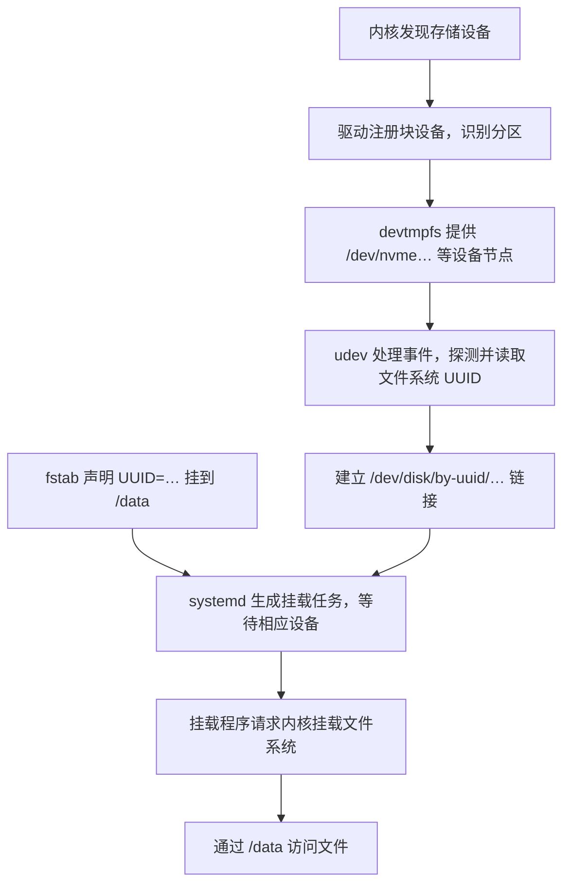
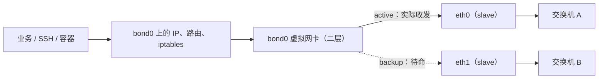
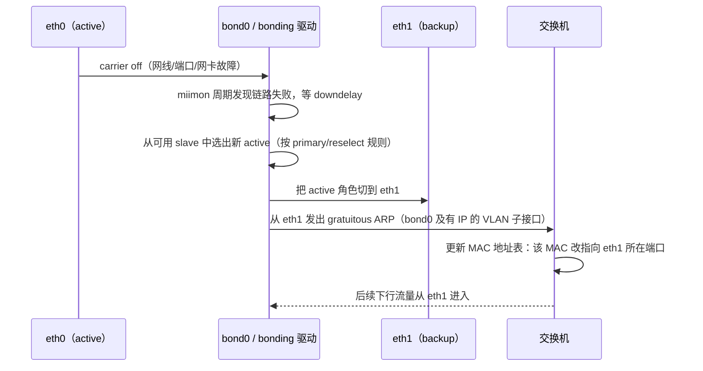

## 1、磁盘IO瓶颈的排查链路

iostat 查看是否为IO瓶颈 需要注意的指标是 `await`(等待时间) 和 `aqu-sz`等待队列长度 确定是否达到了IO瓶颈

接着使用的 podstat -d 查询是哪个进程在疯狂的读写 

> 相关的命令和指标
>
> ## top
>
> ```
> top - 14:30:10 up 12 days, 3:20, 2 users, load average: 8.60, 6.20, 3.10
> Tasks: 320 total, 4 running, 315 sleeping, 0 stopped, 1 zombie
> %Cpu(s): 28.0 us, 12.0 sy, 0.0 ni, 40.0 id, 18.0 wa, 0.0 hi, 2.0 si, 0.0 st
> MiB Mem : 32768.0 total, 2048.0 free, 8192.0 used, 22528.0 buff/cache
> MiB Swap:  8192.0 total, 8192.0 free,    0.0 used. 24576.0 avail Mem
> 
>   PID USER  PR  NI    VIRT    RES    SHR S  %CPU  %MEM     TIME+ COMMAND
>  3812 app   20   0   12.0g   4.0g  20000 S 180.0  12.5  120:30.25 java
> ```
>
> **第一行告诉你运行时间和系统负载。**
>
> | 字段                             | 含义                                   |
> | -------------------------------- | -------------------------------------- |
> | `14:30:10`                       | 当前系统时间                           |
> | `up 12 days, 3:20`               | 系统启动后运行了 12 天 3 小时 20 分钟  |
> | `2 users`                        | 当前登录会话数量，不一定是两个不同的人 |
> | `load average: 8.60, 6.20, 3.10` | 最近 1、5、15 分钟的系统平均负载       |
>
> 理解 `load average`，关键是：**它统计的是“正在运行、等待 CPU，以及处于不可中断等待状态的任务”的平滑平均数量，不是 CPU 使用率。** Linux 中通常可以理解为 `R` 状态和 `D` 状态任务共同影响负载。[负载定义](https://man7.org/linux/man-pages/man1/uptime.1.html)
>
> 例如，一台 **8 个逻辑 CPU** 的机器，如果任务主要在争抢 CPU：
>
> | 持续负载    | 可以怎样理解                                               |
> | ----------- | ---------------------------------------------------------- |
> | `load ≈ 2`  | CPU 整体通常还有余量                                       |
> | `load ≈ 8`  | 大致有 8 个任务处于运行或等待状态，需要结合 CPU 使用率判断 |
> | `load ≈ 16` | 如果主要是 CPU 计算任务，通常已经存在明显排队              |
>
> 但如果大量任务在等待磁盘，可能出现：
>
> ```
> load 很高
> CPU 使用率不高
> D 状态任务较多
> ```
>
> 因此，不能看到 `load > CPU 数量` 就直接认定 CPU 不够用。
>
> 这三个数还能粗略反映趋势：
>
> ```
> 8.60 > 6.20 > 3.10：近期负载在上升
> 2.00 < 5.00 < 9.00：近期负载在下降
> ```
>
> 可以用以下命令辅助查看：
>
> ```
> # 查看当前可用的逻辑 CPU 数
> nproc
> 
> # 查看 CPU 拓扑、逻辑 CPU、物理核心等信息
> lscpu
> 
> # 单独查看负载和运行时间
> uptime
> ```
>
> **第二行是任务数量，需要与进程状态一起看。**
>
> | 字段       | 含义                                     | 排障时怎样看                         |
> | ---------- | ---------------------------------------- | ------------------------------------ |
> | `total`    | 总任务数                                 | 在线程模式下，统计对象变为线程       |
> | `running`  | 正在运行或等待 CPU 的任务数              | 持续很多时关注 CPU 竞争              |
> | `sleeping` | 睡眠、等待事件的任务数                   | 多数服务平时就在睡眠，数量多通常正常 |
> | `stopped`  | 被暂停或调试停止的任务数                 | 结合业务确认原因                     |
> | `zombie`   | 已退出、但父进程尚未回收退出信息的任务数 | 持续存在或增长时检查父进程           |
>
> 进程列表中的 `S` 列，会给出更具体的状态：
>
> | 状态      | 含义               | 常见场景                                       |
> | --------- | ------------------ | ---------------------------------------------- |
> | `R`       | Running / Runnable | 正在执行，或者等待 CPU                         |
> | `S`       | 可中断睡眠         | 等待连接、定时器、锁或其他事件                 |
> | `D`       | 不可中断睡眠       | 常见于存储、文件系统等内核等待，也可能涉及 NFS |
> | `T` / `t` | 暂停或被调试跟踪   | 收到停止信号、调试器控制                       |
> | `Z`       | 僵尸               | 已退出，等待父进程回收                         |
> | `I`       | 空闲内核线程       | 某些版本中可以看到                             |
>
> 旧版 `top` 可能把 `D` 状态也归入汇总中的 `sleeping`；部分新版会单列 `d-sleep`。
>
> 两个判断比较实用：
>
> - **`D` 多且持续不消失**：优先检查 I/O 和具体等待位置。
> - **`Z` 多**：重点检查父进程的子进程回收逻辑。僵尸通常不消耗 CPU，也不会继续保留原来的大量用户态内存。[Linux 进程状态说明](https://gitlab.com/procps-ng/procps/-/raw/master/man/ps.1)
>
> **第三行是 CPU 时间分布。**
>
> ```
> %Cpu(s): 28.0 us, 12.0 sy, 0.0 ni, 40.0 id, 18.0 wa, 0.0 hi, 2.0 si, 0.0 st
> ```
>
> | 指标 | 含义                                   | 偏高时的排查方向                        |
> | ---- | -------------------------------------- | --------------------------------------- |
> | `us` | 普通用户态执行时间                     | 应用计算、压缩、加密、GC、循环等        |
> | `sy` | 内核态执行时间                         | 系统调用、内核处理、内存管理等          |
> | `ni` | 调整过 nice 值的任务在用户态执行的时间 | 看哪些任务调整了调度优先级              |
> | `id` | 空闲时间                               | 越高通常表示 CPU 越有余量，但仍需看单核 |
> | `wa` | 记为等待 I/O 的空闲时间                | 结合磁盘延迟、队列和阻塞任务判断        |
> | `hi` | 硬中断处理时间                         | 查看中断来源及分布                      |
> | `si` | 软中断处理时间                         | 网络收发等软中断处理                    |
> | `st` | 虚拟机被宿主机占用掉的 CPU 时间        | 关注虚拟化平台的 CPU 调度和争抢         |
>
> 这些百分比合计通常约为 `100%`，汇总行反映所有逻辑 CPU 的平均情况。
>
> 其中有三个容易误判的地方。
>
> **一是 `wa` 高，不表示 CPU 在执行磁盘读写。**
>
> 任务等待 I/O 时，CPU 可以执行别的任务；没有其他任务可执行而进入空闲时，其中一部分时间可能记为 `iowait`。这个指标存在多核记账等局限，所以：
>
> ```
> wa 高：值得继续检查 I/O
> wa 低：不能排除存储延迟问题
> ```
>
> 不能把 `wa=30%` 理解成“磁盘使用率 30%”。[内核 CPU 时间与 iowait 说明](https://www.kernel.org/doc/html/latest/filesystems/proc.html)
>
> **二是整机 CPU 不高，也可能存在单核瓶颈。**
>
> 例如 8 个逻辑 CPU 中，只有一个长期跑满，整体使用率可能只有约 `12.5%`。进入 `top` 后按数字 **`1`**，可以展开每个逻辑 CPU。
>
> **三是进程 `%CPU` 超过 `100%` 通常正常。**
>
> 常见默认显示模式下：
>
> ```
> 100%：大约占满一个逻辑 CPU
> 180%：大约消耗 1.8 个逻辑 CPU 的执行能力
> 400%：大约消耗四个逻辑 CPU 的执行能力
> ```
>
> 多线程进程可以超过 `100%`。按大写 `I` 可以切换 CPU 百分比的归一化模式，所以比较不同机器输出时需要留意显示模式。
>
> **内存部分，优先理解 `free`、`buff/cache` 和 `available` 的区别。**
>
> ```
> MiB Mem : 32768.0 total, 2048.0 free, 8192.0 used, 22528.0 buff/cache
> MiB Swap:  8192.0 total, 8192.0 free,    0.0 used. 24576.0 avail Mem
> ```
>
> | 字段                      | 含义                                           |
> | ------------------------- | ---------------------------------------------- |
> | `total`                   | 操作系统可用的物理内存总量                     |
> | `free`                    | 当前完全未使用的内存                           |
> | `used`                    | 已使用内存，具体计算口径随版本变化             |
> | `buff/cache`              | 缓冲、文件页缓存、部分可回收内核缓存等         |
> | `avail Mem` / `available` | 估计在不发生交换的前提下，可供新应用使用的内存 |
> | Swap `total`              | 交换空间总量                                   |
> | Swap `free`               | 未使用的交换空间                               |
> | Swap `used`               | 已使用的交换空间                               |
>
> Linux 会利用空闲内存做缓存，因此：
>
> > **`free` 小不一定是内存不足；判断余量时，通常更应该看 `available`。**
>
> `available` 会考虑缓存中可以回收的部分，但也不是简单地把所有缓存都算成可用内存。较新版本常用 `total - available` 计算 `used`，旧版本可能采用其他口径。[内存字段定义](https://man7.org/linux/man-pages/man1/free.1.html)
>
> 同样，**Swap 已使用，不一定说明现在正在发生内存压力**。可能只是过去换出的一些冷数据还没有换回来。更值得关注的是：
>
> ```
> available 持续偏低
> 同时持续发生较多 swap in / swap out
> 应用延迟明显增加
> ```
>
> 常用辅助命令：
>
> ```
> free -h
> vmstat 1 10
> ```
>
> 在 `vmstat` 中：
>
> - `si`：每秒从交换空间换入内存的数据量。
> - `so`：每秒从内存换出到交换空间的数据量。
>
> 注意：**`top` 的 `si` 是软中断，`vmstat` 的 `si` 是 swap in，含义完全不同。**
>
> **再看下面的进程列表，各列分别是什么。**
>
> | 字段      | 含义                         | 使用时注意                                         |
> | --------- | ---------------------------- | -------------------------------------------------- |
> | `PID`     | 进程 ID                      | 线程模式下对应线程 ID                              |
> | `USER`    | 任务所属的有效用户           | 确认是哪个服务账户                                 |
> | `PR`      | 调度优先级显示值             | 普通任务中数值通常越小优先级越高；实时任务另有规则 |
> | `NI`      | nice 值                      | 通常为 `-20～19`，越小越优先获得 CPU               |
> | `VIRT`    | 虚拟地址空间大小             | 包含映射、预留空间等，不等于实际占用物理内存       |
> | `RES`     | 驻留在物理内存中的大小       | 判断进程物理内存占用的常用入口                     |
> | `SHR`     | `RES` 中被统计为可共享的部分 | 包括共享库、文件映射等，未必真的正被其他进程共享   |
> | `S`       | 任务状态                     | 如 `R`、`S`、`D`、`Z`                              |
> | `%CPU`    | 最近采样区间内的 CPU 使用率  | 多线程进程可超过 `100%`                            |
> | `%MEM`    | `RES` 占物理内存总量的比例   | 通常不是占 `available` 的比例                      |
> | `TIME+`   | 累计消耗的 CPU 时间          | 不是进程启动至今经过的现实时间                     |
> | `COMMAND` | 命令名或命令行               | 按 `c` 切换显示                                    |
>
> 例如上面的 Java 进程：
>
> ```
> VIRT = 12 GiB
> RES  = 4 GiB
> CPU  = 180%
> ```
>
> 可以理解为：它的虚拟地址空间约 12 GiB，当前驻留物理内存约 4 GiB，近期平均消耗约 1.8 个逻辑 CPU。
>
> 另外：
>
> - `RES - SHR` 不能精确得到进程独占内存。
> - 多个进程的 `RES` 直接相加，可能重复计算共享页面。
> - 更精确地分析共享内存分摊时，可以查看 `PSS`。
> - nice 值影响 CPU 竞争时的调度权重，不能把它当作 CPU 使用率上限。[调度优先级说明](https://man7.org/linux/man-pages/man7/sched.7.html)
>
> **工作中，`top` 常用的启动方式如下。**
>
> ```bash
> # 每秒刷新
> top -d 1
> 
> # 只看指定进程
> top -p 1234
> 
> # 同时看多个进程
> top -p 1234,5678
> 
> # 查看指定进程内部的线程
> top -H -p 1234
> 
> # 只看指定用户
> top -u nginx
> 
> # 按 CPU 从高到低排序
> top -o +%CPU
> 
> # 按内存从高到低排序
> top -o +%MEM
> 
> # 非交互模式，每秒采样一次，共输出 60 次，保存到文件
> top -b -d 1 -n 60 -w 512 > top.log
> ```
>
> 这些参数可以这样记：
>
> | 参数 | 作用                                |
> | ---- | ----------------------------------- |
> | `-d` | 刷新间隔，单位秒                    |
> | `-p` | 指定 PID                            |
> | `-H` | 显示线程                            |
> | `-u` | 按用户过滤                          |
> | `-o` | 指定排序字段，前缀 `+` 表示从高到低 |
> | `-b` | 批处理模式，适合保存输出            |
> | `-n` | 输出次数                            |
> | `-w` | 输出宽度                            |
>
> 进入 `top` 后，常用按键是：
>
> | 按键      | 作用                             |
> | --------- | -------------------------------- |
> | `1`       | 切换整体 CPU 与每个逻辑 CPU      |
> | `P`       | 按 CPU 排序                      |
> | `M`       | 按内存排序                       |
> | `T`       | 按累计 CPU 时间排序              |
> | `H`       | 切换进程／线程模式               |
> | `c`       | 切换命令名／完整命令行           |
> | `u`       | 按用户过滤                       |
> | `f`       | 选择显示字段及排序字段           |
> | `E` / `e` | 分别切换汇总区／进程区的内存单位 |
> | `R`       | 反转排序方向                     |
> | `W`       | 保存当前显示配置                 |
> | `h` / `q` | 帮助／退出                       |
>
> 排障时持续观察几轮，通常比只运行一次 `top -b -n 1` 更有价值。[top 参数与交互操作手册](https://gitlab.com/procps-ng/procps/-/raw/master/man/top.1)
>
> ------
>
> ## iostat
>
> 接着看 `iostat`。它属于 `sysstat` 软件包，通常与 `mpstat`、`pidstat` 一起安装：
>
> ```
> # Debian / Ubuntu
> sudo apt install sysstat
> 
> # RHEL / Rocky Linux / AlmaLinux / Fedora
> sudo dnf install sysstat
> ```
>
> **先记住它的采样规则：**
>
> ```
> iostat
> ```
>
> 默认第一份报告通常统计**从系统启动到现在**的数据。
>
> ```
> iostat 1
> ```
>
> 第一份仍通常是开机以来的数据，后续每份才是最近 1 秒的数据。排查当前问题时，常加 `-y` 跳过首份历史报告：
>
> ```
> iostat -x -y 1
> ```
>
> 这一点解释了为什么有时第一次看到的数据与后续差别很大。[sysstat 采样规则说明](https://sysstat.github.io/faq.html)
>
> `iostat` 可以显示 CPU 汇总和设备统计。CPU 部分通常是：
>
> ```
> avg-cpu:  %user  %nice  %system  %iowait  %steal  %idle
>           28.00   0.00    14.00    18.00    0.00  40.00
> ```
>
> | 指标      | 含义                                  |
> | --------- | ------------------------------------- |
> | `%user`   | 普通用户态 CPU 时间                   |
> | `%nice`   | 调整过 nice 值的任务的用户态 CPU 时间 |
> | `%system` | 内核执行时间                          |
> | `%iowait` | 记为等待磁盘 I/O 的空闲时间           |
> | `%steal`  | 虚拟机被宿主机占用掉的 CPU 时间       |
> | `%idle`   | 普通空闲时间                          |
>
> 这些也是整机各逻辑 CPU 的平均值。它们与 `top` 的 CPU 统计来源相近，但展示分类不完全相同。
>
> **普通设备输出里，最常见的是这些字段。**
>
> | 字段                      | 含义                                     |
> | ------------------------- | ---------------------------------------- |
> | `Device`                  | 块设备或分区名称                         |
> | `tps`                     | 每秒设备传输请求数，不是数据库每秒事务数 |
> | `kB_read/s` / `MB_read/s` | 每秒读取的数据量                         |
> | `kB_wrtn/s` / `MB_wrtn/s` | 每秒写入的数据量                         |
> | `kB_read` / `MB_read`     | 本份报告统计范围内的读取总量             |
> | `kB_wrtn` / `MB_wrtn`     | 本份报告统计范围内的写入总量             |
>
> 第一份报告的范围通常是开机以来，后续报告则对应各自采样区间。
>
> 实际排查磁盘性能，更多会用 `-x` 展开指标。下面只保留一些核心列：
>
> ```
> Device   r/s   w/s  rkB/s  wkB/s  r_await  w_await  aqu-sz  rareq-sz  wareq-sz  %util
> sda    100.0 200.0 1600.0 3200.0     15.0     30.0     7.5      16.0      16.0   95.0
> ```
>
> **这些字段可以按“次数、数据量、延迟、并发、忙碌时间”来理解。**
>
> | 指标              | 含义与单位                                    |
> | ----------------- | --------------------------------------------- |
> | `r/s`             | 每秒完成的读请求数，已经过请求合并            |
> | `w/s`             | 每秒完成的写请求数，已经过请求合并            |
> | `rkB/s` / `rMB/s` | 每秒读取数据量                                |
> | `wkB/s` / `wMB/s` | 每秒写入数据量                                |
> | `r_await`         | 读请求平均完成时间，单位毫秒                  |
> | `w_await`         | 写请求平均完成时间，单位毫秒                  |
> | `await`           | 某些版本或输出模式中的总体平均 I/O 完成时间   |
> | `aqu-sz`          | 平均未完成请求数，可理解为平均在途 I/O 并发量 |
> | `rareq-sz`        | 平均每个读请求的大小，单位 KiB                |
> | `wareq-sz`        | 平均每个写请求的大小，单位 KiB                |
> | `%util`           | 采样期间设备被记为有 I/O 活动的时间比例       |
>
> 这里的 `await` **包含排队时间和处理时间**；`aqu-sz` 也包含正在处理的请求，不能只理解成“还没轮到处理的排队数量”。
>
> 单位也要留意：sysstat 中标为 `kB`、`MB` 的数据通常实际采用 KiB、MiB，即以 `1024` 为换算基数。[iostat 字段和单位手册](https://man7.org/linux/man-pages/man1/iostat.1.html)
>
> 拿上面的示例计算，就比较直观了：
>
> ```
> 读 IOPS = 100
> 写 IOPS = 200
> 读写总 IOPS ≈ 300
> 
> 读吞吐量 = 1600 KiB/s
> 写吞吐量 = 3200 KiB/s
> 
> 平均读请求大小 = 1600 ÷ 100 = 16 KiB
> 平均写请求大小 = 3200 ÷ 200 = 16 KiB
> ```
>
> 其中，**IOPS 是每秒多少次，吞吐量是每秒多少数据**。一次请求大小不同，这两个指标就会有很大差异：
>
> ```
> 1000 IOPS × 4 KiB   ≈ 3.9 MiB/s
> 1000 IOPS × 1 MiB   ≈ 1000 MiB/s
> ```
>
> 因此，吞吐量不高，也可能存在大量小块随机 I/O。
>
> 示例中的总体平均读写延迟约为：
>
> ```
> (100 × 15ms + 200 × 30ms) ÷ 300 = 25ms
> ```
>
> 在流量相对稳定、统计口径一致时，可以近似理解：
>
> ```
> 平均未完成请求数 ≈ 每秒完成请求数 × 平均完成时间（秒）
> 
> 7.5 ≈ 300 × 0.025
> ```
>
> 这也说明：**并发较高时，很多请求的处理时间会重叠，不能直接累加成设备忙碌时间。**[内核 I/O 计数方式](https://www.kernel.org/doc/html/latest/admin-guide/iostats.html)
>
> **其他扩展字段，主要涉及请求合并、discard 和 flush。**
>
> | 字段               | 含义                                      |
> | ------------------ | ----------------------------------------- |
> | `rrqm/s`           | 每秒被合并的读请求数                      |
> | `wrqm/s`           | 每秒被合并的写请求数                      |
> | `%rrqm` / `%wrqm`  | 读／写请求合并比例                        |
> | `d/s`              | 每秒完成的 discard 请求数，常与 TRIM 有关 |
> | `dkB/s` / `dMB/s`  | 每秒 discard 涉及的数据量                 |
> | `drqm/s` / `%drqm` | discard 请求合并数量／比例                |
> | `d_await`          | discard 平均完成时间                      |
> | `dareq-sz`         | 平均 discard 请求大小                     |
> | `f/s`              | 每秒完成的设备 flush 请求数               |
> | `f_await`          | flush 平均完成时间                        |
>
> 例如两个相邻的 `4 KiB` 请求，可以被合并为一个 `8 KiB` 请求。合并率高低与访问模式有关，**合并率低不等于性能差**。
>
> flush 与持久化有关，但 `f/s` 不能直接当成应用的 `fsync()` 调用次数。[sysstat 上游字段定义](https://github.com/sysstat/sysstat/blob/master/man/iostat.in)
>
> 旧服务器上还可能看到这些名称：
>
> | 旧字段     | 与新版的关系                                                 |
> | ---------- | ------------------------------------------------------------ |
> | `avgqu-sz` | 新版通常叫 `aqu-sz`                                          |
> | `avgrq-sz` | 旧版平均请求大小，通常以 512 字节扇区为单位；新版 `areq-sz` 以 KiB 为单位 |
> | `svctm`    | 旧版推算的服务时间，已经废弃，不适合据此诊断设备服务时间     |
>
> 不要用 `await - svctm` 精确计算排队时间，并发 I/O 会使这种推算失去可靠性。[旧版 svctm 说明](https://access.redhat.com/solutions/2039133)
>
> **判断磁盘是否存在瓶颈，尤其要避免单看 `%util`。**
>
> `%util=95%` 可以粗略理解为：该采样窗口内，设备大部分时间都有 I/O 活动。
>
> 它不能直接解释成：
>
> ```
> 已经用了 95% 的最大带宽
> 磁盘空间使用了 95%
> 只剩 5% 的性能
> ```
>
> 对串行处理能力较强约束的设备，接近 `100%` 常提示接近饱和；对于 NVMe、现代 SSD、RAID 等并行设备，`100%` 时仍可能有性能余量。
>
> 实际工作中，更有意义的是组合观察：
>
> | 观察结果                              | 判断方向                             |
> | ------------------------------------- | ------------------------------------ |
> | 延迟升高、`aqu-sz` 增大、吞吐不再增长 | 存储处理能力或限额可能成为瓶颈       |
> | `%util` 很高，但延迟稳定、业务正常    | 持续繁忙，未必存在性能问题           |
> | 吞吐不高、IOPS 较高、请求很小         | 可能受小块随机 I/O 能力限制          |
> | 写延迟或 flush 延迟明显升高           | 继续检查写回、同步持久化及存储后端   |
> | 应用慢，但设备指标正常                | 继续查锁、网络、缓存、应用内部排队等 |
>
> 延迟也没有统一的“超过多少毫秒就异常”：要结合设备类型、访问模式、平时基线和业务要求。`await` 是平均值，不能反映所有长尾请求，也不能直接等同于应用端的完整读写耗时。
>
> **工作中最常用的一条 `iostat` 命令是：**
>
> ```
> iostat -dxm -y 1 10
> ```
>
> 它表示：
>
> | 参数 | 作用                   |
> | ---- | ---------------------- |
> | `-d` | 只显示设备统计         |
> | `-x` | 显示扩展指标           |
> | `-m` | 吞吐量采用 MiB/s 显示  |
> | `-y` | 跳过开机以来的首份报告 |
> | `1`  | 每隔 1 秒采样          |
> | `10` | 输出 10 份采样报告     |
>
> 注意，`-m` 不会把所有字段都改成 MB：延迟仍是毫秒，`rareq-sz` 等请求大小字段仍按其规定单位显示。
>
> 其他常用组合：
>
> ```
> # 持续观察，按 Ctrl+C 退出
> iostat -dxm -y 1
> 
> # 同时看 CPU 和设备扩展统计
> iostat -xm -y 1 10
> 
> # 只看某块设备，替换为实际设备名
> iostat -dxm -y nvme0n1 1 10
> 
> # 看 sda 及其分区
> iostat -dxm -y -p sda 1 10
> 
> # 显示所有设备及分区
> iostat -dxm -y -p ALL 1 10
> 
> # 显示 device mapper 名称，便于辨认 LVM
> iostat -dxm -N -y 1 10
> 
> # 每份报告带时间，采样 60 次并保存
> iostat -dxm -y -t 1 60 > iostat.log
> ```
>
> 另外两个常用参数：
>
> ```
> -k：吞吐量以 KiB/s 显示
> -z：隐藏本采样区间没有活动的设备
> ```
>
> 看到 `dm-0`、`sda`、`sda1` 同时出现时，要先确认设备层次。同一次 I/O 可能在逻辑卷、分区和底层设备分别计数，不能直接把所有行相加。
>
> ------
>
> 实际排障时，可以按下面的顺序使用这些命令。
>
> **先确认整机是否存在持续压力：**
>
> ```
> uptime
> top -d 1
> vmstat 1 10
> ```
>
> 在 `vmstat` 中重点看：
>
> | 字段        | 含义                         |
> | ----------- | ---------------------------- |
> | `r`         | 正在运行或等待 CPU 的任务数  |
> | `b`         | 等待 I/O 完成而阻塞的任务数  |
> | `si` / `so` | 换入／换出交换空间的数据速率 |
> | `cs`        | 每秒上下文切换次数           |
>
> `vmstat` 第一行的速率统计通常也是开机以来的平均值，后续才对应采样区间。[vmstat 手册](https://gitlab.com/procps-ng/procps/-/raw/master/man/vmstat.8)
>
> **如果 CPU 高，继续找进程、线程和具体核心：**
>
> ```
> # 每个逻辑 CPU 的使用情况
> mpstat -P ALL 1 10
> 
> # 各进程的 CPU 使用情况
> pidstat -u 1 10
> 
> # 指定进程内部的线程
> top -H -p 1234
> 
> # 持续采样指定进程的各线程
> pidstat -u -t -p 1234 1 10
> ```
>
> **如果怀疑 I/O，先找设备，再找产生读写的进程：**
>
> ```
> # 哪个设备延迟高、队列大
> iostat -dxm -y 1 10
> 
> # 哪些进程产生较多磁盘读写
> pidstat -d 1 10
> 
> # 持续看指定进程
> pidstat -d -p 1234 1 10
> 
> # 查看逻辑卷、磁盘、分区及挂载点
> lsblk -o NAME,TYPE,SIZE,FSTYPE,MOUNTPOINT
> ```
>
> `pidstat -d` 中，`kB_rd/s`、`kB_wr/s` 可帮助定位读写来源。但应用缓存、页缓存、后台写回等会影响归属和时机，因此不一定与 `iostat` 每一秒严格对齐。[pidstat 进程 I/O 统计说明](https://man7.org/linux/man-pages/man1/pidstat.1.html)
>
> **如果内存紧张，观察余量、进程增长和交换活动：**
>
> ```
> free -h
> top -o +%MEM
> vmstat 1 10
> pidstat -r -p 1234 1 10
> ```
>
> **如果遇到“磁盘满”或“无法创建文件”，还要单独检查容量和 inode：**
>
> ```
> # 文件系统容量、类型和使用率
> df -hT
> 
> # inode 使用率
> df -i
> ```
>
> `df` 回答“还能放多少文件和数据”，`iostat` 回答“设备读写表现怎样”。排查服务变慢时，把设备延迟、进程资源消耗和业务延迟放在同一个时间窗口里对照，判断才更可靠。
>
> **`pidstat -d` 可以帮助定位哪些进程正在大量读写磁盘**，配合采样间隔看当前活动：
>
> ```
> # 每秒统计一次，观察各进程的 I/O
> pidstat -d 1
> 
> # 只看指定进程
> pidstat -d -p 1234 1
> 
> # 进一步查看该进程内各线程的 I/O
> pidstat -d -t -p 1234 1
> ```
>
> 重点看这些字段：
>
> | 字段      | 含义                               |
> | --------- | ---------------------------------- |
> | `PID`     | 进程 ID                            |
> | `kB_rd/s` | 该任务每秒引起的磁盘读取量         |
> | `kB_wr/s` | 该任务每秒引起或将引起的磁盘写入量 |
> | `Command` | 进程名称                           |
>
> 实际排查时：
>
> ```
> iostat -dxm -y 1   → 看哪些设备繁忙、延迟升高
> pidstat -d 1       → 找产生大量读写的进程
> ```

## 2、服务器CPU100%但top看很正常？

考察的是恶性进程的对抗机制，恶意进程在后台做了动态躲避和进程名伪装

- 这些进程会监控系统的进程列表，一旦发现类似top，ts这样的诊断工具启动，他就会立刻把自己挂起休眠释放CPU
- 同时查到后  这里可能 也会伪装自己的运行命令是 nginx或者mysql 这样的进程，但是他也不一定是对应的业务进程

> 一个检测思路
>
> - `cp /usr/bin/top /tmp/my_too`l   cp一下原本的top命令 看下内存占用
> - `ps -ef | grep` 进程号
> - `ls -l /proc/1883/exe`    内核会在对应的进程创建一个软链接 指明对应的执行的源文件
> - kill -9  +  rm -rf /xxxxxx 即可

## 3、k8s pending pod的排查逻辑

- kubeclt describe pod xxxxx -n xxxxxx 
  - insuffcient  cpu/mem xxxx
  - 调度规则 taint/nodeSelector/节点亲和性
  - 存储卷未绑定

## 4、K8s如何把服务暴露给外网？

利用service 动态绑定pod IP 

- node port 在集群的物理机器强制打开一个port，不管用户的请求打到哪个节点，底层的kube-proxy 都会吧流量拦截 并转发至对应的pod

- ingress 七层反向代理 和现在shopee的逻辑可以相通

  域名 绑定到集群内的几台主机上 --》 traefik --〉 ingress --> service ---> endpoint ---> 后端service

  > 这是一个简单的实例
  >
  > ### 1、workload + service 
  >
  > ```yaml
  > apiVersion: v1
  > kind: Namespace
  > metadata:
  >   name: ingress-demo
  > ---
  > apiVersion: apps/v1
  > kind: Deployment
  > metadata:
  >   name: web
  >   namespace: ingress-demo
  > spec:
  >   replicas: 2
  >   selector:
  >     matchLabels:
  >       app: web
  >   template:
  >     metadata:
  >       labels:
  >         app: web
  >     spec:
  >       containers:
  >         - name: whoami
  >           image: traefik/whoami:v1.11.0
  >           args:
  >             - --port=8080
  >             - --name=web
  >           ports:
  >             - name: http
  >               containerPort: 8080
  > ---
  > apiVersion: v1
  > kind: Service
  > metadata:
  >   name: web-svc
  >   namespace: ingress-demo
  > spec:
  >   type: ClusterIP
  >   selector:
  >     app: web
  >   ports:
  >     - name: http
  >       port: 80
  >       targetPort: http
  > ---
  > apiVersion: apps/v1
  > kind: Deployment
  > metadata:
  >   name: api
  >   namespace: ingress-demo
  > spec:
  >   replicas: 2
  >   selector:
  >     matchLabels:
  >       app: api
  >   template:
  >     metadata:
  >       labels:
  >         app: api
  >     spec:
  >       containers:
  >         - name: whoami
  >           image: traefik/whoami:v1.11.0
  >           args:
  >             - --port=8080
  >             - --name=api
  >           ports:
  >             - name: http
  >               containerPort: 8080
  > ---
  > apiVersion: v1
  > kind: Service
  > metadata:
  >   name: api-svc
  >   namespace: ingress-demo
  > spec:
  >   type: ClusterIP
  >   selector:
  >     app: api
  >   ports:
  >     - name: http
  >       port: 80
  >       targetPort: http
  > ```
  >
  > > 1、这里重点对应这几个字段：
  > >
  > > ```
  > > Service selector: app=api
  > >               │ 匹配
  > >               ▼
  > > Pod labels: app=api
  > > 
  > > Service port: 80
  > >               │ targetPort: http
  > >               ▼
  > > Pod 端口名 http → 8080
  > > ```
  > >
  > > 2、workload中定义的 containerPort 只是声明，需要你在容器内启动的pod 也使用同样的监听port配置
  > >
  > > 
  >
  > ### 2、ingress 
  >
  > ```yaml
  > apiVersion: networking.k8s.io/v1
  > kind: Ingress
  > metadata:
  >   name: demo
  >   namespace: ingress-demo
  >   annotations:
  >     traefik.ingress.kubernetes.io/router.entrypoints: web
  > spec:
  >   ingressClassName: traefik-demo
  >   rules:
  >     - host: demo.example.com
  >       http:
  >         paths:
  >           - path: /api
  >             pathType: Prefix
  >             backend:
  >               service:
  >                 name: api-svc
  >                 port:
  >                   number: 80
  >           - path: /
  >             pathType: Prefix
  >             backend:
  >               service:
  >                 name: web-svc
  >                 port:
  >                   number: 80
  > ```
  >
  > ### 3、port 转发关系
  >
  > 这里是 Service 使用 `http` 找到 Pod 的端口，Ingress 引用的是 Service 的端口。**完整对应关系如下：
  >
  > ```
  > # Ingress：找 api-svc 的 80 端口
  > backend:
  >   service:
  >     name: api-svc
  >     port:
  >       number: 80
  > # Service：将服务端口 80 对应到 Pod 中名为 http 的端口
  > ports:
  >   - name: http
  >     port: 80
  >     targetPort: http
  > # Pod：名为 http 的端口是 8080
  > ports:
  >   - name: http
  >     containerPort: 8080
  > ```
  >
  > 所以对应关系是：
  >
  > ```
  > Ingress 引用 api-svc:80
  >           ↓
  > Service port: 80
  >           ↓
  > Service targetPort: http
  >           ↓
  > Pod 端口 name: http → containerPort: 8080
  >           ↓
  > 应用实际监听 8080，才能接收请求
  > ```
  >
  > ### 4、ingress controller
  >
  > ingress只是绑定了集群内部的转发逻辑，具体还需要 ingress controller 接收请求 ---》 查询转发规则 ---》 转发到service
  >
  > 这里能够 使用常用的 traefik 作为 ingress controller 自动感知集群 ingress 变动进行转发
  >
  > - `hostnetwork = true` 表示pod共用宿主机网络，这里能够让外部域名/访问直接到宿主机即可
  > - `hostNetwork = false`  再包一层 nodePort Service 绑定一些物理机IP作为入口，让其负载均衡到 traefik pod 再进行转发

  

- 云原生标准的load balancer  阿里云/AWS 这样的云，将service 定义为 LoadBalancer 类型，k8s就会自动呼叫云厂商的API，给分配一个真实的公网IP

## 5、CPU告警却查不到进程？内核级Rootkit排查

服务器CPU告警持续80%以上，top中  us 占比非常高，但是进程列表中 所有的us 加起来都不够 20%

总算力和进程算力对不上，常规工具长期无法对账的问题，就要考虑是不是内核态异常，甚至存在 Rootkit 的可能

整体排查思路如下，常规的top ps 都是获取 proc 的相关参数信息，如果系统被植入了内核级的 Rootkit，他可能会劫持 getdents的相关调用 proc fs 接口，甚至直接在内核层把恶意进程的PID隐藏掉

也就是说，系统总体统计状态可能是真实的，但是操作系统返回的统计工具可能是有问题的

这里建议跳过常规的工具，使用安全检测工具，比如 unhide 或者 chkrootkit，这些工具 通常是暴力遍历系统的PID状态，或者直接去扫描系统调用表

- unhide 暴力遍历系统pid 查找是否有隐藏的PID

  - apt install -y unhide

  - unhide proc  

    Searching for Hidden processes through /proc stat scanning

- chkrootkit  依赖已知库做检查
  - sudo apt install -y chkrootkit
  - chkrootkit | grep "hooked

## 6、容器镜像启动长达15秒，如何压进5秒内？

抛除升级硬件(网络带宽、CPU) 等因素，真正的瓶颈可能在镜像本身，基础镜像太臃肿，导致拉取、解压和文件加载阶段都在额外耗时

核心是减少IO等待和优化层级结构

- 多阶段构建

  传统的构建容易把编译环境的垃圾，例如源码、构建工具一股脑打包进去

  使用多阶段构建、编译阶段使用完整的开发镜像、构建时只把用到的二进制文件加载进去

  这一步通常能把几百兆的镜像压缩至十几兆

  ```dockerfile
  FROM sdk-image AS build
  
  WORKDIR /src
  COPY . .
  RUN build-command
  
  
  FROM runtime-image AS runtime
  
  WORKDIR /app
  COPY --from=build /src/artifact /app/artifact
  CMD ["/app/artifact"]
  ```

  

- 优化镜像层

  镜像的构建是分层的，每层可能会有一部分变更，这样不同的层 cover 在一起形成了最终的FS

  - 把系统依赖安装放在文件最上面 变更频率低 拉取时能够多次复用
  - 变更频繁的业务代码放在最下面
  - 多条run指令合并吗，或者使用工具压缩镜像层

- 针对超大镜像的懒加载机制

  对于 AI 模型这类没法压缩的庞大镜像，传统模式是先全量下载 全量解压 再启动 非常耗时

  引入 nydus 这类 snapshotter 插件，支持按需拉取，容器启动时 会优先拉取元数据和启动所需的关键数据块，业务进程先拉取，剩余数据再在后台按需加载

## 7、100个容器如何动态下发不同配置？Docker配置解耦与底层原理实机剖析

### 1、dockerfile 中 run 和 cmd 都能够执行命令，他们在底层机制上的本质区别是什么

执行阶段完全不一样，run发生在构建镜像的阶段，dockerfile中 每一句run，都是实打实生成一层的只读的文件系统，为了避免镜像臃肿，通常需要合并命令来精简层数

CMD通常发生在容器启动阶段，他只是说明 容器启动时默认要跑什么进程


**`RUN` 负责构建镜像，`CMD` 和 `ENTRYPOINT` 负责决定容器启动时运行什么。**

| 指令         | 什么时候执行              | 主要作用                                     | 常见用途                         |
| ------------ | ------------------------- | -------------------------------------------- | -------------------------------- |
| `RUN`        | `docker build` 构建镜像时 | 执行命令，将文件系统变化保存到镜像层         | 安装软件、编译代码、创建目录     |
| `CMD`        | 容器启动时                | 提供默认命令，或给 `ENTRYPOINT` 提供默认参数 | 默认启动应用                     |
| `ENTRYPOINT` | 容器启动时                | 指定容器的入口程序                           | 把镜像作为某个固定工具或应用运行 |

`CMD` 和 `ENTRYPOINT` 在构建时只记录配置，不执行其中的命令。[Docker 官方文档](https://docs.docker.com/reference/dockerfile/#cmd)

**`CMD` 和 `ENTRYPOINT` 最关键的区别，是启动时如何覆盖它们。**

只有 `CMD` 时：

```
FROM alpine
CMD ["echo", "hello"]
docker run demo
# 执行：echo hello

docker run demo echo world
# 执行：echo world
```

镜像名后面的命令会**整体替换 `CMD`**。

使用 `ENTRYPOINT` 配合 `CMD` 时：

```
FROM alpine

RUN apk add --no-cache curl

ENTRYPOINT ["curl"]
CMD ["--version"]
```

这里：

- `RUN`：构建镜像时安装 curl，启动容器时不会重新安装。
- `ENTRYPOINT`：指定入口程序为 curl。
- `CMD`：给 curl 提供默认参数 `--version`。

假设镜像构建为 `mycurl`：

```
docker run --rm mycurl
# 执行：curl --version

docker run --rm mycurl -I https://example.com
# 执行：curl -I https://example.com
```

第二条命令中，`-I https://example.com` **替换了 `CMD`，再追加到 `ENTRYPOINT` 后面**。若要替换入口程序，需要显式使用 `--entrypoint`：[组合规则](https://docs.docker.com/reference/dockerfile/#understand-how-cmd-and-entrypoint-interact)

```
docker run --rm --entrypoint sh mycurl -c 'echo hello'
# 执行：sh -c 'echo hello'
```

写 Dockerfile 时，再注意两点：

- 同一构建阶段可以有多个 `RUN`；多个 `CMD` 或多个 `ENTRYPOINT`，各自只有最后一个生效。
- `CMD`、`ENTRYPOINT` 通常推荐使用 `["程序", "参数"]` 这种 **exec 形式**。上面的参数拼接规则基于这种形式；`ENTRYPOINT curl` 这样的 shell 形式会忽略 `CMD` 和启动时传入的参数，还可能影响停止信号的传递。[ENTRYPOINT 文档](https://docs.docker.com/reference/dockerfile/#entrypoint)

> 关键看：**你在 `docker run 镜像名` 后面写的内容，是用来替换命令，还是传给已有程序当参数。**
>
> 我们做两个镜像，默认都打印 `hello`。
>
> **镜像 a：用 `CMD`**
>
> ```
> FROM alpine
> CMD ["echo", "hello"]
> ```
>
> 意思是：“如果启动时没指定命令，就执行 `echo hello`。”
>
> ```
> docker run a
> # 执行 echo hello，打印 hello
> 
> docker run a ls
> # 执行 ls，列出文件
> ```
>
> 这里的 `ls` 把整个 `echo hello` 替换掉了。
>
> **镜像 b：用 `ENTRYPOINT` 配合 `CMD`**
>
> ```
> FROM alpine
> ENTRYPOINT ["echo"]
> CMD ["hello"]
> ```
>
> 意思是：“启动时运行 `echo`，默认给它传入参数 `hello`。”
>
> ```
> docker run b
> # 执行 echo hello，打印 hello
> 
> docker run b ls
> # 执行 echo ls，打印字符串 ls
> ```
>
> 这里的 `echo` 仍然保留，`ls` 只替换了默认参数 `hello`。
>
> 把两者放在一起看：
>
> | 启动方式        | 镜像 a：只有 CMD | 镜像 b：ENTRYPOINT + CMD |
> | --------------- | ---------------- | ------------------------ |
> | 不额外写内容    | `echo hello`     | `echo hello`             |
> | 镜像名后写 `ls` | **运行 `ls`**    | **运行 `echo ls`**       |
>
> 所以选择时可以这样想：
>
> - 想让用户方便地换成别的命令 → 用 `CMD`。
> - 想让镜像始终作为某个程序使用，用户主要调整参数 → 用 `ENTRYPOINT` 配合 `CMD`。
>
> `ENTRYPOINT` 也能被替换，只是需要专门使用 `--entrypoint`。

### 2、docker 的 写时复制机制

docker的镜像层都是只读的，容器启动时，系统只会在顶层挂载一个临时的可写层，在容器内的所有的修改，都只发生在这个临时层上，容器一旦销毁，临时层马上被丢弃，底层镜像保持原样。

### 3、如果要让100个文件加载不同的配置文件，你要怎么设计

正确的方式是将配置和镜像解耦

 因此 这里可以想着这么搞，

- 启动时 利用volume 动态挂载外部配置文件 或者通过 环境变量的方式注入 容器启动时动态加载


## 8、K8s业务高峰期升级如何做到零中断？

实现真正的无感知的平滑升级 要从容量底线 流量探测和优雅下线三个维度来说

### 容量底线 - 通过stragety保证

```yaml
stragety:
	type: RollingUpdate
	rollingUpdate:
		maxUnavailable: 0  # 最多不可使用数
		maxSurge: 10%      # 最大增量 就是多出replica的pod数

```

>**先分清三种策略：RollingUpdate、OnDelete、Recreate。**
>
>| 策略            | 修改 Pod 模板后的行为                                        |
>| --------------- | ------------------------------------------------------------ |
>| `RollingUpdate` | 控制器自动、逐步替换旧 Pod                                   |
>| `OnDelete`      | 保留现有 Pod，等旧 Pod 被删除后，才按更新后的模板创建替代 Pod |
>| `Recreate`      | 更新时，先终止全部旧 Pod，再创建新版本 Pod                   |
>
>它们在三种工作负载中的常见配置是：
>
>| 工作负载    | 策略字段              | 常用策略                    | 默认策略        |
>| ----------- | --------------------- | --------------------------- | --------------- |
>| Deployment  | `spec.strategy`       | `RollingUpdate`、`Recreate` | `RollingUpdate` |
>| StatefulSet | `spec.updateStrategy` | `RollingUpdate`、`OnDelete` | `RollingUpdate` |
>| DaemonSet   | `spec.updateStrategy` | `RollingUpdate`、`OnDelete` | `RollingUpdate` |
>
>**先看 Deployment：主要控制“可用副本数量”和“额外副本数量”。**
>
>它最重要的两个参数是：
>
>| 参数             | 含义                                           |
>| ---------------- | ---------------------------------------------- |
>| `maxUnavailable` | 相对于期望副本数，更新时允许缺少多少个可用副本 |
>| `maxSurge`       | 更新时，允许额外创建多少个 Pod                 |
>
>假设期望副本数为 3：
>
>```yaml
>spec:
>  replicas: 3
>  strategy:
>    type: RollingUpdate
>    rollingUpdate:
>      maxUnavailable: 0
>      maxSurge: 1
>```
>
>它表达的意思是：
>
>- 更新操作不能主动把可用副本数降到 3 以下。
>- 允许临时多创建 1 个 Pod。
>
>一种典型更新过程是：
>
>```
>最初：3 个旧 Pod
>          ↓
>额外创建 1 个新 Pod
>          ↓
>等待新 Pod 可用
>          ↓
>删除 1 个旧 Pod
>          ↓
>再次创建新 Pod、等待可用、删除旧 Pod
>          ↓
>最终：3 个新 Pod
>```
>
>所以，**RollingUpdate 不等于固定“先删除，再创建”**，先后顺序受参数约束。
>
>换成下面的配置：
>
>```yaml
>rollingUpdate:
>  maxUnavailable: 1
>  maxSurge: 0
>```
>
>含义就变成：
>
>- 不允许额外增加副本。
>- 更新时允许暂时只有 2 个可用副本。
>
>这时可以先删除一个旧 Pod，再创建一个新 Pod。[Deployment 滚动更新](https://kubernetes.io/docs/concepts/workloads/controllers/deployment/#rolling-update-deployment)
>
>两种配置对照：
>
>| 配置                               | 常见更新方式                       | 特点                   |
>| ---------------------------------- | ---------------------------------- | ---------------------- |
>| `maxUnavailable: 0`、`maxSurge: 1` | 先增加新 Pod，等可用后再删除旧 Pod | 需要额外资源           |
>| `maxUnavailable: 1`、`maxSurge: 0` | 可以先删除旧 Pod，再补新 Pod       | 更新时可用容量可以下降 |
>
>Deployment 中，这两个参数**可以同时大于 0，但不能同时为 0**。
>
>另外，它们是控制器的更新约束，不能保证节点故障、应用崩溃时副本数仍然满足要求；正在终止的 Pod 也可能暂时继续占用资源，所以实际资源消耗不能简单视为硬性不超过 `replicas + maxSurge`。
>
>**Deployment 的百分比和默认值也要记住。**
>
>| 参数             | 默认值 | 百分比取整 |
>| ---------------- | ------ | ---------- |
>| `maxUnavailable` | `25%`  | 向下取整   |
>| `maxSurge`       | `25%`  | 向上取整   |
>
>例如 3 个副本使用默认值：
>
>```
>maxUnavailable = floor(3 × 25%) = 0
>maxSurge       = ceil(3 × 25%)  = 1
>```
>
>所以默认行为相当于前面的“允许多一个，不能主动减少可用容量”。[Deployment 参数](https://kubernetes.io/docs/reference/kubernetes-api/apps/deployment-v1/#DeploymentSpec)
>
>**如果选择 Recreate：**
>
>```yaml
>spec:
>  strategy:
>    type: Recreate
>```
>
>更新过程是：
>
>```
>全部旧 Pod 终止
>       ↓
>创建新版本 Pod
>       ↓
>等待新版本可用
>```
>
>这会出现没有可用副本的时间段，适用于可以接受中断、且更新时需要新旧版本分开运行的场景。它描述的是版本更新过程；平时手动删除某个 Pod，仍然会触发副本补齐。[Recreate 行为](https://kubernetes.io/docs/concepts/workloads/controllers/deployment/#recreate-deployment)
>
>------
>
>**再看 StatefulSet：主要控制“按什么序号更新”和“哪些序号参与更新”。**
>
>假设有三个 Pod：
>
>```
>db-0
>db-1
>db-2
>```
>
>在默认的常见配置下，滚动更新从**大序号向小序号**推进：
>
>```
>删除并重建 db-2
>       ↓
>等待新的 db-2 Ready、满足可用条件
>       ↓
>删除并重建 db-1
>       ↓
>等待新的 db-1 Ready、满足可用条件
>       ↓
>删除并重建 db-0
>```
>
>这里的“重建”意味着新 Pod 的 UID 会变化，但它继续使用对应的固定名称和存储关联。
>
>如果新的 `db-2` 一直无法 Ready，默认更新过程就会停在那里，不继续更新 `db-1`、`db-0`。[StatefulSet 滚动更新](https://kubernetes.io/docs/concepts/workloads/controllers/statefulset/#rolling-updates)
>
>**StatefulSet 特有的关键参数是 `partition`。**
>
>```yaml
>spec:
>  replicas: 3
>  updateStrategy:
>    type: RollingUpdate
>    rollingUpdate:
>      partition: 2
>```
>
>它的含义是：
>
>> **只有序号大于等于 partition 的 Pod，才参与这次模板更新。**
>
>对于序号从 0 开始的三个副本：
>
>| partition   | 参与更新的 Pod         |
>| ----------- | ---------------------- |
>| `0`，默认值 | `db-2`、`db-1`、`db-0` |
>| `1`         | `db-2`、`db-1`         |
>| `2`         | 只有 `db-2`            |
>| `3`         | 都不更新               |
>
>**partition 是序号分界线，不是每批更新几个。**
>
>因此可以分阶段发布：
>
>```
>partition=2：先更新 db-2，观察效果
>      ↓
>partition=1：再放行 db-1
>      ↓
>partition=0：最后放行 db-0
>```
>
>**还有一个容易忽略的规则：在这个分区滚动更新模式下，低于 partition 的 Pod 即便被删除，也会按之前的版本重建**。[分区滚动更新](https://kubernetes.io/docs/concepts/workloads/controllers/statefulset/#partitioned-rolling-updates)
>
>**StatefulSet 也可能支持 `maxUnavailable`，但需要看版本。**
>
>较新的 Kubernetes 提供：
>
>```yaml
>updateStrategy:
>  type: RollingUpdate
>  rollingUpdate:
>    partition: 0
>    maxUnavailable: 1
>```
>
>这个字段在 Kubernetes v1.35 进入 Beta：
>
>- 默认值为 `1`。
>- 不能为 `0`。
>- 百分比向上取整。
>- 已经不可用的 Pod 也会消耗不可用预算。
>
>把它调大是否能实现并发更新，还涉及版本、特性门控和 `podManagementPolicy`；不能只改一个数字，就假设 StatefulSet 一定会并行更新。它也没有 Deployment 那样的 `maxSurge` 参数。[StatefulSet 参数](https://kubernetes.io/docs/reference/kubernetes-api/apps/stateful-set-v1/#RollingUpdateStatefulSetStrategy)
>
>版本方面，官方 v1.37 文档还列出了需要启用 `StatefulSetRecreateStrategy` 的 Alpha `Recreate` 策略；这属于实验能力，不能当作所有集群通用的配置。[StatefulSet 更新策略](https://kubernetes.io/docs/concepts/workloads/controllers/statefulset/#update-strategies)
>
>**如果 StatefulSet 使用 OnDelete，更新节奏由你掌握。**
>
>```
>spec:
>  updateStrategy:
>    type: OnDelete
>```
>
>例如最初是：
>
>```
>db-0:v1   db-1:v1   db-2:v1
>```
>
>把 StatefulSet 模板中的镜像改成 `app:v2` 后：
>
>```
>db-0:v1   db-1:v1   db-2:v1
>```
>
>现有 Pod 保持原样。
>
>随后手动删除：
>
>```
>kubectl delete pod db-2
>```
>
>控制器补建后变成：
>
>```
>db-0:v1   db-1:v1   db-2:v2
>```
>
>然后你可以检查业务状态，再决定什么时候删除 `db-1`。
>
>这里要分清：
>
>- **OnDelete 关闭的是自动替换旧版本 Pod，不会关闭副本补齐。**
>
>- 原 Pod 内部仅仅重启容器，仍然使用这个 Pod 自己的配置，不会自动套用 StatefulSet 中改过的 `app:v2`。
>
>- 手动删除的节奏需要自己控制；不要期待 RollingUpdate 的参数自动约束你一次删除多少个 Pod。[OnDelete 说明](https://v1-35.docs.kubernetes.io/docs/concepts/workloads/controllers/statefulset/#update-strategies)
>
>- 具体对照：
>
>  | 发生的事情                        | 是否创建新 Pod | 使用哪个镜像配置     |
>  | --------------------------------- | -------------- | -------------------- |
>  | 应用崩溃，容器重启                | 否             | 原 Pod 中的 `app:v1` |
>  | 容器 OOM 后重启                   | 否             | 原 Pod 中的 `app:v1` |
>  | liveness 失败后重启容器           | 否             | 原 Pod 中的 `app:v1` |
>  | `kubectl delete pod db-0` 后补建  | 是             | 新模板中的 `app:v2`  |
>  | Pod 被驱逐、移除后补建            | 是             | 新模板中的 `app:v2`  |
>  | 节点故障，旧 Pod 最终被清理后补建 | 是             | 新模板中的 `app:v2`  |
>
>------
>
>**再看 DaemonSet：更新单位与节点关联。**
>
>假设三个节点各有一个日志采集 Pod：
>
>```
>节点 A：agent-v1
>节点 B：agent-v1
>节点 C：agent-v1
>```
>
>默认滚动配置是：
>
>```
>spec:
>  updateStrategy:
>    type: RollingUpdate
>    rollingUpdate:
>      maxUnavailable: 1
>      maxSurge: 0
>```
>
>表示：
>
>- 更新时允许一个节点暂时没有可用的 DaemonSet 实例。
>- 不通过 surge 在节点上额外启动替换实例。
>
>一种可能的更新过程是：
>
>```
>节点 A：旧实例删除 → 新实例启动 → 新实例可用
>                       ↓
>节点 B：旧实例删除 → 新实例启动 → 新实例可用
>                       ↓
>节点 C：旧实例删除 → 新实例启动 → 新实例可用
>```
>
>**节点的处理顺序不保证一定是 A、B、C。**[DaemonSet 更新](https://kubernetes.io/docs/tasks/manage-daemon/update-daemon-set/)
>
>**DaemonSet 也可以先创建新实例，再删除同节点的旧实例。**
>
>```
>updateStrategy:
>  type: RollingUpdate
>  rollingUpdate:
>    maxUnavailable: 0
>    maxSurge: 1
>```
>
>正常情况下可以这样推进：
>
>```
>节点 A 上保留旧实例
>        ↓
>在节点 A 上创建新实例
>        ↓
>等待新实例可用
>        ↓
>删除节点 A 上的旧实例
>```
>
>这时同一个节点上会临时出现新旧两个实例。因此，节点必须有足够资源，程序也要允许两份实例短暂共存；例如使用相同 `hostPort` 就可能阻碍新实例调度。[DaemonSet surge 行为](https://kubernetes.io/docs/reference/kubernetes-api/apps/daemon-set-v1/#DaemonSetUpdateStrategy)
>
>这里有一个和 Deployment 不同的约束：
>
>> **DaemonSet 的 `maxUnavailable` 与 `maxSurge` 必须恰好一个为 0，另一个非 0。**
>
>不能同时为 0，也不能同时大于 0。这一点可直接在 Kubernetes 的参数校验代码中确认。[官方校验实现](https://github.com/kubernetes/kubernetes/blob/v1.35.0/pkg/apis/apps/validation/validation.go#L426-L445)
>
>DaemonSet 的 `OnDelete` 和 StatefulSet 类似：修改模板后保留已有实例，删除某个节点上的旧 Pod 后，控制器才补建该节点的新版本实例。
>
>------
>
>**把最容易混淆的参数放在一起比较。**
>
>| 参数                    | Deployment         | StatefulSet            | DaemonSet          |
>| ----------------------- | ------------------ | ---------------------- | ------------------ |
>| `maxSurge`              | 支持，默认 `25%`   | 无此参数               | 支持，默认 `0`     |
>| `maxUnavailable`        | 默认 `25%`         | 较新版本支持，默认 `1` | 默认 `1`           |
>| `maxUnavailable` 百分比 | 向下取整           | 向上取整               | 向上取整           |
>| `partition`             | 不支持             | 支持，默认 `0`         | 不支持             |
>| `minReadySeconds`       | 支持               | 支持                   | 支持               |
>| 默认更新侧重点          | 副本数量与可用容量 | Pod 序号与身份         | 每个符合条件的节点 |
>
>最后将它和前面学的 readiness 连起来，就能理解“更新为什么会等待”。
>
>三种工作负载都可以设置：
>
>```
>spec:
>  minReadySeconds: 10
>```
>
>它表示新 Pod 需要持续 Ready 达到规定时间，才被控制器认为是 **Available（可用）**，从而影响下一步更新。
>
>```
>新 Pod 启动
>    ↓
>readiness 成功，Pod Ready=True
>    ↓
>Service 可以开始把正常流量转给它
>    ↓
>持续 Ready 满 10 秒
>    ↓
>更新控制器认为它 Available
>    ↓
>根据更新策略，继续删除旧 Pod 或更新下一批
>```
>
>**`minReadySeconds` 控制更新推进时的稳定观察时间，不会让 Service 额外等待这段时间才接流量。**[Deployment 可用条件](https://kubernetes.io/docs/concepts/workloads/controllers/deployment/#min-ready-seconds)、[StatefulSet 更新等待](https://kubernetes.io/docs/concepts/workloads/controllers/statefulset/#rolling-updates)、[DaemonSet 可用条件](https://kubernetes.io/docs/reference/kubernetes-api/apps/daemon-set-v1/#DaemonSetSpec)

### readinessProbe - pod ready 检测，service 只会转发至ready的容器

```yaml
readinessProbe:
  httpGet:
    path: /ready
    port: 8080
  periodSeconds: 5
  timeoutSeconds: 1
  failureThreshold: 3
  successThreshold: 1
```

> 一、Service 如何根据 readiness 决定流量发给谁。
>
> **先分清各个对象的职责。**
>
> | 对象或机制            | 负责什么                                      |
> | --------------------- | --------------------------------------------- |
> | Service               | 提供稳定访问入口，通过标签选择一组 Pod        |
> | Pod 的 `Ready` 状态   | 表示这个 Pod 当前是否适合接收流量             |
> | `readinessProbe`      | 检查容器是否就绪，是判断 Pod Ready 的依据之一 |
> | EndpointSlice         | 记录 Service 后端的 IP、端口、就绪状态等信息  |
> | kube-proxy 等转发组件 | 根据后端信息配置转发规则，把流量送到 Pod      |
>
> 这里有一个关键点：**Service 不会自己请求应用的健康接口。执行探针的是 Pod 所在节点上的 kubelet。**
>
> 状态变化的传播过程大致是：
>
> ```
> 应用响应 readiness 探测
>         ↓
> kubelet 更新容器的就绪状态
>         ↓
> 更新 Pod 的 Ready 状态
>         ↓
> EndpointSlice controller 更新后端信息
>         ↓
> 节点上的转发组件更新规则
>         ↓
> 影响后续流量转发
> ```
>
> Pod 的 Ready 还会综合其他容器的就绪情况，以及可选的 `readinessGates`，所以它并不总是由某一个 readiness 探针单独决定。[Pod 就绪状态](https://kubernetes.io/docs/concepts/workloads/pods/pod-lifecycle/#pod-readiness)
>
> **标签匹配和 Ready，是两道不同的判断。**
>
> 假设 Service 的选择条件是：
>
> ```
> selector:
>   app: web
> ```
>
> 集群里有三个 Pod：
>
> | Pod  | 标签      | Ready | 默认是否作为这个 Service 的正常后端 |
> | ---- | --------- | ----- | ----------------------------------- |
> | A    | `app=web` | True  | 是                                  |
> | B    | `app=web` | False | 暂时不接正常流量                    |
> | C    | `app=api` | True  | 否，标签不匹配                      |
>
> 所以：
>
> - 标签决定：**这个 Pod 是否属于该 Service 的后端范围。**
> - Ready 决定：**它现在是否可以作为正常流量的后端。**
>
> **readiness 解决的是“进程运行”和“业务可用”之间的差别。**
>
> 例如一个应用启动需要 30 秒：
>
> ```
> 第 0 秒：进程启动
> 第 5 秒：HTTP 端口开始监听
> 第 20 秒：加载配置、连接数据库
> 第 30 秒：缓存预热完成，可以处理业务
> ```
>
> 这个过程中，Pod 可能已经是 `Running`，但应用还不能正确处理业务。
>
> 因此：
>
> > **Running 表示容器在运行；Ready 表示当前可以接业务流量。**
>
> 应用可以提供一个 `/ready` 接口：
>
> - 业务准备完成，返回 `200`。
> - 还没准备好，或者暂时不能处理业务，返回 `503`。
>
> 然后在容器上配置：
>
> ```yaml
> readinessProbe:
>   httpGet:
>     path: /ready
>     port: 8080
>   periodSeconds: 5
>   timeoutSeconds: 1
>   failureThreshold: 3
>   successThreshold: 1
> ```
>
> 它表示：
>
> | 配置                  | 含义                                |
> | --------------------- | ----------------------------------- |
> | `periodSeconds: 5`    | 通常每 5 秒检查一次                 |
> | `timeoutSeconds: 1`   | 一次检查最多等待 1 秒               |
> | `failureThreshold: 3` | 连续失败 3 次，判为未就绪           |
> | `successThreshold: 1` | 成功 1 次即可满足恢复就绪的探针条件 |
>
> HTTP 探测中，`200～399` 算成功。`/ready` 的判断逻辑需要应用自己实现，Kubernetes 不会自动知道数据库是否连通、缓存是否预热完成。[探针配置](https://kubernetes.io/docs/tasks/configure-pod-container/configure-liveness-readiness-startup-probes/)
>
> **readiness 在启动之后，也会持续起作用。**
>
> ```
> 启动中
>   ↓ readiness 成功
> 可以接流量
>   ↓ readiness 连续失败达到阈值
> 暂时停止作为可用后端，容器继续运行
>   ↓ readiness 恢复
> 重新接流量
> ```
>
> **readiness 失败本身不会重启容器。**
>
> 为了避免和另外两种探针混淆，可以这样对照：
>
> | 探针             | 判断的问题                   | 达到失败阈值后的主要动作 |
> | ---------------- | ---------------------------- | ------------------------ |
> | `startupProbe`   | 应用启动完成了吗？           | 终止容器，按重启策略处理 |
> | `readinessProbe` | 现在能接业务流量吗？         | 标记未就绪，容器继续运行 |
> | `livenessProbe`  | 应用是否已经卡死，需要重启？ | 终止容器，按重启策略处理 |
>
> 配置了 startup 探针时，它成功之前，readiness 和 liveness 都不会开始检查。**探针负责检查状态，不负责替应用完成初始化。**[三类探针](https://kubernetes.io/docs/concepts/workloads/pods/probes/)
>
> **再回到你最初的问题：Endpoint 里是不是只有 Ready 的 Pod IP？**
>
> 需要区分“记录了 IP”和“使用这个 IP 转发流量”。
>
> | 资源             | 如何记录就绪与未就绪地址                     |
> | ---------------- | -------------------------------------------- |
> | 旧的 `Endpoints` | 分别放在 `addresses`、`notReadyAddresses` 中 |
> | `EndpointSlice`  | 可以都记录，通过 `conditions.ready` 区分     |
>
> 因此，**未 Ready 的 Pod IP 可以出现在资源中，但默认不会被当作正常可用后端。**[Endpoints API](https://kubernetes.io/docs/reference/kubernetes-api/core/endpoints-v1/)、[EndpointSlice 条件](https://kubernetes.io/docs/concepts/services-networking/endpoint-slices/#conditions)
>
> 这里还需要知道两个边界：
>
> - Service 设置 `publishNotReadyAddresses: true` 时，控制器会忽略 Pod 自身的就绪状态，把后端视为就绪。这常用于 StatefulSet 的节点发现。[Service API](https://kubernetes.io/docs/reference/kubernetes-api/core/service-v1/)
> - 状态和转发规则的更新需要传播时间；Ready 变成 False，也不会自动切断已经建立的连接。


### preStop 优雅下限前置hook

防止正在处理中的用户请求被暴力切断，收到停机信号时 让pod停机几秒 或者主动向网关注销

```yaml
lifecycle:
  preStop:
    exec:
      command: ["/app/hooks/pre-stop.sh"]
```

> **lifecycle 如何控制容器启动和停止时的动作。**
>
> 先把名称对应清楚：
>
> | 名称        | Kubernetes 是否提供这种原生钩子 | 含义或替代方式                                   |
> | ----------- | ------------------------------- | ------------------------------------------------ |
> | `preStart`  | 没有                            | 启动前准备通常用普通 initContainer 或入口脚本    |
> | `postStart` | 有                              | 容器创建后执行一个动作                           |
> | `preStop`   | 有                              | 容器被管理性终止时，在发送停止信号前执行动作     |
> | `postStop`  | 没有                            | 退出前清理由应用处理；退出后处理通常交给外部系统 |
>
> 这些钩子配置在**容器**上，例如：
>
> ```yaml
> lifecycle:
>   postStart:
>     exec:
>       command: ["/app/hooks/post-start.sh"]
>   preStop:
>     exec:
>       command: ["/app/hooks/pre-stop.sh"]
> ```
>
> 示例中的两个脚本需要事先存在于镜像内。[生命周期处理器配置](https://kubernetes.io/docs/tasks/configure-pod-container/attach-handler-lifecycle-event/)
>
> **先看启动过程：哪些事情有先后保证？**
>
> 普通 initContainer 的执行顺序是明确的：
>
> ```
> initContainer 1 成功完成
>           ↓
> initContainer 2 成功完成
>           ↓
> 启动业务容器
> ```
>
> 因此，业务容器启动前必须完成的准备工作，例如生成共享配置文件，可以放在普通 initContainer 中。[Init Containers](https://kubernetes.io/docs/concepts/workloads/pods/init-containers/)
>
> 业务容器内部如果也需要严格的先后顺序，可以通过入口脚本保证：
>
> ```
> #!/bin/sh
> set -e
> 
> /app/prepare-config.sh
> exec /app/server
> ```
>
> 这里先准备配置，成功后才启动服务。
>
> **`postStart` 不提供这样的先后保证。**
>
> 它和主程序的关系大致是：
>
> ```
> 创建并启动业务容器
>        ├── 主程序开始运行
>        └── postStart 执行
> ```
>
> **两个分支可能并发。**所以：
>
> - `postStart` 执行时，主程序可能还没准备好。
> - 主程序可能已经开始执行，而 `postStart` 还没完成。
> - 不能让主程序依赖“postStart 一定先生成好某个文件”。
> - `postStart` 失败会导致容器被终止，随后按重启策略处理。[PostStart 行为](https://kubernetes.io/docs/concepts/containers/container-lifecycle-hooks/)
>
> 这也解释了它与 readiness 的区别：
>
> | 机制             | 实际作用                   |
> | ---------------- | -------------------------- |
> | `postStart`      | 执行你指定的动作           |
> | `startupProbe`   | 检查应用是否完成启动       |
> | `readinessProbe` | 持续检查应用能否接业务流量 |
>
> **`postStart` 执行成功，不等于应用 Ready。**
>
> **再看停止过程：`preStop` 在哪里执行？**
>
> 以正常删除 Pod 为例，有两条流程大致同时推进：
>
> ```
> 删除 Pod
>    │
>    ├── 控制面更新后端状态
>    │       ↓
>    │   EndpointSlice 标记正在终止、通常 ready=false
>    │       ↓
>    │   转发组件逐步更新后端列表
>    │
>    └── kubelet 开始停止容器
>            ↓
>        开始计算终止宽限期
>            ↓
>        执行 preStop
>            ↓
>        发送停止信号，通常为 SIGTERM
>            ↓
>        应用处理剩余请求并退出
>            ↓
>        超时仍未退出，则强制 SIGKILL
> ```
>
> **两条分支之间，没有“先完成流量摘除，再执行 preStop”的严格顺序。**
>
> 而在停止容器的这条分支内部，正常顺序是明确的：
>
> > **先执行完 preStop，再发送停止信号。**
>
> `preStop` 也可以在 liveness/startup 探针失败等管理性终止场景中执行，不只用于删除 Pod。[钩子执行顺序](https://kubernetes.io/docs/concepts/containers/container-lifecycle-hooks/)、[Pod 终止流程](https://kubernetes.io/docs/concepts/workloads/pods/pod-lifecycle/#pod-termination-flow)
>
> **“流量摘除”和“优雅退出”需要分别处理。**
>
> 流量摘除解决：
>
> > 后续建立的连接，尽量不要再选中这个 Pod。
>
> 优雅退出解决：
>
> > 已经交给这个 Pod 的请求，尽量处理完成。
>
> 因此，一个 Web 应用收到 SIGTERM 后，通常需要自己执行：
>
> 1. 停止接受新连接。
> 2. 等待正在处理的请求完成。
> 3. 关闭连接池、刷新必要的数据。
> 4. 退出进程。
>
> `preStop` 可以做下线准备，也可以留一段等待时间，让转发规则有机会传播；**它不能代替应用本身的优雅退出逻辑，也不能保证所有转发组件已经更新完成。**[终止时的 Endpoint 行为](https://kubernetes.io/docs/tutorials/services/pods-and-endpoint-termination-flow/)
>
> **最后，停止过程有一个共同的时间预算。**
>
> 例如：
>
> ```
> terminationGracePeriodSeconds: 30
> ```
>
> 这 30 秒包含：
>
> ```
> preStop 执行时间 + 应用收到停止信号后的退出时间
> ```
>
> 如果 `preStop` 用了 10 秒，应用通常只剩约 20 秒完成退出；超出宽限期仍未结束，就可能被强制杀死。
>
> 另外，进程已经崩溃、被 SIGKILL 或节点突然断电时，不能指望 `preStop` 一定执行。钩子也可能重复调用，因此清理脚本应允许重复执行。[终止宽限期](https://kubernetes.io/docs/concepts/workloads/pods/pod-lifecycle/#pod-termination-flow)、[钩子交付保证](https://kubernetes.io/docs/concepts/containers/container-lifecycle-hooks/#hook-delivery-guarantees)

### 程序优雅下线

配置足够的  `terminationGracePeriodSeconds: 30` 和程序支持 让pod能够优雅处理完所有的排队请求 再停止。


## 9、Docker容器通信的真实底层网络解析

本质是docker借助了linux内核，完成了隔离、打通和转发三个步骤

- 内核通过 network namespace 分别创建了独立的网络空间，在这个网络空间中，分别拥有自己的虚拟IP，路由表
- 内核使用 veth pair技术，相当于一根成对存在的虚拟网线，一端放在容器内部，表现为容器的eth0网卡，另一端
- linux 的 bridge，默认在宿主机上创建的docker0，本质上扮演着虚拟交换机的角色，宿主机会把所有留在外面的veth接口，全部挂载在这个docker0网桥上
- 所以当nginx发起请求时，数据包首先从它内部的etho发出，顺着veth pair到达宿主机的docker0网桥，网桥接收到数据后，docker0 根据路由转发表（ARP协议)  转发到对应的容器挂载在宿主机的上的另一端，再通过veth pair数据包送回对应容器的namespace

````bash
 # 创建网络空间
ip netns add web
ip netns add app

# 查看网络空间内的接口
ip netns exec web ip add

ip link add veth-web type veth peer name br-web # 创建一对 veth pair
ip link set veth-web netns web # 将一头挪到对应的网络ns中

ip link add veth-app type veth peer name br-app # 创建一对 veth pair
ip link set veth-app netns app # 将一头挪到对应的网络ns中

# 给ns中网卡绑定ip
ip netns exec web ip addr add 10.0.0.1/24 dev veth-web
# 激活网卡状态
ip netns exec web ip link set veth-web up
ip netns exec web ip link set lo up

# 同理 另外一个ns
ip netns exec ip addr add 10.0.0.3/24 dev veth-app
ip netns exec app ip link set veth-app up
ip netns exec app ip link set lo up 

# 在宿主机创建一个网桥当作虚拟交换机
ip link add br0 type bridge
ip link set br0 up

# 将veth pair 宿主机的这一头插在这个网桥上
ip link set br-web master br0
ip link set br-web up


````


## 10、K8s Pod 无日志神秘重启的真实排查链路

现象 某个微服务的pod经常在没有任何报错日志的情况下重启

- 没有异常日志，大概率是进程触碰到了相关的资源红线 可能直接被内核的 signkill 命令杀了 强制删除进程可能都没法触发日志相关的报错

- `kubectl describe pod xxxxx`   OOMKilled + exit code 137

  > ### 一、服务pod的QOS等级和作用
  >
  > 理解 QoS，需要同时看清三件事：**如何分类、资源如何分配、资源不足时如何处理。**
  >
  > 先看三个等级：
  >
  > | QoS 等级       | 容器级资源配置下的判定条件                                   | 主要意义                                         |
  > | -------------- | ------------------------------------------------------------ | ------------------------------------------------ |
  > | **Guaranteed** | 每个容器都配置 CPU、内存的 request 和 limit；同一种资源的 request = limit，且大于 0 | 资源需求明确，通常有较强的内存压力保护           |
  > | **Burstable**  | 不满足 Guaranteed，但至少一个容器配置了 CPU 或内存的 request 或 limit | 声明部分资源需求，允许利用节点空闲资源           |
  > | **BestEffort** | 所有容器都没有配置 CPU、内存的 request 和 limit              | 没有声明 CPU、内存资源需求，资源紧张时通常最脆弱 |
  >
  > 
  >
  > ### 二、理解这些条件之前，要先区分 **requests 和 limits 的作用**：
  >
  > | 配置              | 调度阶段的作用                   | Linux 节点上运行时的作用                                   |
  > | ----------------- | -------------------------------- | ---------------------------------------------------------- |
  > | `requests.cpu`    | 作为 CPU 需求参与节点容量判断    | CPU 竞争时，通常影响 CPU 时间的分配权重                    |
  > | `limits.cpu`      | 常规资源容量判断主要依据 request | 限制 CPU 时间，达到配额会被节流                            |
  > | `requests.memory` | 作为内存需求参与节点容量判断     | 是内存压力管理的重要基准；不等于提前分配并锁住相应物理内存 |
  > | `limits.memory`   | 常规资源容量判断主要依据 request | 限制内存，无法继续分配或回收时可能触发 OOM Kill            |
  >
  > 
  >
  > ### 三、QoS 最重要的意义，体现在**节点资源紧张时，哪些工作负载更容易受到影响**。
  >
  > 常见说法是：
  >
  > ```
  > 通常更容易被驱逐                 通常更受保护
  > BestEffort  →  Burstable  →  Guaranteed
  > ```
  >
  > 这个顺序适合帮助记忆，但**不能直接作为实际驱逐算法**。
  >
  > 对于内存压力，kubelet 排序主要依次考虑：
  >
  > 1. Pod 的内存用量是否超过 memory request。
  > 2. Pod Priority，优先驱逐较低优先级的 Pod。
  > 3. 内存用量超过 request 的多少。
  >
  > 在统计数据正常的情况下，内存比较使用的是 `usage - request`，也就是超出量。[官方驱逐规则](https://kubernetes.io/docs/concepts/scheduling-eviction/node-pressure-eviction/)、[内存驱逐排序实现](https://github.com/kubernetes/kubernetes/blob/v1.34.0/pkg/kubelet/eviction/helpers.go)
  >
  > 例如，假设三个 Pod 的 Priority 相同：
  >
  > | Pod  | QoS        | 内存 request | 当前用量 | 用量减去 request |
  > | ---- | ---------- | ------------ | -------- | ---------------- |
  > | A    | BestEffort | 0            | 100Mi    | +100Mi           |
  > | B    | Burstable  | 256Mi        | 1024Mi   | +768Mi           |
  > | C    | Burstable  | 2048Mi       | 1024Mi   | −1024Mi          |
  >
  > 按上述规则推导，**B 会排在 A 前面**，因为两者都超过了 request，而 B 的超出量更大；C 则处于更受保护的分组。
  >
  > 这说明，合理设置 memory request 对稳定性很重要。把一个长期使用 `2Gi` 内存的服务只声明成 `128Mi`，即使 limit 设置得很高，节点紧张时仍容易成为驱逐目标。
  >
  > Guaranteed 也有边界：当系统进程占用超出预留、节点必须继续回收资源时，它仍可能被驱逐。磁盘压力和 PID 压力也有各自的处理规则，不能直接套用上述 QoS 顺序。[节点压力驱逐说明](https://kubernetes.io/docs/concepts/scheduling-eviction/node-pressure-eviction/)
  >
  > 
  >
  > ### 四、还需要把 **CPU 节流、容器 OOM、节点 OOM、Pod 驱逐**区分开：
  >
  > | 情况           | 主要触发原因                                   | 常见结果                             |
  > | -------------- | ---------------------------------------------- | ------------------------------------ |
  > | CPU throttling | 容器耗尽 CPU 配额                              | 容器继续运行，但吞吐下降或延迟上升   |
  > | 容器内存 OOM   | 容器受到内存 cgroup 上限约束，无法继续分配内存 | 容器内进程被杀，可能显示 `OOMKilled` |
  > | 节点级 OOM     | 节点整体内存不足，内核先于 kubelet 完成处理    | 内核选择进程执行 OOM Kill            |
  > | kubelet 驱逐   | 节点资源达到驱逐阈值                           | 整个 Pod 终止，常见原因为 `Evicted`  |
  >
  > **Guaranteed 不会豁免自身的 memory limit。** 一个 Guaranteed 容器如果内存配置不足，仍然可能 OOM。
  >
  > OOM 后，容器可以根据 `restartPolicy` 在原 Pod 中重启；Pod 被驱逐后，则需要 Deployment、StatefulSet 等控制器创建替代 Pod。[资源限制机制](https://kubernetes.io/docs/concepts/configuration/manage-resources-containers/)、[OOM 与驱逐的区别](https://kubernetes.io/docs/concepts/scheduling-eviction/node-pressure-eviction/)
  >
  > 在 Linux 节点发生全局 OOM 时，QoS 还会影响 **`oom_score_adj`**。常规配置下：
  >
  > | QoS        | 常见 `oom_score_adj`                              |
  > | ---------- | ------------------------------------------------- |
  > | Guaranteed | `-997`                                            |
  > | Burstable  | 通常在 `2～999`，与内存 request、节点内存容量有关 |
  > | BestEffort | `1000`                                            |
  >
  > 数值越大，通常越容易成为 OOM Kill 的目标。内核还会结合进程实际内存占用等因素，因此它也不是一个固定的 Pod 杀死顺序；`system-node-critical` Pod 还有特殊处理。[官方节点 OOM 行为](https://kubernetes.io/docs/concepts/scheduling-eviction/node-pressure-eviction/)
  >
  > 从调度和性能角度，还需要注意两个容易误解的地方。
  >
  > **QoS 与 PriorityClass 是两个独立维度。** QoS 反映资源声明方式，PriorityClass 表达工作负载的重要程度。调度器选择抢占目标时，不依据 QoS；低优先级的 Guaranteed Pod，也可能被更高优先级 Pod 抢占。[Priority 与 QoS 的关系](https://kubernetes.io/docs/concepts/scheduling-eviction/pod-priority-preemption/)
  >
  > **Guaranteed 也不会自动获得独占 CPU。** 在传统容器级配置下，需要节点启用 CPU Manager 的 `static` 策略，并且容器属于 Guaranteed Pod、CPU request 为整数，才符合分配独占 CPU 的条件。例如 `2 CPU` 与 `500m CPU` 的处理可能不同。[CPU Manager 官方说明](https://kubernetes.io/docs/tasks/administer-cluster/cpu-management-policies/)

> k8s 中 pod 资源管理的底层逻辑
>
> **在 Linux 节点上，Kubernetes 对 Pod、容器的 CPU 和内存限制，主要通过 Linux cgroup 实现。**
>
> 更具体地说：**Kubernetes 负责把资源配置转换成规则，cgroup 负责组织进程并承载这些规则，Linux 内核负责执行限制。**
>
> 先看一段配置：
>
> ```yaml
> resources:
>   requests:
>     cpu: "500m"
>     memory: "256Mi"
>   limits:
>     cpu: "1"
>     memory: "512Mi"
> ```
>
> 这段配置从提交到执行，大致经过：
>
> ```
> Pod 配置
>     │
>     ├─ scheduler：按 requests 等条件选择节点
>     │
>     └─ 节点上的 kubelet：计算 Pod、容器的资源配置
>            │
>            ├─ 管理 QoS、Pod 层的 cgroup
>            │
>            └─ 通过 CRI 将容器资源配置交给 containerd / CRI-O
>                     │
>                     └─ 通过 runc / crun 等 OCI runtime
>                              │
>                              └─ 配置容器 cgroup，并将进程放进去
>                                       │
>                                       └─ Linux 内核执行限制
> ```
>
> 因此，运行时并不需要 kubelet 不断检查“CPU 是否超过 1 核”。规则设置后，内核会在调度、内存分配等路径上执行限制。[Kubernetes 资源执行机制](https://kubernetes.io/docs/concepts/configuration/manage-resources-containers/)、[OCI cgroup 配置规范](https://github.com/opencontainers/runtime-spec/blob/main/config-linux.md)
>
> ### **cgroup 管理的对象，最终是宿主机上的进程。**
>
> 容器中的应用，对宿主机而言仍然是进程。cgroup 将这些进程组织成树，每层都可以配置资源控制规则。
>
> 常见的 `systemd` cgroup driver 布局大致如下，名称做了简化：
>
> ```
> /sys/fs/cgroup/
> ├── system.slice/                       # 系统服务
> │   ├── kubelet.service/
> │   └── containerd.service/
> │
> └── kubepods.slice/                     # Kubernetes 工作负载
>     │
>     ├── kubepods-pod<UID>.slice/         # Guaranteed Pod
>     │   └── cri-containerd-<ID>.scope/   # 容器
>     │
>     ├── kubepods-burstable.slice/
>     │   └── kubepods-burstable-pod<UID>.slice/
>     │       ├── cri-containerd-<ID1>.scope/   # 业务容器
>     │       └── cri-containerd-<ID2>.scope/   # sidecar
>     │
>     └── kubepods-besteffort.slice/
>         └── kubepods-besteffort-pod<UID>.slice/
>             └── cri-containerd-<ID>.scope/
> ```
>
> 这里有两个容易忽略的点：
>
> - **一个 Pod 通常有自己的父 cgroup，各容器再拥有子 cgroup。**
> - Guaranteed Pod 通常直接放在 `kubepods` 下，没有单独的 `guaranteed` 分组目录。
>
> 实际路径受运行时、cgroup driver、kubelet 配置影响。上述结构对应常见的 `cgroupsPerQOS` 布局。[kubelet 的 QoS 分组实现](https://github.com/kubernetes/kubernetes/blob/v1.34.0/pkg/kubelet/cm/qos_container_manager_linux.go)、[Pod cgroup 实现](https://github.com/kubernetes/kubernetes/blob/v1.34.0/pkg/kubelet/cm/pod_container_manager_linux.go)
>
> **父子层级意味着：容器既受自身限制，也受上层总预算限制。**
>
> 例如，一个 Pod 有两个普通容器，没有 init container，也不考虑额外开销：
>
> | 容器    | memory limit |
> | ------- | ------------ |
> | app     | 512Mi        |
> | sidecar | 128Mi        |
>
> 在这种简单配置下，Pod 层可以形成约 `640Mi` 的总内存限制，同时两个容器仍有各自的限制。
>
> 因此：
>
> - app 不能因为 sidecar 没用满，就突破自己的 `512Mi`。
> - 即使某个子 cgroup 没设置限制，也仍受父 cgroup 限制。
> - 排查限制时，需要同时查看容器和祖先 cgroup。
>
> 如果配置了 Pod 级资源预算，或者存在 init container、Pod overhead，Pod 层数值还需要按对应规则计算，不能始终简单相加。[Pod 资源配置计算实现](https://github.com/kubernetes/kubernetes/blob/v1.34.0/pkg/kubelet/cm/helpers_linux.go)、[cgroup 层级约束](https://www.kernel.org/doc/html/latest/admin-guide/cgroup-v2.html)
>
> CPU 和内存如何落到文件上，还要区分 **cgroup v1 与 v2**：
>
> | 控制目标           | cgroup v1 常见接口                      | cgroup v2 常见接口 |
> | ------------------ | --------------------------------------- | ------------------ |
> | CPU 竞争权重       | `cpu.shares`                            | `cpu.weight`       |
> | CPU 配额           | `cpu.cfs_quota_us`、`cpu.cfs_period_us` | `cpu.max`          |
> | CPU 使用、节流统计 | `cpu.stat`，以及 cpuacct 接口           | `cpu.stat`         |
> | 内存硬上限         | `memory.limit_in_bytes`                 | `memory.max`       |
> | 当前内存用量       | `memory.usage_in_bytes`                 | `memory.current`   |
> | 内存详细统计       | `memory.stat`                           | `memory.stat`      |
>
> v1 可以为不同控制器建立不同层级；v2 使用统一层级，CPU、内存等控制器的接口通常出现在同一个 cgroup 目录中。[cgroup v2 说明](https://kubernetes.io/docs/concepts/architecture/cgroups/)、[内存 v1 接口](https://www.kernel.org/doc/html/latest/admin-guide/cgroup-v1/memory.html)
>
> **CPU limit 通常限制的是一段时间内可消耗的 CPU 时间。**
>
> 假设配置：
>
> ```
> limits:
>   cpu: "500m"
> ```
>
> 采用常见的 `100ms` 配额周期时，可以近似理解为：
>
> ```
> 每 100ms，整个容器获得 50ms 的 CPU 时间预算
> ```
>
> 在 cgroup v2 中，对应的 `cpu.max` 可能是：
>
> ```
> 50000 100000
> ```
>
> 两个数的单位都是微秒：
>
> ```
> 允许使用的 CPU 时间 / 周期 = 50000 / 100000 = 0.5 CPU
> ```
>
> 同理：
>
> | CPU limit          | 示例 `cpu.max`  |
> | ------------------ | --------------- |
> | `500m`             | `50000 100000`  |
> | `1`                | `100000 100000` |
> | `2`                | `200000 100000` |
> | 当前层没有配额上限 | `max 100000`    |
>
> 这里的预算由容器里的线程共同消耗。如果多个线程在多个 CPU 上并行运行，预算可能很快耗尽，随后被节流，等待预算补充。
>
> 所以会出现一种现象：**节点整体 CPU 仍有空闲，但某个容器因为自己的 CPU 配额耗尽，响应延迟明显增加。** 父 cgroup 的预算耗尽，也能让子 cgroup 被节流。[Linux CPU 带宽控制](https://www.kernel.org/doc/html/latest/scheduler/sched-bwc.html)
>
> **CPU request 通常影响竞争权重，不会设置同等大小的 CPU 上限。**
>
> 例如：
>
> ```
> requests:
>   cpu: "500m"
> limits:
>   cpu: "2"
> ```
>
> 其作用可以拆成：
>
> - 调度时，声明需要 `0.5 CPU`。
> - 运行时，request 通常参与生成 CPU shares/weight。
> - 节点空闲时，允许尝试使用更多 CPU。
> - 最终仍受 `2 CPU` 的配额，以及祖先 cgroup 的约束。
>
> 权重主要在发生 CPU 竞争时发挥作用，并且沿 cgroup 层级分配。它不能直接解释成“进程每秒必定执行 500ms”。
>
> 另外，**CPU 时间配额和 CPU 绑核是两件事**。固定在哪些 CPU 上运行，涉及 `cpuset` 和 Kubernetes CPU Manager 等机制。[容器资源参数转换实现](https://github.com/kubernetes/kubernetes/blob/v1.34.0/pkg/kubelet/kuberuntime/kuberuntime_container_linux.go)、[CPU Manager](https://kubernetes.io/docs/tasks/administer-cluster/cpu-management-policies/)
>
> **memory limit 则约束 cgroup 的内存记账量。**
>
> 例如：
>
> ```
> limits:
>   memory: "512Mi"
> ```
>
> 在 cgroup v2 中，通常对应：
>
> ```
> memory.max = 536870912
> ```
>
> 也就是 `512 × 1024 × 1024` 字节。
>
> 当继续分配内存会触碰上限时，内核会尝试回收；如果无法将用量控制在范围内，可能在该 cgroup 中触发 OOM Kill。即使宿主机还有空闲内存，也可能发生这种情况。
>
> 这里统计的内存还包括匿名内存、文件页缓存，以及部分内核内存、网络缓冲等，所以容器内存用量不能只看应用堆大小。[Linux 内存控制器说明](https://www.kernel.org/doc/html/latest/admin-guide/cgroup-v2.html)
>
> **memory request 不会自动变成一块提前划给容器的物理内存。**
>
> 例如：
>
> ```
> requests:
>   memory: "256Mi"
> limits:
>   memory: "512Mi"
> ```
>
> 通常意味着：
>
> - 调度器按 `256Mi` 进行容量记账。
> - kubelet 在节点压力管理中参考 request。
> - 容器实际按需申请内存。
> - `512Mi` 对应运行时内存上限。
>
> cgroup v2 还提供更细的内存控制：
>
> | 接口          | 作用                                       |
> | ------------- | ------------------------------------------ |
> | `memory.min`  | 对一定范围内的已用内存提供较强的回收保护   |
> | `memory.low`  | 提供尽力而为的回收保护                     |
> | `memory.high` | 超过后加强回收，并使分配内存的任务受到节流 |
> | `memory.max`  | 内存硬上限，无法控制用量时可能触发 OOM     |
>
> 这些接口是否由 Kubernetes 设置，取决于版本、MemoryQoS、运行时和 kubelet 配置。**不能看到 memory request，就认定对应的 `memory.min` 或 `memory.low` 一定已经设置。** [systemd 对内存控制接口的说明](https://www.freedesktop.org/software/systemd/man/latest/systemd.resource-control.html)、[Kubernetes Memory QoS](https://kubernetes.io/docs/concepts/workloads/pods/pod-qos/)
>
> 这也解释了 **QoS 和 cgroup 的关系**：
>
> | 层面       | 负责什么                                 |
> | ---------- | ---------------------------------------- |
> | QoS        | Kubernetes 根据资源声明划分类别          |
> | cgroup     | 组织进程，承载资源权重、配额、上限等规则 |
> | Linux 内核 | 执行调度、节流、内存回收和 OOM Kill      |
> | kubelet    | 维护配置、监控节点压力、必要时驱逐 Pod   |
>
> **cgroup 的局部 OOM、节点全局 OOM、kubelet 驱逐，触发路径不同。**
>
> - 容器达到自身内存上限：可能发生局部 OOM。
> - 节点整体内存不足：可能触发内核全局 OOM，QoS 相关的 `oom_score_adj` 会影响选择。
> - kubelet 发现节点资源达到驱逐阈值：主动终止 Pod，回收资源。
>
> 因此，容器被限制在 cgroup 中，也不意味着整个节点一定安全。多个容器可能同时增长，而 requests 总量和实际用量并不相等。[节点 OOM 与驱逐机制](https://kubernetes.io/docs/concepts/scheduling-eviction/node-pressure-eviction/)
>
> 对于“每个主机上的 Pod 总体能用多少资源”，还需要看 **Node Allocatable**。
>
> 节点的全部资源通常需要分给三部分：
>
> ```
> 主机资源
> ├── 操作系统、系统服务
> ├── kubelet、容器运行时等 Kubernetes 组件
> └── 可供 Pod 使用的资源：Allocatable
> ```
>
> `systemReserved`、`kubeReserved` 和驱逐预留等配置会影响这个预算。调度器使用 Allocatable 判断节点能否继续容纳 Pod；节点侧再结合 cgroup 和驱逐机制执行资源管理。预留和强制执行哪些范围，取决于 kubelet 的具体配置。[Node Allocatable 官方说明](https://kubernetes.io/docs/tasks/administer-cluster/reserve-compute-resources/)
>
> 实际排查时，最有用的是**在对应 Linux 节点上，找到容器进程的 cgroup 路径，再查看限制和统计**。
>
> 先检查 cgroup 挂载：
>
> ```
> stat -fc %T /sys/fs/cgroup
> ```
>
> 输出 `cgroup2fs` 表示该挂载使用 cgroup v2。
>
> 通过运行时检查信息获取容器进程的**宿主机 PID** 后：
>
> ```
> cat /proc/<宿主机PID>/cgroup
> ```
>
> v2 的输出可能类似：
>
> ```
> 0::/kubepods.slice/kubepods-burstable.slice/.../cri-containerd-xxx.scope
> ```
>
> 在宿主机上，这条相对路径通常对应 `/sys/fs/cgroup` 下的目录。进入对应目录后，可以读取：
>
> ```
> # CPU 配额、权重
> cat cpu.max
> cat cpu.weight
> 
> # CPU 使用和节流统计
> cat cpu.stat
> 
> # 内存上限、当前用量和构成
> cat memory.max
> cat memory.current
> cat memory.stat
> 
> # 内存压力与 OOM 事件
> cat memory.events
> ```
>
> 重点观察：
>
> | 现象                             | 建议检查                                                   |
> | -------------------------------- | ---------------------------------------------------------- |
> | 服务变慢，节点 CPU 仍有空闲      | `cpu.max`，以及 `cpu.stat` 中节流计数的增量                |
> | 容器 OOM，但节点内存仍充足       | `memory.max`、`memory.events`                              |
> | 应用堆不大，但容器内存很高       | `memory.stat` 中的匿名内存、文件缓存等构成                 |
> | 当前容器层显示没有上限，仍受限制 | 向上检查 Pod、QoS 等祖先 cgroup                            |
> | 容器内部显示 `0::/`              | 可能是 cgroup namespace 的相对视图，需要结合宿主机路径判断 |
>
> 读取统计时要看一段时间内的变化；历史上存在节流或 OOM 计数，并不代表此刻仍在发生问题。
>
> 还要区分 **cgroup 版本与 cgroup driver**：v1/v2 决定内核接口，`systemd`/`cgroupfs` 决定 kubelet、运行时如何管理这些接口。kubelet 和运行时的 driver 应保持一致；Kubernetes 对 cgroup v2 推荐使用 `systemd` driver。[cgroup driver 配置要求](https://kubernetes.io/docs/setup/production-environment/container-runtimes/)


## 11、systemd服务管理

systemd 中几个常见概念：

| 类型       | 用途                                               |
| ---------- | -------------------------------------------------- |
| `.service` | 启动、监督一个服务及其进程                         |
| `.slice`   | 将多个服务或进程组放在一起管理资源                 |
| `.scope`   | 管理由外部启动、再交给 systemd 管理的一组进程      |
| `.target`  | 将多个 unit 组织成某种运行目标，例如多用户运行环境 |
| `.timer`   | 定时触发其他 unit                                  |

系统级 service 默认通常进入 `system.slice`，也可以通过 `Slice=` 放进自定义分组。因此，**systemd 管理的服务不一定都在 `system.slice` 下面**。[slice 官方说明](https://www.freedesktop.org/software/systemd/man/latest/systemd.slice.html)

------

**一个服务通常由一个 `.service` 文件描述，分成三个主要部分。**

```
[Unit]
# 服务说明、依赖关系、启动顺序

[Service]
# 如何启动、以谁运行、如何重启、日志和资源限制

[Install]
# enable 时如何挂接到启动目标
```

它们的职责分别是：

| 配置段      | 常见内容                                                     |
| ----------- | ------------------------------------------------------------ |
| `[Unit]`    | `Description`、`After`、`Wants`、`Requires`                  |
| `[Service]` | `Type`、`ExecStart`、`User`、`WorkingDirectory`、`Restart`、资源限制 |
| `[Install]` | `WantedBy`，用于配置开机等自动启动关系                       |

并不是所有字段都必须填写。例如，只有手动启动需求时，可以没有 `[Install]`。

文件位置通常这样选择：

| 路径                       | 用途                                                     |
| -------------------------- | -------------------------------------------------------- |
| `/usr/lib/systemd/system/` | 软件包提供的 unit，部分发行版使用 `/lib/systemd/system/` |
| `/etc/systemd/system/`     | 管理员创建的 unit 和本地覆盖配置                         |
| `/run/systemd/system/`     | 运行期配置，重启后通常消失                               |

自己创建的系统服务，通常放在 **`/etc/systemd/system/`**。[unit 文件格式与搜索路径](https://www.freedesktop.org/software/systemd/man/latest/systemd.unit.html)

------

> **用一个本机 HTTP 服务演示创建过程。**
>
> 这个例子需要 `/usr/bin/python3` 存在，服务监听本机 `127.0.0.1:18080`。
>
> 先准备运行用户和目录：
>
> ```
> # 创建专用系统用户和同名组，只需执行一次
> sudo useradd --system --user-group --no-create-home \
>   --shell /usr/sbin/nologin sre-demo
> 
> # 创建程序工作目录
> sudo install -d -m 0755 /opt/sre-demo
> 
> # 创建示例页面
> printf 'Hello from systemd\n' \
>   | sudo tee /opt/sre-demo/index.html >/dev/null
> ```
>
> 不同发行版的 `nologin` 路径可能不同，可以先用 `command -v nologin` 确认。
>
> 创建服务文件：
>
> ```
> sudoedit /etc/systemd/system/sre-demo.service
> ```
>
> 写入：
>
> ```
> [Unit]
> Description=SRE demo HTTP service
> After=network.target
> StartLimitIntervalSec=60
> StartLimitBurst=5
> 
> [Service]
> Type=simple
> 
> User=sre-demo
> Group=sre-demo
> WorkingDirectory=/opt/sre-demo
> Environment="PORT=18080"
> 
> ExecStart=/usr/bin/python3 -u -m http.server ${PORT} --bind 127.0.0.1
> 
> Restart=on-failure
> RestartSec=3s
> TimeoutStopSec=15s
> 
> StandardOutput=journal
> StandardError=journal
> SyslogIdentifier=sre-demo
> 
> CPUQuota=100%
> MemoryHigh=384M
> MemoryMax=512M
> TasksMax=128
> 
> [Install]
> WantedBy=multi-user.target
> ```
>
> 这里的参数可以分几组理解。
>
> | 参数                                   | 作用                             |
> | -------------------------------------- | -------------------------------- |
> | `Type=simple`                          | 启动一个在前台持续运行的主进程   |
> | `User`、`Group`                        | 指定进程身份                     |
> | `WorkingDirectory`                     | 指定工作目录                     |
> | `Environment`                          | 设置环境变量                     |
> | `ExecStart`                            | 启动命令                         |
> | `Restart=on-failure`                   | 非正常退出时自动重启             |
> | `RestartSec=3s`                        | 自动重启前等待 3 秒              |
> | `TimeoutStopSec=15s`                   | 停止过程的等待时间               |
> | `StandardOutput/StandardError=journal` | 将标准输出、标准错误交给 journal |
> | `WantedBy=multi-user.target`           | enable 后挂接到多用户运行目标    |
>
> `StartLimitIntervalSec` 和 `StartLimitBurst` 用来限制短时间内反复启动，避免服务无限快速失败重试。[service 配置说明](https://www.freedesktop.org/software/systemd/man/latest/systemd.service.html)
>
> 还有两个配置细节：
>
> - `ExecStart=` 默认不会像 shell 那样处理 `|`、`>`、`&&`；需要管道时，应显式调用 shell，或写成独立脚本。
> - 前台服务交给 systemd 管理即可，不需要添加 `nohup` 或 `&`。示例中的 `${PORT}` 是 systemd 支持的环境变量替换。
>
> 对于停止操作，默认的 `KillMode=control-group` 会管理这个服务 cgroup 内的进程。通常先发送 `SIGTERM`，超时仍未退出时再执行强制终止；应用应自行处理好优雅退出。[命令解析规则](https://www.freedesktop.org/software/systemd/man/latest/systemd.service.html)、[服务停止机制](https://www.freedesktop.org/software/systemd/man/latest/systemd.kill.html)

**创建后，先检查配置，再启动。**

```
# 检查 unit 配置，不能替代应用本身的运行验证
sudo systemd-analyze verify /etc/systemd/system/sre-demo.service

# 让 systemd 重新读取 unit 文件
sudo systemctl daemon-reload

# 启动服务
sudo systemctl start sre-demo.service

# 查看状态
systemctl status sre-demo.service --no-pager -l

# 验证实际响应
curl http://127.0.0.1:18080/
```

`systemd-analyze verify` 可以发现部分配置、依赖或命令路径问题，但端口冲突、应用配置错误等仍需要运行验证。[配置验证工具](https://www.freedesktop.org/software/systemd/man/latest/systemd-analyze.html)

确认服务正常后，再配置开机启动：

```
sudo systemctl enable sre-demo.service
```

也可以合并执行：

```
sudo systemctl enable --now sre-demo.service
```

需要明确区分：

| 操作            | 作用                           |
| --------------- | ------------------------------ |
| `start`         | 现在启动                       |
| `stop`          | 现在停止                       |
| `restart`       | 停止后重新启动                 |
| `enable`        | 配置自动启动关系               |
| `disable`       | 移除自动启动关系               |
| `daemon-reload` | 重新读取 systemd 的 unit 配置  |
| `reload`        | 要求应用重载配置，需要服务支持 |

**`enable` 本身不会立即启动，`disable` 本身也不会停止已经运行的服务。**

同样，`daemon-reload` 不会自动重启应用；本例没有配置 `ExecReload`，不能直接用 `reload` 重载这个 HTTP 服务。[systemctl 操作说明](https://www.freedesktop.org/software/systemd/man/latest/systemctl.html)

------

**再验证：资源配置是否真的转换成了 cgroup 文件。**

先查询 systemd 识别到的属性：

```
systemctl show sre-demo.service \
  -p MainPID \
  -p ControlGroup \
  -p MemoryHigh \
  -p MemoryMax \
  -p TasksMax
```

例如，`ControlGroup` 可能是：

```
ControlGroup=/system.slice/sre-demo.service
```

然后读取对应的内核接口：

```
service_cgroup=$(systemctl show sre-demo.service \
  -p ControlGroup --value)

sudo cat "/sys/fs/cgroup${service_cgroup}/cpu.max"
sudo cat "/sys/fs/cgroup${service_cgroup}/memory.high"
sudo cat "/sys/fs/cgroup${service_cgroup}/memory.max"
sudo cat "/sys/fs/cgroup${service_cgroup}/pids.max"
```

按照上面的示例，在默认 CPU 配额周期下，可能看到：

```
cpu.max       → 100000 100000
memory.high   → 402653184
memory.max    → 536870912
pids.max      → 128
```

对应关系是：

| 配置              | 含义                                   |
| ----------------- | -------------------------------------- |
| `CPUQuota=100%`   | 总 CPU 时间预算约等于一个逻辑 CPU      |
| `MemoryHigh=384M` | 超过后加强内存回收、对分配任务施加节流 |
| `MemoryMax=512M`  | 内存硬上限，无法回收时可能触发 OOM     |
| `TasksMax=128`    | 限制任务数量，线程也计入               |

**`CPUQuota=100%` 不是整台机器的 100%。** 在 16 核主机上，它仍约等于一个 CPU 的时间预算；`200%` 则约等于两个 CPU。

另外，`CPUWeight=` 表达竞争权重，不是硬上限；`LimitNOFILE=` 等参数属于进程资源限制，也不能全部解释成 cgroup 配置。[CPU 与内存控制映射](https://www.freedesktop.org/software/systemd/man/latest/systemd.resource-control.html)、[进程执行环境与限制](https://www.freedesktop.org/software/systemd/man/latest/systemd.exec.html)

日常观察还可以使用：

```
# 查看 cgroup 与进程层级
systemd-cgls

# 查看各 cgroup 的资源使用情况
systemd-cgtop

# 查看这个服务的内存及 CPU 累计统计
systemctl show sre-demo.service \
  -p MemoryCurrent -p CPUUsageNSec
```

统计是否完整，还与控制器和 accounting 配置有关。需要时可以显式配置 `CPUAccounting=yes`、`MemoryAccounting=yes`。

------

**日志通常由 journald 收集，再通过 `journalctl` 查询。**

对于本例：

```
HTTP 服务的 stdout / stderr
            ↓
    systemd-journald
            ↓
       journal 文件
            ↓
       journalctl 查询
```

常用命令：

```
# 最近 100 条日志
sudo journalctl -u sre-demo.service -n 100 --no-pager

# 实时跟踪
sudo journalctl -u sre-demo.service -f

# 本次开机以来的日志
sudo journalctl -u sre-demo.service -b

# 最近一小时
sudo journalctl -u sre-demo.service --since "1 hour ago"

# 按时间区间查询
sudo journalctl -u sre-demo.service \
  --since "2026-11-01 10:00:00" \
  --until "2026-11-01 11:00:00"

# 查看保留了哪些启动周期的日志
sudo journalctl --list-boots

# 上一次开机的日志，需要对应历史日志仍然存在
sudo journalctl -u sre-demo.service -b -1
```

`systemctl status` 只展示少量近期日志，完整排障通常要用 `journalctl`。[journalctl 查询说明](https://www.freedesktop.org/software/systemd/man/latest/journalctl.html)

应用也需要配合：

- 应用只写独立日志文件时，journal 不会自动读取那个文件。
- 应用输出有缓冲时，日志可能延迟出现；示例中的 Python `-u` 用于减少这类缓冲。
- systemd 启动服务时不会自动加载交互 shell 的 `.bashrc`，需要的环境变量应明确配置。

------

**是否能在重启后查到日志，取决于 journald 的存储配置。**

常见存储位置是：

```bash
/run/log/journal/       # 临时存储
/var/log/journal/       # 持久化存储
```

需要显式配置持久化时，可以创建：

```bash
sudo mkdir -p /etc/systemd/journald.conf.d
sudoedit /etc/systemd/journald.conf.d/60-storage.conf
```

内容例如：

```bash
[Journal]
Storage=persistent
SystemMaxUse=1G
MaxRetentionSec=14day
```

然后应用配置：

```bash
sudo systemctl restart systemd-journald
sudo journalctl --flush
```

这属于**主机级日志配置**。`SystemMaxUse` 和保留时间等条件都会影响历史日志是否仍存在，不能把 `14day` 理解成保证至少保留 14 天。[journald 存储与保留配置](https://www.freedesktop.org/software/systemd/man/latest/journald.conf.html)

------

**修改已有服务时，优先用 drop-in 覆盖需要调整的字段。**

例如，只调整内存上限：

```
sudo systemctl edit sre-demo.service
```

填入：

```
[Service]
MemoryMax=1G
```

通常生成：

```
/etc/systemd/system/sre-demo.service.d/override.conf
```

`systemctl edit` 保存后会自动重新加载 unit 配置，再重启服务，让新配置用于进程：

```
sudo systemctl restart sre-demo.service
```

查看主文件和覆盖片段：

```
systemctl cat sre-demo.service
```

如果需要覆盖 `ExecStart`，通常应先清空原值：

```
[Service]
ExecStart=
ExecStart=/usr/bin/python3 -u -m http.server 18081 --bind 127.0.0.1
```

这是因为部分字段按列表处理，覆盖时不能一律认为“再写一行就替换原值”。

对于支持在线修改的资源属性，也可以直接调整：

```
sudo systemctl set-property --runtime \
  sre-demo.service CPUQuota=50%
```

该命令会立即调整支持的资源属性，`--runtime` 表示不保存为跨主机重启的配置。省略 `--runtime` 时，`set-property` 默认会持久化修改。[覆盖配置与在线属性修改](https://www.freedesktop.org/software/systemd/man/latest/systemctl.html)

------

**如果要限制多个服务的总资源，可以创建自己的 slice。**

例如创建 `/etc/systemd/system/apps.slice`：

```
[Unit]
Description=Application services

[Slice]
CPUQuota=200%
MemoryMax=2G
```

然后在需要加入的 service 中配置：

```
[Service]
Slice=apps.slice
```

重新加载并重启相关服务后，层级类似：

```
apps.slice                    # 所有子服务共享 2 CPU、2G 总预算
├── service-a.service         # 仍可设置自身限制
└── service-b.service         # 仍可设置自身限制
```

父层预算与各服务自身限制会同时生效。给 `system.slice` 设置上限，则会影响它下面整个系统服务集合；单独建立应用 slice，更方便明确资源管理范围。[slice 层级与资源管理](https://www.freedesktop.org/software/systemd/man/latest/systemd.slice.html)

------

遇到问题时，可以按下面的线索排查：

| 现象                       | 重点检查                                               |
| -------------------------- | ------------------------------------------------------ |
| `203/EXEC`                 | 可执行文件路径、执行权限、脚本解释器，以及相关访问限制 |
| `200/CHDIR`                | `WorkingDirectory` 是否存在、运行用户是否能访问        |
| `217/USER`                 | `User` 配置、用户是否存在、身份切换是否成功            |
| `start-limit-hit`          | 短时间内反复启动失败，先查最初的失败原因               |
| 启动后马上退出             | 程序是否需要前台运行、`Type` 是否匹配                  |
| 服务正常启动，但功能不可用 | 端口、应用配置、依赖服务，以及应用是否真正就绪         |
| 日志没有出现               | 输出位置、应用缓冲、journal 查询条件和日志保留情况     |
| 服务被 OOM Kill            | 服务及祖先 cgroup 的内存限制，同时检查内核日志         |

常用排障组合：

```bash
systemctl status sre-demo.service --no-pager -l
sudo journalctl -u sre-demo.service -b -n 200 --no-pager
systemctl cat sre-demo.service

# 查看本次开机的内核日志，包括可能的 OOM 信息
sudo journalctl -k -b
```

修复反复启动失败的原因后，可以清除失败状态和启动限流计数，再启动：

```bash
sudo systemctl reset-failed sre-demo.service
sudo systemctl start sre-demo.service
```

这些启动阶段错误码可以在目标主机的 `man systemd.exec` 中查询；依赖顺序和应用就绪状态则需要分别判断。例如，`After=network.target` 只是顺序关系，不代表网络或远端数据库已经可用。[执行错误码说明](https://www.freedesktop.org/software/systemd/man/latest/systemd.exec.html)、[unit 依赖关系](https://www.freedesktop.org/software/systemd/man/latest/systemd.unit.html)


## 12、线上紧急变更，1000台服务器10分钟并发推配置

- 面对1000台机器，for循环的串行耗时可能无法接受的
- 多线程的并发，成百上千的进程 栈内存的开销仍然可能有问题 和 频繁cpu上下文切换

核心瓶颈在于网络IO的操作

优先考虑异步协程，遇到ssh网络握手这种耗时操作，协程会自动切换区连接下一台机器，单线程下就能够维持极高的并发，最大限度节约宿主机的内存和调度开销，这里有几个需要关注的点

- 并发限流
- 异常重试 + 指数级回避策略
- 

## 13、线上排障：日志打爆磁盘，别直接用 rm 删

线上目录触发报警，日式目录使用率达到了100%

这里发现，ls -l 查看，日志确实被删除了，但是 df -h 查看，磁盘占用率仍然 100%，报警没有删除

在linux删除一个文件 

- 硬连接数为0
- 没有其他进程占用该文件的句柄IO

当还有进程在向这个文件写入的时候，这里使用rm命令，仅仅是移除了这个文件在目录树下的访问路径 

后台进程的文件描述符仍在紧紧抓着他，磁盘上的数据块仍然没有被回收，这部分空间陷入了被僵尸句柄占用的状态


- 使用 lsof 命令  `lsof | grep deleted` 过滤出所有系统中被删除，但是仍然被活动进程持有的文件

- 这里能够直接定位到对应的进程号

  - 如果业务允许，这里能够通过重启业务进程解决

  - **不能立即重开日志时，可以通过 `/proc` 截断旧文件，应急释放空间。**

    先查找：

    ```bash
    sudo lsof +L1
    ```

    假设找到下面这条记录（示例）：

    ```bash
    COMMAND  PID USER FD TYPE DEVICE    SIZE/OFF NLINK  NODE NAME
    java    1234 app  7w REG     8,1 10737418240     0 56789 /var/log/app.log (deleted)
    ```

    这里进程号是 `1234`，文件描述符是 **`7`**，后面的 `w` 表示以写方式打开。

    Linux 的 `/proc/1234/fd/7` 可以访问这个进程仍然打开着的文件，即使原文件名已经被删除。[Linux `/proc/pid/fd` 手册](https://man7.org/linux/man-pages/man5/proc_pid_fd.5.html)

    执行前重新核对目标，避免进程退出或 FD 被复用：

    ```bash
    sudo readlink /proc/1234/fd/7
    # 预期输出：/var/log/app.log (deleted)
    ```

    **确认是允许丢弃内容的普通日志后**，将它截断为 0：

    ```bash
    sudo truncate -s 0 /proc/1234/fd/7
    # 或者同样的思路
    # > /proc/1234/fd/7
    ```

    > **！注意**，此时文件已经被删除，纯粹靠着文件进程吊着一口气，这里进程重启后所有的东西都会被删除，这里需要在下一次重启前把通过这个 pid + fd 把文件拷贝出来
    >
    > ```bash
    > # 找到已删除但仍被打开的文件
    > sudo lsof +L1
    > 
    > # 核对这个 FD 指向的文件
    > sudo readlink /proc/1234/fd/7
    > # /var/log/app.log (deleted)
    > 
    > # 把内容复制出来；目标目录需要已存在且有足够空间
    > sudo cp -L /proc/1234/fd/7 /mnt/recovery/app.log.recovered
    > # 或者简单一些
    > cp /proc/1234/fd/7 /var/log/new_log.log
    > ```

    这和清空文件的思路一样，只是访问文件的入口换了：

    ```bash
    原来的路径 app.log      → 已删除，无法找到旧文件
    /proc/1234/fd/7         → 仍能访问旧文件 → 清空内容
    ```

    然后通过 `df -h` 检查空间是否释放。

    **这个操作不会关闭业务进程的 FD，也不会恢复文件名。** 进程可能继续向这个“已删除的文件”写日志，所以它只是应急处理，之后仍应安排日志重开或服务重启。

    还有一个细节：截断不会重置业务进程的写入位置。使用 `O_APPEND` 追加写的日志通常能正常继续；非追加写可能从原偏移继续写，形成稀疏文件。因此不能把这种方法直接套用到数据库文件等任意文件上。[truncate 手册](https://man7.org/linux/man-pages/man2/truncate.2.html)、[open 手册](https://man7.org/linux/man-pages/man2/open.2.html)

    **服务不支持日志重开、也不适合直接截断时，安排正常重启。**

    重启后再检查 `lsof +L1` 和 `df -h`；如果还有其他进程持有同一个旧文件，需要让那些进程也释放它。

    

**正确的做法是文件截断 `> app.log`**

> 核心是：**文件名消失了，不代表文件的数据已经从磁盘释放。** 而你最后说的 `> app.log` 有一个关键前提：**原来的日志文件还没有被删除。**
>
> Linux 中，可以把文件关系简化理解为：
>
> ```
> 文件名 app.log ────→ inode（文件本体）────→ 磁盘上的数据
>                         ↑
> 业务进程的文件描述符 fd ───┘
> ```
>
> 进程打开日志后，会通过文件描述符 `fd` 持续写入，不需要每次都通过文件名查找。
>
> **执行 `rm app.log` 时，删除的是文件名与 inode 的关联。** 如果进程仍然打开着这个文件，文件的数据就会继续保留，进程甚至还能继续向里面写日志。[Linux unlink 手册](https://www.man7.org/linux/man-pages/man2/unlink.2.html)
>
> 因此会出现：
>
> - `ls -l`：目录里已经没有这个文件名，所以看不到它。
> - `df -h`：统计文件系统实际占用的空间，旧日志的数据仍然占空间，所以使用率没有下降。
> - 磁盘报警：使用率仍然达到阈值，因此不会恢复。
>
> `lsof | grep deleted` 就是在找这种“文件名已经删除，但进程仍然持有”的文件。也可以用更直接的筛选方式：
>
> ```bash
> sudo lsof +L1
> ```
>
> 它筛选链接数小于 1 的已打开文件。[lsof 手册](https://man7.org/linux/man-pages/man8/lsof.8.html)
>
> 重启业务能解决，是因为进程退出会关闭文件描述符。**当所有持有该文件的进程都释放它后**，这部分空间才可以回收；如果服务支持重新打开日志，也可以通过该机制释放旧文件，不一定需要重启整个业务。
>
> 而在文件**还存在时**执行：
>
> ```bash
> > app.log
> ```
>
> 效果是把原文件长度截断为 0，清掉已有内容，但保留文件名和 inode：
>
> ```
> 文件名 app.log ────→ 原来的 inode ────→ 内容被清空
>                          ↑
> 业务进程的 fd ────────────┘
> ```
>
> 进程仍然持有同一个文件，按追加模式写日志时，可以继续向清空后的文件写入。[Linux truncate 手册](https://man7.org/linux/man-pages/man2/truncate.2.html)
>
> **如果已经执行了 `rm app.log`，再执行 `> app.log`，通常只会创建一个新的同名文件。** 业务进程仍然持有旧文件，因此旧文件占用的空间不会因此释放。
>
> 所以原文更准确的表述是：**对于允许清空的普通日志，应在删除之前截断；已经删除但仍被占用的日志，需要让进程关闭旧文件。** 日常维护则应配置日志轮转，避免依赖手动清空。

## 14、K8s新服务死活打不通？一招查清断点

情况概述

- `kubectl get pod xxxxxx` pod 状态正常
- `Kubectl log xxxxxx` pod 日志正常
- 但是对外的services不通 curl http://<serviceI>:8080

这里最好是去查 endpoint 大多数情况是pod label没有跟上

```bash
kubectl get endpoint xxxx -n xxxx

kubectl label pod xxxxxxxx key=val --overwrite
```


## 15、线上排障：磁盘没满文件却写不进？rm命令失效怎么删百万级小文件？

情况概述

- df -h /  磁盘仍然有空间
- 但是任何的创建都会报错  `no space left on device`

这里的原因是，linux储存文件，不仅要消耗磁盘空间，同时也会消耗一个 inode索引节点，如果某个程序创建了许多小文件，这些文件虽然不占磁盘空间，但是每个文件会占用系统预先分配的inode

```shell
find /inode_bomb type -f | wc -l  # 查看某个文件夹下文件的数量

df -i /  # 查看某个inode占用情况

## 这里如果直接使用 rm -rf ./* 系统会报 Argument list too long 超过了shell展开参数的上限
# 这里能够用 find命令去清理
find /inode_bomb type --delete


```


## 16、线上排障：网关大量 502，CPU、内存正常，如何定位临时源端口不足

网关返回 502 时，CPU、内存正常，并不能说明系统资源和网络都正常。Nginx 连接后端还依赖临时源端口、文件描述符、连接数等资源；这些资源中的任何一项达到限制，都可能导致请求失败。

本案例的关键线索是：**在网关上直接访问后端时，curl 立即返回 `Cannot assign requested address`，同时网关存在大量 TIME_WAIT。应优先验证网关到后端的临时源端口是否不足。**

> 现有截图能够证明直连建连失败，以及整机存在大量 TIME_WAIT；尚未提供端口范围、连接明细和 Nginx 错误日志，所以“临时源端口耗尽”和“上游使用短连接”仍属于待验证的判断。本文中的日志示例和配置示例，不代表现场已经取得的证据或已经完成的修复。

### 16.1、故障现场：先明确报错发生在哪一跳

业务访问链路：


客户端访问网关接口，得到 Nginx 返回的 `502 Bad Gateway`：


随后登录 **192.168.0.88 网关**，直接访问后端：

```bash
curl -v http://192.168.0.106:8080/api/test
```


关键输出：

```text
Trying 192.168.0.106:8080...
Immediate connect fail for 192.168.0.106: Cannot assign requested address
curl: (7) Couldn't connect to server
```

这里的失败发生在 **88 主动建立到 106:8080 的 TCP 连接时**，还没有进入正常的 HTTP 请求处理阶段。`curl: (7)` 是 curl 的错误码，不能把它当成 Linux 的 errno。

排查价值来自“在网关上绕过 Nginx，直接测试后端”与 `-v` 的结合。仅在客户端执行 `curl -v http://192.168.0.88/api/test`，仍然无法直接看到 Nginx 内部连接上游时的系统错误。[curl verbose 文档](https://curl.se/docs/manpage.html#-v)

标题和复盘中应区分 **502** 与 **超时**：502 表示网关处理上游通信时发生错误；等待上游响应超时通常对应 504。截图中的 `Immediate connect fail` 是立即建连失败，不宜描述成“全部连接超时”。实际状态码还要结合代理重试和错误处理配置判断。[HTTP 状态码定义](https://www.rfc-editor.org/rfc/rfc9110.html#name-502-bad-gateway)

### 16.2、连接原理：网关为什么也会消耗临时端口

#### 1、Nginx 反向代理建立的是两条独立连接

以普通 HTTP 反向代理为例，端口号仅作示意：

| 连接 | 源 IP 与源端口 | 目标 IP 与目标端口 |
| --- | --- | --- |
| 客户端访问网关 | `192.168.0.89:51000` | `192.168.0.88:80` |
| 网关访问后端 | `192.168.0.88:40001` | `192.168.0.106:8080` |

在第一条连接中，Nginx 是服务端，使用监听端口 `80`；在第二条连接中，Nginx 是客户端，需要使用本地源端口，例如 `40001`。没有显式绑定端口时，内核通常从临时端口范围自动分配。[Linux IP 文档](https://man7.org/linux/man-pages/man7/ip.7.html)

**一个监听端口可以接收很多连接。** 后端持续监听 `8080`，并不意味着只能处理一个连接；后端通过连接双方的地址和端口区分它们。

#### 2、TCP 用四元组区分连接

```text
源 IP + 源端口 + 目标 IP + 目标端口
```

当网关以同一个源 IP 同时连接同一个后端 IP、同一个后端端口时，不同连接需要不同源端口：

```text
192.168.0.88:40001 → 192.168.0.106:8080
192.168.0.88:40002 → 192.168.0.106:8080
192.168.0.88:40003 → 192.168.0.106:8080
```

实际分配不保证连续递增。若目标 IP 或目标端口不同，内核在允许的条件下可以复用相同的源端口号，因此不能把整台网关的 TCP 连接总数简单限制成“最多 65535 个”。[TCP 标准](https://www.rfc-editor.org/rfc/rfc9293.html)

#### 3、消耗新源端口的关键是新建 TCP 连接

| 访问方式 | 请求与连接的关系 | 对新建连接的需求 |
| --- | --- | --- |
| 每次请求建立并关闭连接 | 请求数与新建连接数接近 | 高 |
| HTTP 长连接复用 | 多个请求可以先后使用同一连接 | 降低 |
| HTTP/2 多路复用 | 支持时，多个请求可以并发使用同一连接 | 进一步降低 |

客户端到网关、网关到后端的复用分别生效。客户端使用长连接，并不能证明 Nginx 到后端也复用了连接。

### 16.3、TIME_WAIT：为什么存在，真正影响什么

#### 1、TIME_WAIT 通常在主动关闭连接的一侧

正常 TCP 关闭流程中，主动关闭的一方通常经历：

```text
ESTABLISHED → FIN_WAIT_1 → FIN_WAIT_2 → TIME_WAIT → CLOSED
```

同时关闭等情况也可能进入 TIME_WAIT。谁发起 TCP 连接，与谁主动关闭，是两个不同的问题：**网关是连接发起方，并不意味着 TIME_WAIT 一定留在网关上。**

TIME_WAIT 的作用包括处理对端 FIN 的重传，以及让旧连接的延迟报文失效，避免干扰后续使用相同四元组的连接。TCP 标准规定主动关闭后保留 2×MSL 的等待时间。[TCP 关闭流程](https://www.rfc-editor.org/rfc/rfc9293.html#section-3.6)

Linux 常见实现中的 TIME_WAIT 定时长度约为 60 秒；实际观察还会受到复用等机制影响，不能直接把所有系统的 2×MSL 都写死成某个数值。[Linux TCP 定时定义](https://github.com/torvalds/linux/blob/master/include/net/tcp.h)

#### 2、TIME_WAIT 通常不再占用进程 FD

应用调用 `close()` 关闭 FD 后，这个 FD 可以重新使用；内核仍可保留 TIME_WAIT 状态。排障时应区分：

| 资源 | 需要关注的问题 |
| --- | --- |
| 进程 FD | 进程仍持有的打开文件和 socket 是否达到限制 |
| 内核 TCP 状态 | 内核保留的连接状态与相关内存 |
| 临时源端口与四元组 | 新连接是否还能分配到满足条件的源端口 |

因此，描述本案例时应写“TIME_WAIT 等连接状态限制了四元组的立即复用，可能造成特定后端方向临时源端口不足”。FD 不足需要通过相应日志和进程限制另行确认。[close(2)](https://man7.org/linux/man-pages/man2/close.2.html)

#### 3、大量 TIME_WAIT 本身不等于故障

网关上可能同时存在：

```text
192.168.0.88:80    → 客户端临时端口       # 下游连接
192.168.0.88:40001 → 192.168.0.106:8080  # 上游连接
```

两类连接都可能出现 TIME_WAIT。本案例需要重点核对第二类，整机 TIME_WAIT 总量不能直接证明它们都在消耗到 `106:8080` 的临时源端口。

#### 4、用一个简化模型理解端口压力

假设现场读取的临时端口范围为 `32768 60999`，则范围内共有：

```text
60999 - 32768 + 1 = 28232 个端口号
```

在“单个源 IP、固定后端 IP:端口、每次请求新建连接、TIME_WAIT 留在网关、没有提前复用”的简化条件下：

```text
TIME_WAIT 数量 ≈ 每秒进入 TIME_WAIT 的连接数 × 平均保留时间

500 条/秒 × 60 秒 ≈ 30000 条
```

这里估算的是维持该连接速率所需的状态容量；若超过可分配端口数，实际新建连接会先失败，并不意味着系统能成功保留 30000 条该方向的连接。每秒几百条短连接就可能带来明显端口压力，即使 CPU、内存仍正常。模型还没有计入 ESTABLISHED、SYN_SENT 等状态和保留端口，实际余量可能更小。

**这是帮助理解数量级的估算，不是本机固定的 QPS 上限。** 连接复用、目标分布、源 IP 数量、端口配置和内核行为都会改变结果。

### 16.4、排查第一步：从 curl 输出判断失败阶段

以下命令按标注在对应 Linux 节点执行。若 Nginx 运行在容器或独立网络命名空间中，连接统计、路由和 sysctl 检查应在对应命名空间内进行，避免把宿主机结果当成容器结果。

在客户端复现网关响应：

```bash
curl -v --noproxy '*' --connect-timeout 3 --max-time 10 \
  http://192.168.0.88/api/test
```

在 **88 网关**直接访问后端：

```bash
curl -v --noproxy '*' --connect-timeout 3 --max-time 10 \
  http://192.168.0.106:8080/api/test
```

`--noproxy '*'` 避免环境中的 HTTP 代理改变测试路径；两个超时参数分别约束连接阶段和整体测试时长。依赖域名路由的服务，还需要携带真实业务 `Host`；HTTPS 服务则要同时保持正确的 SNI 和证书校验条件。[curl 手册](https://curl.se/docs/manpage.html)

结合 `Trying`、`Connected to` 等输出判断阶段：

| 输出或报错 | 含义与下一步 |
| --- | --- |
| `Connection refused` | 连接被拒绝，检查目标监听地址、端口、进程，以及主动拒绝连接的防火墙规则 |
| 建连阶段 `Connection timed out` | 在时限内没有完成建连，检查 SYN 是否发出、丢包、防火墙、回程路径及服务端承载能力 |
| 已出现 `Connected to`，随后整体超时 | TCP 已建立，继续排查 HTTP 请求、应用处理、依赖和响应读取阶段 |
| `Cannot assign requested address` | 优先检查本地临时源端口分配，以及是否绑定了无效的本地源 IP |
| `Network is unreachable` / `No route to host` | 优先检查路由、接口和相关拒绝信息 |

Linux 的 `connect(2)` 文档明确列出了自动分配临时端口失败时的 `EADDRNOTAVAIL`；若报错出现在 `bind()`，非本地源地址也是重要方向。单凭错误文案不能跳过调用阶段和配置检查。[connect(2)](https://man7.org/linux/man-pages/man2/connect.2.html)、[bind(2)](https://man7.org/linux/man-pages/man2/bind.2.html)

### 16.5、排查第二步：读取 Nginx 日志，关联外部 502

在 **88 网关**检查实际生效的 Nginx 配置和错误日志路径：

```bash
sudo nginx -T 2>&1 | rg -n \
  'error_log|upstream|proxy_pass|proxy_bind|keepalive|proxy_http_version|proxy_set_header'
```

上面用于定位配置，判断生效行为时仍需结合完整的 `http`、`server`、`location` 上下文和继承关系。`nginx -T` 读取的是当前配置文件；磁盘上的变更若尚未成功 reload，不代表 worker 已经加载。应结合实例启动参数和最近成功 reload 的记录确认；容器部署还要核对实际实例。

读取实际错误日志，下面路径仅为常见示例：

```bash
sudo tail -n 200 /var/log/nginx/error.log
```

重点查找故障时段是否出现类似内容，以下为**示例日志**：

```text
connect() failed (99: Cannot assign requested address) while connecting to upstream
```

核对同一时段、同一请求或接口、同一 upstream 是否与外部 502 对应。如果只是 curl 直连失败，而 Nginx 实际运行在另一个命名空间或绑定了另一源地址，两者可能不共享相同的端口资源。

日志也能帮助区分其他限制：

| 日志线索 | 优先方向 |
| --- | --- |
| `Cannot assign requested address` | 本地源地址、临时源端口分配 |
| `Too many open files` | 进程 FD 或系统打开文件限制 |
| `worker_connections are not enough` | Nginx worker 连接数限制 |
| `Connection refused` | 后端监听、端口及主动拒绝 |
| `upstream timed out` | 结合 `while connecting`、`while reading` 等上下文定位超时阶段 |

### 16.6、排查第三步：核对端口范围及具体后端的连接分布

#### 1、读取系统配置和实际出站源 IP

在 **88 网关**执行：

```bash
uname -r
sysctl net.ipv4.ip_local_port_range
sysctl net.ipv4.ip_local_reserved_ports
sysctl net.ipv4.tcp_tw_reuse
ip -br addr
ip route get 192.168.0.106
```

重点记录实际临时端口范围、范围内的保留端口，以及路由选择的 `src` 地址。如果配置了 Nginx `proxy_bind` 或策略路由，还要结合相应配置确认真实出站源 IP。

`ip_local_reserved_ports` 中的端口不会被自动分配；估算候选端口数量时，要减去落在临时范围内的保留端口，并考虑其他分配约束。[Linux 端口范围与保留端口说明](https://docs.kernel.org/networking/ip-sysctl.html#ip-variables)

#### 2、先看整机状态，再缩小到目标链路

原来的命令可以用于观察整机 TCP 状态：

```bash
netstat -n | awk '/^tcp/ {++S[$NF]} END {for(a in S) print a, S[a]}'
```


截图中的 `TIME_WAIT 12376` 只是线索。它没有说明这些连接属于哪个后端、使用哪个源 IP，也没有说明故障瞬间还存在哪些其他连接状态。

进一步使用 `ss`。以下假设实际出站源 IP 确认为 `192.168.0.88`，否则应替换成现场值：

```bash
# 到同一个后端、使用同一个源 IP 的全部 TCP 状态
ss -tanH '( src 192.168.0.88 and dst 192.168.0.106 and dport = :8080 )'

# 按状态统计该方向的连接数量
ss -tanH '( src 192.168.0.88 and dst 192.168.0.106 and dport = :8080 )' \
  | awk '{n[$1]++} END {for (s in n) print s, n[s]}'

# 统计该方向的 TIME_WAIT
ss -tanH state time-wait \
  '( src 192.168.0.88 and dst 192.168.0.106 and dport = :8080 )' | wc -l

# 查看 TIME_WAIT 的剩余定时信息
ss -tano state time-wait \
  '( src 192.168.0.88 and dst 192.168.0.106 and dport = :8080 )'
```

不要只统计 TIME_WAIT，ESTABLISHED、SYN_SENT 等状态也会占用该方向的连接四元组。`ss -o` 可以查看相关定时信息；TIME_WAIT 一般没有对应的进程 FD，所以缺少进程信息并不意味着统计异常。[ss 手册](https://man7.org/linux/man-pages/man8/ss.8.html)

#### 3、形成可以解释故障的证据

如果要把根因写成“短连接造成临时源端口不足”，至少要回答：

1. Nginx 和直连测试是否在故障时段出现相符的本地建连错误？
2. 实际源 IP、目标 IP、目标端口、命名空间和临时端口范围分别是什么？
3. 该方向的连接状态与源端口分布是否说明可分配余量不足？采样是否覆盖了报错时刻？
4. 源地址是否有效，是否存在 `proxy_bind`、VIP 漂移或其他绑定约束？
5. 是否通过配置、连接建立速率或抓包确认了上游连接频繁建立、关闭？
6. 降低新建连接压力或改善端口可用性后，建连错误是否同步下降？

如果数量明显对不上，应继续检查采样时间、统计范围、保留端口和绑定方式。仅凭 `12376` 这个数值，不能判定临时端口已经用完。

### 16.7、必要时继续验证：后端监听、系统调用和抓包

#### 1、在 106 后端确认监听和本机访问

```bash
sudo ss -lntp 'sport = :8080'
curl -v --noproxy '*' --connect-timeout 3 --max-time 10 \
  http://192.168.0.106:8080/api/test
```

核对服务是否监听在允许远程访问的地址上。只监听 `127.0.0.1:8080`，无法接收发往 `192.168.0.106:8080` 的远程连接。本机访问成功只能说明本机这条测试路径可用，跨主机链路仍需单独验证。

#### 2、在 88 用 strace 确认失败的调用

如现场已具备 `strace`，可针对一次受控的 curl 测试观察，不必先附加到所有 Nginx worker：

```bash
strace -f -e trace=socket,bind,connect,getsockopt \
  curl -v --noproxy '*' --connect-timeout 3 --max-time 10 \
  http://192.168.0.106:8080/api/test
```

如果看到以下**示意输出**，可确认是 `connect()` 返回的本地错误：

```text
connect(..., 192.168.0.106:8080, ...) = -1 EADDRNOTAVAIL (...)
```

若错误来自 `bind()`，则结合绑定的源地址、端口继续排查。非阻塞连接还可能先返回 `EINPROGRESS`，随后通过 `getsockopt(SO_ERROR)` 得到最终结果。[connect 的非阻塞错误处理](https://man7.org/linux/man-pages/man2/connect.2.html)

#### 3、在 88 对后端方向做短时抓包

```bash
sudo timeout 10s tcpdump -ni any -nn -c 100 \
  'host 192.168.0.106 and tcp port 8080'
```

配合一次可识别的测试连接，观察握手和关闭过程：

| 抓包现象 | 排查方向 |
| --- | --- |
| curl 本地立即失败，没有对应 SYN | 支持建连发包前失败的判断；同时核对抓包接口、命名空间和过滤条件 |
| SYN 多次重传，没有 SYN-ACK | 链路丢包、防火墙丢弃、回程异常或服务端无法及时处理 |
| 对端或中间设备返回 RST | 无监听或主动拒绝，结合两端抓包确认来源 |
| 三次握手完成，请求发出后迟迟无响应 | 继续检查 HTTP、应用和依赖处理 |
| 大量重复握手、很快关闭 | 存在频繁新建连接；结合请求量验证是否缺少连接复用 |

同一网关上可能有大量并发请求，抓包必须与测试的四元组对应，不能把其他请求的 SYN 当成当前失败请求的报文。

如果部署路径还经过 SNAT 或连接跟踪设备，再补查对应节点的连接跟踪表、NAT 端口及丢包指标。NAT 设备自己的端口不足和网关本机的端口分配失败，需要分层定位。

### 16.8、临时恢复：降低新建连接压力，并按证据调整参数

以下操作是针对已经确认的瓶颈选择的措施，应逐项验证效果，而不是把所有参数一起修改。

#### 1、先减少持续进入的新建连接

可以根据现场条件对非核心流量限流、停止异常压测、撤回导致连接复用失效的变更，或把新增流量切到健康网关。减少进入 TIME_WAIT 的速度后，已有状态可以逐步退出。

重启 Nginx 进程不保证清空内核保存的 TIME_WAIT。恢复服务后仍需查清连接为何频繁创建，否则流量回升后可能再次耗尽。

#### 2、评估启用 tcp_tw_reuse

先记录内核版本和原值：

```bash
uname -r
sysctl net.ipv4.tcp_tw_reuse
```

在确认适用的网关网络命名空间中，临时修改：

```bash
sudo sysctl -w net.ipv4.tcp_tw_reuse=1
```

其含义是：**在满足协议安全条件时，允许将 TIME_WAIT 连接用于新连接。** 它不会立刻清空所有 TIME_WAIT，效果还受到时间戳等安全条件和内核实现影响。

支持三种取值的内核中，`0` 表示关闭，`1` 表示全局启用，`2` 表示仅对 loopback 流量启用；当前主线文档默认值为 `2`，现场值和发行版实现应实测确认。`88 → 106` 的跨主机连接不属于 loopback。[tcp_tw_reuse 说明](https://docs.kernel.org/networking/ip-sysctl.html#tcp-tw-reuse-integer)

修改后观察相同负载下的建连成功率、502 和端口余量；需要回滚时恢复变更前记录的原值。验证有效后，再通过系统配置管理持久化。例如专用配置文件的内容可以是：

```ini
# /etc/sysctl.d/99-gateway-network.conf
net.ipv4.tcp_tw_reuse = 1
```

在普通 Linux 主机上，可用 `sudo sysctl -p /etc/sysctl.d/99-gateway-network.conf` 加载该文件。容器环境需要由平台在正确的命名空间配置，不能假定修改宿主机文件就对所有容器生效。

#### 3、评估扩大临时端口范围

如果实际范围偏小，可结合端口规划扩大。例如：

```bash
# 修改前先记录原值与保留端口
sysctl net.ipv4.ip_local_port_range
sysctl net.ipv4.ip_local_reserved_ports

# 仅为示例范围，需结合本机端口规划确定
sudo sysctl -w net.ipv4.ip_local_port_range='10000 65535'
```

应为需要固定使用的业务端口规划保留项。修改 `ip_local_reserved_ports` 会替换整个列表，配置时需要合并已有项，避免覆盖其他业务的端口保留设置。扩大范围增加的是容量余量；持续高频短连接仍可能把新增余量消耗掉。[端口分配配置](https://docs.kernel.org/networking/ip-sysctl.html#ip-variables)

### 16.9、长期解决：让上游连接真正复用

#### 1、先查版本与实际配置

```bash
nginx -v
sudo nginx -T
```

本案例截图显示 `nginx/1.31.2`。按当前官方文档，自 **1.29.7** 起，上游 keepalive 缓存默认启用，上游 HTTP 默认版本也已调整。因此不能照搬旧版本的默认行为，直接认定“未手写 keepalive 就一定走短连接”。需要核对显式关闭项、继承关系及后端行为。[Nginx upstream keepalive](https://nginx.org/en/docs/http/ngx_http_upstream_module.html#keepalive)、[proxy_http_version](https://nginx.org/en/docs/http/ngx_http_proxy_module.html#proxy_http_version)

#### 2、配置 HTTP 上游连接复用

以下为示例，`upstream` 和 `server` 都放在 `http` 上下文中；合并到现有配置时，应核对原有路径、Host 和鉴权等业务要求：

```nginx
upstream backend_api {
    server 192.168.0.106:8080;

    # 每个 worker 最多缓存 32 条空闲上游连接
    keepalive 32;
}

server {
    listen 80;

    location /api/ {
        # 此处不附加 URI，保留 /api/test 请求路径
        proxy_pass http://backend_api;

        proxy_http_version 1.1;
        proxy_set_header Connection "";
    }
}
```

`keepalive 32` 设置每个 worker 缓存的空闲上游连接数，**不是总连接数或并发上限**。后端也必须支持持久连接；若后端主动返回 `Connection: close`，或关闭连接过于频繁，实际复用仍会受限。[Nginx keepalive 配置](https://nginx.org/en/docs/http/ngx_http_upstream_module.html#keepalive)

修改后先检查，再平滑重载：

```bash
sudo nginx -t

# 仅在检查通过后执行；也可使用现场服务管理方式进行 reload
sudo nginx -s reload
```

验证要看实际 TCP 建立速率与请求量的关系，而不仅是配置文件里出现了 `keepalive`。合理配置连接池、空闲超时及请求次数上限，并与后端支持的连接策略匹配。

#### 3、区分几类名称相似的配置

| 配置或机制 | 作用 |
| --- | --- |
| HTTP 上游 `upstream { keepalive ...; }` | 缓存并复用到后端的连接 |
| `http` / `server` 中面向客户端的 keepalive 设置 | 管理客户端到网关的连接 |
| `proxy_socket_keepalive on` | 为上游 socket 开启 TCP 保活探测，不等于启用 HTTP 连接池 |
| `tcp_tw_reuse` | 在安全条件允许时复用 TIME_WAIT，不提供 HTTP 请求级连接复用 |

TCP 保活探测通过 `SO_KEEPALIVE` 实现，解决的是连接存活探测问题。[proxy_socket_keepalive](https://nginx.org/en/docs/http/ngx_http_proxy_module.html#proxy_socket_keepalive)

#### 4、容量仍不足时再分散连接压力

可以结合流量分布增加网关或后端实例，必要时规划多个出站源 IP。评估时应按“源 IP → 后端 IP:端口”查看热点；如果最终仍汇聚到同一个 SNAT 出口，还要验证出口侧容量。

### 16.10、容易误用的处理方式

| 做法或说法 | 应如何修正 |
| --- | --- |
| TIME_WAIT 多，所以 FD 一定不足 | FD、内核 TCP 状态和临时端口需要分别验证 |
| 整机 TIME_WAIT 接近某个数字，就说明端口耗尽 | 按源 IP、后端 IP:端口、命名空间和实际端口范围分析 |
| 客户端使用 keepalive，就说明上游也复用了 | 下游与上游是两条独立连接 |
| 把 `tcp_fin_timeout` 调小，就能缩短 TIME_WAIT | 该参数控制孤儿连接的 FIN_WAIT_2 等待，与 TIME_WAIT 不同 |
| 开启 `tcp_tw_recycle` 加速回收 | 该旧机制存在兼容问题，已从 Linux 4.12 移除 |
| 增大 Nginx `worker_connections` 就能修复 | 先确认是否触及该限制，它无法直接解决临时端口分配失败 |
| 增大连接超时就能修复本次故障 | 本例是立即建连失败，等待更久不会增加可用端口 |

FIN_WAIT_2 和旧 TIME_WAIT 参数的行为可查阅 [Linux TCP 手册](https://man7.org/linux/man-pages/man7/tcp.7.html)。

### 16.11、修复后如何验证与建立监控

修复后在有代表性的流量下持续观察，覆盖连接建立、复用和关闭周期，确认：

1. 网关与直连后端的请求成功率恢复，502/504 和延迟指标符合业务要求。
2. Nginx 日志中该后端方向的 `Cannot assign requested address` 不再持续出现。
3. 相同请求量下，新建上游 TCP 连接速率下降，复用行为符合预期。
4. 固定源 IP 到热点后端的端口分布有余量，TIME_WAIT 不再持续挤占可分配空间。
5. FD、worker 连接数和后端连接池没有成为新的限制。

可以给现有访问日志补充上游信息，以下示例放在 `http` 上下文：

```nginx
log_format upstream_diag
    '$remote_addr [$time_local] "$request_method $uri" '
    'status=$status rt=$request_time '
    'upstream=$upstream_addr us=$upstream_status '
    'uct=$upstream_connect_time '
    'uht=$upstream_header_time urt=$upstream_response_time';

access_log /var/log/nginx/upstream_diag.log upstream_diag;
```

这些字段帮助关联具体后端、建连耗时和响应阶段；系统 errno 仍主要从错误日志获取。发生重试时，上游字段可能包含多个值，不能按单次连接简单解析，也不能仅凭 `uct=0.000` 就认定发生了连接复用。[上游日志变量](https://nginx.org/en/docs/http/ngx_http_upstream_module.html#variables)

监控应同时关注 502/504 比例、建连错误、上游新建连接速率、热点后端方向的端口状态，以及 FD 和连接数余量。TIME_WAIT 总量可以作为辅助趋势，不宜单独设一个固定数字就判定故障。

### 16.12、本案例的复盘表述

**基于当前截图，可以这样记录：**

> 客户端访问 192.168.0.88 网关接口返回 502。在网关上直接访问后端 192.168.0.106:8080 时，curl 立即返回 `Cannot assign requested address`；同时观察到网关整机存在 12,376 个 TIME_WAIT。优先怀疑网关到该后端的临时源端口分配受限，仍需结合故障时段 Nginx 错误日志、实际源 IP、临时端口范围及该后端方向的连接分布确认。现有截图不能单独证明端口已耗尽，也不能证明上游没有复用连接。

**只有补齐证据并验证修复效果后，才能将结论写成：**

> 已确认网关到指定后端频繁建立短连接，且大量 TIME_WAIT 留在网关，导致该源 IP 到后端 IP:端口的可用临时源端口不足。新建连接失败后，Nginx 对外返回 502。通过改善上游连接复用，并按实际内核和端口规划调整相关配置，建连错误消失，代表性流量下的请求成功率与端口余量恢复正常。


## 17、生产实操：Linux 挂载硬盘为什么推荐使用 UUID？

新增数据盘后，可以用设备路径完成一次挂载；但把 `/dev/sdb`、`/dev/nvme0n1p1` 这样的名称长期写进挂载配置，会把配置绑定到可能变化的设备名。生产环境通常使用文件系统 UUID，让系统在每次启动时找到同一个文件系统。[fstab 手册](https://man7.org/linux/man-pages/man5/fstab.5.html)

需要分别解决两个问题：

- **找到哪个文件系统：** 使用 `UUID=` 等合适的持久标识，降低设备名变化导致挂错盘的风险。
- **什么时候、挂到哪里：** 使用 `/etc/fstab` 或挂载单元声明挂载关系，由启动管理器在开机时执行。

临时执行一次 `mount -U UUID /data`，仍然不会自动生成开机挂载配置；把 `/dev/sdb1` 写进 `fstab` 虽然可以开机挂载，设备身份却仍不稳定。“生产环境推荐 UUID”也不等于任何存储场景都只能使用 UUID。

> 本节保留原实操的四张截图。截图展示的是**整盘直接创建 ext4**；推荐流程另以“空数据盘创建 GPT 分区，再在分区上创建 ext4”为例。截图中的 UUID 属于原来的整盘文件系统，不能直接套到后来新建的分区文件系统上。下文命令是 Linux 操作说明，不表示这些操作已在本仓库所在电脑执行。

### 17.1、原实操现场：新增磁盘、创建文件系统、查看 UUID

通过 `lsblk` 查看磁盘拓扑，截图中系统盘是 `sda`，新增的 `sdb` 容量为 20G，尚未显示分区及挂载点：


**没有挂载点，不代表这块盘没有数据，也不代表它没有被 LVM、RAID 等使用。** 初始化前还要核对设备用途、已有签名及实际存储结构。

原操作直接执行了：

```bash
mkfs.ext4 /dev/sdb
```


这条命令的目标是整块 `sdb`，没有创建 `sdb1` 分区。输出中已经出现文件系统 UUID：

```text
98fe2403-243e-4545-8037-059bc382f511
```

随后查询：

```bash
blkid /dev/sdb
```


两处 UUID 相同，说明创建文件系统时已经设置了 UUID，后来的 `blkid` 只是读取它。截图尚不能证明后续按 `fstab` 挂载、重启后的自动挂载已经验证通过。

### 17.2、先分清：磁盘、分区、文件系统、挂载点

普通数据盘可以按下面的层次组织：

```text
物理磁盘 /dev/sdb
├─ GPT 分区表：记录各分区的起止位置、类型和标识
└─ 分区 /dev/sdb1
   └─ ext4 文件系统：管理文件、目录、inode 和数据块，保存文件系统 UUID
      └─ 挂载到 /data：通过这个目录访问该文件系统
```

| 概念 | 例子 | 标识的对象 |
| --- | --- | --- |
| PCI 地址 | `0000:03:00.0` | 设备在当前 PCI 拓扑中的位置 |
| 整盘或命名空间设备路径 | `/dev/sdb`、`/dev/nvme0n1` | 内核当前注册的块设备 |
| 分区设备路径 | `/dev/sdb1`、`/dev/nvme0n1p1` | 块设备上的某个分区 |
| 文件系统 UUID | `98fe2403-243e-4545-8037-059bc382f511` | 本例中的 ext4 文件系统 |
| 分区 PARTUUID | GPT 分区的唯一 GUID | 分区表中的某个分区，与文件系统独立 |
| 挂载点 | `/data` | 文件系统接入目录树的位置 |

分区由 `fdisk`、`parted` 等工具管理；`mkfs.ext4` 在选定的存储空间内创建文件系统；`mount` 再把它接入目录树。这三个操作不能互相替代。[fdisk 手册](https://man7.org/linux/man-pages/man8/fdisk.8.html)、[mke2fs 手册](https://man7.org/linux/man-pages/man8/mke2fs.8.html)、[mount 手册](https://man7.org/linux/man-pages/man8/mount.8.html)

### 17.3、为什么 /dev/sdb、/dev/nvme0n1 不能当成永久身份

这类名称由内核驱动在设备发现、探测和注册过程中分配，顺序会受到硬件拓扑、驱动加载及初始化时序等影响。增减硬盘、调整连接方式，甚至没有移动硬盘的两次启动之间，都不能保证名称与物理盘永远一一对应。[udev 手册](https://man7.org/linux/man-pages/man7/udev.7.html)

对于常见 NVMe 设备：

```text
/dev/nvme0n1p2
         │ │ └─ 第 2 个分区
         │ └─── 命名空间对应的块设备编号
         └───── NVMe 实例编号，常见单路径场景下与控制器实例相关
```

NVMe 命名空间是控制器提供给操作系统的逻辑存储空间，与 `p1`、`p2` 这样的分区不同。常见消费级 NVMe SSD 只有一个命名空间，所以经常看到 `n1`。

这些数字不是 PCI 地址的直接转换，也不是硬盘出厂序列号。严格来说，Linux 命名中的命名空间编号不能一概当作硬件 NSID；多路径情况下，前缀编号也存在实现差异。[Linux NVMe 驱动源码](https://github.com/torvalds/linux/blob/master/drivers/nvme/host/core.c)

假设两个文件系统分别用 `U_A`、`U_B` 简写其 UUID：

| 文件系统 | 第一次启动时的路径 | 下一次启动时可能的路径 | 文件系统 UUID |
| --- | --- | --- | --- |
| A：业务数据 | `/dev/nvme0n1p1` | `/dev/nvme1n1p1` | `U_A` |
| B：备份数据 | `/dev/nvme1n1p1` | `/dev/nvme0n1p1` | `U_B` |

如果配置为：

```fstab
/dev/nvme0n1p1  /data  ext4  defaults  0  2
```

系统会使用**本次启动时**该路径指向的设备。名称交换后，可能把 B 挂到 `/data`；也可能因为文件系统类型不匹配而挂载失败。系统不会记录“这个名字以前对应 A”，也不会根据旧配置记住当时的 PCI 位置。

如果改为 A 的文件系统 UUID，系统就可以根据该标识查找它这次对应的设备路径。**设备编号受发现和注册顺序影响，不能概括成纯随机；但它也不构成稳定身份保证。**

### 17.4、UUID 存在哪里，为什么换插槽后通常不变

以 ext4 为例，创建文件系统时设置 UUID，并将其写入文件系统元数据。ext4 超级块中有 `s_uuid[16]` 字段，保存 128 位的文件系统 UUID。[ext4 超级块文档](https://www.kernel.org/doc/html/latest/filesystems/ext4/super.html)

换插槽或更换设备名，通常没有修改文件系统的这段内容，所以 UUID 保持不变。这里的 UUID 标识文件系统，不能简单叫作“硬盘本体的永久编号”。

| 操作 | 文件系统 UUID 的常见结果 |
| --- | --- |
| 重启、改变 `/dev` 名称、换插槽 | 保持不变 |
| 普通文件读写、卸载后重新挂载 | 保持不变 |
| 重新创建文件系统，即重新格式化 | 通常生成新 UUID，原挂载配置需要重新核对 |
| 使用文件系统工具主动修改 UUID | 会改变，需要同步核对引用该 UUID 的配置 |
| 对文件系统做逐块克隆或原样恢复 | 可能复制出相同 UUID，导致标识冲突 |

例如 ext4 的 `tune2fs` 支持修改 UUID。因此不能把“正常使用时稳定”理解成“永远无法改变”。克隆盘与原盘同时连接时，要先确认是否出现重复 UUID，再按文件系统类型和迁移方案处理。[tune2fs 手册](https://man7.org/linux/man-pages/man8/tune2fs.8.html)

`UUID` 与 `PARTUUID` 的区别也很重要：

- **UUID：** 本例中属于 ext4 文件系统，重新格式化通常会改变。
- **PARTUUID：** 属于分区表中的分区。对已有分区普通执行 `mkfs`，不会因此自动改变 PARTUUID；删除重建分区或修改分区 GUID 则可能改变它。

原截图是整盘文件系统，没有对应 GPT 分区的 PARTUUID，但文件系统本身仍然有 UUID。

### 17.5、从识盘到挂载：内核、udev、fstab 分别做什么

常见使用 devtmpfs、udev 和 systemd 的 Linux 系统中，可以把关系画成：



这里的配置处理和设备探测可以并行进行，关键是挂载任务需要等所需设备就绪。

| 组件 | 主要职责 |
| --- | --- |
| 内核及存储驱动 | 发现硬件、注册块设备、分配基本设备名、执行实际文件系统挂载 |
| devtmpfs | 为已注册设备提供基本设备节点 |
| udev | 处理内核设备事件，管理权限、属性及持久标识链接 |
| blkid / libblkid | 探测块设备中的文件系统类型、UUID 等元数据 |
| `/etc/fstab` | 保存挂载来源、挂载点、类型及选项等静态配置 |
| systemd / mount | 读取或转换配置、解析目标设备、安排和发起挂载 |

内核的 devtmpfs 说明明确区分了基本设备节点与用户空间增加的链接；systemd 存储规则则会探测元数据，再建立 `by-uuid` 等链接。[devtmpfs 说明](https://github.com/torvalds/linux/blob/master/drivers/base/Kconfig)、[systemd 存储规则](https://github.com/systemd/systemd/blob/main/rules.d/60-persistent-storage.rules.in)

例如同一个 UUID 的链接在两次启动中可能分别是：

```text
第一次：/dev/disk/by-uuid/同一个UUID → ../../nvme0n1p1
第二次：/dev/disk/by-uuid/同一个UUID → ../../nvme1n1p1
```

**UUID 已经保存在磁盘里；每次启动重新建立的是“UUID 到当前设备路径”的对应关系。** udev 不负责在每次开机时生成文件系统 UUID，也不会因为建立了链接就自动把文件系统挂到 `/data`。

在 systemd 系统上，`systemd-fstab-generator` 会把 `fstab` 转换成挂载单元，相应挂载单元依赖所需的设备单元。因此不是内核直接读取 `fstab` 并照表执行。[fstab generator 文档](https://www.freedesktop.org/software/systemd/man/latest/systemd-fstab-generator.html)、[设备单元文档](https://www.freedesktop.org/software/systemd/man/latest/systemd.device.html)

自制 initramfs 时，如果脚本依赖 `by-uuid` 链接，却在设备事件处理完成前查找链接，就可能找不到路径。此时未就绪的是链接或设备状态，不能说成“磁盘上的 UUID 尚未初始化”。

读取 UUID 本身也不必须依靠 udev：已知当前设备路径时，可以用 `sudo blkid -p /dev/sdb1` 直接探测。libblkid 支持通过 udev 链接和扫描块设备等方式查找，具体取决于工具与环境。[blkid 手册](https://man7.org/linux/man-pages/man8/blkid.8.html)

根文件系统 `/` 通常需要在 initramfs 阶段先找到并挂载，才能进入主系统；普通数据盘则通常在后续启动阶段挂载。根盘迁移时，还需要核对启动参数及 initramfs，不能只修改主系统的 `fstab`。[Linux 启动流程](https://www.freedesktop.org/software/systemd/man/latest/bootup.html)

### 17.6、新增空数据盘的推荐流程：先分区，再创建文件系统

以下以**已经确认可以初始化的空数据盘 `/dev/sdb`** 为例，创建一个占据几乎全部可用空间的 GPT 分区。设备名仅作示例，实际操作前用型号、序列号和用途辨认目标盘。

**已经存在有效文件系统和业务数据的磁盘，应从识别、核验和挂载开始，不要为了符合这个流程重新分区或格式化。** 原截图中的整盘 ext4 布局也是可用布局，不能直接在其上新建 GPT；需要改变布局时，应按数据迁移方案处理。

#### 1、确认目标盘身份、已有结构及使用情况

```bash
# 查看磁盘、分区、LVM 等层次，以及文件系统和挂载点
lsblk -o NAME,SIZE,TYPE,FSTYPE,UUID,PARTUUID,MOUNTPOINTS

# 辅助辨认物理盘；虚拟机中某些字段可能为空
lsblk -d -o NAME,SIZE,MODEL,SERIAL

# 查看目标盘的分区表
sudo fdisk -l /dev/sdb

# 直接探测目标盘已有的存储签名
sudo blkid -p /dev/sdb
```

`lsblk` 读取 sysfs 和 udev 数据库等信息，`blkid -p` 直接探测指定设备。无输出不能单独证明“没有重要数据”；还要结合资产信息和 LVM、RAID 等实际用途核对。[lsblk 手册](https://man7.org/linux/man-pages/man8/lsblk.8.html)

#### 2、创建 GPT 分区表和分区

```bash
sudo fdisk /dev/sdb
```

在交互界面按实际提示操作：

| 输入 | 含义 |
| --- | --- |
| `g` | 新建 GPT 分区表，仅用于本例允许初始化的目标盘 |
| `n` | 新建分区；单分区示例通常接受分区号、起始扇区和结束扇区的默认值 |
| `p` | 打印待写入的分区方案，核对目标与容量 |
| `w` | 写入变更并退出 |

使用工具默认的对齐位置，不要强行从第一个扇区开始划分。现代 `fdisk` 会根据设备属性安排对齐。[fdisk 手册](https://man7.org/linux/man-pages/man8/fdisk.8.html)

等待当前 udev 事件处理后，确认新分区已经出现：

```bash
sudo udevadm settle
lsblk -o NAME,SIZE,TYPE,FSTYPE,MOUNTPOINTS /dev/sdb
```

只有看到预期的 `/dev/sdb1`，并确认它尚未挂载、允许初始化，才继续创建文件系统。`udevadm settle` 等待的是当前事件队列处理完成，不能代替检查分区结果。[udevadm 文档](https://www.freedesktop.org/software/systemd/man/latest/udevadm.html)

#### 3、在分区上创建 ext4 文件系统

```bash
sudo mkfs.ext4 -L data /dev/sdb1
```

`-L data` 设置便于识别的文件系统标签，但标签也可能重复。此时新建的文件系统会有自己的 UUID；它与原截图 `/dev/sdb` 上的 UUID 没有必然关系。

对 NVMe，同样的目标层级通常是：

```bash
# 示例：在第一个分区上创建文件系统
sudo mkfs.ext4 -L data /dev/nvme0n1p1
```

**分区后的目标应是 `/dev/sdb1` 或 `/dev/nvme0n1p1`。误写成整盘路径，会对整个设备操作，可能破坏已有布局和数据。**

直接在整盘创建文件系统在技术上可行；普通数据盘采用分区表，则便于明确布局、划分多个用途和使用分区标识。使用 LVM、软件 RAID、加密映射等方案时，应在存储方案指定的最终块设备上创建文件系统，不能照搬“对底层盘分区执行 mkfs”。

#### 4、创建目录并做一次临时挂载

```bash
sudo mkdir -p /data
sudo ls -la /data

# 确认目录没有需要继续直接访问的原有业务文件，再挂载
sudo mount /dev/sdb1 /data

# 精确检查 /data 本身是不是挂载点，以及挂载来源
findmnt --mountpoint /data -o SOURCE,TARGET,FSTYPE,OPTIONS
df -hT /data
```

挂载会遮住挂载点目录原来可见的内容，不会自动迁移或删除那些文件；卸载后原内容通常会重新可见。业务用户的目录属主、权限应在挂载完成后按服务需求配置。

这次挂载关系存在于当前系统的挂载状态中。重启后需要由启动配置重新建立，单次执行 `mount` 不会自动写入 `fstab`。

### 17.7、使用文件系统 UUID 配置 /etc/fstab

#### 1、查询实际 UUID，备份并编辑配置

对于上面新建的分区文件系统：

```bash
sudo blkid /dev/sdb1
sudo blkid -s UUID -o value /dev/sdb1

# 备份现有配置，再编辑；已有 /data 条目时核对并修改，避免重复
sudo cp -a /etc/fstab "/etc/fstab.bak.$(date +%Y%m%d-%H%M%S)"
sudoedit /etc/fstab
```

假设查询到的 UUID 为下面的**示意值**，可增加一条 ext4 数据盘配置；实际必须使用现场查到的完整 UUID：

```fstab
UUID=a3e8a0b4-8f9b-4e31-a9cb-0e4b66fb53db  /data  ext4  defaults  0  2
```

对于原截图中保留下来的整盘 ext4，查询目标应仍是 `/dev/sdb`，对应 UUID 则是截图里的 `98fe2403-243e-4545-8037-059bc382f511`。两种布局都能使用 UUID；不要把整盘旧 UUID 和新分区 UUID 混用。

#### 2、理解六个字段

| 字段 | 本例 | 含义 |
| --- | --- | --- |
| 挂载来源 | `UUID=...` | 通过文件系统 UUID 识别来源 |
| 挂载点 | `/data` | 接入目录树的位置 |
| 文件系统类型 | `ext4` | 与实际文件系统一致 |
| 挂载选项 | `defaults` | 使用默认挂载选项，通常包含自动挂载、读写等行为 |
| dump 字段 | `0` | 不由传统 `dump` 工具按该字段安排备份 |
| fsck 字段 | `2` | 普通 ext4 数据文件系统通常设为 2，纳入启动检查安排；根文件系统通常为 1，0 表示不按该项安排启动检查 |

最后一列的具体检查行为还受文件系统、检查工具及启动管理器影响；不要把 ext4 的 `0 2` 原样套到 XFS、网络文件系统等所有场景。[fstab 字段说明](https://man7.org/linux/man-pages/man5/fstab.5.html)

原截图通过命令替换和追加重定向写入配置：


这种写法适合解释“从 blkid 取 UUID 再生成配置”的思路，但生产操作中应先检查查询结果、已有条目及配置差异，再写入，避免空 UUID 和重复追加。截图中的 `0 0` 不影响使用 UUID 挂载，但会关闭该条目对应的启动 fsck 检查安排，需要明确是否符合要求。

#### 3、按磁盘用途决定是否使用 nofail

必须存在的业务数据盘，可以保留对挂载失败的启动依赖，并让相关服务明确依赖 `/data`。

对于允许缺失、且希望不影响主机正常启动的可选备份盘，systemd 环境中可以按需求采用：

```fstab
# 示例：可选备份盘，UUID 需替换为备份文件系统的实际值
UUID=b4f9b1c5-9a0c-4f42-badc-1f5c77ac64ec  /backup  ext4  defaults,nofail,x-systemd.device-timeout=10s  0  2
```

`nofail` 允许启动目标不等待该挂载成功；`x-systemd.device-timeout=10s` 设置设备等待时间，不能保证磁盘会在 10 秒内准备好。这两个选项不适合不加区分地复制到所有数据盘。[systemd 挂载选项](https://www.freedesktop.org/software/systemd/man/latest/systemd.mount.html)

### 17.8、验证配置：检查 fstab、按配置挂载、核对真实来源

修改后先检查配置：

```bash
sudo findmnt --verify --verbose

# 使用 systemd 的主机：重新生成和读取挂载配置
sudo systemctl daemon-reload
```

`findmnt --verify` 检查 `fstab` 的可解析性和可用性，不执行实际挂载；`daemon-reload` 重新加载配置，也不会自动卸载或替换已经存在的挂载。[findmnt 手册](https://man7.org/linux/man-pages/man8/findmnt.8.html)

对**本例刚新增、尚未投入业务使用的挂载点**，可以验证从未挂载状态按 `fstab` 挂载的完整过程：

```bash
# 仅在确认没有业务使用该文件系统时卸载；如果失败，先查占用原因
sudo umount /data

# 只给挂载点，让 mount 从 fstab 获取 UUID、类型和选项
sudo mount /data

# 检查 /data 自身的挂载状态
findmnt --mountpoint /data -o SOURCE,TARGET,FSTYPE,OPTIONS
lsblk -o NAME,FSTYPE,UUID,MOUNTPOINTS
df -hT /data
```

如果目标原本尚未挂载，直接从 `mount /data` 开始；如果已经承载业务，应保留当前挂载，按维护安排验证，不要为测试直接卸载。

**不要把 `mount /dev/sdb1 /data` 当成对 UUID 配置的验证。** 直接给出来源和目标的普通挂载命令，不能验证新写入的 `fstab` 条目是否正确。

原笔记中的 `mount -a` 会处理 `fstab` 中符合条件的所有挂载项，通常跳过已经挂载的文件系统。它会实际改变挂载状态，不能替代只读的配置检查；如果 `/data` 已经挂载，它也不能充分证明从未挂载状态读取新配置一定成功。单点变更通常先验证 `mount /data` 更容易定位问题。[mount -a 说明](https://man7.org/linux/man-pages/man8/mount.8.html)

还有两个检查细节：

- **UUID 配置成功后，`findmnt` 的来源仍可能显示 `/dev/sdb1`。** UUID 用于查找设备，运行时显示解析后的设备路径是正常现象。
- **`df -hT /data` 有输出，不代表数据盘已挂载。** 未挂载时它可能显示 `/data` 所在的根文件系统；需要先用 `findmnt --mountpoint /data` 或 `mountpoint /data` 确认这个目录本身是挂载点。

条件允许时，在维护安排中补做一次真实重启验证，确认自动挂载、设备身份、目录权限及业务读写结果。普通 `mount` 测试不能完全覆盖启动时的设备准备和服务依赖问题。

### 17.9、生产上的另一种风险：挂载失败，应用却写入系统盘

假设 `/data` 原本是根文件系统中的普通目录，数据盘挂载成功后，这个路径才指向数据盘。

如果开机挂载失败，目录本身仍然可能存在；应用继续向 `/data` 写文件，实际消耗的是根文件系统空间，可能把系统盘写满。后来数据盘成功挂载，还会把这些误写到根盘的文件遮住，造成“文件不见了，但根盘空间仍被占用”的现象。

因此，关键业务除了使用 UUID，还需要声明对挂载点的依赖。对于由 systemd 管理的服务，可以在现有服务的 drop-in 中按需求增加：

```ini
[Unit]
RequiresMountsFor=/data

[Service]
ExecStartPre=/usr/bin/mountpoint -q /data
```

`RequiresMountsFor` 为访问该路径所需的挂载单元添加依赖和启动顺序；启动前检查进一步确认 `/data` 自身确实是挂载点。`mountpoint` 的实际路径以本机 `command -v mountpoint` 为准。[systemd 依赖说明](https://www.freedesktop.org/software/systemd/man/latest/systemd.unit.html#RequiresMountsFor=)、[mountpoint 手册](https://man7.org/linux/man-pages/man1/mountpoint.1.html)

这不能代替来源身份核验：`mountpoint` 只验证“这里是否有挂载”，不验证“是不是预期 UUID”。还需要在部署与监控中核对实际来源、读写状态和剩余空间。`RequiresMountsFor` 也不应被当成运行中磁盘故障的完整处理方案。

### 17.10、挂载失败时，按哪条链路排查

先确认“设备是否出现”，再确认“标识是否正确”，最后检查挂载配置、文件系统和启动依赖：

```bash
lsblk -o NAME,SIZE,TYPE,FSTYPE,UUID,PARTUUID,MOUNTPOINTS
ls -l /dev/disk/by-uuid/

# 已根据当前拓扑确认设备路径后，再直接探测
sudo blkid -p /dev/sdb1

sudo findmnt --verify --verbose
findmnt --mountpoint /data -o SOURCE,TARGET,FSTYPE,OPTIONS

# systemd 主机中，/data 对应 data.mount
systemctl status data.mount --no-pager -l
sudo journalctl -u data.mount -b --no-pager -n 100
sudo journalctl -k -b --no-pager -n 100
```

| 现象 | 优先检查 |
| --- | --- |
| 找不到原来的 `/dev/sdb1` | 用完整拓扑、型号、序列号确认是否改名，或设备根本未出现 |
| 提示找不到某个 UUID | UUID 拼写、设备是否接入、是否格式化后更换 UUID、加密或卷管理层是否就绪 |
| 两个设备出现相同 UUID | 是否把原盘和逐块克隆盘同时接入；确认后按迁移方案处理冲突 |
| 文件系统类型不匹配或超级块报错 | 实际 FSTYPE、驱动支持、内核日志及文件系统健康状态，不要直接重新 mkfs |
| 手动挂载正常，开机失败 | fstab、设备等待、udev / initramfs 和服务启动依赖 |
| 目录存在，但容量显示成根盘 | 数据盘可能没有挂载，检查精确挂载点与业务误写 |
| 设备路径和 UUID 都正确，业务仍无法写 | 是否只读、目录权限、容量和 inode，以及应用实际所在的挂载命名空间 |

容器或受隔离服务看到的挂载状态可能与宿主机不同，排查时应在发生问题的挂载命名空间中确认结果。不要仅凭宿主机 `/data` 正常就认定容器内同名路径一定正常。

### 17.11、常见误解与持久标识的选择

| 说法 | 更准确的理解 |
| --- | --- |
| `nvme0n1` 是固定 PCI 地址对应的名称 | 它由内核驱动命名，不能等同于固定插槽身份 |
| 设备名是纯随机分配 | 受发现、探测和注册顺序影响，系统没有承诺其永久稳定 |
| UUID 是硬盘出厂后永不改变的编号 | 本例中是文件系统标识，可因重建或主动修改而改变，也可能被克隆 |
| udev 开机生成文件系统 UUID | udev 读取已有 UUID，建立属性和查找链接 |
| 没有 udev，就不可能读取 UUID | blkid 等工具可以直接探测；具体启动方案是否依赖链接是另一回事 |
| 用 UUID 手动挂一次就能开机自动挂载 | 还需要 fstab、挂载单元等启动配置 |
| 生产挂载只能用 UUID | 应按要追踪的对象选择合适的持久标识 |
| 数据盘都加 nofail 更好 | 是否允许缺盘继续启动取决于用途，关键服务还要有挂载依赖 |
| mount -a 没报错就证明重启一定成功 | 还需核对真实来源，考虑已挂载跳过、启动时序和业务依赖 |

常见选择如下：

| 希望稳定找到的对象 | 通常考虑的标识 | 需要注意 |
| --- | --- | --- |
| 某个文件系统 | `UUID=` | 格式化可能改变，克隆可能重复 |
| 某个 GPT 分区 | `PARTUUID=` | 与文件系统独立，重新格式化后仍可能指向这个分区 |
| 便于人工识别的文件系统 | `LABEL=` | 标签可修改，也可能重复 |
| 某块盘或某个 NVMe 命名空间 | 合适的 `/dev/disk/by-id/…` | 取决于序列号、WWN 等属性和 udev 规则，不能盲信所有硬件报告的值 |
| 当前拓扑中的连接位置 | `/dev/disk/by-path/…` | 路径随拓扑变化，不保证追踪到同一块物理盘 |

这些链接的建立依据可以在 [systemd 存储规则](https://github.com/systemd/systemd/blob/main/rules.d/60-persistent-storage.rules.in) 中查看。对普通 ext4 数据盘，使用文件系统 UUID 通常符合“继续挂载同一个文件系统”的目标。

补充一个 UUID 格式细节：**UUIDv4 的 128 位由 122 位随机数据、4 位版本字段和 2 位变体字段组成**，不是“最后 6 位全是版本号”。其他 UUID 版本有不同生成方式；Linux 工具显示的 UUID 字段也不保证都是这种 128 位格式，例如 FAT 常显示短卷标识。[RFC 9562 §5.4](https://www.rfc-editor.org/rfc/rfc9562.html#section-5.4)、[fstab 标识格式](https://man7.org/linux/man-pages/man5/fstab.5.html)

### 17.12、复盘或面试时如何回答

> Linux 的 `/dev/sdb`、`/dev/nvme0n1` 等设备名受内核发现和注册顺序影响，增减设备或启动时序变化后，名称与实际磁盘的对应关系可能改变。如果把这种路径写死在挂载配置里，就可能挂错文件系统或挂载失败。
>
> 对普通数据盘，我通常先确认设备身份及用途，对新空盘按方案分区，在目标分区上创建文件系统，再查询文件系统 UUID，用 `UUID=...` 配置 `/etc/fstab`。UUID 保存在文件系统元数据中，通常不会随着设备名和插槽变化而改变。
>
> 配置后先检查 fstab，再验证按配置挂载及实际来源；关键业务还要声明对挂载点的依赖，避免缺盘时写入根盘。UUID 不是绝对不变或绝对唯一，格式化、克隆和迁移后需要重新核对，根盘迁移还要检查启动参数和 initramfs。


## 18、磁盘100%打满，如何不停机扩容？

Linux 服务器 /data 目录被打满，业务直接卡死。如果没有 LVM，通常需要停机迁移数据；

LVM的本质，是在物理硬盘和文件系统之间 建立了一个动态的存储池，以后新增的硬盘都能够不断加入这个池子，再从池子里给不同的逻辑卷分配空间。可以理解成将挂载点和一块能够调整大小的逻辑硬盘挂载绑定。

- `pvcreate /dev/sdc`  增加lvm管理的磁盘
-  `vgextend data_vg /dev/sdc`   将新盘直接加入到池子中
- `lvextend -L +5G /dev/data_vg/data_lv`  给虚拟卷增加容量
- `resize2fs /dev/data_vg/data_lv`  刷新文件系统，不同的fs命令不同，让逻辑卷里的文件系统重新向外拉伸

### LVM 逻辑卷管理：从物理盘到文件系统的完整逻辑

> 18 节用“磁盘打满、如何不停机扩容”这个场景开了个头：LVM 的本质，是在物理硬盘和文件系统之间加一个可以动态调整的存储池。本节把这个存储池完整展开：对象模型、内核映射、创建 / 扩容 / 缩容 / 快照 / 迁移、排障和命令速查。
>
> 本节以 Linux 的 LVM2（Logical Volume Manager 2）为对象。命令在 RHEL、Rocky、Ubuntu、Debian 等常见发行版上通用；不同版本的默认值（PE 大小、元数据大小、thin 自动扩展阈值等）和报告字段可能略有差异，可以用 `lvmconfig`、`pvs`、`vgs`、`lvs` 的 `-o` 字段和 man 手册核对。以下命令是操作说明，不表示已经在当前电脑执行；分区、`pvcreate`、`mkfs`、删除卷等破坏性操作，必须先在测试机演练，并在操作前核对设备身份。

#### 18.1、LVM 解决什么问题：普通分区的三个硬约束

普通分区表（MBR / GPT）只描述“盘上某一段空间”，分区大小在建表那一刻就定下来了。它有三个绕不开的约束：

1. **分区的边界是固定的**：想把 `/dev/sdb1` 从 100G 扩到 200G，要改分区表、可能要移动相邻分区，文件系统还要再扩一次；很多场景需要停机，分区工具本身也有误操作风险。
2. **一块盘的空间不能跨盘合并**：`/data` 快满了，但另一块盘还有空闲；普通分区只能靠再挂一个目录、做软链接或迁移数据，无法让同一个文件系统“长大”。
3. **无法在块设备层做快照和在线迁移**：做一次升级前回滚、把数据从旧盘搬到新盘，普通分区通常只能停机 `dd` 或重新挂载。

LVM 的做法是：**在物理块设备和文件系统之间插入一层可动态分配的映射**。底层物理盘 / 分区先登记成 PV，多个 PV 组成一个 VG（存储池），再从 VG 里切出 LV 给文件系统使用。LV 的大小可以随 VG 的空闲空间调整，物理空间可以来自任意一块成员盘。

| 能力 | 普通分区 | LVM |
| --- | --- | --- |
| 调整大小 | 受分区表和相邻空间限制，常需停机 | 从 VG 空闲 PE 分配，扩容通常在线完成 |
| 跨盘使用 | 一个分区只能落在一块盘上 | 多个 PV 组成一个 VG，空间统一分配 |
| 快照 | 没有块设备级快照 | COW 快照 / thin 快照 |
| 在线迁移数据 | 一般要停机拷贝 | `pvmove` 在后台搬移 PE，业务可继续读写 |
| 设备命名 | `/dev/sdb` 等名称随探测顺序变化 | LV 有稳定的 VG / LV 名称和 `/dev/vg/lv` 路径 |
| 容量规划 | 一开始就要切准 | 可以先建池，按需分配，后期加盘扩容 |

但要注意，LVM **不是文件系统**：LV 只是一个块设备，上面仍然要 `mkfs.ext4` / `mkfs.xfs`，然后再挂载；LVM **不是备份**：快照和原卷在同一个 VG、同一批物理盘上，盘坏了会一起丢；LVM **也不等于 RAID**：它支持 mirror / RAID 类型的 LV，但生产上做冗余通常还是优先考虑硬件 RAID、`mdadm` 或分布式存储，要按整体方案设计。另外，根文件系统放在 LVM 上会增加启动依赖（initramfs 必须带 LVM 模块），这是运维要额外关注的点。

#### 18.2、先分清层次：LVM 在存储栈里的位置

一块盘从物理设备到能被应用写文件，通常经过下面这些层：

```text
物理硬盘 / 云盘 / SAN LUN
└─ 分区表 + 分区（可选，如 /dev/sdb1）
   └─ RAID / LUKS / multipath（可选）
      └─ PV：物理卷（带 LVM 标签的块设备，如 /dev/sdb1）
         └─ VG：卷组（PE 池，如 vg_data）
            └─ LV：逻辑卷（块设备，如 /dev/vg_data/lv_app）
               └─ 文件系统：ext4 / xfs
                  └─ 挂载点：/data
```

| 层 | 典型对象 | 查看命令 | 管理命令 |
| --- | --- | --- | --- |
| 物理盘 / 分区 | `/dev/sdb`、`/dev/sdb1` | `lsblk`、`blkid`、`fdisk -l` | `parted`、`fdisk`、`gdisk` |
| 加解密 / 多路径 | `/dev/mapper/cryptdata`、`mpatha` | `cryptsetup status`、`multipath -ll` | `cryptsetup`、`multipath` |
| PV | `/dev/sdb1`（`TYPE="LVM2_member"`） | `pvs`、`pvdisplay` | `pvcreate`、`pvremove`、`pvresize` |
| VG | `vg_data` | `vgs`、`vgdisplay` | `vgcreate`、`vgextend`、`vgreduce` |
| LV | `/dev/vg_data/lv_app` | `lvs`、`lvdisplay` | `lvcreate`、`lvextend`、`lvreduce` |
| 文件系统 | ext4 / xfs | `blkid`、`df -hT`、`dumpe2fs` | `mkfs`、`resize2fs`、`xfs_growfs` |
| 挂载点 | `/data` | `findmnt`、`mount` | `mount`、`/etc/fstab` |

常见组合顺序（**顺序不同，命令作用的对象也不同**）：

```text
常规：  盘 → 分区 → PV → VG → LV → 文件系统
加密：  盘 → 分区 → PV → VG → LV → LUKS → 文件系统        （LUKS on LVM）
或：    盘 → 分区 → LUKS → PV → VG → LV → 文件系统        （LVM on LUKS）
软 RAID：盘 → 分区 → mdadm → PV → VG → LV → 文件系统
云盘：  控制台扩容 → 分区 growpart → pvresize → lvextend → 扩文件系统
```

操作前先问自己一句：**“我现在动的是哪一层的设备？”** 最常见的误操作，是对已经是 PV 的底层设备直接 `mkfs` 或 `mount`，或者只扩了 LV 没扩文件系统。后面的“扩容”章节会反复强调这一点。

#### 18.3、三个核心对象：PV、VG、LV，以及 PE

- **PV（Physical Volume，物理卷）**：用 `pvcreate` 初始化过、带有 LVM 标签的块设备。它可以是整块盘（`/dev/sdb`），也可以是分区（`/dev/sdb1`）。PV 上是 LVM 自己的元数据和一个个固定大小的 PE。
- **VG（Volume Group，卷组）**：由一个或多个 PV 组成的存储池，VG 内所有 PV 使用**同一个 PE 大小**。VG 是所有“空闲空间”的集合，LV 从这里申请 PE。
- **LV（Logical Volume，逻辑卷）**：从 VG 中分配出一组 LE（Logical Extent，逻辑块）后形成的块设备。文件系统看到的就是 LV，它不关心这些 LE 在物理上落在哪块盘、是否连续。
- **PE / LE（Physical / Logical Extent，物理 / 逻辑块）**：LVM 的最小分配单位。默认 PE 通常是 **4 MiB**（以 `vgdisplay -v` 里显示的 `PE Size` 为准）。创建 LV 时，`lvextend` 会把请求的大小向上取整到 PE 的整数倍；一个 PE 在同一时间只能分配给一个普通 LV。

```text
        sdb (100G)          sdc (100G)
            │                   │
        /dev/sdb1           /dev/sdc1           ← 分区（也可以整盘）
            │                   │
         pvcreate            pvcreate
            │                   │
            └────── vg_data ─────┘              ← VG：200G 的 PE 池
                       │
            ┌──────────┴──────────┐
         lv_app 150G          lv_log 30G         ← LV：从池里切出来
            │                     │
        /dev/vg_data/lv_app   /dev/vg_data/lv_log
            │                     │
        mkfs.xfs              mkfs.ext4
            │                     │
          /data                 /var/log
```

几个容易记混的点：

| 说法 | 更准确的理解 |
| --- | --- |
| “PV 就是分区” | PV 可以是整盘、分区，甚至是 loop 设备、iSCSI LUN；关键是它被 `pvcreate` 打过 LVM 标签 |
| “VG 是文件夹式的目录” | VG 是 PE 的分配池，不直接挂载；挂载的是 LV |
| “LV 的物理空间一定连续” | LV 的逻辑地址连续，但物理 PE 可以分散在多个 PV 上，由多个 segment 拼起来 |
| “PE 越大越省事” | PE 越大，小容量 LV、快照的浪费越明显；存量 VG 改 PE 大小很麻烦，要在建 VG 时规划 |
| “扩容就是改大小数字” | 改的是 LV 的块设备大小；文件系统必须单独扩，否则 `df` 不变 |

PE 大小会影响三件事：**空间碎片**（PE 越大，尾部浪费越多）、**单个 LV 的分配粒度**（扩容按 PE 取整）、**快照的 COW 块管理**。所以 `vgcreate -s` 不要随手改；已经有数据的 VG 想改 PE 大小，通常只能新建 VG 再迁移。LVM 还提供分配策略（`--alloc`：`normal`、`contiguous`、`anywhere`、`cling`、`inherit`），默认的 `normal` 会在多个 PV 之间做出“避免并行条纹落在同一块盘”之类的选择；了解即可，日常扩容一般不用手动指定。

#### 18.4、LVM 如何把 IO 落到盘上：device-mapper 映射与元数据

LVM 的 LV 在内核里是 **device-mapper（dm）设备**。内核的 `dm-linear`、`dm-thin`、`dm-snapshot` 等 target 把 LV 的读写翻译成对底层设备的读写；LVM 用户态工具负责创建、修改、加载这些映射。

执行：

```bash
dmsetup table vg_data-lv_app
```

典型输出示例：

```text
0 209715200 linear 8:17 2048
```

逐段读这条映射：

| 字段 | 示例值 | 含义 |
| --- | --- | --- |
| 起始扇区 | `0` | LV 内从第 0 个扇区开始 |
| 长度 | `209715200` | 映射 209715200 个 512 字节扇区 = 100 GiB |
| target | `linear` | 线性映射：LV 的地址按顺序对应底层设备 |
| 底层设备 | `8:17` | major:minor，此处对应 `/dev/sdb1` |
| 偏移 | `2048` | 从底层设备的第 2048 个扇区开始，即 1 MiB 处（PE 起始位置） |

也就是说，LV 的第 0 个扇区落在 `/dev/sdb1` 的 1 MiB 偏移处，之后顺序对应。如果是 striped LV，会拆成多段、每段映射到不同底层设备；如果是 thin LV，target 是 `thin`，由 thin-pool 按需分配块。`dmsetup ls --tree` 可以把“LV → dm 设备 → 物理盘”的树打出来：

```bash
dmsetup ls --tree
```

```text
vg_data-lv_app (253:2)
 └─ (8:17)
```

**LV 只是内核里的一条映射表，映射表来自盘上的元数据。** LVM 的元数据不在 LV 里，而在 PV 的头部：`pvcreate` 会在设备的第 2 个扇区（sector 1）写入 `LABELONE` 标签，随后是 metadata area；PE 数据区从 `pe_start`（默认对齐到 1 MiB）开始。VG 的元数据会写在**每个 PV 的 metadata area** 里（`pvcreate --pvmetadatacopies 0|1|2` 可以调整，0 表示这个 PV 不存元数据副本），这样只要还有一块成员盘在，VG 的配置就还能读出来。

除了盘上的副本，LVM 还会自动做文本备份：

- `/etc/lvm/backup/<vgname>`：当前 VG 元数据的文本备份，`vgcfgbackup` 写到这儿。
- `/etc/lvm/archive/<vgname>_<序号>-<时间>.vg`：每次元数据变更前的历史版本，用于误操作后恢复。
- `vgcfgrestore -f <文件> <vgname>`：从备份 / 历史版本恢复 VG 元数据。

这解释了 LVM 排障里一条很重要的原则：**盘上的 LVM 元数据和 `/etc/lvm/backup` 是两套东西**。PV 丢了、元数据损坏，可能还有 `/etc/lvm/backup` 能救；但反过来，只靠备份文件不能把已经写坏的数据块恢复出来。

日常验证映射关系的命令：

| 目的 | 命令 |
| --- | --- |
| LV 在哪些 PV 上、怎么分段 | `lvs -o +devices`、`lvdisplay -m` |
| PV 上 PE 分配情况 | `pvdisplay -m`、`pvs --segments` |
| LV 的 segment 列表 | `lvs --segments`、`lvs -o +seg_start,seg_size` |
| 内核实际映射表 | `dmsetup table`、`dmsetup table --showkeys`（加密卷时） |
| dm 设备树 | `dmsetup ls --tree`、`lsblk -o NAME,TYPE,SIZE` |

注意：`dm-0`、`dm-1` 这类编号是**本次启动**由内核分配的顺序号，重启后可能变化，不能写进 fstab 或脚本；`/dev/mapper/vg-lv` 也不是给脚本写死用的（见 18.5）。

#### 18.5、设备名与持久标识：/dev/vg/lv、/dev/mapper、UUID

LV 激活后通常能通过三种路径访问：

```text
/dev/vg_data/lv_app                 ← LVM 提供的符号链接，推荐脚本使用
/dev/mapper/vg_data-lv_app          ← device-mapper 的设备节点，LVM 内部使用
/dev/dm-2                           ← 内核 dm 设备的真实编号，随启动变化
```

`lvm(8)` 明确建议：**脚本和其他软件使用 `/dev/VolumeGroupName/LogicalVolumeName`**，因为 `/dev/mapper` 下的名称格式和转义方式可能随版本、发行版变化，属于内部实现。

| 标识 | 指向的对象 | 稳定性 | 适合场景 |
| --- | --- | --- | --- |
| `/dev/sdb1` | 内核当前注册的块设备 | 受探测顺序影响 | 临时操作 |
| `/dev/disk/by-id/...` | 物理盘（序列号 / WWN） | 较好，取决于硬件和 udev | `pvcreate` 前确认设备身份 |
| `/dev/vg_data/lv_app` | LV 名称 | 名称不变就稳定，改名 / 重建会变 | 脚本、临时挂载 |
| `UUID=...`（文件系统） | 文件系统 | 格式化才会变，克隆可能重复 | `/etc/fstab`、自动挂载 |
| LVM 的 PV UUID / VG UUID | PV / VG 元数据 | 重建、克隆会冲突 | 识别盘、处理克隆盘 |

结论：**`/etc/fstab` 里优先写文件系统的 `UUID=`**（与 17 节的结论一致），LV 路径只作为辅助；不要写 `/dev/dm-N`。查询文件系统 UUID：

```bash
blkid /dev/vg_data/lv_app
findmnt -o SOURCE,UUID,FSTYPE,TARGET /data
```

还有一个细节：VG / LV 名称里如果带 `-`，映射到 `/dev/mapper` 时会被转义成 `--`（例如 `vg-lv` 变成 `vg--lv`），这也是“优先用 `/dev/vg/lv`”的原因之一。另外，**不要对底层 PV 设备执行 `mkfs` / `mount`**，也不要在 LV 正在使用时对 PV 做分区操作。

#### 18.6、一次完整生命周期：从裸盘到 fstab

把上面的概念串起来，一个数据盘接入的完整流程如下（示例：全新 `/dev/sdb`，创建 GPT 分区，做成一个 XFS 文件系统挂到 `/data`）：

```bash
# 1. 先确认设备身份、容量、是否已有文件系统 / RAID / LVM 签名
lsblk -o NAME,SIZE,TYPE,FSTYPE,MOUNTPOINTS,MODEL,SERIAL
ls -l /dev/disk/by-id/
sudo blkid /dev/sdb
sudo wipefs -n /dev/sdb          # -n 只探测不擦除，确认有没有旧签名

# 2. 创建 GPT 分区表，并分一个从 1 MiB 开始、到盘尾的分区
sudo parted -s /dev/sdb mklabel gpt
sudo parted -s /dev/sdb mkpart primary 1MiB 100%
sudo partprobe /dev/sdb
sudo udevadm settle
lsblk /dev/sdb                   # 确认出现 /dev/sdb1

# 3. 初始化 PV
sudo pvcreate /dev/sdb1
sudo pvs

# 4. 创建 VG（-s 指定 PE 大小，建好后很难改）
sudo vgcreate -s 4M vg_data /dev/sdb1
sudo vgs

# 5. 从 VG 切出 LV
sudo lvcreate -L 100G -n lv_app vg_data
sudo lvs

# 6. 在 LV 上创建文件系统（不是格式化 PV，也不是格式化分区）
sudo mkfs.xfs /dev/vg_data/lv_app

# 7. 挂载并验证
sudo mkdir -p /data
sudo mount /dev/vg_data/lv_app /data
findmnt /data
df -hT /data

# 8. 查文件系统 UUID，写进 fstab（推荐 UUID）
sudo blkid /dev/vg_data/lv_app
```

`/etc/fstab` 示例：

```fstab
UUID=xxxxxxxx-xxxx-xxxx-xxxx-xxxxxxxxxxxx  /data  xfs  defaults,nofail  0 0
```

写完后先验证再重启：

```bash
sudo systemctl daemon-reload
sudo umount /data
sudo mount -a
findmnt /data
```

每一步做完都应该有对应的验证命令，不要“一路回车到底”：

| 步骤 | 验证 | 失败时优先看 |
| --- | --- | --- |
| 分区 | `lsblk /dev/sdb` | `partprobe`、`dmesg`、分区表类型 |
| PV | `pvs`、`pvdisplay` | 设备是否被 `wipefs` 清过、是否被 filter 排除 |
| VG | `vgs`、`vgdisplay -v` | PE 大小、VG 名称是否重复 |
| LV | `lvs`、`lvdisplay` | VG 剩余空间、PE 取整 |
| 文件系统 | `blkid`、`df -hT` | `mkfs` 目标是否写错层 |
| 挂载 | `findmnt`、`mount -a` | fstab 字段、UUID 是否抄错 |
| 开机自动挂载 | 重启后 `findmnt` / `systemctl --failed` | initramfs、fstab、挂载单元依赖 |

补充两个细节：

- `vgcreate` 对**还没有 PV 标签**的设备会自动先做 `pvcreate` 初始化；但生产上建议显式 `pvcreate` 再 `vgextend` / `vgcreate`，两步都能核对设备。
- `mkfs.xfs` / `mkfs.ext4` 会直接覆盖目标设备上的旧文件系统，执行前必须用 `lsblk`、`blkid`、`wipefs -n` 确认目标。

#### 18.7、查看与解读：pvs / vgs / lvs 的正确姿势

三个报告命令是最常用的“LVM 望远镜”，默认输出示例：

```text
# pvs
  PV         VG      Fmt  Attr PSize    PFree
  /dev/sdb1  vg_data lvm2 a--  <100.00g 50.00g

# vgs
  VG      #PV #LV #SN Attr   VSize    VFree
  vg_data   1   1   0 wz--n- <100.00g  50.00g

# lvs
  LV     VG      Attr       LSize   Pool Origin Data%  Meta%  Move Log Cpy%Sync Convert
  lv_app vg_data -wi-ao---- 100.00g
```

| 命令 | 默认列 | 重点看什么 |
| --- | --- | --- |
| `pvs` | PV、VG、Fmt、Attr、PSize、PFree | 每块 PV 还有多少空闲 PE |
| `vgs` | VG、#PV、#LV、#SN、Attr、VSize、VFree | VG 总容量、空闲容量、PV/LV/快照数量 |
| `lvs` | LV、VG、Attr、LSize、Pool、Origin、Data%、Meta%… | LV 大小、类型、快照 / thin 使用率 |

**按需加列**，比死记默认输出有用得多：

```bash
# PV 明细：设备、UUID、所属 VG、空闲
sudo pvs -o pv_name,pv_uuid,vg_name,pv_size,pv_free,pv_used

# VG 明细：空闲空间、PV 数量、PE 大小
sudo vgs -o vg_name,vg_size,vg_free,pv_count,lv_count,snap_count,vg_extent_size

# LV 明细：设备映射、类型、是否激活
sudo lvs -a -o lv_name,vg_name,lv_size,segtype,lv_layout,devices,lv_attr

# 看 segment（LV 由哪些物理段拼成）
sudo lvs --segments -o lv_name,vg_name,seg_start,seg_size,stripes,stripesize,segtype

# 看 thin pool 使用率和监控状态
sudo lvs -a -o lv_name,lv_size,data_percent,metadata_percent,seg_monitor

# 机器可读输出，便于脚本 / 巡检
sudo pvs --reportformat json
sudo lvs --reportformat json --units b
```

**`lvs` 的 Attr 列（10 位）**是排障时最重要的信息之一。各位含义（以 `man lvs` 为准）：

| 位 | 含义 | 常见取值 |
| --- | --- | --- |
| 1 | 卷类型 | `-` 普通、`s` 快照、`o` origin、`t` thin pool、`V` thin 卷、`r` RAID、`m` mirror、`p` pvmove、`i`/`I` RAID image |
| 2 | 权限 | `w` 可写、`r` 只读 |
| 3 | 分配策略 | `n` normal、`c` contiguous、`a` anywhere、`i` inherit、`l` cling |
| 4 | 固定 minor | `-` 或 `m` |
| 5 | 状态 | `a` 激活、`s` 挂起、`I` 快照失效、`S` 挂起的快照失效、`X` 未知 |
| 6 | 设备是否打开 | `o` 打开（例如已挂载）、`-` 未打开 |
| 7 | target 类型 | `s` 快照、`t` thin、`m` mirror、`r` RAID、`v` virtual、`-` linear |
| 8 | 新数据块是否清零 | `z` 清零、`-` 不清 |
| 9 | 健康状态 | `p` partial（有 PV 缺失）、`X` 未知、RAID 还有 `r`/`m`/`w` |
| 10 | 是否跳过激活 | `k` 跳过、`-` 不跳过 |

常见组合：

| Attr 示例 | 含义 |
| --- | --- |
| `-wi-ao----` | 普通 LV，可写、激活、正在被打开（通常已挂载） |
| `-wi-------` | 普通 LV，未激活 |
| `swi-a-s---` | COW 快照，激活；若第 10 位是 `k` 则表示激活时跳过 |
| `twi-aotz--` | thin pool，激活、被打开、新块清零 |
| `Vwi-a-tz--` | thin 卷 |
| `rwi-a-r---` | RAID LV |
| `pwi-a-p---` | pvmove 过程中的临时 LV |

VG 的 Attr 是 6 位：权限（`w`/`r`）、可调整大小（`z`）、是否 exported（`x`）、是否 partial（`p`）、分配策略（`n`/`c`/`a`/`l`）、是否 clustered（`c`）。例如 `wz--n-` 表示可写、可调大小、未导出、无缺失 PV、normal 分配策略。

几个容易忽略的查看命令：

| 目的 | 命令 |
| --- | --- |
| 磁盘 / 分区 / LV / 挂载点一屏看全 | `lsblk -o NAME,MAJ:MIN,RM,SIZE,RO,TYPE,FSTYPE,MOUNTPOINTS` |
| 按文件系统看挂载 | `findmnt -o SOURCE,UUID,FSTYPE,SIZE,USED,TARGET` |
| 看文件系统使用率 | `df -hT`、`df -i`（inode 也要看） |
| 看设备签名 | `blkid`、`wipefs -n` |
| 看 LV 的实际内核映射 | `dmsetup table`、`dmsetup info -c` |
| 看 dm 设备树 | `dmsetup ls --tree` |

注意几个口径差异：`lvs` 里 `LSize` 是**块设备大小**，`df` 里 `Size` 是**文件系统可用大小**（ext4/xfs 自身有元数据开销，`df` 会更小）；thin 卷的 `LSize` 是**虚拟大小**，`df` 看到的是文件系统大小，而真正占用要看 thin pool 的 `Data%`；快照的 `Data%` 是 COW 空间使用率。`-a` 会显示 `[lv_tdata]`、`[lv_tmeta]`、`[lv_rimage_0]` 等内部 LV，方括号表示隐藏卷，不要手动操作。
#### 18.8、创建：参数细节与常见坑

##### 1. 整盘做 PV，还是先分区？

两种做法都常见：

| 做法 | 命令形态 | 优点 | 注意 |
| --- | --- | --- | --- |
| 整盘做 PV | `pvcreate /dev/sdb` | 少一层分区表，容量利用率高，超过 2 TiB 也没有分区表限制 | 盘上没有分区表，部分工具 / 资产扫描会把它当“未使用盘”；需要清楚盘上已有数据 |
| 分区做 PV | `pvcreate /dev/sdb1` | 分区表清晰，便于记录布局，可留 BIOS boot 等特殊分区 | 分区要从 1 MiB 对齐；GPT 支持大容量；改分区表有风险 |

整盘做 PV 时，LVM 的标签写在 sector 1，数据从 `pe_start` 开始，**不需要分区表**。如果后续想改成分区方案，要先 `pvremove`（等于放弃 LVM 元数据），所以初始规划要定好。

##### 2. pvcreate 的关键参数

```bash
# 常用：初始化一块盘 / 分区
sudo pvcreate /dev/sdb1

# 指定元数据区大小和副本数（PV 上存 VG 元数据的区域）
sudo pvcreate --metadatasize 4M --pvmetadatacopies 1 /dev/sdb1

# 明确指定数据对齐（一般不用手改，默认按 1 MiB 对齐）
sudo pvcreate --dataalignment 1M /dev/sdb1

# 清掉旧签名后再初始化（确认没有数据！）
sudo wipefs -a /dev/sdb1
sudo pvcreate /dev/sdb1
```

| 参数 | 作用 | 什么时候用 |
| --- | --- | --- |
| `--metadatasize` | 每个 metadata area 的大致大小 | VG 里 LV / 快照非常多，元数据超出默认大小时 |
| `--pvmetadatacopies 0\|1\|2` | 这个 PV 存几份 VG 元数据；2 表示头尾各一份 | 0 适合“成员很多、只想在少数 PV 留元数据”；2 适合提高元数据冗余 |
| `--dataalignment` | 指定 `pe_start` 的对齐 | 特殊 RAID / 4K 盘 / 需要和上层条带对齐时 |
| `--labelsector` | LVM 标签写在哪个扇区 | 特殊引导场景，普通环境不要动 |
| `--uuid` | 指定 PV UUID | 恢复 / 克隆场景，通常由工具自动生成 |
| `-y` | 跳过交互确认 | 脚本中使用，但必须确认设备身份 |

`pvcreate` 会覆盖目标设备开头的扇区（默认清前 4 个扇区），并检测已有的文件系统 / 分区签名。如果提示发现旧签名，说明目标设备可能仍有数据，**先停下来确认**，不要习惯性输入 `y`。

##### 3. vgcreate 的关键参数

```bash
# 创建 VG，显式指定 PE 大小
sudo vgcreate -s 4M vg_data /dev/sdb1 /dev/sdc1

# 后续加盘：先 pvcreate，再 vgextend
sudo pvcreate /dev/sdd1
sudo vgextend vg_data /dev/sdd1
```

| 参数 | 说明 |
| --- | --- |
| `-s/--physicalextentsize` | PE 大小，必须是 2 的幂且不小于 1 个扇区，或至少 128 KiB；默认通常是 4 MiB |
| `--alloc` | VG 的默认分配策略，一般保持 `normal` |
| `-A/--autobackup` | 元数据变更后是否自动备份（默认开启，强烈建议保留） |
| `-p/--maxphysicalvolumes` | VG 允许的最大 PV 数，通常不设 |
| `-l/--maxlogicalvolumes` | 旧接口留下的 LV 数量上限，通常不设 |
| `-M lvm2` | 元数据格式，现代系统只有 lvm2 |

注意：`vgcreate` 对没有 PV 标签的设备会先自动 `pvcreate`；`vgextend` 对未初始化的设备也会自动初始化（man 手册明确说明）。但生产脚本里最好显式 `pvcreate`，这样每一步都能核对设备。另外，VG 名称不能与 `/dev` 下已有名称冲突，也不能叫 `.`、`..`。

##### 4. lvcreate 的关键参数

```bash
# 固定大小
sudo lvcreate -L 100G -n lv_app vg_data

# 按 PE 数量 / 百分比
sudo lvcreate -l 25600 -n lv_small vg_data          # 25600 × 4MiB = 100GiB
sudo lvcreate -l 100%FREE -n lv_data vg_data        # 占满 VG 当前空闲
sudo lvcreate -l 50%VG -n lv_half vg_data           # 占 VG 总容量的 50%

# 条带化：跨 2 块 PV，条带大小 64 KiB（需要足够的 PV 和空间）
sudo lvcreate -i 2 -I 64K -L 200G -n lv_fast vg_data

# 先建 LV，再在新 LV 上创建文件系统
sudo mkfs.ext4 -L app /dev/vg_data/lv_app
```

| 参数 | 说明 |
| --- | --- |
| `-L/--size` | LV 大小，支持 `K/M/G/T` 等后缀；会按 PE 向上取整 |
| `-l/--extents` | 以 extent 数或百分比指定；`%FREE`、`%VG`、`%PVS`、快照的 `%ORIGIN` |
| `-n/--name` | LV 名称 |
| `-i/--stripes` | 条带数（跨几个 PV），提升吞吐用 |
| `-I/--stripesize` | 条带大小，如 `64K` |
| `-s/--snapshot` | 创建快照（第 18.11 节） |
| `-T/--thin`、`-V/--virtualsize` | 创建 thin pool / thin 卷（第 18.12 节） |
| `--type` | 显式指定 `linear`、`striped`、`raid1`、`thin-pool` 等 |
| `-a/--activate` | 创建后是否激活，默认激活 |

两个容易踩的坑：

- **容量不是想写多少就多少**：`-L 100G` 要求 VG 里至少有对应数量的空闲 PE；分区从 1 MiB 开始对齐、PE 大小为 4 MiB 时，一块标称 100G 的盘做出来的 PV 通常略小于 100 GiB，`-L 100G` 可能报空间不足。稳妥做法是先 `vgs` 看 `VFree`，用 `-l 100%FREE` 或按 `VFree` 减一点来建。
- **`-l 100%FREE` 会把 VG 用光**：以后要做快照、thin 元数据、`pvmove` 中转空间时可能不够。生产上通常给 VG 留 10%～20% 的空闲 PE，或者至少保证关键 VG 有应急空间。

##### 5. 文件系统与挂载

LV 上创建文件系统的命令和普通设备一样：

```bash
sudo mkfs.ext4 /dev/vg_data/lv_app       # 或 mkfs.xfs
sudo mkdir -p /data
sudo mount /dev/vg_data/lv_app /data
```

ext4 和 xfs 在 LVM 上的差异主要在调整大小：ext4 可以扩、也可以缩（缩小需离线）；xfs **只能扩，不能缩**。所以“可能缩容”的场景，文件系统层面要提前想清楚。

#### 18.9、扩容：生产最常用，按层排查

扩容的本质是**沿着存储栈一层一层确认，缺哪层补哪层**：

```text
物理盘容量 → 分区大小 → PV 大小 → VG 空闲 → LV 大小 → 文件系统大小 → df 可见
```

任何一步没做，`df` 都不会变。下面按“空间从哪来”分场景。

##### 场景 A：同一块盘变大了（云盘扩容、虚拟磁盘扩容）

```bash
# 0. 先确认现状：盘多大、分区多大、PV 多大、VG 有多少空闲
lsblk /dev/sdb
sudo pvs /dev/sdb1 -o pv_name,pv_size,pv_free,vg_name
sudo vgs vg_data -o vg_name,vg_size,vg_free
df -hT /data

# 1. 扩分区（需要 cloud-utils-growpart；整盘 PV 则跳过这步）
sudo growpart /dev/sdb 1
sudo partprobe /dev/sdb
sudo udevadm settle

# 2. 让 PV 识别到变大的分区
sudo pvresize /dev/sdb1
sudo pvs /dev/sdb1

# 3. 扩 LV 并同时扩文件系统（-r 会调用 fsadm）
sudo lvextend -r -l +100%FREE /dev/vg_data/lv_app
```

如果 PV 是**整盘**（`/dev/sdb` 没有分区），云盘扩容后直接 `pvresize /dev/sdb`，不需要 `growpart`。

##### 场景 B：新增一块盘

```bash
sudo lsblk -o NAME,SIZE,TYPE,FSTYPE
sudo pvcreate /dev/sdc1
sudo vgextend vg_data /dev/sdc1
sudo vgs vg_data                      # 确认 VFree 增加
sudo lvextend -r -l +100%FREE /dev/vg_data/lv_app
```

##### 场景 C：VG 里已经有空闲 PE

直接从第 3 步开始：

```bash
sudo lvextend -r -L +50G /dev/vg_data/lv_app
# 或
sudo lvextend -r -l +100%FREE /dev/vg_data/lv_app
```

##### 场景 D：thin pool / 快照

- LV 在 **thin pool** 里：先确认 thin pool 的 `Data%` / `Meta%`，不够就先扩池（`lvextend -L +50G vg/pool`），再扩 thin 卷（thin 卷的 `-L` 或 `-V` 调整虚拟大小，实际占用仍受池容量约束）。
- **COW 快照**：`lvextend -L +10G /dev/vg_data/snap_data` 扩大 COW 空间，避免快照写满失效。

##### lvextend / 文件系统扩容命令对照

| 操作 | ext4 | xfs |
| --- | --- | --- |
| 只扩 LV | `lvextend -L +50G /dev/vg/lv` | 同左 |
| 扩文件系统（在线） | `resize2fs /dev/vg/lv` （**参数是LV虚拟 设备路径**） | `xfs_growfs /data`（**参数是挂载点**） |
| 一步完成 | `lvextend -r ...` | `lvextend -r ...` |
| 缩小 LV | 支持，需先缩文件系统（离线） | **不支持** |
| 检查文件系统 | `e2fsck -f`（离线） | `xfs_repair`（离线）、`xfs_info` |

`lvextend -r` 通过 `fsadm` 调用文件系统的扩容工具，ext4 / xfs 在线扩容都支持；但生产上建议先确认 `lvextend` 本身成功、`df` 确实变大，再继续业务操作。

##### 扩容后的验证清单

```bash
sudo lvs -o lv_name,lv_size,devices /dev/vg_data/lv_app
lsblk /dev/sdb
df -hT /data
sudo dmesg | tail -20
```

如果 `lvs` 的 `LSize` 已经变大但 `df` 没变，说明**只扩了 LV，没扩文件系统**，这是最常见的一类“扩容无效”。

##### 把扩容写成可检查的脚本

```bash
grow_lv() {
    local vg=$1 lv=$2 add=$3
    set -e
    sudo vgs "$vg" -o vg_name,vg_free --noheadings
    sudo lvextend -r -L "+$add" "/dev/$vg/$lv"
    sudo lvs -o lv_name,lv_size,devices "/dev/$vg/$lv"
    df -hT
}

# 使用：给 vg_data/lv_app 增加 50G，并同步扩文件系统
grow_lv vg_data lv_app 50G
```

脚本里仍然要防止“加错盘、加错 LV”，`-r` 只是省一步，不会替你检查业务。

#### 18.10、缩容：可以做，但风险比扩容高得多

缩容的难点不在 LVM，而在**文件系统**：LV 只是块设备，文件系统并不知道“后面被切掉了”。正确顺序永远是：

```text
备份数据 → 卸载文件系统 → 检查文件系统 → 缩小文件系统 → 缩小 LV → 重新挂载验证
```

ext4 缩容示例（**必须先卸载**）：

```bash
# 0. 备份（快照、备份系统，至少要有可回滚的副本）
# 1. 卸载
sudo umount /data

# 2. 离线检查
sudo e2fsck -f /dev/vg_data/lv_app

# 3. 把文件系统缩到 80G（不能小于文件系统实际使用量对应的大小）
sudo resize2fs /dev/vg_data/lv_app 80G

# 4. 再把 LV 缩到 80G（或略大，但不能小于文件系统）
sudo lvreduce -L 80G /dev/vg_data/lv_app

# 5. 重新挂载并验证
sudo mount /dev/vg_data/lv_app /data
df -hT /data
```

几个关键点：

- **xfs 不能缩小**，只能备份、重建、迁移数据；ext4 可以，但一般也建议离线做。
- `resize2fs` 支持在线**扩大**，但缩小要求卸载并做 `e2fsck`；不要用 `-r` / `--resizefs` 图省事，缩容时自动步骤一旦顺序或数值出错，损失直接落在数据上。
- 先缩文件系统、再缩 LV。反过来会先把文件系统尾部切掉，属于数据损坏。
- `lvreduce` 默认有确认提示，`-f` 会跳过确认；生产上不建议在脚本里用 `-f`。
- 缩容前先 `lvs`、`df`、`dumpe2fs -h` 核对文件系统的块数和实际使用量；拿不准就只扩不缩，或者迁移到新 LV 后删旧卷。

如果只是想“把空间腾出来给别的 LV”，比缩容更安全的做法通常是：新建一个 LV，把数据迁过去，删除旧 LV；或者加盘扩容，不动现有卷。

#### 18.11、快照：COW 原理、创建、回滚与坑

##### 1. COW 快照做了什么

经典 LVM 快照是 **Copy-On-Write（写时复制）**：创建快照时不在物理上复制整卷，只保留一个指向 origin 的映射；当 origin 上某个块**第一次被写**时，先把旧内容复制到快照的 COW 区，再写 origin。读取快照时，没改过的块读 origin，改过的块读 COW 区。

```text
创建快照时：
  origin (lv_app)  ────────────────┐
                                   ├── 快照 (snap_data) 初始不占数据块
  COW 区（从 VG 分配的固定大小）   ─┘

写 origin 的块 A 后：
  块 A 的旧内容 → 复制到 COW 区
  origin 的块 A → 写入新内容
  快照读块 A   → 从 COW 区读旧内容
```

因此快照的大小**不是** origin 的大小，而是“预计会改动多少数据”的容量，man 手册给的经验值是 origin 的 20% 左右，具体取决于业务写入量。快照和 origin 必须在同一个 VG 里。

##### 2. 创建、查看、回滚

```bash
# 创建快照：-s 表示 snapshot，-L 是 COW 区大小
sudo lvcreate -s -L 20G -n snap_app /dev/vg_data/lv_app

# 查看快照使用率（Data% 是 COW 区已用比例）
sudo lvs -a -o lv_name,vg_name,lv_size,data_percent,origin,lv_attr

# 在快照上挂载检查（快照本身也是块设备，通常只读挂载检查）
sudo mkdir -p /mnt/snap
sudo mount -o ro /dev/vg_data/snap_app /mnt/snap

# 回滚：把快照内容合并回 origin
sudo lvconvert --merge /dev/vg_data/snap_app
```

回滚的语义（`man lvconvert` 有明确说明）：

- 如果 origin 和快照都**没有被打开**，合并立刻开始；否则合并会等到它们第一次都关闭、再次激活时执行。
- 合并完成后，得到的 LV 使用 **origin 的名称、minor 号和 UUID**，快照 LV 被删除。
- 像根文件系统这种“无法关闭”的卷，合并会推迟到下次激活（通常就是重启）时执行；所以根盘回滚一般要安排重启窗口。
- 合并进行中，对 origin 的读写会先落到正在合并的快照上，等待合并完成。

##### 3. 快照写满会怎样

COW 区被写满后，快照会变成 **invalid** 状态（`lvs` 的 Attr 第 5 位可能出现 `I`），之后不能再用于读取或回滚；**origin 本身不受影响**，业务继续跑。处理办法就是删掉失效快照，必要时重新创建并扩大 COW 区。

因此快照必须监控 `Data%`：

```bash
sudo lvs -a -o lv_name,data_percent,metadata_percent,seg_monitor
```

LVM 的 `dmeventd` / `lvm2-monitor` 可以对快照做自动扩展（`lvm.conf` 的 `snapshot_autoextend_threshold`、`snapshot_autoextend_percent`，以实际配置为准），但生产上更稳的是自己监控 + 留足余量。也可以手动扩：

```bash
sudo lvextend -L +10G /dev/vg_data/snap_app
```

man 手册还说明快照可以缩小（`lvreduce`），但缩容本身风险高，不建议在快照上折腾。

##### 4. 快照不是备份

快照和 origin 在同一个 VG、同一批物理盘上：盘坏、RAID 失效、LVM 元数据损坏、误删 VG，都会让两者一起没。快照适合：

- 升级 / 变更前的短时间回滚点；
- 在一个时间点挂起文件系统做一致性校验、备份读取；
- 测试环境快速复制数据。

不适合：替代备份系统、长期保留、跨机房容灾。

如果要求“文件系统一致”的快照，创建前应先让文件系统落盘并冻结：

```bash
sudo sync
sudo fsfreeze -f /data
sudo lvcreate -s -L 20G -n snap_data /dev/vg_data/lv_app
sudo fsfreeze -u /data
```

不冻结的话，快照是“崩溃一致性”的——对 ext4/xfs 通常能通过日志恢复，但不能保证业务层数据一致。

##### 5. COW 快照 vs thin 快照

| 对比项 | COW 快照（`lvcreate -s -L ...`） | thin 快照（thin pool 上 `lvcreate -s`，不带 `-L`） |
| --- | --- | --- |
| 空间来源 | 从 VG 单独分配一块固定 COW 区 | 共享 thin pool 的数据块，按需分配 |
| 容量风险 | COW 区写满后快照失效 | pool 写满影响池内所有卷 |
| 创建成本 | 小，但需要预留 COW 空间 | 很小，几乎立即完成 |
| 快照数量 | 多了会占 VG 空间 | 可以创建很多，递归快照也支持 |
| origin 删除后 | 快照通常不可用 | 快照仍可独立存在 |
| 适用 | 临时回滚点、少量快照 | 大量快照、开发测试、备份窗口 |

#### 18.12、精简置备（thin pool）：把“超卖”做进块设备层

thin pool 允许 thin LV 的**虚拟大小**大于池里实际可用的空间，块在真正写入时才从池中分配。这是虚拟机镜像、容器存储、开发测试环境常见的做法，但也是“池满炸一片”的典型来源。

##### 1. 创建

```bash
# 创建 thin pool（数据区 100G，元数据由 LVM 自动计算）
sudo lvcreate --type thin-pool -L 100G -n pool vg_data

# 在池上创建虚拟大小 200G 的 thin 卷
sudo lvcreate --type thin -V 200G --thinpool pool -n lv_vm1 vg_data

# 查看池和卷（-a 显示内部卷 _tdata / _tmeta）
sudo lvs -a -o lv_name,lv_size,pool_lv,data_percent,metadata_percent,seg_monitor
```

thin pool 内部由两个隐藏 LV 组成：`[pool_tdata]` 存数据，`[pool_tmeta]` 存映射元数据；两者都不要手动操作。`lvs -a` 里方括号表示隐藏卷。

##### 2. 监控与扩容

```bash
# 数据使用率、元数据使用率、是否被 dmeventd 监控
sudo lvs -a -o lv_name,data_percent,metadata_percent,seg_monitor

# 扩池的数据区
sudo lvextend -L +50G vg_data/pool

# 扩池的元数据区（元数据也会满）
sudo lvextend --poolmetadatasize +512M vg_data/pool

# 手工开启监控（自动扩展依赖 dmeventd）
sudo lvchange --monitor y vg_data/pool
sudo systemctl status lvm2-monitor
```

自动扩展由 `dmeventd` 完成，典型配置在 `lvm.conf` 的 `activation` 段：`thin_pool_autoextend_threshold`（常见默认 70，最小 50，100 表示关闭）和 `thin_pool_autoextend_percent`（扩展当前大小的百分比，常见默认 20）。自动扩展只能在 VG 还有空闲 PE 时生效，所以**池的自动扩展不能替代容量规划**。

池满的后果：新写入会失败（具体行为与 `activation/error_when_full` 等配置有关），文件系统可能报 I/O error，严重时业务只读 / 崩溃；元数据满则可能导致池无法继续分配。恢复通常靠扩池、删除不再需要的 thin 卷 / 快照、`fstrim` 回收，但过程有风险，所以**必须提前告警**。

##### 3. discard / fstrim

thin 池和 SSD 上，删除文件后需要把“不再使用的块”告知底层，才能释放空间：

```bash
# 对挂载的文件系统执行 trim（ext4/xfs 支持）
sudo fstrim -v /data

# lvm.conf 中 issue_discards=1 可让 LVM 在释放 extent 时下发 discard（按需开启）
```

##### 4. 适合与不适合

| 场景 | 是否适合 thin |
| --- | --- |
| 大量虚拟机 / 容器镜像，写时分配 | 适合 |
| 开发测试、快速克隆 | 适合 |
| 关键数据库、要求容量可预测 | 谨慎，必须严格监控，或直接用普通 LV |
| 不了解业务写入量的环境 | 不适合超卖，宁可少分配虚拟大小 |

普通 LV 是“先分配、后使用”，thin LV 是“先承诺、后分配”。两者的容量风险完全相反，选型时要让业务方知道“虚拟大小不等于可用空间”。

#### 18.13、换盘、迁移、重命名：pvmove 与 vg 导入导出

##### 1. 在线换盘：pvmove

目标：把 `/dev/sdb1` 上的所有 PE 迁到其他 PV，然后安全拔盘。前提是 VG 里还有足够的空闲 PE（或先加新盘）。

```bash
# 1. 新盘加入 VG
sudo pvcreate /dev/sdd1
sudo vgextend vg_data /dev/sdd1

# 2. 把旧 PV 上的数据迁走（在线，业务可继续读写）
#    不指定目标 PV 时，LVM 自动找其他 PV 的空闲 PE
sudo pvmove /dev/sdb1

# 3. 迁移完成后，把旧 PV 从 VG 移除
sudo vgreduce vg_data /dev/sdb1
sudo pvremove /dev/sdb1

# 4. 确认没有残留后，再安排拔盘
sudo pvs
sudo vgs
```

`pvmove` 的要点：

- 迁移过程是通过在内核里做临时镜像实现的，会有额外 I/O 开销；大数据量可能跑很久，建议在业务低峰做。
- 中断（机器重启、命令被 kill）后，重新执行**不带参数的 `pvmove`** 可以从检查点继续；`pvmove --abort` 可以中止。
- `--atomic` 保证“要么全迁走、要么都不迁”，适合对布局一致性要求高的场景。
- 迁移源 PV 时，VG 里所有 LV 的 PE 都会被搬走；thin pool、快照等复杂卷建议先确认空间和兼容性，必要时停机窗口操作。
- 迁移期间 `lvs -a` 里可能出现 `pvmove` 临时 LV，属于正常现象。

##### 2. 整机迁移：vgexport / vgimport

把一组盘从 A 机搬到 B 机：

```bash
# A 机：停止使用并导出
sudo umount /data
sudo vgchange -an vg_data          # 停用 VG 内所有 LV
sudo vgexport vg_data

# 拔盘，接到 B 机
# B 机：扫描、导入、激活
sudo pvscan
sudo vgscan
sudo vgimport vg_data
sudo vgchange -ay vg_data
sudo mount /dev/vg_data/lv_app /data
```

注意：

- `vgexport` 要求 VG 未被激活；导出后 VG 处于“exported”状态，本机不能再正常使用，直到 `vgimport`。
- 如果 B 机上已经有同名 VG，先处理重名，否则 `vgimport` 会报冲突。
- 同一个 LUN 不能被两台主机同时导入并激活（除非有集群锁 / 文件系统集群支持），否则会互相覆盖元数据。

##### 3. 克隆盘 / 硬件快照：vgimportclone

用存储阵列克隆出来的 LUN，PV UUID 和 VG UUID 与原盘相同，同时接在两台机器上会发生冲突。`vgimportclone` 专门处理这种情况：导入克隆盘并生成新的 VG / PV UUID、改名。

```bash
sudo vgimportclone -n vg_data_copy /dev/sdd1
sudo vgchange -ay vg_data_copy
```

**不要在克隆盘和原盘同时在线的情况下直接 `vgchange -ay`**，也不要用 `pvcreate` 硬来，先确认哪一份是要保留的数据。

##### 4. 重命名

```bash
# 先停用，再改名（在线改也可以，但改名后相关配置要同步）
sudo vgrename vg_data vg_data_new
sudo lvrename /dev/vg_data_new/lv_app lv_app_new
```

改名影响的不是文件系统 UUID，所以 fstab 里写 UUID 的挂载通常不受影响；但如果 fstab / 脚本 / 监控写的是 `/dev/vg/lv` 路径，必须同步更新。根文件系统所在 VG / LV 改名还要同步 GRUB、内核参数和 initramfs，风险高，一般不做。

##### 5. vgsplit / vgmerge

- `vgsplit`：把一个 VG 拆成两个，把指定的 PV（连同其上的 LV）分到新 VG。
- `vgmerge`：把两个 VG 合并成一个（要求 PE 大小等条件兼容）。

这两个命令在整理历史遗留布局时有用，但会改变设备路径和 VG 结构，生产上要评估挂载配置、监控、备份任务，操作前先做元数据备份。
#### 18.14、故障排查：LVM 不识别、PV missing、容量不对

LVM 的问题通常分三类：**设备没被识别**、**元数据 / 激活异常**、**容量与文件系统不一致**。排查顺序建议固定：

```bash
# 1. 先看内核和 udev 层：设备在不在、签名是什么
lsblk -o NAME,SIZE,TYPE,FSTYPE,MOUNTPOINTS,MODEL,SERIAL
sudo blkid
dmesg | grep -iE 'lvm|dm-|sd[a-z]|nvme|scsi' | tail -30

# 2. 再看 LVM 报告：PV / VG / LV 是否完整
sudo pvs -a -o +pv_uuid,vg_name,pv_attr,pv_used
sudo vgs -a -o +vg_attr,pv_count,lv_count,snap_count
sudo lvs -a -o +devices,lv_attr,segtype

# 3. 看内核映射：LVM 认为的设备和内核实际是否一致
sudo dmsetup ls --tree
sudo dmsetup table
sudo dmsetup info -c

# 4. 看日志和配置
sudo journalctl -u lvm2-* -b --no-pager | tail -50
sudo lvmconfig --type current
```

常见问题与处理：

| 现象 | 常见原因 | 检查 / 处理 |
| --- | --- | --- |
| `lsblk` 能看到盘，但 `pvs` 没有 | 没做 `pvcreate`；设备被 `lvm.conf` 的 filter / global_filter 排除；multipath 导致同一盘有两个设备名；新版本 devices file 未登记 | 看 `pvs -a`；检查 `/etc/lvm/lvm.conf` 的 filter；多路径用 `/dev/mapper/mpathX`；`lvmdevices` 查看设备白名单 |
| 开机提示找不到 VG / 进 emergency shell | initramfs 没带 LVM 模块；`rd.lvm.lv` / `root=` 参数不对；盘未就绪 | 检查 GRUB 内核参数、`dracut -f` / `update-initramfs -u`、`/etc/lvm/backup` |
| `vgs` 显示 VG partial，`pvs` 有 `<unknown>` | 某块 PV 丢失 / 线缆 / 阵列掉盘 | 先恢复硬件；确认是否要用 `vgreduce --removemissing`（会丢该 PV 上的数据，务必先备份） |
| 同一 PV UUID 出现两次，或 VG 重名 | 克隆盘 / 硬件快照同时接入；从旧机搬盘未清理 | 只保留一份在线；用 `vgimportclone` 给克隆盘换身份；必要时用 filter 隔离 |
| `lvextend` 成功，但 `df` 不变 | 只扩了 LV，没扩文件系统 | ext4：`resize2fs /dev/vg/lv`；xfs：`xfs_growfs /data`；或直接用 `lvextend -r` |
| `pvresize` 没变化 | 分区没先扩；整盘 PV 但云盘未真正扩容 | 先 `growpart` / `partprobe`，再 `pvresize`；对比 `lsblk` 和 `pvs` 的大小 |
| VG 没有空闲空间 | LV 占满；`-l 100%FREE` 留下 0；快照 / thin 元数据占空间 | `vgs -o vg_free,pv_count`；加盘后 `vgextend`；或清理无用 LV / 快照 |
| 快照 `Data%` 到 100%，`lvs` 显示 invalid | COW 区写满 | 删除失效快照；重新创建时给足 COW 区并监控；origin 不受影响 |
| thin pool 满，业务写失败 | 超卖 + 未监控；元数据也满 | 扩池 / 扩元数据；删除无用 thin 卷；`fstrim`；恢复后调整监控阈值 |
| `device busy`，`lvremove` / `vgremove` 失败 | LV 仍挂载、被进程打开、被 swap / LVM 自身占用 | `findmnt`、`lsof`、`fuser -vm`；先 `umount`，必要时 `lvchange -an` |
| 提示 metadata area 满 / `vgcfgbackup` 失败 | VG 元数据太多（大量 LV / 快照 / thin 卷） | `vgs -o mda_free,mda_size`；早期规划 `--metadatasize`；必要时重建 PV 元数据布局 |
| `pvmove` 很慢 / 中断 | 数据量大、目标 PV 空间紧张、I/O 竞争 | 低峰执行；重新运行不带参数的 `pvmove` 续传；`--abort` 中止；确认目标空间 |
| 误删 LV / VG 后想恢复 | 元数据被改 | 停手，先备份现场；查 `/etc/lvm/archive` 和 `/etc/lvm/backup`，用 `vgcfgrestore` 恢复元数据（数据块是否还在要看具体情况） |
| 根盘扩容后 GRUB / 启动异常 | 只扩了 LV / 文件系统，但引导参数或 initramfs 没同步 | 确认 `root=` / `rd.lvm.lv`；重新生成 initramfs；必要时 `grub2-mkconfig` |

补充几个细节：

- **LVM 2.03 之后的 devices file**：RHEL 9 等新版本默认用 `/etc/lvm/devices/system.devices` 记录受管设备；新盘一般由 `pvcreate` / `vgcreate` 登记，但排查“加盘后 LVM 看不到”时要检查这个文件和 `lvmdevices` 命令。
- **multipath**：同一 LUN 的多条路径会显示成多个 `/dev/sdX`，LVM 必须只用 multipath 设备（`/dev/mapper/mpathX`），并在 `lvm.conf` 里过滤底层路径；否则会出现 duplicate PV。
- **不要急着 `vgreduce --removemissing --force`**：它会永久丢缺失 PV 上的数据；先确认那块盘是否真的回不来，以及 VG / LV 的冗余方案是否允许。
- **`lvmdump`**：一键收集 LVM 现场（配置、报告、dm 表、日志），提工单 / 复盘时很好用。
- **`pvck`**：检查 PV 的 LVM 元数据是否完整；怀疑元数据损坏时先 `pvck --dump metadata` 看内容，再决定是否恢复。

#### 18.15、LVM 与启动、systemd、文件系统的配合

##### 1. 根文件系统在 LVM 上：initramfs 必须认识 LVM

系统启动早期，内核要先激活根 LV 才能挂根文件系统。这要求 initramfs 里包含 LVM / device-mapper 相关模块，并且引导参数能定位到 LV：

```text
# dracut（RHEL / Rocky / Fedora 等）常见形式
rd.lvm.lv=vg_root/lv_root

# 或者直接写设备路径
root=/dev/mapper/vg_root-lv_root
```

改了 VG / LV 名称、迁移了根盘、换了内核之后，要重新生成 initramfs：

```bash
# RHEL 系
sudo dracut -f
# Debian / Ubuntu 系
sudo update-initramfs -u -k all
```

否则可能出现“GRUB 能起来，但内核找不到根文件系统”的紧急模式。根盘在 LVM 上时，`/etc/fstab` 建议用 UUID；如果写 `/dev/vg/lv` 路径，VG 改名后必须同步改 fstab。

##### 2. fstab 与 systemd 挂载单元

```fstab
# 普通 LVM 数据盘
UUID=xxxxxxxx-xxxx-xxxx-xxxx-xxxxxxxxxxxx  /data  xfs  defaults,nofail  0 0

# 非关键盘允许缺盘启动，加超时避免卡住
UUID=yyyyyyyy-yyyy-yyyy-yyyy-yyyyyyyyyyyy  /backup  ext4  defaults,nofail,x-systemd.device-timeout=10s  0 2
```

- `nofail`：设备不存在 / 挂载失败时不让启动失败；关键业务盘不要随便加，否则可能“启动成功但数据盘没挂上”。
- `x-systemd.device-timeout=10s`：设备迟迟不出现时限制等待时间。
- `_netdev`：网络存储 / iSCSI 场景，让 systemd 等网络就绪再挂载。
- 改完 fstab 执行 `sudo systemctl daemon-reload`、`sudo mount -a`，再重启验证。
- `systemd-fsck` 会在挂载前检查 ext 系列文件系统；xfs 一般不做启动时 fsck（用 `xfs_repair` 离线处理）。

##### 3. 根盘扩容

根分区在 LVM 上时，扩容流程和其他 LV 一样，只是最后扩文件系统时要对 `/` 操作：

```bash
sudo pvresize /dev/sda2          # 假设根 PV 是 sda2，且已扩分区
sudo lvextend -r -l +100%FREE /dev/vg_root/lv_root
df -hT /
```

`lvextend -r` 对挂载中的 `/` 通常可以完成 ext4 / xfs 在线扩容；不需要改 GRUB，因为文件系统在 LV 内部变大，`root=` 参数不变。

根盘缩容则要非常谨慎：要离线缩 ext4、改 LV、可能还要调整引导和 initramfs，生产上通常不做，宁可迁移重建。

##### 4. 容器与 Kubernetes 场景

- 容器看到的是宿主机挂载进 namespace 的目录 / 块设备；LVM 在宿主机层面管理，容器内通常看不到 `pvs` / `vgs`。
- CSI / local PV 方案（如基于 LVM 的 local provisioner）会在节点上管理 VG / LV；**不要手工对 kubelet 正在使用的 LV 做 `lvremove` / `lvreduce`**，先确认 PV / Pod 状态。
- PVC 扩容最终仍然会落到文件系统扩容（kubelet / CSI 负责），但宿主机 VG 不够时扩不出来；节点侧要监控 `vgs` 空闲和 thin pool 使用率。
- 云盘 + LVM 的节点，云盘扩容后仍然要走“分区 → pvresize → lvextend → 扩文件系统”，只是在节点上批量做，注意逐台验证。

#### 18.16、性能与容量规划

##### 1. LVM 本身的开销

| 类型 | 额外开销 | 说明 |
| --- | --- | --- |
| 普通 linear LV | 很小 | 只是地址映射，接近裸盘性能 |
| striped LV | 取决于条带和盘数 | 提升顺序吞吐，但无冗余；条带不当会放大故障影响 |
| COW 快照 | 写放大 | origin 第一次写会触发旧块拷贝，写延迟上升；合并时 I/O 很重 |
| thin | 元数据 + 碎片 | 按需分配导致块分散；池元数据满会出问题 |
| cache / writecache | 取决于策略 | 用 SSD 加速 HDD；要评估掉电一致性和回源 |
| LVM RAID | 取决于 RAID 级别 | 底层用 md，重建 / 校验有开销 |

排查 I/O 时要注意**同一笔 I/O 会在多层设备上被统计**：`iostat` 里 `/dev/mapper/vg-lv`、`/dev/sdb1`、`/dev/sdb` 可能同时出现，不能直接把所有设备的值相加；`lsblk` / `dmsetup ls --tree` 先厘清层次，再判断瓶颈在哪一层（与第 1 节的 IO 排查链路一致）。

##### 2. 规划建议

| 规划项 | 建议 |
| --- | --- |
| PE 大小 | 默认 4 MiB 通常够用；特别大的 VG 或特别小的 LV 场景再评估；建 VG 时定好 |
| VG 预留空间 | 不要 `100%FREE` 分光，留 10%～20% 给快照、thin 元数据、pvmove 中转 |
| 盘的角色 | 系统盘、数据盘、日志盘分开；不要把所有 LV 都压在单块盘上 |
| 分区对齐 | 从 1 MiB 开始，和 LVM 的 `pe_start` 对齐；4K 盘注意 4K 对齐 |
| 文件系统 | 会缩容的场景选 ext4；只扩不缩的选 xfs；数据库按厂商建议 |
| 快照 | 给 COW 区留足空间并监控 `Data%`；快照只做短期回滚点 |
| thin | 严格监控 `Data%` / `Metadata%`，超卖比例要事先评估 |
| 监控 | `vgs` 空闲、`pvs` 空闲、LV / thin / 快照使用率、`dmeventd`、`pvmove` 进度 |

##### 3. 容量计算示例

一块标称 1 TB 的盘，分区从 1 MiB 开始，PE 4 MiB：

```text
盘容量：1 TB ≈ 931.32 GiB（厂商按 10^12 字节标称）
减去分区起始 1 MiB、LVM 元数据区（默认几 MiB）
PV 可用 ≈ 931 GiB 左右
PE = 4 MiB，可分配 PE 数 ≈ 931 GiB ÷ 4 MiB ≈ 238,000 个
LV 大小按 PE 向上取整
```

如果写 `lvcreate -L 931G`，很可能因为 PE 取整和元数据开销差几个 PE 而失败；用 `-l 100%FREE` 或先看 `vgs -o vg_free` 更稳。生产上更重要的是**预留**：100% 分光的 VG 在后面做快照、`pvmove`、thin 扩展时都会很被动。

#### 18.17、生产安全清单

LVM 的命令大多很“干脆”：不问你业务，只要参数对就直接改元数据。因此流程比命令更重要。

**操作前：**

```bash
# 记录现状（设备、拓扑、映射、元数据）
date; hostname
lsblk -o NAME,MAJ:MIN,SIZE,TYPE,FSTYPE,MOUNTPOINTS,MODEL,SERIAL
sudo pvs -o +pv_uuid,vg_name,vg_attr
sudo vgs -o +vg_attr,vg_free
sudo lvs -a -o +devices,lv_attr,segtype
sudo dmsetup table > /root/dmsetup-table-$(date +%F_%H%M).txt
sudo vgcfgbackup -f /root/vg_data-$(date +%F_%H%M).vg vg_data
sudo sfdisk -d /dev/sdb > /root/sdb-partition-$(date +%F_%H%M).sfdisk
```

- 通过 `/dev/disk/by-id/`、序列号、WWN 确认“要操作的是哪块盘”，不要只看 `/dev/sdb`。
- 破坏性操作前用 `wipefs -n`、`blkid` 确认没有旧数据；确认后才 `wipefs -a` / `pvcreate`。
- 先在测试环境把命令跑一遍，尤其是缩容、换盘、根盘操作。
- 备份业务数据；LVM 元数据备份只是“找回配置”，不是数据备份。

**操作中：**

- 一次只做一层操作，每一步都验证；不要 `pvcreate && vgcreate && lvcreate && mkfs` 一条命令梭哈。
- 扩容时按“盘 → 分区 → PV → VG → LV → 文件系统”的顺序，确认前一步成功再做下一步。
- 缩容时按“文件系统 → LV”的顺序，宁可少缩一点，不要多切。
- 可以用 `--test` 做元数据层面的演练（不会真正写元数据），但 `--test` 不能替代真实环境验证。
- 涉及根盘、启动、集群共享盘时，安排维护窗口并准备回滚方案。

**操作后：**

- `lvs`、`df`、`findmnt`、`dmesg` 验证；业务侧做读写验证。
- 更新资产记录 / 监控 / 备份任务；把变更内容写进变更单。

**红线：**

- 不对底层 PV 设备 `mkfs` / `mount`。
- 不在克隆盘与原盘同时在线时直接激活同名 VG。
- 不用快照替代备份；不把唯一的业务数据放在单盘 LVM 上还不做冗余。
- 不在没有备份和窗口的情况下缩容根盘或业务盘。
- 不手工修改 `/dev/mapper` 下的设备节点、不写死 `/dev/dm-N`。

#### 18.18、命令速查

##### 1. 生命周期总表

| 对象 | 创建 | 查看 | 扩展 / 调整 | 删除 |
| --- | --- | --- | --- | --- |
| PV | `pvcreate /dev/sdb1` | `pvs`、`pvdisplay` | `pvresize`、`pvmove` | `pvremove`（先 `vgreduce`） |
| VG | `vgcreate -s 4M vg_data /dev/sdb1` | `vgs`、`vgdisplay` | `vgextend`、`vgreduce` | `vgremove`（先删 LV） |
| LV | `lvcreate -L 100G -n lv_app vg_data` | `lvs`、`lvdisplay` | `lvextend`、`lvreduce`、`lvresize` | `lvremove`（先卸载） |
| 文件系统 | `mkfs.ext4 /dev/vg/lv` | `blkid`、`df -hT`、`dumpe2fs` | `resize2fs`、`xfs_growfs` | 无（重建） |

##### 2. 按场景速查

```bash
# 查看拓扑与容量
lsblk -o NAME,SIZE,TYPE,FSTYPE,MOUNTPOINTS
sudo pvs; sudo vgs; sudo lvs -a
sudo lvs -a -o +devices
sudo pvs --segments
sudo lvs --segments
dmsetup ls --tree
dmsetup table

# 创建
sudo pvcreate /dev/sdb1
sudo vgcreate -s 4M vg_data /dev/sdb1
sudo lvcreate -L 100G -n lv_app vg_data
sudo mkfs.xfs /dev/vg_data/lv_app
sudo mount /dev/vg_data/lv_app /data

# 扩容（VG 有空闲）
sudo lvextend -r -L +50G /dev/vg_data/lv_app
sudo lvextend -r -l +100%FREE /dev/vg_data/lv_app

# 扩容（新盘）
sudo pvcreate /dev/sdc1
sudo vgextend vg_data /dev/sdc1
sudo lvextend -r -l +100%FREE /dev/vg_data/lv_app

# 扩容（同盘变大）
sudo growpart /dev/sdb 1
sudo pvresize /dev/sdb1
sudo lvextend -r -l +100%FREE /dev/vg_data/lv_app

# 缩容（ext4，必须先卸载）
sudo umount /data
sudo e2fsck -f /dev/vg_data/lv_app
sudo resize2fs /dev/vg_data/lv_app 80G
sudo lvreduce -L 80G /dev/vg_data/lv_app
sudo mount /dev/vg_data/lv_app /data

# 快照
sudo lvcreate -s -L 20G -n snap_app /dev/vg_data/lv_app
sudo lvs -a -o lv_name,data_percent,origin
sudo lvconvert --merge /dev/vg_data/snap_app
sudo lvextend -L +10G /dev/vg_data/snap_app

# thin
sudo lvcreate --type thin-pool -L 100G -n pool vg_data
sudo lvcreate --type thin -V 200G --thinpool pool -n lv_vm1 vg_data
sudo lvs -a -o lv_name,data_percent,metadata_percent,seg_monitor
sudo lvextend -L +50G vg_data/pool

# 换盘
sudo pvmove /dev/sdb1
sudo vgreduce vg_data /dev/sdb1
sudo pvremove /dev/sdb1

# 迁移
sudo vgchange -an vg_data
sudo vgexport vg_data
sudo vgimport vg_data
sudo vgchange -ay vg_data

# 备份 / 恢复元数据
sudo vgcfgbackup -f /root/vg_data.vg vg_data
sudo vgcfgrestore -f /root/vg_data.vg vg_data
```

##### 3. 常用选项

| 选项 | 适用命令 | 作用 |
| --- | --- | --- |
| `-L/--size` | `lvcreate`、`lvextend`、`lvreduce` | 指定大小；`+` / `-` 表示相对值 |
| `-l/--extents` | `lvcreate`、`lvextend` | 按 extent 数或百分比（`%FREE`、`%VG`） |
| `-n/--name` | `lvcreate`、`pvmove` | 指定 LV 名称 |
| `-r/--resizefs` | `lvextend`、`lvresize` | 同时调用 fsadm 调整文件系统 |
| `-a/--activate` | `lvcreate`、`vgchange` | 激活 / 停用；`vgchange -ay` 激活全部 |
| `-o/--options` | `pvs`、`vgs`、`lvs` | 选择输出字段 |
| `--units` | 报告命令 | 指定单位；注意输入 / 输出单位的大小写差异 |
| `--reportformat json` | 报告命令 | JSON 输出，便于巡检脚本 |
| `--test` | 大多数 LVM 命令 | 只演练不写元数据 |
| `-y/--yes` | 大多数命令 | 跳过确认；生产慎用 |
| `-f/--force` | 删除类命令 | 强制；生产慎用 |
| `-A/--autobackup` | 元数据变更命令 | 是否自动备份（默认开，建议保留） |

#### 18.19、常见误解与复盘回答

| 说法 | 更准确的理解 |
| --- | --- |
| LVM 是文件系统 | LVM 是块设备管理层，LV 上还要 `mkfs` 并挂载 |
| `lvextend` 后 `df` 就会变大 | 只扩了块设备；文件系统必须单独扩（或 `-r`） |
| LVM 扩容一定在线 | 扩文件系统通常可以；缩容、根盘、复杂卷往往要窗口 |
| 快照可以当备份 | 快照与 origin 同 VG 同盘，盘坏、误删会一起丢 |
| PV 就是分区 | PV 可以是整盘、分区、LUN、loop 设备 |
| PE 越大越省空间 | PE 大会让尾部浪费更明显，小 LV / 快照更不划算 |
| `lvs` 的 LSize 就是可用容量 | 是块设备大小；`df` 才是文件系统可用容量 |
| `/dev/mapper/vg-lv` 可以随便写死 | 优先 `/dev/vg/lv`，挂载优先文件系统 UUID |
| VG 重名没关系 | 同名 VG 会让命令歧义，可能操作错对象 |
| `pvmove` 中断就前功尽弃 | 可以重新运行续传，也可以 `--abort` |
| LVM 可以替代 RAID | 有 RAID / mirror 能力，但冗余方案要按整体架构设计 |
| 云盘在控制台扩容后 `df` 就会变 | 还要 growpart → pvresize → lvextend → 扩文件系统 |
| 快照写满会影响 origin | origin 正常运行，快照失效 |
| 缩容只是改两个数字 | 顺序错会直接损坏文件系统 |
| 新盘插上 LVM 就能看到 | 要 `pvcreate`，还要看 filter / devices file / multipath |
| 根文件系统不能放 LVM | 可以，但要保证 initramfs 和引导参数正确 |

复盘 / 面试时可以这样组织：

> LVM 是在物理块设备和文件系统之间加的一层映射：磁盘或分区先 `pvcreate` 成 PV，多个 PV 组成 VG 这个 PE 池，再从池里切出 LV，文件系统建在 LV 上。内核侧由 device-mapper 用 linear / thin / snapshot 等 target 把 LV 的 I/O 映射到底层设备，映射表来自 PV 头部的元数据，`/etc/lvm/backup` 和 `/etc/lvm/archive` 还有文本备份。
>
> 扩容时我会沿存储栈一层层确认：盘和分区是否变大，`pvresize` 是否让 PV 识别新大小，VG 是否有空闲，`lvextend` 是否成功，最后文件系统是否扩了、`df` 是否变化。生产上常用 `lvextend -r` 一步完成，但验证时仍然要分别看 `lvs` 和 `df`。
>
> 快照是 COW 的：写 origin 的块时先把旧数据拷到快照的 COW 区，所以快照大小取决于预期写入量，写满会失效；回滚用 `lvconvert --merge`，origin 在用时合并会推迟到下次激活。排障时先看 `lsblk` / `blkid` / `pvs` 确认设备层，再看 `vgs` / `lvs -a` 和 `dmsetup` 确认元数据和映射，最后看日志和 `/etc/lvm/backup`。涉及缺失 PV、缩容、换盘时，先备份元数据和业务数据，再动手。

#### 18.20、用 loop 设备安全练手

没有多余的盘时，可以在虚拟机 / 实验机上用 loop 设备把整套流程练一遍（**不要在生产机执行**）：

```bash
cd /tmp
truncate -s 512M disk1.img
truncate -s 512M disk2.img

# 关联成块设备（需要 root）
sudo losetup -f --show disk1.img     # 假设输出 /dev/loop0
sudo losetup -f --show disk2.img     # 假设输出 /dev/loop1

sudo pvcreate /dev/loop0 /dev/loop1
sudo vgcreate -s 4M vg_lab /dev/loop0 /dev/loop1
sudo lvcreate -L 300M -n lv_lab vg_lab
sudo mkfs.ext4 /dev/vg_lab/lv_lab
sudo mkdir -p /mnt/lab
sudo mount /dev/vg_lab/lv_lab /mnt/lab

# 在实验环境里练习扩容 / 快照 / 缩容
sudo lvextend -r -L +100M /dev/vg_lab/lv_lab
sudo lvcreate -s -L 64M -n snap_lab /dev/vg_lab/lv_lab
sudo lvconvert --merge /dev/vg_lab/snap_lab

# 清理
sudo umount /mnt/lab
sudo lvremove /dev/vg_lab/lv_lab
sudo vgremove vg_lab
sudo pvremove /dev/loop0 /dev/loop1
sudo losetup -d /dev/loop0 /dev/loop1
rm -f disk1.img disk2.img
```

注意 loop 设备名不一定是 `loop0` / `loop1`，以 `losetup -f --show` 的输出为准；如果中途重启，loop 关联会丢失，用 `losetup -a` 查看，重新关联后再 `pvscan`。

#### 18.21、参考

- LVM 总览：[lvm(8)](https://man7.org/linux/man-pages/man8/lvm.8.html)、[lvm.conf(5)](https://man7.org/linux/man-pages/man5/lvm.conf.5.html)、[lvmconfig(8)](https://man7.org/linux/man-pages/man8/lvmconfig.8.html)
- PV：[pvcreate(8)](https://man7.org/linux/man-pages/man8/pvcreate.8.html)、[pvs(8)](https://man7.org/linux/man-pages/man8/pvs.8.html)、[pvresize(8)](https://man7.org/linux/man-pages/man8/pvresize.8.html)、[pvmove(8)](https://man7.org/linux/man-pages/man8/pvmove.8.html)、[pvck(8)](https://man7.org/linux/man-pages/man8/pvck.8.html)
- VG：[vgcreate(8)](https://man7.org/linux/man-pages/man8/vgcreate.8.html)、[vgs(8)](https://man7.org/linux/man-pages/man8/vgs.8.html)、[vgextend(8)](https://man7.org/linux/man-pages/man8/vgextend.8.html)、[vgreduce(8)](https://man7.org/linux/man-pages/man8/vgreduce.8.html)、[vgchange(8)](https://man7.org/linux/man-pages/man8/vgchange.8.html)、[vgcfgbackup(8)](https://man7.org/linux/man-pages/man8/vgcfgbackup.8.html)、[vgcfgrestore(8)](https://man7.org/linux/man-pages/man8/vgcfgrestore.8.html)、[vgimportclone(8)](https://man7.org/linux/man-pages/man8/vgimportclone.8.html)
- LV：[lvcreate(8)](https://man7.org/linux/man-pages/man8/lvcreate.8.html)、[lvs(8)](https://man7.org/linux/man-pages/man8/lvs.8.html)、[lvextend(8)](https://man7.org/linux/man-pages/man8/lvextend.8.html)、[lvreduce(8)](https://man7.org/linux/man-pages/man8/lvreduce.8.html)、[lvresize(8)](https://man7.org/linux/man-pages/man8/lvresize.8.html)、[lvconvert(8)](https://man7.org/linux/man-pages/man8/lvconvert.8.html)
- 专题：[lvmthin(7)](https://man7.org/linux/man-pages/man7/lvmthin.7.html)、[lvmraid(7)](https://man7.org/linux/man-pages/man7/lvmraid.7.html)、[lvmcache(7)](https://man7.org/linux/man-pages/man7/lvmcache.7.html)
- 文件系统与底层：[fsadm(8)](https://man7.org/linux/man-pages/man8/fsadm.8.html)、[resize2fs(8)](https://man7.org/linux/man-pages/man8/resize2fs.8.html)、[xfs_growfs(8)](https://man7.org/linux/man-pages/man8/xfs_growfs.8.html)、[dmsetup(8)](https://man7.org/linux/man-pages/man8/dmsetup.8.html)、[fstab(5)](https://man7.org/linux/man-pages/man5/fstab.5.html)、[systemd.mount(5)](https://man7.org/linux/man-pages/man5/systemd.mount.5.html)
- 内核 device-mapper：[Device Mapper 文档](https://docs.kernel.org/admin-guide/device-mapper/index.html)
- 发行版实践：[RHEL 9 逻辑卷管理](https://docs.redhat.com/en/documentation/red_hat_enterprise_linux/9/html/configuring_and_managing_logical_volumes/index)


## 19、主网卡宕机，为什么业务没断？双网卡Bond主备实战

生产服务器上两块网卡 `eth0`、`eth1` 做成 `bond0`，模式 `active-backup`。某天 `eth0` 的网线被误拔、光模块故障或交换机端口 down，监控显示 `eth0` 链路中断，但 SSH 没掉、业务接口继续返回 200。这类现象最容易被总结成一句话："做了 bond，所以业务没断。"

更准确的说法是：**bond 把"单块网卡 / 单条链路故障"从"主机整体失联"降级成了一次几十到几百毫秒的二层切换**。它提供的是链路冗余，不是应用层无损。业务是否真的"没断"，还取决于切换耗时、交换机 MAC 表是否及时刷新、ARP 缓存、上层连接状态，以及应用有没有超时重试。

这一节就沿着这个问题展开：bond 在协议栈的哪一层、七种模式分别在做什么、主备和 802.3ad 两种常用模式分别怎么工作、故障时到底发生了什么、交换机为什么（以及为什么不需要）gratuitous ARP、怎么配置、怎么验证、怎么安全地演练拔网线，以及 bond 解决不了哪些问题。

> 本节命令以 Linux bonding 驱动、NetworkManager、netplan 和 iproute2 为对象，适用于 RHEL / Rocky / Ubuntu / Debian 等常见发行版，但具体界面（`nmcli` 版本、netplan 版本、`/proc` 字段）会有差异，以本机 `man`、`nmcli --version` 和实际输出为准。以下操作是配置说明，不表示已经在当前电脑执行；改网络配置有把远程连接改断的风险，生产操作必须在带外管理（IPMI / iDRAC / 云控制台 VNC）可用的前提下进行。

### 19.1、先把"业务没断"拆开：断的是什么，靠什么接住

假设现场拓扑是：

```text
                    ┌─────────────┐
        eth0 ──────▶│ 交换机 A     │──▶ 上行
                    └─────────────┘
   服务器 bond0
                    ┌─────────────┐
        eth1 ──────▶│ 交换机 B     │──▶ 上行
                    └─────────────┘
```

两块网卡分别接两台交换机（或同一台交换机的不同板卡），`bond0` 上配业务 IP。当 `eth0` 这条链路失效时，真正发生的事可以按时间顺序拆成五步：

| 时刻 | 发生什么 | 由谁负责 |
| --- | --- | --- |
| t0 | `eth0` 的物理链路断：网线、光模块、交换机端口、网卡自身，任意一环失效 | 硬件 / 交换机 |
| t0 ~ t0+miimon | bonding 驱动周期性检查每个 slave 的 carrier（`miimon`）或 ARP 探测（`arp_interval`），发现 active slave 链路失效 | 内核 bonding |
| 检测到之后 | 按 `downdelay` 等待确认，然后把 active 角色切换到备用 slave | 内核 bonding |
| 切换瞬间 | bond 用同一个 MAC、从 `eth1` 继续收发；同时发送 gratuitous ARP，通知交换机"这个 MAC 现在在我这个端口" | 内核 bonding |
| 之后 | 交换机刷新 MAC 表，流量从 `eth1` 进来；已建立的 TCP 连接不会因为这次切换被内核重置 | 交换机 / TCP 协议栈 |

所以"业务没断"至少需要四个条件同时成立：

1. **bond 配置本身正确**：两块网卡都在 `bond0` 里，模式是主备，`miimon` 有值，`bond0` 是 up 的。
2. **两条链路物理上互相独立**：不同网卡、不同线缆、最好不同交换机或不同板卡。如果两根线插在同一台交换机的相邻端口、共用同一块交换芯片和同一个电源，那只是把故障点换了个位置。
3. **交换机愿意更新 MAC 表**：主备切换后，同一个 MAC 从另一个端口出现。交换机需要靠 bond 发出的 gratuitous ARP 或后续流量重新学习，否则会继续把帧发往已经断掉的端口（黑洞）。
4. **上层能容忍一次短暂中断**：切换期间会丢包，已建立的 TCP 连接可能卡顿、重传，状态防火墙 / NAT 需要相应刷新；应用要有超时和重试，而不是一次超时就判死。

反过来说，下面这些情况即使"配了 bond"，故障时业务照样断：

| 现场情况 | 为什么仍然会断 |
| --- | --- |
| 只把两块网卡加进 bond，`bond0` 却没有配置 IP / 没有 up | 逻辑接口不存在或不可用，业务流量根本没有入口 |
| 模式配成了 `balance-rr` 或 `802.3ad`，但交换机没做对应配置 | 两条链路不能同时正确转发，可能单链路、乱序甚至 MAC 抖动 |
| 两块网卡插同一台交换机、同一块板卡 | 交换机重启、板卡故障、电源故障时两条链路一起失效 |
| 服务器只有一块网卡的两个口（同一颗芯片） | 芯片、PCIe 通道、驱动挂死时两个口一起失效 |
| `miimon=0`，也没有配置 ARP 监测 | 链路断了驱动也不知道，只有等应用超时或人工发现 |
| 应用没有重试、TCP 超时设得很短、连接是有状态的长连接 | 切换丢的几个包足以让连接超时断开 |
| 交换机端口配置了端口安全 / 静态 MAC 绑定，不认新端口上的同一个 MAC | 切换后交换机丢弃流量 |

这张表说明：**bond 的冗余边界在"网卡 → 线缆 → 交换机端口"这一段**。再往上的交换机上行、路由器、电源、宿主、应用，都要单独做冗余。

### 19.2、Bond 是什么：一个内核里的虚拟网卡

Linux bonding 是内核自带的网络驱动（`bonding.ko`，很多发行版直接编进内核）。它把多块物理网卡"聚合"成一个逻辑网卡，例如 `bond0`：

- 对上层（IP、路由、iptables、应用）来说，`bond0` 就是一块普通网卡。
- 对下层来说，`bond0` 把 `eth0`、`eth1` 当作 slave（也叫 port / member）。
- 具体怎么使用这些 slave，由 `mode` 决定：是主备、轮转、哈希、还是 LACP 聚合。

它主要解决两个不同的问题，**而且这两个问题往往不能同时最优**：

| 目标 | 典型模式 | 代价 |
| --- | --- | --- |
| 链路冗余：一条链路坏了业务不断 | `active-backup`、`broadcast` | 同一时刻只有一条链路工作，带宽不叠加 |
| 带宽聚合 / 负载分担：多条链路一起用 | `balance-rr`、`balance-xor`、`802.3ad`、`balance-tlb`、`balance-alb` | 依赖交换机配置或驱动能力，排障更复杂 |

"双网卡 Bond 主备"用的是 `active-backup`，**两块网卡在同一时刻只有一块在转发，带宽等于单块网卡**，它换来的是一块网卡坏掉时业务不中断。把"主备"理解成"带宽翻倍"是最常见的误解之一。

bond 与另外几个容易混淆的概念：

| 概念 | 层次 | 特点 |
| --- | --- | --- |
| bond（bonding） | 内核二层虚拟网卡 | 老牌、稳定、配置简单，`/proc/net/bonding/` 可直接看状态 |
| team（libteam + teamd） | 内核 + 用户态守护进程 | 更灵活、可扩展，用 `teamd` 和 JSON 配置；生态和排障资料少于 bond |
| 交换机堆叠 / MC-LAG | 交换机侧 | 让两台交换机对服务器表现为一台，配合 bond 才能实现"交换机级"冗余 |
| ECMP / 多路径路由 | 三层 | 在多条等价路径间做路由负载分担，和 bond 不是一回事 |
| MPTCP | 传输层 | 多条路径上的多子流，需要两端支持，和 bond 不是一回事 |



**bond 是二层的东西**：它只决定"这一帧从哪块网卡出去、从哪块网卡收进来"。它不感知 IP、不感知 TCP 连接、也不做应用层健康检查。所以 bond 只能判断"链路/网卡是否活着"，判断不了"业务进程是否活着"——后者要靠 keepalived、负载均衡健康检查、Kubernetes probe 等上层机制。

### 19.3、先分清层次：网卡、链路、bond、IP 分别在哪

排障 bond 问题，第一步永远是先看清楚对象在哪一层。以 `eth0`、`eth1` 做 `bond0` 为例：

| 层次 | 对象 | 看什么 | 常见误区 |
| --- | --- | --- | --- |
| 物理设备 | 网卡、光模块、线缆、交换机端口 | `ethtool eth0` 的 `Link detected`、交换机端口状态、光功率 | 以为 `ip link` 显示 UP 就代表物理链路正常 |
| 链路状态 | carrier（`/sys/class/net/eth0/carrier`） | `ip -br link` 的 `UP`/`NO-CARRIER`、`ethtool` | 把"管理状态 up"和"物理 carrier up"混为一谈 |
| 聚合接口 | `bond0`、slave 关系 | `/proc/net/bonding/bond0`、`ip link show master bond0` | 只看 `bond0` 是 UP，不检查 slave 是否都 up |
| 地址 | `bond0` 上的 IP、掩码、网关 | `ip addr show bond0`、`ip route` | 把 IP 配到 `eth0` 上，bond 切换后 IP 不跟着走 |
| 邻居 / MAC | `bond0` 的 MAC、ARP 缓存、交换机 MAC 表 | `ip neigh`、`bridge fdb`（交换机侧）、抓包 | 切换后 ARP / MAC 表没刷新，形成黑洞 |

几条在配置前就要记住的规则：

1. **IP 配在 `bond0` 上，不配在 slave 上。** slave 是 bond 的成员，不参与三层。
2. **同一时刻，一个物理网卡只能属于一个 bond 或一个 bridge。** 已经 enslave 的网卡不能再单独配 IP 或加入 bridge。
3. **bond0 的 MAC 默认取自第一个加入的 slave**（也可以由 `fail_over_mac` 改变行为），所有 slave 会被设置成同一个 MAC，这样切换后交换机看到的还是同一个地址。
4. **`ip link` 里的 UP 有两层含义**：`<BROADCAST,MULTICAST,UP>` 是管理状态，`NO-CARRIER` 表示物理链路没起来。`bond0` 显示 UP 不代表两个 slave 都在线。

典型的 `ip link` 输出（示意）：

```text
2: eth0: <BROADCAST,MULTICAST,SLAVE,UP,LOWER_UP> mtu 1500 qdisc mq master bond0 state UP
    link/ether 52:54:00:12:34:56 brd ff:ff:ff:ff:ff:ff
3: eth1: <BROADCAST,MULTICAST,SLAVE,UP,LOWER_UP> mtu 1500 qdisc mq master bond0 state UP
    link/ether 52:54:00:12:34:56 brd ff:ff:ff:ff:ff:ff
4: bond0: <BROADCAST,MULTICAST,MASTER,UP,LOWER_UP> mtu 1500 qdisc noqueue state UP
    link/ether 52:54:00:12:34:56 brd ff:ff:ff:ff:ff:ff
```

注意 `eth0`、`eth1`、`bond0` 的 `link/ether` 是同一个 MAC；slave 上带 `SLAVE` 标志、`master bond0`。

### 19.4、七种模式：先选对模式，再谈切换

bonding 支持 7 种模式（`mode=0` ~ `mode=6`），内核文档对每种模式有明确定义。日常高可用和带宽需求，基本落在 `active-backup` 和 `802.3ad` 两个模式上。

| 模式 | 名称 | 做什么 | 交换机要求 | 典型场景 |
| --- | --- | --- | --- | --- |
| 0 | `balance-rr` | 逐包轮转，从第一块可用 slave 开始依次发送 | 需要交换机做静态链路聚合（EtherChannel / trunk），否则乱序、MAC 抖动 | 追求带宽、能控制交换机、能接受乱序 |
| 1 | `active-backup` | 只有一块 slave 工作，坏了才切到备用 | 无特殊要求；两台交换机更好 | **服务器高可用首选** |
| 2 | `balance-xor` | 按源/目的 MAC 或 IP 做哈希选路，同一流走同一条链路 | 需要交换机静态聚合（同一哈希策略） | 带宽聚合且希望同流不乱序 |
| 3 | `broadcast` | 所有 slave 都发同一份帧 | 一般也要把交换机端口归入同一组，否则同一 MAC 出现在多个端口 | 极少数特殊容错场景，开销大 |
| 4 | `802.3ad` | 标准 LACP 动态聚合，链路共用一个聚合组 | **交换机必须配置 LACP（port-channel / bond）**，且两端速率、双工一致 | 交换机可控的带宽聚合 |
| 5 | `balance-tlb` | 出方向按负载分摊，入方向仍只走当前 slave | 无特殊要求，但需要网卡驱动支持 `ethtool` 设置 | 无交换机配置权限时的出向均衡 |
| 6 | `balance-alb` | `tlb` + 入向负载均衡（通过 ARP 协商） | 无特殊要求，需要驱动支持修改 MAC / ARP | 无交换机配置权限时的双向均衡 |

逐个说关键点：

- **mode 0 `balance-rr`**：最适合"带宽叠加"的直觉，但它是逐包轮转，同一个 TCP 流的不同包会走不同链路，对端可能乱序，吞吐不一定变好。**必须交换机也有对应的静态聚合配置**，否则两个端口上出现同一个 MAC，交换机的 MAC 表会反复改指向。
- **mode 1 `active-backup`**：同一时刻只有一块 slave 收发，其他 slave 处于 backup 状态待命。不需要交换机配置，是"双网卡主备"的标准答案。
- **mode 2 `balance-xor`**：按 `xmit_hash_policy` 选择的哈希（`layer2`、`layer3+4` 等）把流量分摊到各 slave，同一流固定走一条链路，不乱序。同样需要交换机静态聚合配合。
- **mode 3 `broadcast`**：每个包从所有 slave 都发一份，容错性最强、浪费最大，只在特殊场景（如某些集群心跳）使用。
- **mode 4 `802.3ad`**：唯一的标准动态聚合模式，和交换机通过 LACPDU 协商。交换机侧必须配置 LACP 的 port-channel；两端速率、双工必须一致；端口能不能真正转发，由 LACP 协商状态（Collecting & Distributing）决定，不是 carrier up 就一定参与；聚合组、LACP 状态机、哈希选路和故障处理的细节见 19.8。
- **mode 5 `balance-tlb`**：只做发送方向的负载均衡，接收方向仍然只有当前 slave 收。不需要交换机配置，但要求网卡驱动支持通过 `ethtool` 查询和设置速率等参数。
- **mode 6 `balance-alb`**：在 `tlb` 基础上加入接收负载均衡，通过 ARP 协商让不同对端把流量发到不同 slave 的 MAC 上。不需要交换机配置，但对驱动和网络环境有要求，排障也更复杂。

模式选择可以按这个顺序问自己：

1. 交换机能不能改配置？不能 → 只能在 `active-backup`、`balance-tlb`、`balance-alb` 里选。
2. 要的是"坏了不断"还是"更快"？前者选 `active-backup`，后者才考虑 `802.3ad` / `balance-rr` / `balance-xor`。
3. 两条链路是否真的独立（不同交换机/板卡/电源）？不独立的话，任何模式都只是心理安慰。
4. 对乱序、时延敏感吗？敏感就别用 `balance-rr`。

常见的模式误配：

| 配置 | 期望 | 实际 |
| --- | --- | --- |
| Linux 配 `802.3ad`，交换机没配 LACP | 带宽翻倍 | 交换机不知道这是聚合，通常只有一条链路可用，甚至完全不通 |
| Linux 配 `balance-rr`，交换机没做静态聚合 | 两条链路都用上 | 同一 MAC 在两个端口间跳，MAC 表抖动、乱序、丢包 |
| 配 `active-backup`，两根线插同一台交换机同一板卡 | 高可用 | 交换机重启/板卡故障时两条链路一起断 |
| 配 `active-backup`，但 `miimon=0` 且没有 ARP 监测 | 自动切换 | 链路断了驱动不知道，不切换 |
| 配 `802.3ad`，两块网卡速率/双工不一致 | 正常聚合 | 聚合组无法正常建立或只有部分链路加入 |

### 19.5、active-backup 到底怎么工作：谁在发、谁在收、MAC 用谁的

`active-backup`（`mode=1`）的规则很简单：**同一时刻只有一块 slave 是 active，负责发送；其他 slave 处于 backup 状态，不发业务流量**。active slave 挂掉后，bond 从还活着的 slave 里选一块接替；原来的 active 恢复后是否抢回，由 `primary` / `primary_reselect` 决定。

发送路径可以简化为：

```text
应用 → 路由 → bond0 → bond_start_xmit() → 当前 active slave → 交换机
```

接收方向要更细一点：**所有 slave 的接收队列都保持开启**，正常情况下流量只从 active slave 进来；但广播、未知单播可能从备用端口也到达主机，bond 默认会丢弃"从非 active 端口收到的重复帧"（`all_slaves_active=0`）。这样既保证切换时不用重新初始化接收路径，也避免上层收到重复报文。

**MAC 地址是主备模式的关键设计**。默认行为（`fail_over_mac=none`）是：

- bond0 的 MAC 取自**第一个加入的 slave**，并把这个 MAC 写进所有 slave；
- 对外看来，这个 MAC 始终"只在一个端口上出现"；
- 交换机 MAC 表里，这个 MAC 指向当前 active 端口。

这样切换后，交换机只需要把这个 MAC 的转发端口改到另一个口，IP、ARP、TCP 都不用变。如果两块网卡各用各的 MAC，切换后交换机、ARP 缓存、对端邻居表全都要更新，故障恢复会慢得多。

`fail_over_mac` 提供了三种策略，用于特殊硬件：

| 取值 | 行为 | 适用场景 | 代价 |
| --- | --- | --- | --- |
| `none`（默认） | 加入 bond 时把所有 slave 设成同一个 MAC | 绝大多数网卡 | 要求网卡允许改 MAC |
| `active` | 不改 slave 的 MAC，bond 的 MAC 跟随当前 active slave | 网卡不能改 MAC；或网卡会丢弃"源 MAC 等于自己 MAC"的广播（会干扰 ARP 监测） | 每次切换 bond MAC 都变，**网络上所有设备都要靠 gratuitous ARP 更新**，GARP 丢了通信就可能中断 |
| `follow` | bond MAC 还是取第一个 slave；但 backup slave 平时不写这个 MAC，切换时把 bond MAC 写给新 active，同时把旧 active 改成新 active 原来的 MAC（相当于两个口交换 MAC） | 多端口网卡（同一芯片多个口）不允许两个口用同一 MAC，或同 MAC 会掉性能 | 切换时要改两个口的 MAC，逻辑更绕 |

`fail_over_mac` 只在 `active-backup` 模式下有效；而且通过 sysfs 修改时，**bond 里不能有 slave**。另外内核文档说明：默认是 `none`，但如果第一个 slave 不能修改 MAC，默认会退化成 `active`。生产上如果不是网卡受限，保持默认 `none` 最稳。

另一个和"谁在发"有关的选项是 `primary` 与 `primary_reselect`：

| 选项 | 含义 |
| --- | --- |
| `primary=eth0` | 指定首选 slave。只要它是 up 的，就优先做 active；它掉线时才用别的 slave |
| `primary_reselect=always`（默认） | 首选 slave 一恢复就抢回 active 角色 |
| `primary_reselect=better` | 首选 slave 恢复后，只有速率/双工比当前 active 更好时才抢回 |
| `primary_reselect=failure` | 只有当前 active 失败、且首选 slave 是 up 的，才切回首选；平时不抢回 |

这组选项回答的是"要不要回切"。**默认 `always` 意味着链路会来回切**：主链路恢复的瞬间业务再抖一次。如果两条链路质量差不多、不希望频繁切换，可以设 `primary_reselect=failure`，或者干脆不配 `primary`。

还有两个容易忽略的点：

- **VLAN / 上层接口**：常见做法是 `bond0` 上再建 `bond0.100` 这样的 VLAN 子接口。切换时 bond 会为 bond0 以及"有 IP 的 VLAN 子接口"各发 gratuitous ARP，VLAN 子接口的 GARP 带对应 VLAN tag。
- **VLAN 必须在 bond 加入第一个 slave 之后再建**：内核文档明确说，bond 在加入第一个 slave 之前 MAC 是 `00:00:00:00:00:00`，如果先建 VLAN 子接口，它会继承这个全零 MAC。正确顺序是：建 bond → 加第一个 slave → bond 取得 MAC → 再建 VLAN 子接口。
- **`min_links` 只对 802.3ad 生效**，主备模式没有"至少几条链路在线才 up"的语义；主备模式只要还有一块 slave 活着，`bond0` 就保持 up。如果业务要求"两块网卡都活着才对外服务"，需要靠监控或上层健康检查实现。

### 19.6、故障怎么被发现：miimon、ARP 监测、updelay / downdelay

bond 要切换，前提是它先知道"当前 active slave 不行了"。bonding 提供两种链路监测方式，**二者互斥**：开启一个会自动关闭另一个。

#### 1、miimon：看物理链路 carrier

`miimon` 是 MII 链路监测周期，单位毫秒。内核文档的说法是"每个 slave 的链路状态多久检查一次"，值 0 表示关闭。现代内核里，如果没设置 `arp_interval`，`miimon` 的默认值是 100。

```text
miimon=100   → 每 100ms 检查一次每个 slave 的 carrier
```

它检查的是**物理层链路是否 up**（网线、光模块、交换机端口、网卡本身），底层走的是 `netif_carrier` 子系统，不关心对端是否真的能转发报文。优点是实现简单、开销极小；缺点是对"链路 up 但二层不通"的情况无能为力，比如：

- 交换机端口 up，但 VLAN 配错，报文被丢弃；
- 网线接在中间一台不转发的小交换机/光电转换器上，本地口 up，远端已经断；
- 上游交换机到核心的链路断了，服务器到交换机的这段 carrier 仍然是 up。

`miimon` 的默认值在不同发行版/配置工具里可能被覆盖。**netplan 文档明确写着 `mii-monitor-interval` 默认是 0（关闭监测）**，如果 Ubuntu 上用 netplan 配 bond 却没有显式写这个参数，bond 可能根本不会因为链路断开而切换。这是一个非常常见的坑。

#### 2、arp_interval：用 ARP 探测端到端连通性

`arp_interval` 是 ARP 监测周期，单位毫秒，默认 0（关闭）。开启后，bond 会周期性向 `arp_ip_target` 指定的地址发送 ARP 请求，根据是否收到应答来判断 slave 是否可用。

```text
arp_interval=200
arp_ip_target=192.168.1.1,192.168.1.2
```

要点：

- **必须至少配置一个 `arp_ip_target`**，最多 16 个，只支持 IPv4；否则 ARP 监测不工作。
- **ARP 监测不能和 miimon 同时使用**；开启 ARP 监测会关闭 MII 监测，反之亦然。
- 目标地址要选**真实存在、会回 ARP、且在故障时确实会失联**的设备。选本机同网段的网关或核心交换机管理地址比较常见；选一个永远不回的地址会导致一直误判。
- 在 mode 0/2 这类 EtherChannel 模式下用 ARP 监测，交换机需要把回包均匀分散到各条链路，否则所有 ARP 回包都走同一条链路，其他链路会被误判为 down。内核文档专门提醒了这一点。
- 多交换机拓扑下，ARP 监测比 miimon 更可靠：它能发现"本地链路 up、但经过交换机到目标不通"的问题。文档建议**每个交换机方向至少配一个目标地址**。

#### 3、updelay 与 downdelay：防抖动

`updelay` 和 `downdelay` 都只对 miimon 有效，单位毫秒，必须是 `miimon` 的整数倍（不是整数倍时会向下取整）：

| 选项 | 作用 | 典型用途 |
| --- | --- | --- |
| `downdelay` | 检测到链路失败后，等多久才把 slave 标记为 down | 防止链路瞬间抖动导致误切换 |
| `updelay` | 检测到链路恢复后，等多久才启用 slave | 等交换机端口完成 STP / 协商，避免"网卡 up 了但交换机还没准备好" |

默认都是 0，即检测到就立即动作。把 `updelay` 设得比交换机端口收敛时间略长，可以避免"刚切过去又不通"的来回震荡；但设得太大，故障时切换会很慢。

#### 4、ARP 监测的校验与容错选项

ARP 监测还有几个配套选项，只在特定场景需要：

| 选项 | 默认 | 含义 |
| --- | --- | --- |
| `arp_validate` | `none` | 是否校验收到的 ARP 报文确实来自目标。`none` 不校验；`active` 只校验 active slave；`backup` 只校验 backup；`all` 都校验；`filter*` 系列还会过滤非 ARP 流量 |
| `arp_all_targets` | `any` | 多个目标时，"任意一个可达"还是"全部可达"才算 slave up；只影响开启了校验的 active-backup 模式 |
| `arp_missed_max` | 2 | 连续多少个 ARP 周期没收到应答才判定 down；backup slave 会多给一次机会 |
| `peer_notif_delay` | 0 | 多次 gratuitous ARP 之间的间隔，0 表示跟随 miimon |

`arp_validate` 的典型用途：当多台 bond 主机同时向同一个目标发 ARP 时，交换机到目标的那段链路断了，普通 ARP 监测会被"其他主机发来的 ARP"骗过，以为链路还通；开启校验后只认自己实例的 ARP，才能发现这种故障。代价是配置更复杂，且 backup slave 的校验依赖它能收到 active slave 发出的 ARP 广播，某些交换机会过滤掉。

#### 5、该选哪个

| 维度 | miimon | arp_interval |
| --- | --- | --- |
| 探测对象 | 本地物理链路 carrier | 到目标 IP 的二层连通性 |
| 开销 | 极小 | 需要发 ARP、有目标地址依赖 |
| 能发现交换机端口 down | 能 | 能（超时后） |
| 能发现"链路 up 但 VLAN/上游不通" | 不能 | 能（目标选得对时） |
| 配置复杂度 | 低 | 中（目标、校验、超时） |
| 常见用法 | 单交换机、链路简单 | 双交换机、跨设备、担心上游故障 |

大多数"双网卡主备"场景用 `miimon=100` 就够了；只有在交换机不配合、或者需要检测端到端连通性时，才上 ARP 监测。**不要两个都配**，后配的会覆盖前一个。

#### 6、配置顺序的坑

几种配置方式都有顺序要求，违反时会报错或行为不符合预期：

- **改 `mode` 前，bond0 必须是 down 的，而且不能有 slave**。sysfs 文档明确写了 "The bond interface must be down before the mode can be changed."；内核里 `mode` 同时带 `NOSLAVES` 和 `IFDOWN` 两个约束，不满足会返回 `EBUSY` / `ENOTEMPTY`。
- **改 `fail_over_mac` 时，bond 里不能有 slave**。
- **建议先设好 `miimon` / `mode` 等参数，再把 slave 加进来，最后给 bond0 配 IP 并 up**。如果先把 slave 加进去再改参数，部分参数会拒绝修改或需要把接口 down 掉重来。
- **slave 加入 bond 前先 down 掉**是更稳妥的做法（避免加入瞬间的 carrier 抖动）；加完再统一 up。

### 19.7、切换那一刻：内核做了什么，交换机为什么需要 gratuitous ARP

把 19.1 的时间线展开到内核和交换机层面，一次主备切换大致是：



#### 1、内核侧：切换 active slave

bonding 驱动维护一个 `curr_active_slave` 指针。链路监测发现 active slave 不可用时，`bond_change_active_slave()` 会：

1. 从 slave 列表里按规则选出新的 active（有 `primary` 时优先 primary；否则取第一个可用 slave）；
2. 把发送路径指向新 slave；
3. 更新混杂模式、多队列等 per-slave 设置；
4. 触发上层通知（netdev notifier），让 VLAN、bridge 等上层接口感知；
5. 从新 active slave 发出 peer notification（gratuitous ARP / 无请求 NA）。

#### 2、为什么必须是 gratuitous ARP

交换机是靠 **MAC 地址表**转发帧的：`MAC → 端口`。active-backup 模式下所有 slave 用同一个 MAC，所以交换机 MAC 表里这个 MAC 只对应一个端口（当前 active 那个）。

链路切换后，同一个 MAC 要从另一个端口出去。如果交换机不知道这件事，它会继续把目的地址是这个 MAC 的帧发往**已经断掉的旧端口**，这些帧就被丢进黑洞。主机虽然已经从 eth1 发出去了，但对端回不来，业务表现为"能发不能收"。

解决方式是主机主动广播一个 gratuitous ARP：源 MAC 是 bond0 的 MAC，内容大意是"这个 IP 对应这个 MAC，现在在这里"。交换机会借机刷新 MAC 表，把这个 MAC 指向新端口。内核文档对 active-backup 的描述是：**failover 后会在新 active slave 上发出一个或多个 gratuitous ARP；bond0 及每个配置了 IP 的 VLAN 子接口各发一份，VLAN 的带对应 tag。**

相关选项：

| 选项 | 默认 | 含义 |
| --- | --- | --- |
| `num_grat_arp` | 1 | failover 后发几个 gratuitous ARP，范围 0~255；sysfs 名字是 `num_grat_arp`，netplan 里对应 `gratuitous-arp` |
| `num_unsol_na` | 1 | IPv6 的无请求邻居通告数量 |
| `peer_notif_delay` | 0 | 多次通告之间的间隔，0 表示跟随 miimon |

从 Linux 3.0 起，这些通告由 IPv4/IPv6 协议栈代码发出，和 VLAN 子接口的联动也由协议栈处理。**GARP 不是万能的**：如果交换机配置了端口安全、静态 MAC 绑定、或者上游还有设备缓存了旧 MAC，GARP 可能被丢弃或没有效果；如果 GARP 在链路上丢了（比如 `fail_over_mac=active` 时网络设备还在初始化），通信可能中断到下一个 ARP 周期。

#### 3、TCP 连接会断吗

这是面试和复盘里最常见的问题。准确回答要分两层：

- **bonding 驱动本身不会重置 TCP 连接**。它只是在二层换了一块网卡，TCP 的四元组、序列号、连接状态都在内核里，和网卡无关。
- **但切换期间的丢包会导致 TCP 重传，是否"感觉断了"取决于丢失时长和应用超时**。Linux 的 TCP 最小重传超时（RTO）是 200ms 量级，通常丢几个包会触发快速重传/重传恢复，连接能续上；如果中断时间超过应用的读超时、或者对端先超时关闭，连接就会断。对长连接、心跳敏感的业务（数据库连接池、SSH、消息队列），切换仍然可能造成一次可感知的卡顿。

所以正确说法是：**bond 保证的是链路冗余，不是"零丢包"；TCP 连接在切换后通常能存活，但业务要按"可能短暂丢包"来设计（超时、重试、幂等）。** 需要说明的是，内核文档只对 gratuitous ARP、peer notification、IGMP 重发这些机制作了承诺，并没有"TCP 连接不会被重置"的明文保证；"bonding 不主动断 TCP"是从实现机制得出的结论，验证时还是应该以实际抓包和业务监控为准。

#### 4、双交换机拓扑：为什么主备比聚合更适合

内核文档在"High Availability in a Multiple Switch Topology"里给出了明确结论：当两条链路接到**两台不同的交换机**时，为了可用性，**只有 `active-backup` 和 `broadcast` 是合理选择**；其他模式都要求所有链路终结在同一个对端（同一台交换机/同一个聚合组），否则行为不合理。

多交换机主备的额外要求：

- 两台交换机之间最好有 **ISL（互联链路）**，否则两台交换机后面的网络是隔离的，切换过去也未必能通；
- ARP 监测建议给**每台交换机方向各配一个目标地址**，避免"active 交换机方向能通、backup 方向其实不通"却检测不出来；
- 交换机侧最好支持 **trunk failover**（端口联动 down/up），把远端链路故障传递到连接服务器的端口，让 miimon 也能感知；
- 如果要求"交换机级"冗余且两条链路同时工作，需要 **交换机堆叠 / MC-LAG / vPC** 这类跨设备聚合技术，这已经超出普通 bond 的能力范围，属于交换机侧方案。

#### 5、切换耗时怎么估

影响切换时间的因素：

| 因素 | 影响 |
| --- | --- |
| `miimon` 周期 | 最长要等一个周期才发现链路断；100ms 是比较常用的折中 |
| `downdelay` | 检测到后再等这么久才真正切换，防抖但增加中断时间 |
| slave 驱动上报 carrier 的速度 | 有些驱动/光模块感知断链有延迟 |
| `updelay` | 只影响 slave 恢复后重新启用的时间 |
| 交换机 MAC 表更新速度 | 取决于交换机实现，GARP 到达后通常很快 |
| 交换机 STP / 端口收敛 | 如果 backup 端口处于阻塞/收敛过程，切换后可能还要等 |

工程上一般按"**百毫秒级到秒级**"估算，不要承诺"业务完全无感"。验证方法见 19.11 的故障演练：一边长 ping，一边手动 down 掉 active slave，看丢几个包、`/proc/net/bonding` 里 active slave 什么时候变。

### 19.8、802.3ad（mode 4）：多条链路同时工作，坏一条怎么扛

19.5～19.7 讲的是主备：一条链路干活，坏了切另一条，靠 gratuitous ARP 让交换机更新 MAC 表。生产上另一类常见配置是 **802.3ad（LACP）**。它和主备的区别不是参数，而是故障模型：**所有成员链路同时工作，坏一条就把它从聚合组里摘掉，剩下的继续转发**。这一节按"对象 → 转发 → 故障 → 检测 → 配置 → 验证"展开。

#### 1、核心对象：聚合组、端口状态机、LACPDU

| 概念 | 含义 |
| --- | --- |
| 聚合组（aggregator） | 一组速率/双工相同、能通过 LACP 与同一个对端同步的端口；只有 active aggregator 里的端口参与转发 |
| 端口（port） | 每块 slave 在 802.3ad 里是一个 port，有自己的 actor/partner 状态机 |
| actor / partner | 本端 / 对端；LACPDU 里交换系统优先级、系统 MAC、端口号、key、端口状态 |
| LACPDU | LACP 协议帧（目的 MAC `01:80:c2:00:00:02`），周期发送；状态不同步的端口不会被选中 |
| Collecting / Distributing | 端口状态；只有进入 Collecting & Distributing 的端口才真正收发业务 |
| key | 端口 key 相同才可能进入同一个聚合组；速率/双工变化会改变 key，把端口移出聚合组 |

几个要点：

- **同一时刻只有一个 active aggregator**。如果成员速率/双工不一致，可能形成多个 aggregator，只有其中一个被使用，表现为"有的链路看着 up 但没流量"。
- **LACP 速率**：`lacp_rate=slow`（默认，30 秒一个 LACPDU）/ `fast`（1 秒一个）；`lacp_active=on`（默认，主动发）/ `off`（被动，只在对端先发时才回）。两边都 passive 时谁都不发 LACPDU，聚合组建立不起来。
- **聚合组选择策略**：`ad_select` 有 `stable`（默认）、`bandwidth`、`count`、`actor_port_prio`，决定 active aggregator 怎么选、什么时候重选；日常用默认即可，排障时要知道它会影响"哪一组端口在工作"。

#### 2、转发：哈希 + 可用成员数组

bond 对每个要发出的包算 hash，再在"当前可用成员"里取模选一块网卡：

```text
hash  = f(源/目的 MAC、IP、端口……)      # 由 xmit_hash_policy 决定
slave = usable_slaves[hash % count]     # count 是当前可用成员数
```

`xmit_hash_policy` 的取值（802.3ad 模式下可用）：

| 策略 | 哈希依据 | 效果 |
| --- | --- | --- |
| `layer2`（默认） | 源/目的 MAC + 类型 | 同一对 MAC 的流量固定走一条；符合 802.3ad |
| `layer2+3` | MAC + IP | 比 layer2 分散更均匀；符合 802.3ad |
| `layer3+4` | IP + 端口 | 同一主机的多条连接可以分散到不同链路；**不完全符合 802.3ad 的乱序要求** |
| `encap2+3` / `encap3+4` | 内层头（隧道场景） | 为 VXLAN 等封装流量按内层流分散 |
| `vlan+srcmac` | VLAN + 源 MAC | 多租户/多虚机场景，用 VLAN 区分流 |

两个必须记住的结论：

1. **单条 TCP 连接只走一条成员链路**，带宽不会因为多插一块网卡而翻倍；想提高单流带宽，只能换更快的网卡，或者在上层拆成多条连接。
2. 交换机侧也有自己的 LAG 哈希（通常是五元组）。两端的哈希策略**不要求一致**，但选得差别太大时，可能出现上下行分布不均、某条链路先打满。

#### 3、一块网卡故障后发生了什么

```text
故障前：eth0、eth1 都在 active aggregator 里，两条都转发

  主机 bond0 ──┬── eth0 ──┐
               └── eth1 ──┴──▶ 交换机 port-channel（一个逻辑口、一个 MAC）

故障后：eth0 被移出聚合组，只剩 eth1

  主机 bond0 ──── eth1 ──────▶ 交换机 port-channel（成员少了一个）
                eth0  ×（down）
```

按时间顺序：

| 步骤 | 主机侧 | 交换机侧 |
| --- | --- | --- |
| ① 链路断 | `eth0` carrier off | 对应物理端口 down |
| ② 发现 | `miimon`（常用 100ms）发现链路失败 | 端口 down；若只是"对端不发包"，等 LACP 超时 |
| ③ 摘除 | AD 状态机把该端口置为 disabled，从聚合组和可用数组里移除 | LACP 把该成员从 port-channel 移除 |
| ④ 重分布 | `hash % count` 的除数从 2 变 1，后续包只走 `eth1` | LAG 成员表更新，下行只走剩余成员 |
| ⑤ 业务 | 原来走 `eth0` 的流丢包后重传；部分原本走 `eth1` 的流也可能因为取模变化被重新映射 | 两个方向的流量继续，MAC 不变 |

关键点：

- **没有"切换 active"这个动作**，所有健康成员一直都在用。
- **不需要 gratuitous ARP**。主备切换后，同一个 MAC 要换一个物理端口出现，交换机必须更新 MAC 表；而 802.3ad 里，交换机看到的是**一个 LAG 逻辑口**，成员增减不改变"这个 MAC 从哪个逻辑口出去"，所以二层转发路径没变，不需要 GARP，也不需要更新 ARP 缓存。
- **受影响的不只是原来走坏链路的那条流**：`hash % count` 的除数变了，一部分原本在其他链路上的流也会重新映射，可能造成短暂乱序；TCP 会重排、重传，但连接本身不会被 bonding 重置。
- 链路恢复后，端口重新协商、回到 Collecting & Distributing，再被加回聚合组；新流会重新分布到它上面，不会造成整组中断。

和主备的对比：

| 维度 | `active-backup` | `802.3ad` |
| --- | --- | --- |
| 成员使用 | 同一时刻只有一条 | 所有成员同时 |
| 故障动作 | 切 active slave | 把成员从聚合组移除 |
| 交换机要求 | 无特殊要求 | 必须配 LACP port-channel |
| 切换后 MAC 表 | 需要 GARP 更新 | 不需要，MAC 绑在 LAG 上 |
| 带宽 | 单链路 | 多链路聚合，单流仍单链路 |
| 故障瞬间影响 | 全部流量中断 | 只有部分流丢包重传 |
| 跨交换机 | 可以（双上行） | 需要 MC-LAG / 堆叠 |

#### 4、故障检测与时间

| 故障形态 | 检测方式 | 典型时间 |
| --- | --- | --- |
| 网卡/线缆/端口物理 down | `miimon` 的 carrier 检查（802.3ad 下仍建议保留 100ms） | 百毫秒级 |
| 端口 up，但对端不再发 LACPDU | LACP 超时：`lacp_rate=fast` 约 3 秒，`slow` 约 90 秒 | 秒级到分钟级 |
| 端口 up、但上游/对端不转发（静默故障） | carrier 和 LACP 都可能发现不了，需要 `arp_interval` 或业务层探测 | 取决于探测周期 |

所以：

- 不要因为"mode 4 有 LACP"就关掉 `miimon`。
- 想更快发现静默故障，把 `lacp_rate` 设为 `fast`，**交换机侧也要配置 fast / short timeout**；两端不一致时，主机仍按对端通告的 long timeout 计算。
- **`min_links`** 是 802.3ad 专用参数：默认 0（有 1 条成员就保持 bond up）；设成 2 表示"至少 2 条成员在线才让 bond 有 carrier"，一条链路故障时 bond0 直接 down，让 keepalived / K8s / 负载均衡把流量整体切走，而不是降级继续跑。
- **`lacp_strict`** 默认 0：当所有成员都有 carrier、但没有一个完成 LACP 协商时，允许选一条链路当普通链路用，避免对端不支持 LACP 时完全不通。这也意味着**"能 ping 通"不代表聚合成功**——如果交换机没配 LACP，可能只是 fallback 到一条链路，根本没有冗余。

#### 5、前提与边界

| 前提 | 不满足会怎样 |
| --- | --- |
| 交换机配置 LACP 的 port-channel | 聚合组建不起来；`lacp_strict=0` 时退化成单链路，看着通、实际没冗余 |
| 所有成员接同一台交换机/同一个 LAG；跨交换机要 MC-LAG/堆叠 | 802.3ad 要求链路终结于同一个对端，否则聚合组不成立或行为异常 |
| 成员速率、双工一致 | 速率不同的端口无法进入同一个聚合组，可能只有部分链路在用 |
| 剩余链路带宽能扛住业务 | 故障后剩余链路可能被打满，业务时延上升 |
| 应用能容忍短暂丢包 | 哈希到坏链路的流会丢包、重传，长连接可能卡顿 |
| 交换机端口 VLAN / trunk 配置一致 | 成员加进来但流量不通，或只有部分 VLAN 通 |

它**不能**解决：所有成员链路同时故障、交换机整体故障、交换机上行/核心故障、单流带宽受限、应用进程挂死。这些要靠双交换机、MC-LAG、多路径、上层负载均衡和健康检查。

#### 6、配置：先交换机，后主机

**交换机侧（不同厂商叫法不同）**：

| 厂商 | 配置对象 | 关键命令 / 要点 |
| --- | --- | --- |
| Cisco | Port-channel | 成员口 `channel-group 10 mode active`；需要快检测时在 Port-channel 上配 `lacp rate fast` |
| 华为 | Eth-Trunk | `interface Eth-Trunk 10` 下 `mode lacp-static`，再把成员口 `trunkport` 加进去 |
| H3C | Bridge-Aggregation | `link-aggregation mode dynamic`，成员口加入聚合组 |

共同要求：成员口速率/双工一致、VLAN / trunk 配置一致、至少一端是 LACP active（主机默认 `lacp_active=on`）。**交换机没配好之前，不要指望主机侧配了 802.3ad 就有冗余。**

**主机侧（NetworkManager）**：

```bash
nmcli con add type bond con-name bond0 ifname bond0 \
  bond.options "mode=802.3ad,miimon=100,lacp_rate=fast,xmit_hash_policy=layer3+4"

nmcli con add type ethernet con-name bond0-port1 ifname eth0 master bond0
nmcli con add type ethernet con-name bond0-port2 ifname eth1 master bond0

nmcli con mod bond0 ipv4.method manual \
  ipv4.addresses 192.168.1.10/24 ipv4.gateway 192.168.1.1

nmcli con up bond0
```

**主机侧（netplan）**：

```yaml
network:
  version: 2
  renderer: networkd
  ethernets:
    enp1s0: {}
    enp2s0: {}
  bonds:
    bond0:
      interfaces: [enp1s0, enp2s0]
      addresses: [192.168.1.10/24]
      routes:
        - to: default
          via: 192.168.1.1
      parameters:
        mode: "802.3ad"
        mii-monitor-interval: 100ms
        lacp-rate: fast
        transmit-hash-policy: layer3+4
        min-links: 0
```

**临时验证（iproute2）**：

```bash
sudo ip link add bond0 type bond mode 802.3ad miimon 100 \
  lacp_rate fast xmit_hash_policy layer3+4
sudo ip link set eth0 down
sudo ip link set eth1 down
sudo ip link set eth0 master bond0
sudo ip link set eth1 master bond0
sudo ip link set bond0 up
```

顺序上的坑：**改 `mode` 前 bond 必须 down 且没有 slave**。实际变更通常是"先配好交换机成员口 → 主机 down 掉 bond → 改 mode / 加 slave → up"，中间会短暂断网，务必有带外。

#### 7、验证：/proc 字段 + 交换机状态

```bash
cat /proc/net/bonding/bond0
```

802.3ad 的示例输出（root 才能看到 `System priority`、`details actor/partner lacp pdu` 这些字段；字段随内核版本略有差异）：

```text
Ethernet Channel Bonding Driver: v6.8.0

Bonding Mode: IEEE 802.3ad Dynamic link aggregation
Transmit Hash Policy: layer3+4 (1)
MII Status: up
MII Polling Interval (ms): 100
Up Delay (ms): 0
Down Delay (ms): 0
Peer Notification Delay (ms): 0

802.3ad info
LACP active: on
LACP rate: fast
Min links: 0
Aggregator selection policy (ad_select): stable
System priority: 65535
System MAC address: 52:54:00:12:34:56
Active Aggregator Info:
        Aggregator ID: 1
        Number of ports: 2
        Actor Key: 15
        Partner Key: 1
        Partner Mac Address: 52:54:00:aa:bb:cc

Slave Interface: eth0
MII Status: up
Speed: 1000 Mbps
Duplex: full
Link Failure Count: 0
Permanent HW addr: 52:54:00:12:34:56
Slave queue ID: 0
Aggregator ID: 1
Actor Churn State: none
Partner Churn State: none
Actor Churned Count: 0
Partner Churned Count: 0
details actor lacp pdu:
    system priority: 65535
    ...
```

逐项读：

| 字段 | 含义 | 排障价值 |
| --- | --- | --- |
| `Bonding Mode` | `IEEE 802.3ad Dynamic link aggregation` | 确认模式 |
| `Transmit Hash Policy` | 哈希策略及编号 | 判断分流方式，以及上下行是否可能不均 |
| `LACP active` / `LACP rate` | 是否主动发、快慢速率 | 两端不一致会导致检测慢或聚不起来 |
| `Min links` | carrier 的最小成员数 | 非 0 时，成员数低于阈值 bond 会 down |
| `Aggregator selection policy` | `ad_select` | 存在多个聚合组时选哪个 |
| `Active Aggregator Info` | 当前聚合组 ID、成员数、actor/partner key、partner MAC | **`Number of ports` 是排障最该看的一行** |
| 每个 slave 的 `Aggregator ID` | 该成员属于哪个聚合组 | `N/A` 或与 active 不一致，说明它没在转发 |
| `Actor/Partner Churn State` | 端口状态是否在反复抖动 | 频繁 churn 说明 LACP 协商不稳定 |
| `details actor/partner lacp pdu` | 双方 LACP 报文细节 | 排查 key、端口状态、系统优先级不一致 |

注意：**mode 4 的 `/proc` 输出里没有 `Currently Active Slave` 这一行**，因为 802.3ad 不是"一主一备"；要看的是 active aggregator 的成员数和每个 slave 的 Aggregator ID。

交换机侧也要对：

| 厂商 | 命令 | 看什么 |
| --- | --- | --- |
| Cisco | `show etherchannel summary` | 成员口是 `P`（bundled）还是 `D`（down） |
| 华为 | `display eth-trunk 10` | 成员状态、LACP 模式 |
| H3C | `display link-aggregation verbose` | 成员端口和聚合组状态 |

验证清单：

| # | 检查项 | 合格标准 |
| --- | --- | --- |
| 1 | 模式是 802.3ad | `/proc` 里 `Bonding Mode: IEEE 802.3ad...` |
| 2 | 有 active aggregator | `Active Aggregator Info` 存在 |
| 3 | 成员都在 active aggregator 里 | 每个 slave 的 `Aggregator ID` 与 Active 一致，`Number of ports` 等于成员数 |
| 4 | LACP 协商正常 | churn state 为 none，交换机成员为 bundled |
| 5 | 哈希策略符合预期 | `Transmit Hash Policy` 与规划一致 |
| 6 | min_links 符合预期 | 不是"一坏就整组 down"，除非本来就这么设计 |
| 7 | 演练能扛 | down 掉一个成员，成员数减 1、流量继续 |

演练方法和 19.11 一样，只是观察点不同：down 掉一个成员后，`Number of ports` 从 2 变 1，故障成员 `MII Status` 变 down，ping 只丢少量包，交换机侧对应成员变 `D`；恢复后成员数回到 2。

#### 8、常见误配与误解

| 说法 / 配置 | 问题 | 正确理解 |
| --- | --- | --- |
| "mode 4 带宽翻倍，单条 TCP 也翻倍" | 单流只走一条成员链路 | 聚合提高的是总吞吐和多流分布，单连接上限仍是单链路 |
| "主机配了 802.3ad 就行" | 交换机没配 LACP | 聚合组不成立；`lacp_strict=0` 时可能 fallback 到单链路，且没有冗余 |
| "LACP 配成 static 也一样" | 静态 trunk 不跑 LACP | 802.3ad 必须两端都跑 LACP；静态聚合应该用 `balance-xor` 等模式 |
| "两块网卡接两台交换机做 mode 4" | 不在同一个 LAG | 需要 MC-LAG / 堆叠，否则聚合组不成立 |
| "链路 up 就说明在聚合里" | 速率/双工不同、key 不同 | 端口可能不在 active aggregator 里，看着 up 但没有流量 |
| "LACP 能检测业务死活" | 只检测链路/协议 | 进程级故障要靠上层健康检查 |
| "lacp_rate 调 fast 就快了" | 只调了主机侧 | 交换机也要配 short / fast timeout，否则仍按 long timeout 检测 |
| "端口 up 就是好的" | 静默丢包 | 端口 up 但对端不转发时，carrier 和 LACP 都可能发现不了 |

用一句话总结 802.3ad：**它把多条物理链路变成一个逻辑口，所有成员同时工作；一条坏了就动态摘除并重新哈希，上层看到的是"带宽暂时变小"，而不是"网卡切换"。**

### 19.9、实操：配置双网卡主备 Bond

配置之前先明确一件事：**改网络配置是一件可能把远程连接改断的操作**。如果这台机器只有一条带内 SSH 通路，而你要改的正是这条通路的网卡，一旦配错就再也连不上。生产操作的前提是：带外管理（IPMI / iDRAC / iLO / 云控制台 VNC）可用，或者有现场人员能接显示器；最好先在测试机把整个流程演练一遍。

#### 1、配置前检查：确认两块网卡、当前状态和交换机侧

```bash
# 确认两块网卡的名称、管理状态和 carrier 状态
ip -br link

# 确认驱动、固件、速率和双工
ethtool -i eth0
ethtool eth0 | grep -E 'Speed|Duplex|Link detected'
ethtool eth1 | grep -E 'Speed|Duplex|Link detected'

# 确认两块网卡当前没有被分配 IP、没有加入 bridge/bond
ip addr show eth0
ip addr show eth1
ip link show eth0
ip link show eth1

# 记录现有默认路由、DNS、以及业务依赖的地址，切换后逐项核对
ip route
cat /etc/resolv.conf
```

交换机侧也要确认，否则 Linux 配得再对也没用：

| 检查项 | 说明 |
| --- | --- |
| 两个端口是否在同一个 VLAN | 主备切换后，流量从另一个端口进来，VLAN 必须一致 |
| 端口是 access 还是 trunk | 如果是 trunk，允许的 VLAN 列表要一致 |
| 端口速率/双工是否一致 | 802.3ad 要求一致；主备模式速率不一致也能工作，但切换后带宽会变 |
| 是否有端口安全 / 静态 MAC 绑定 | 有的话切换后同一个 MAC 从新端口出现会被丢弃 |
| 是否分别接在两台交换机上 | 是的话确认两台交换机之间有 ISL，且 backup 方向确实能通 |
| 生成树 / 端口状态 | backup 端口不能长期处于阻塞或 error-disable 状态 |

#### 2、方式一：NetworkManager + nmcli（RHEL / Rocky / AlmaLinux 推荐）

RHEL 系现代版本默认用 NetworkManager 管理网络，推荐用 `nmcli` 配置，配置文件由 NetworkManager 统一生成，不需要手写 ifcfg。

```bash
# 1. 创建 bond0 控制器连接
#    bond.options 是 NetworkManager 唯一暴露 bond 参数的入口（字典形式）
nmcli con add type bond con-name bond0 ifname bond0 \
  bond.options "mode=active-backup,miimon=100,primary=eth0"

# 2. 把两块物理网卡作为 port 加入 bond0
#    NM 1.40+ 把 master 改叫 controller，老写法 master 仍然兼容
nmcli con add type ethernet con-name bond0-port1 ifname eth0 master bond0
nmcli con add type ethernet con-name bond0-port2 ifname eth1 master bond0

# 3. 给 bond0 配 IP、网关、DNS
nmcli con mod bond0 ipv4.method manual \
  ipv4.addresses 192.168.1.10/24 \
  ipv4.gateway 192.168.1.1 \
  ipv4.dns 192.168.1.1

# 4. 检查生成的三个连接：bond0 和两个 port
nmcli con show
nmcli -f connection.id,connection.type,bond.options con show bond0

# 5. 启用（如果 IP 配错，这一步就可能断网，确保有带外再执行）
nmcli con up bond0
```

几个细节：

- **`bond.options` 必须写成逗号分隔的字符串**，例如 `"mode=active-backup,miimon=100,primary=eth0"`。NetworkManager 的 bond 设置里没有 `mode`、`miimon` 这类独立属性，只有一个 options 字典。较新的 `nmcli` 也支持 `nmcli con add type bond ... mode active-backup` 这种简写，但跨版本、跨发行版时用 `bond.options` 最稳。
- **port 连接的类型是 `ethernet`，不是 `bond-slave`**。`bond-slave` 是已废弃的类型，新版本用 `ethernet` + `master/controller` 表达"这是某个 bond 的 port"。
- **`ipv4.method manual` 要在 up 之前设置好**；如果先 up 再改 IP，会经历一次"无 IP → 有 IP"的抖动。
- 想取消回切引起的二次抖动，可以追加 `primary_reselect=failure`：

```bash
nmcli con mod bond0 +bond.options "primary_reselect=failure"
```

#### 3、方式二：netplan（Ubuntu / Debian 的 networkd）

Ubuntu 22.04 及以后默认用 netplan + systemd-networkd 渲染网络配置。把配置写进 `/etc/netplan/` 下的 YAML：

```yaml
network:
  version: 2
  renderer: networkd
  ethernets:
    enp1s0: {}
    enp2s0: {}
  bonds:
    bond0:
      interfaces: [enp1s0, enp2s0]
      addresses: [192.168.1.10/24]
      routes:
        - to: default
          via: 192.168.1.1
      nameservers:
        addresses: [192.168.1.1]
      parameters:
        mode: active-backup
        # 必须显式写！netplan 文档里这个参数的默认值是 0（关闭监测）
        mii-monitor-interval: 100ms
        primary: enp1s0
        primary-reselect-policy: failure
        fail-over-mac-policy: none
```

```bash
# 先做语法和生成检查，不实际生效
sudo netplan generate

# 推荐用 try：默认 120 秒内不确认会自动回滚，防止把自己关在门外
sudo netplan try

# 确认无误后正式应用
sudo netplan apply

# 查看 networkd 视角下的 bond 状态
networkctl status bond0
```

**这是 netplan 配置 bond 最容易踩的坑**：`mii-monitor-interval` 的文档默认值是 0，也就是关闭 MII 监测。如果不写这一项，网线拔了 bond 也不会切换——配置看起来"成功"了，故障时却完全没起作用。

netplan 支持的 bond 参数和内核不全一样：`arp-validate` 只支持 `none / active / backup / all`（没有 `filter*`），`ad-select` 只支持 `stable / bandwidth / count`，`transmit-hash-policy` 没有 `vlan+srcmac`。需要更细的参数时，要么用 NetworkManager 渲染器，要么在 netplan 之外配合 systemd-networkd 的配置文件。

#### 4、方式三：ifcfg 脚本（CentOS 7 / RHEL 7 遗留环境）

RHEL 8/9 已经默认移除 initscripts，这个方法只适用于老系统。文件都在 `/etc/sysconfig/network-scripts/`：

```bash
# /etc/sysconfig/network-scripts/ifcfg-bond0
DEVICE=bond0
TYPE=Bond
BONDING_MASTER=yes
BOOTPROTO=none
IPADDR=192.168.1.10
PREFIX=24
GATEWAY=192.168.1.1
DNS1=192.168.1.1
ONBOOT=yes
BONDING_OPTS="mode=active-backup miimon=100 primary=eth0"
```

两个 slave 的配置：

```bash
# /etc/sysconfig/network-scripts/ifcfg-eth0
DEVICE=eth0
TYPE=Ethernet
BOOTPROTO=none
ONBOOT=yes
MASTER=bond0
SLAVE=yes

# /etc/sysconfig/network-scripts/ifcfg-eth1
DEVICE=eth1
TYPE=Ethernet
BOOTPROTO=none
ONBOOT=yes
MASTER=bond0
SLAVE=yes
```

```bash
# 生效（CentOS 7）
systemctl restart network

# 如果系统用的是 NetworkManager 管理连接
nmcli con reload
nmcli con up bond0
```

注意 `BONDING_OPTS` 里的参数是**空格分隔**，和 nmcli 的逗号分隔不同；两种写混了会报"未知参数"。

#### 5、方式四：iproute2 / sysfs（临时配置、实验环境）

不经过任何网络管理工具，直接用 `ip` 命令创建，**重启后不会保留**，适合实验和临时排障：

```bash
# 1. 创建 bond0，同时指定模式和监测参数
#    具体支持哪些参数可以用 ip link add ... type bond help 查看
sudo ip link add bond0 type bond mode active-backup miimon 100

# 2. slave 先 down，再加入 bond
sudo ip link set eth0 down
sudo ip link set eth1 down
sudo ip link set eth0 master bond0
sudo ip link set eth1 master bond0

# 3. 需要首选 slave 和回切策略时，写 sysfs
echo eth0 | sudo tee /sys/class/net/bond0/bonding/primary
echo failure | sudo tee /sys/class/net/bond0/bonding/primary_reselect

# 4. 先 up，再配 IP 和默认路由（接口 down 时加默认路由可能报 unreachable）
sudo ip link set bond0 up
sudo ip addr add 192.168.1.10/24 dev bond0
sudo ip route add default via 192.168.1.1
```

sysfs 里的参数名和内核模块参数一一对应（`/sys/class/net/bond0/bonding/` 下每个文件就是一个选项），例如：

```bash
ls /sys/class/net/bond0/bonding/
cat /sys/class/net/bond0/bonding/mode
cat /sys/class/net/bond0/bonding/miimon
cat /sys/class/net/bond0/bonding/slaves
cat /sys/class/net/bond0/bonding/active_slave
```

#### 6、四种方式怎么选

| 方式 | 适用场景 | 持久化 | 优点 | 缺点 |
| --- | --- | --- | --- | --- |
| NetworkManager / nmcli | RHEL / Rocky / Alma 9 | 是 | 官方推荐、可回滚、和 `nmcli` 生态一致 | 参数格式（逗号）容易写错 |
| netplan | Ubuntu / Debian | 是 | 声明式、`netplan try` 有自动回滚 | 参数不全、默认 `miimon=0` 是坑 |
| ifcfg | CentOS 7 / RHEL 7 | 是 | 老运维熟悉 | 新系统已移除，参数格式是空格分隔 |
| iproute2 / sysfs | 实验、临时排障 | 否 | 直观、能看到每一步 | 重启丢失，不建在管理工具之外长期使用 |

#### 7、配置完成后的第一轮检查

不要急着说"配好了"，先确认下面几件事同时成立：

```bash
# bond0 存在且 up
ip -br link show bond0

# 两个 slave 都在 bond 里，且都是一个 active、一个 backup
cat /proc/net/bonding/bond0

# slave 上带 SLAVE 标志、master 指向 bond0
ip link show eth0
ip link show eth1

# IP 在 bond0 上，slave 上没有 IP
ip addr show bond0
ip addr show eth0

# 路由、网关可达
ip route
ping -c 3 192.168.1.1
```

### 19.10、验证：从内核状态到真实链路

以下以 active-backup 为例；802.3ad 的 `/proc` 字段和验证清单见 19.8 的"验证"部分。

"bond 配好了"和"bond 真的能切换"是两回事。验证要分四层做，任何一层没确认，都不能说冗余可用。

#### 1、第一层：内核是否真的按预期建了 bond

```bash
# 管理工具和内核两边的视角都要看
nmcli con show
ip -d link show bond0
cat /proc/net/bonding/bond0
```

`/proc/net/bonding/bond0` 是排障时最重要的一份现场。一个 active-backup 的示例输出（字段随内核版本略有差异）：

```text
Ethernet Channel Bonding Driver: v6.8.0

Bonding Mode: fault-tolerance (active-backup)
Primary Slave: eth0 (primary_reselect failure)
Currently Active Slave: eth0
MII Status: up
MII Polling Interval (ms): 100
Up Delay (ms): 0
Down Delay (ms): 0
Peer Notification Delay (ms): 0

Slave Interface: eth0
MII Status: up
Speed: 1000 Mbps
Duplex: full
Link Failure Count: 0
Permanent HW addr: 52:54:00:12:34:56
Slave queue ID: 0

Slave Interface: eth1
MII Status: up
Speed: 1000 Mbps
Duplex: full
Link Failure Count: 0
Permanent HW addr: 52:54:00:12:34:57
Slave queue ID: 0
```

逐项读：

| 字段 | 含义 | 排障价值 |
| --- | --- | --- |
| `Bonding Mode` | 当前模式 | 确认是不是 `active-backup`；配错模式看这里最直接 |
| `Primary Slave` | 首选 slave 及回切策略 | 配了 `primary` 才有内容；括号里是 `primary_reselect` |
| `Currently Active Slave` | 当前真正在收发的那块网卡 | **切换是否发生、切到了哪块，看这一行** |
| `MII Status`（bond 级） | bond0 整体链路状态 | 为 `down` 时业务基本不可用 |
| `MII Polling Interval` | miimon 周期 | 为 0 说明 MII 监测被关闭，要查配置 |
| `Up Delay` / `Down Delay` | 启用/禁用 slave 前的等待 | 排查"为什么切换/恢复慢" |
| `Peer Notification Delay` | 多次 GARP 的间隔 | 0 表示跟随 miimon |
| `Slave Interface` | 每块 slave 的开始 | 两块都要有，少一块就是没加进去 |
| `MII Status`（slave 级） | 该 slave 的链路状态 | `down` 的那块就是故障链路 |
| `Speed` / `Duplex` | 速率/双工 | 不一致会导致 802.3ad 异常，主备下也要关注 |
| `Link Failure Count` | 该 slave 累计链路失败次数 | **演练前后对比，能证明切换确实发生过** |
| `Permanent HW addr` | 网卡出厂/永久 MAC（不是 bond 的 MAC） | 辨别物理网卡身份 |
| `Slave queue ID` | 多队列队列号 | 一般不用管，多队列调优时才看 |

ARP 监测模式下还会有 `ARP Polling Interval (ms)`、`ARP IP target/s` 等字段；802.3ad 模式还会有 `LACP rate`、`Aggregator ID`、`Actor/Partner Churn State` 等字段，含义各不相同，不要拿主备的输出去套。

#### 2、第二层：slave 是否都健康

```bash
# 逐个确认 carrier、速率、双工
for i in eth0 eth1; do
  echo "== $i =="
  ip -br link show "$i"
  ethtool "$i" | grep -E 'Speed|Duplex|Link detected'
done

# bond 视角下的 slave 列表和当前 active
cat /sys/class/net/bond0/bonding/slaves
cat /sys/class/net/bond0/bonding/active_slave
```

合格标准：`ip -br link` 里两个 slave 都是 `UP`，`ip link show` 里能看到 `LOWER_UP`（表示 carrier 正常），`ethtool` 显示 `Link detected: yes`；速率和双工一致（至少不要一个 100M 一个 1000M），`slaves` 里有两块，`active_slave` 是预期的那块。

#### 3、第三层：地址、路由和邻居

```bash
ip addr show bond0
ip route
ip neigh show dev bond0
```

重点：

- IP 只出现在 `bond0` 上，slave 上没有 IP；
- 默认路由走 `bond0`，不是走某块 slave；
- `ip neigh` 里网关的 MAC 能正常解析，说明二层到网关是通的。

#### 4、第四层：真实流量和切换行为

静态状态都对，不代表切换能用。必须做一次真实故障演练（下一节），至少验证：

- 把 active slave 的链路 down 掉后，`Currently Active Slave` 变成另一块；
- 长 ping 只丢了少量包就恢复；
- 切换瞬间能抓到 gratuitous ARP；
- 交换机侧 MAC 表指向的端口跟着变化；
- 恢复 active slave 后，回切行为符合 `primary_reselect` 的预期。

#### 5、一份可执行的验证清单

| # | 检查项 | 命令/位置 | 合格标准 |
| --- | --- | --- | --- |
| 1 | bond0 存在且 up | `ip -br link show bond0` | `UP` 且 `LOWER_UP` |
| 2 | 模式正确 | `/proc/net/bonding/bond0` | `Bonding Mode: fault-tolerance (active-backup)` |
| 3 | 监测开启 | 同上 | `MII Polling Interval (ms)` 不为 0，或 ARP 监测有目标 |
| 4 | 两块 slave 都在 | 同上 | 两段 `Slave Interface` |
| 5 | slave 链路健康 | `ethtool eth0/eth1` | `Link detected: yes` |
| 6 | 一主一备 | 同上 | `Currently Active Slave` 有值，另一块 MII up |
| 7 | MAC 一致 | `ip link show` | bond0 与 slave 的 `link/ether` 相同 |
| 8 | IP 位置正确 | `ip addr` | IP 只在 bond0 上 |
| 9 | 网关可达 | `ping` | 通 |
| 10 | 切换可用 | 故障演练 | active 切换、丢包可接受、GARP 可见 |

### 19.11、故障演练：怎么安全地模拟"主网卡宕机"

验证 bond 唯一可靠的方法是**真的把一条链路弄断**，看它切不切、切多快、业务受多大影响。但这件事必须按演练来做，不能在生产业务高峰随手执行。

#### 1、演练前的准备

| 准备项 | 说明 |
| --- | --- |
| 带外通道 | IPMI / iDRAC / 云控制台 VNC 可用；演练期间不依赖被测链路 |
| 变更窗口 | 低峰期，提前通知业务方 |
| 影响评估 | 确认单条链路断开后，剩余链路带宽能扛住业务 |
| 基线记录 | 记录当前 `/proc/net/bonding/bond0`、路由、`Link Failure Count` |
| 观察手段 | 长 ping、业务监控、`dmesg -w`、抓包，至少开两个窗口 |
| 回滚预案 | 明确怎么把链路恢复、怎么回滚配置变更 |

#### 2、开几个观察窗口

```bash
# 窗口 1：实时看 bond 状态（0.2 秒刷新一次）
watch -n 0.2 'cat /proc/net/bonding/bond0'

# 窗口 2：长 ping，-O 表示"还在等回包"就立即打印，方便数丢包
ping -i 0.2 -O 192.168.1.1

# 窗口 3：抓 gratuitous ARP，带 -e 看 MAC
sudo tcpdump -i bond0 -n -e arp

# 窗口 4：看内核日志（bond 的链路事件会打在这里）
sudo dmesg -w
```

`ping -O` 在丢包时会打印 `no answer yet for icmp_seq=N`，比等 ping 结束再统计更直观。

#### 3、模拟故障的几种方法

| 方法 | 命令/操作 | 真实性 | 风险 | 适用 |
| --- | --- | --- | --- | --- |
| 本机 down 掉 slave | `ip link set eth0 down` | 中：模拟本地链路失效 | 低 | 最常用的演练方式 |
| 断开 NetworkManager 连接 | `nmcli device disconnect eth0` | 中 | 中：NM 可能把 profile 置为不可自动连接，恢复要 `nmcli con up` | 验证管理工具行为 |
| 交换机 shutdown 端口 | 交换机 `shutdown` 命令 | 高：最接近真实断线 | 中：需交换机权限，可能触发告警 | 接近真实的验收 |
| 拔网线 / 拔光模块 | 现场操作 | 最高 | 高：需要现场人员 | 最终验收 |

**不要用 `ifconfig eth0 down` 之后忘了 `up`**；也不要在演练后只确认 `bond0` 通，就忽略 slave 是否恢复。

#### 4、执行一次切换演练

假设当前 active 是 `eth0`，要在窗口 1 里观察到变化：

```bash
# 1. 执行前先记录基线
cat /proc/net/bonding/bond0 | grep -E 'Currently Active Slave|Link Failure Count'

# 2. 把主用链路 down 掉（这一步会触发切换）
sudo ip link set eth0 down

# 3. 在窗口 1 观察：
#    Currently Active Slave 从 eth0 变成 eth1
#    eth0 的 MII Status 变成 down，Link Failure Count +1
#    窗口 2 的 ping 丢 1~几个包后恢复
#    窗口 3 能看到从 eth1 发出的 gratuitous ARP
#    窗口 4 能看到类似 "bond0: (slave eth0): link status down" 的内核日志

# 4. 记录：丢包数、切换耗时、业务监控是否告警
```

预期现象（数值因环境而异，这里只是示意）：

| 观察点 | 切换前 | 切换后 |
| --- | --- | --- |
| `Currently Active Slave` | `eth0` | `eth1` |
| `eth0 MII Status` | `up` | `down` |
| `eth0 Link Failure Count` | `0` | `1` |
| `eth1 MII Status` | `up` | `up`（一直是 up，只是从 backup 变 active） |
| ping 丢包 | — | 通常 1~3 个包，取决于 `miimon`、`downdelay` 和交换机收敛 |
| 抓包 | 正常流量 | 出现 gratuitous ARP / 无请求 NA |

#### 5、恢复链路，观察回切

```bash
# 把链路恢复
sudo ip link set eth0 up

# 观察是否回切：
#   primary_reselect=always（默认）：eth0 一恢复就抢回 active，业务再抖一次
#   primary_reselect=failure：只有当前 active 再失败时才回 eth0，平时不抢
cat /proc/net/bonding/bond0 | grep -E 'Currently Active Slave|Primary Slave'
```

这一步经常被忽略：**很多"切换正常"的演练，其实没验证回切**。如果业务对抖动敏感，回切带来的第二次中断可能比故障本身更影响体验，需要按 `primary_reselect` 的语义明确选择。

#### 6、演练结束后的恢复检查

```bash
# 两块 slave 都恢复、都在 bond 里
ip -br link show eth0 eth1
cat /sys/class/net/bond0/bonding/slaves

# active/backup 状态符合预期
cat /proc/net/bonding/bond0

# 地址、路由、网关、业务端口都正常
ip addr show bond0
ip route
ping -c 3 192.168.1.1
ss -lntp | grep -E ':(80|443|22)\b'

# 业务侧健康检查和监控恢复
curl -fsS http://127.0.0.1/healthz
```

#### 7、演练记录模板

| 项目 | 记录内容 |
| --- | --- |
| 演练时间 / 环境 | 例如 2026-01-01 02:00 生产集群 A |
| 初始 active slave | `eth0` |
| 故障注入方式 | `ip link set eth0 down` / 交换机 shutdown |
| 切换耗时 | 从 down 到 ping 恢复的时间，例如 180ms |
| 丢包数量 | 例如 2 个 ICMP |
| GARP 是否抓到 | 是/否，抓到的源 MAC 和目的地址 |
| 业务影响 | 监控是否告警、连接是否重连、错误率变化 |
| 回切行为 | 是否回切、回切耗时、是否再次丢包 |
| 结论与改进 | 参数是否要调、监控是否要补、文档是否要更新 |

演练的价值不只是"证明 bond 能用"，更是把这些数字变成容量和 SLA 评估的依据：**如果切换要 300ms、会丢 2 个包，业务的重试和超时就要按这个量级设计。**

### 19.12、排障：切换没生效、切换了业务还断，分别查什么

bond 的排障顺序应该是：**先确认 bond 本身是否成立 → 再确认链路监测是否工作 → 再确认切换是否发生 → 最后确认切换后流量是否真的通**。跳过前面几步直接查业务，很容易在应用层绕圈。

#### 1、按现象定位

| 现象 | 优先怀疑 | 检查命令 |
| --- | --- | --- |
| 没有 `bond0` 接口 | bonding 模块没加载、NetworkManager 配置没生效、`ip link add` 语法/权限错误 | `lsmod \| grep bonding`、`nmcli con show`、`journalctl -u NetworkManager -b` |
| `bond0` 起不来 | slave 配置错误、IP 冲突、上游交换机端口问题 | `ip -br link`、`cat /proc/net/bonding/bond0`、`dmesg -T \| grep -i bond` |
| `bond0` up，但只有一个 slave | slave 没加进去、被 bridge 占用、网卡 down | `cat /sys/class/net/bond0/bonding/slaves`、`ip link show master bond0` |
| 链路断了不切换 | `miimon=0`、ARP 监测没配目标、模式不是 active-backup、`Link Failure Count` 不涨 | `/proc/net/bonding/bond0`、`cat .../bonding/miimon`、`ethtool eth0` |
| 切换了，业务还是断 | 交换机 MAC 表没刷新、端口安全、上游 NAT/防火墙会话、应用超时 | 抓包看 GARP、交换机 MAC 表、`ip neigh`、业务日志 |
| 切换后单向通 | MAC 表只更新了半边、GARP 丢失、`fail_over_mac=active` 且 GARP 丢了、VLAN tag 不一致 | `tcpdump` 双向抓包、交换机 `show mac address-table` |
| 来回切换（flapping） | 链路物理抖动、`updelay`/`downdelay` 太小、`primary_reselect=always`、光模块劣化 | `Link Failure Count` 增长情况、`dmesg`、`ethtool -S`、光功率 |
| 带宽没有叠加 | 主备模式本来就不叠加；802.3ad 没协商成功 | `/proc` 里聚合器状态、交换机 port-channel、`ethtool -S` |
| 配 802.3ad 后不通 | 交换机没配 LACP、速率/双工不一致、聚合组被拆 | 交换机 `show etherchannel summary`、`/proc` 里的 LACP 字段 |
| 重启后 bond 没了 | 用的是 sysfs/`ip link add` 临时配置，没写持久配置 | 检查 nmcli / netplan / ifcfg 是否有对应 profile |
| 云主机改 bond 后失联 | 云平台不支持实例内对弹性网卡做 bond | 从云控制台 VNC 登录恢复，查厂商文档 |

#### 2、常用命令集合

```bash
# 1. 内核和驱动层
lsmod | grep bonding
dmesg -T | grep -i -E 'bond|eth0|eth1' | tail -50

# 2. bond 状态（最重要）
cat /proc/net/bonding/bond0

# 3. 内核视角的 bond 参数
ip -d link show bond0
ip -d link show eth0

# 4. 统计：收发错误、丢包
ip -s link show bond0
ip -s link show eth0
ip -s link show eth1

# 5. 网卡硬件层
ethtool eth0
ethtool -S eth0 | head -50
ethtool --show-eee eth0

# 6. 切换瞬间的抓包
sudo tcpdump -i bond0 -n -e arp
sudo tcpdump -i eth0 -n -e arp

# 7. 管理工具和日志
nmcli con show
journalctl -b -u NetworkManager --no-pager | tail -100
networkctl status bond0

# 8. 链路事件
ip monitor link
```

#### 3、几个典型排障场景

**场景 A：`/proc/net/bonding/bond0` 里 `MII Polling Interval (ms): 0`。**

说明 MII 监测被关闭了。如果是 netplan 配的，大概率是没写 `mii-monitor-interval`（默认 0）；如果是 nmcli 配的，检查 `bond.options` 里有没有 `miimon=100`。这种情况下链路断了 bond 不会切，只有等业务超时。

**场景 B：切换发生了，但业务还是断。**

先在服务器上抓包，确认两个方向：

```bash
# 确认主机能收到下行流量
sudo tcpdump -i bond0 -n host 192.168.1.1

# 确认主机在向上发流量
sudo tcpdump -i bond0 -n -e arp
```

如果"能发不能收"，问题基本在交换机 MAC 表或上游设备；如果"能收不能发"，查服务器路由和 ARP；如果两个方向都通、只是应用报错，查应用超时、连接池、防火墙 conntrack。**bond 只负责二层链路，不能保证上层设备的状态表同步更新。**

**场景 C：切换后回切，业务抖两次。**

默认 `primary_reselect=always`：主链路恢复后，active 角色会切回主链路，业务再抖一次。如果两条链路质量接近、不希望来回切，改 `primary_reselect=failure`，或者不配 `primary`。

**场景 D：两块网卡都 up，但 `bond0` 只有一个 slave。**

通常是 slave 已经加入了别的 master（bridge、另一个 bond），或者网卡被 NetworkManager 的其他 profile 接管。用下面的命令确认：

```bash
ip link show eth0        # 看有没有 master 字段
ip link show master bond0
cat /sys/class/net/eth0/master/bonding/slaves 2>/dev/null
```

**场景 E：802.3ad 模式下只有一条链路在转发。**

看 `/proc/net/bonding/bond0` 里的 `LACP rate`、`Aggregator ID`、`Actor Churn State`、`Partner Churn State`，再去交换机上确认 port-channel 的 LACP 状态。常见原因是交换机没配 LACP、两端速率/双工不一致、或者只在一侧做了聚合。

### 19.13、生产上的边界：Bond 不能解决什么

bond 很容易让人产生"网络已经高可用"的错觉。实际上它只覆盖了**服务器网卡到交换机端口**这一段，下面这些单点它一个都解决不了：

| 单点 | bond 是否覆盖 | 正确做法 |
| --- | --- | --- |
| 网卡故障、线缆断、光模块坏 | **覆盖** | bond |
| 交换机端口 / 单台交换机故障 | 部分覆盖（需两条链路接不同交换机 + ISL/MC-LAG） | 双上行、交换机堆叠/MC-LAG、备用交换机 |
| 交换机上行 / 核心网络故障 | 不覆盖 | 网络层冗余、多路径、动态路由 |
| 服务器电源 / 主板 / 风扇 / 内核 panic | 不覆盖 | 双电源、集群、多副本 |
| 应用进程挂死 / 死锁 | 不覆盖 | 进程监控、健康检查、K8s probe |
| 磁盘 / 数据库 / 依赖服务故障 | 不覆盖 | 各自领域的冗余方案 |
| 云平台底层网络故障 | 不覆盖（且云上通常不允许自行 bond） | 依托云平台的多可用区、多实例 |

#### 1、云主机和虚拟化环境

- **云主机不要自行把两块弹性网卡做成 bond**。弹性网卡的冗余通常由云平台在虚拟化层负责，实例内对两块 vNIC 做 bond 一般得不到预期的链路冗余，反而可能因为平台不支持某些模式、或网卡在实例内的顺序变化而失联。具体是否支持、怎么配，以云厂商文档为准。
- **虚机内部通常不需要 bond**：宿主机已经做了物理网卡冗余，虚机看到的 vNIC 是虚拟设备，bond 起来只是把同一个虚拟交换机上的两条虚拟链路绑在一起。真正需要冗余的是宿主机。
- 如果确实要在虚拟化环境里做 bond 实验，用两台交换机/两个虚拟网络，并先确认 hypervisor 虚拟交换机支持所选模式。

#### 2、Kubernetes 节点上的注意事项

- 节点 IP 通常配在 `bond0` 上，kubelet 的 `--node-ip`、控制面组件的 advertise address 要指向 bond0 的地址；
- CNI 插件（Calico、Cilium 等）会创建 veth、路由和网卡，**不要让 NetworkManager 去管理 CNI 创建的接口**，否则可能被当作未管理设备重置；
- Overlay 网络（VXLAN）的 MTU 要扣除封装开销，bond0 的 MTU 和交换机 MTU 要匹配，否则大包被丢；
- NodePort / LoadBalancer 的流量最终仍然走节点网卡，bond 只保证链路冗余，不改变 Service 的转发模型；
- 节点上的 bond 切换会导致短暂的网络抖动，etcd、API Server 这类对时延敏感的控制面组件要评估影响。

#### 3、交换机侧仍然是关键

- **跨交换机的主备**：两台交换机之间要有 ISL，最好支持堆叠 / MC-LAG / vPC；否则切换到"另一台交换机"后，后端的网络可能是隔离的。
- **LACP**：`802.3ad` 必须两边都配 LACP，速率/双工一致；只配一边通常不能正常工作。
- **端口安全 / 静态 MAC**：如果交换机端口绑定了 MAC，主备切换后同一个 MAC 从另一个端口出现，会被安全策略丢弃。要么关闭端口安全，要么把 bond 的 MAC 加进允许列表。
- **STP / 端口收敛**：backup 端口要处于转发状态；如果 backup 端口因为 STP 处于阻塞，切换后还要等收敛。
- **trunk failover**：有些交换机支持"某个端口 down 时联动把另一个端口 down"，把远端故障传递给服务器的 miimon。是否支持、怎么配，取决于交换机型号。

#### 4、监控要盯什么

| 监控项 | 采集方式 | 告警意义 |
| --- | --- | --- |
| `bond0` 的 MII Status | `/proc/net/bonding/bond0` 或 `node_exporter` | bond 整体不可用 |
| 当前 active slave | 同上 | active 变化说明发生过切换 |
| 每块 slave 的 MII Status | 同上 | 定位是哪条链路坏了 |
| `Link Failure Count` | 同上 | 累计失败次数，增长说明链路不稳定 |
| 两块 slave 的 carrier | `/sys/class/net/ethX/carrier` | 提前发现单链路故障 |
| 交换机端口状态 | 交换机 SNMP / 网管 | 和服务器侧对照 |
| 业务错误率 / 重传 | 应用监控、`ss -s`、`netstat -s` | 切换是否影响业务 |

注意：**"切换成功"本身不应该算故障恢复，而应该是一个告警事件**。单链路故障意味着冗余已经降级，必须尽快修复，否则第二条链路再坏就真的断了。

### 19.14、常见误解

| 说法 | 更准确的理解 |
| --- | --- |
| 双网卡 bond 会带宽翻倍 | 只有 `balance-rr`、`balance-xor`、`802.3ad` 等模式才可能聚合带宽；`active-backup` 同一时刻只用一条链路，带宽等于单链路 |
| 配了 bond 就自动高可用 | 还要看模式、`miimon`/ARP 监测是否开启、两条链路是否独立、交换机是否配合 |
| 主备切换 TCP 连接一定会断 | bonding 不主动重置 TCP；切换丢包可能导致重传甚至超时，是否断取决于中断时长和应用超时 |
| 主备切换业务完全无感 | 切换会有几十到几百毫秒的中断，长连接、心跳、状态防火墙可能感知到 |
| miimon 越小切换越快越好 | 太小容易因为链路抖动误切换；要配合 `updelay`/`downdelay` 和实际链路质量 |
| LACP 只要 Linux 配了就行 | 交换机也必须配置 LACP 的 port-channel；单边配置通常不工作 |
| 两块网卡插同一台交换机也能防交换机故障 | 只能防单端口/单网卡故障；交换机重启、板卡故障、电源故障时两条链路一起失效 |
| 主链路恢复后会自动切回且无影响 | 默认 `primary_reselect=always` 会切回，业务会再抖一次 |
| `bond0` 是 UP 就说明冗余可用 | `bond0` UP 只代表至少有一块 slave 可用；要看两块 slave 是否都 up、一主一备 |
| bond 能检测业务进程是否存活 | 不能。bond 只看链路/ARP，进程级健康要用 keepalived、健康检查、K8s probe |
| 交换机不需要任何配置 | 主备模式对交换机要求最低，但仍要 VLAN、端口状态、端口安全、STP 配合；LACP 模式必须配交换机 |
| 802.3ad 可以用不同速率的网卡 | 802.3ad 要求聚合组内速率和双工一致；不一致的链路无法加入同一聚合组 |
| team 和 bond 完全等价 | 两者目标类似，但 bond 是内核驱动，team 依赖用户态 `teamd`；配置、排障和生态不同，不能混用配置 |
| 云主机也能随意做 bond | 多数云平台不支持在实例内对多块弹性网卡做 bond，具体以厂商文档为准；不要在生产云主机上试 |

### 19.15、命令速查

```bash
# ---------- 查看状态 ----------
cat /proc/net/bonding/bond0                 # bond 和 slave 的完整状态
cat /sys/class/net/bond0/bonding/mode       # 当前模式
cat /sys/class/net/bond0/bonding/slaves     # slave 列表
cat /sys/class/net/bond0/bonding/active_slave
cat /sys/class/net/bond0/bonding/miimon
ip -d link show bond0                       # 内核视角的 bond 参数
ip link show master bond0                   # 哪些接口是 bond0 的 slave
ip -s link show bond0                       # 收发统计（错误/丢包）
ethtool eth0                                # 速率、双工、carrier

# ---------- 临时创建 / 操作 ----------
sudo ip link add bond0 type bond mode active-backup miimon 100
sudo ip link set eth0 down
sudo ip link set eth1 down
sudo ip link set eth0 master bond0
sudo ip link set eth1 master bond0
echo eth0 | sudo tee /sys/class/net/bond0/bonding/primary
echo failure | sudo tee /sys/class/net/bond0/bonding/primary_reselect
sudo ip addr add 192.168.1.10/24 dev bond0
sudo ip link set bond0 up

# ---------- 修改参数（sysfs，注意约束） ----------
sudo ip link set bond0 down                 # 改 mode 前必须 down
echo active-backup | sudo tee /sys/class/net/bond0/bonding/mode
echo 100 | sudo tee /sys/class/net/bond0/bonding/miimon
echo +192.168.1.1 | sudo tee /sys/class/net/bond0/bonding/arp_ip_target
echo 200 | sudo tee /sys/class/net/bond0/bonding/arp_interval

# ---------- NetworkManager ----------
nmcli con add type bond con-name bond0 ifname bond0 \
  bond.options "mode=active-backup,miimon=100,primary=eth0"
nmcli con add type ethernet con-name bond0-port1 ifname eth0 master bond0
nmcli con add type ethernet con-name bond0-port2 ifname eth1 master bond0
nmcli con mod bond0 ipv4.method manual ipv4.addresses 192.168.1.10/24 \
  ipv4.gateway 192.168.1.1 ipv4.dns 192.168.1.1
nmcli con up bond0
nmcli con show

# ---------- netplan ----------
sudo netplan generate
sudo netplan try
sudo netplan apply
networkctl status bond0

# ---------- 802.3ad ----------
nmcli con add type bond con-name bond0 ifname bond0 \
  bond.options "mode=802.3ad,miimon=100,lacp_rate=fast,xmit_hash_policy=layer3+4"
cat /proc/net/bonding/bond0        # 看 Active Aggregator Info / Number of ports

# ---------- 故障演练 ----------
watch -n 0.2 'cat /proc/net/bonding/bond0'
ping -i 0.2 -O 192.168.1.1
sudo tcpdump -i bond0 -n -e arp
sudo ip link set eth0 down
sudo ip link set eth0 up
dmesg -T | grep -i bond | tail
```

### 19.16、复盘或面试时如何回答

> 双网卡做 bond，用的是 Linux 内核 bonding 驱动的 `active-backup` 模式。这个模式下同一时刻只有一块网卡（active slave）在收发，另一块处于 backup 待命；bond0 把第一个 slave 的 MAC 应用到所有 slave，所以切换后 IP 和 MAC 都不变。
>
> 主网卡故障时，bonding 驱动通过 `miimon` 周期检查每个 slave 的 carrier（常用 100ms），发现 active slave 链路失效后，按 `primary` / `primary_reselect` 规则选出新的 active slave，把发送路径切过去，并从新 slave 发出 gratuitous ARP，通知交换机把 bond 的 MAC 重新学习到新端口上。交换机 MAC 表更新后，下行流量从备用链路进来，业务恢复。TCP 连接本身不会被 bonding 重置，但切换期间的丢包可能导致重传，是否"感觉断"取决于中断时长和应用超时。
>
> 配置上，RHEL 系用 `nmcli` 创建 bond 和两个 port，参数写在 `bond.options` 里；Ubuntu 用 netplan，**必须显式设置 `mii-monitor-interval`**，因为它的默认值是 0（关闭监测）。配置后要用 `/proc/net/bonding/bond0` 确认模式、监测周期、两块 slave 状态和当前 active slave，再做一次故障演练：down 掉 active slave，观察切换、丢包数量、GARP 和回切行为。
>
> 最后要强调边界：bond 只解决"网卡/线缆/交换机端口"这一段的冗余，不解决交换机上行、电源、应用进程、云平台故障；主备模式带宽不叠加；如果两条链路接的是同一台交换机，它并不能防交换机级故障。

> 如果问的是 802.3ad（mode 4）：它没有"一主一备"，而是把所有成员放进一个聚合组同时转发。每块网卡和交换机之间跑 LACP，只有协商进入 Collecting & Distributing 的成员才参与转发；发出去的包按 `xmit_hash_policy` 做哈希、对可用成员数取模选链路。某块网卡故障时，主机侧把它从聚合组和可用数组里移除，交换机侧通过 LACP 把该成员从 port-channel 摘掉，剩下的链路继续转发。交换机的 MAC 表绑在 LAG 逻辑口上，所以**不需要 gratuitous ARP**。代价是故障瞬间哈希到坏链路的流会丢包重传，单条 TCP 流仍然只能走一条链路。它的前提是交换机必须配置 LACP、成员速率/双工一致、接在同一个 LAG（跨交换机要 MC-LAG）；配置后要用 `/proc/net/bonding/bond0` 里的 `Active Aggregator Info`、`Number of ports` 和每个成员的 `Aggregator ID` 验证，再 down 掉一个成员做演练。

### 19.17、参考

- Linux 内核 bonding 文档：[bonding](https://www.kernel.org/doc/html/latest/networking/bonding.html)
- iproute2：[ip-link(8)](https://man7.org/linux/man-pages/man8/ip-link.8.html)、[ip-address(8)](https://man7.org/linux/man-pages/man8/ip-address.8.html)
- 网卡工具：[ethtool(8)](https://man7.org/linux/man-pages/man8/ethtool.8.html)
- NetworkManager：[nmcli(1)](https://networkmanager.dev/docs/api/latest/nmcli.html)、[settings-bond](https://networkmanager.dev/docs/api/latest/settings-bond.html)、[nmcli-examples(7)](https://man.archlinux.org/man/nmcli-examples.7.en)
- netplan：[Netplan YAML 参考](https://netplan.readthedocs.io/en/stable/netplan-yaml/)
- team（对比用）：[libteam](http://libteam.org/)、[teamd(8)](https://manpages.ubuntu.com/manpages/noble/en/man8/teamd.8.html)
- 链路监测与故障切换实践：内核文档 "High Availability"、"Configuring Bonding Manually via Sysfs" 两节


## 20、Prometheus 是怎么发现新服务器的？Pull 原理与动态接入实机演示


prometheus的逻辑比较简单，就是由一个时序数据库和一个定时采集程序组成的，用于定时拉取注册的机器上的 `/metrics` 接口并存到自己的数据库中。

- 启动 Exporter python3 custom_exporter.py & 查看 Metrics 接口 curl localhost:9100/metrics 
- 查看 Prometheus 配置 cat /opt/monitoring/prometheus.yml 
- 查看目标列表 cat /opt/monitoring/targets/nodes.yml 
- 添加新的采集目标 echo -e "\n- targets:\n - '192.168.0.89:9100'\n labels:\n env: 'prod'" >> /opt/monitoring/targets/nodes.yml 
- 验证状态 curl -s localhost:9090/api/v1/targets | grep 192.168.0.89


这个是比较简单的单机配置的逻辑，实际中工作中比较常用的是**Kubernetes 服务发现 + Prometheus Operator** 这一整套：抓取目标由 `kubernetes_sd_configs` 从 apiserver 动态发现，namespace / label 过滤和端口改写写进 `relabel_configs`；再用 ServiceMonitor / PodMonitor 这类 CRD 在 YAML 里声明，由 Operator 渲染成最终的 `prometheus.yml`。下面按"发现 → 过滤 → 渲染 → 验证"的顺序把生产上的这一套补齐。

### 20.1、三种目标来源：static_configs、file_sd、kubernetes_sd

| 来源 | 目标从哪来 | 动态性 | 典型场景 | 缺点 |
| --- | --- | --- | --- | --- |
| `static_configs` | 直接写在 `prometheus.yml` | 无，改配置后 reload | 固定几台机器、实验环境 | 每次加机器都要改主配置 |
| `file_sd_configs` | 读本地/挂载目录下的 YAML、JSON 文件，文件变化自动重读（默认 5 分钟轮询） | 中，改文件即可 | 大集群主机清单、脚本生成、CMDB 导出 | 目标清单要自己维护 |
| `kubernetes_sd_configs` | 直接问 apiserver，list/watch pods、services、endpoints、nodes、ingress | 高，Pod 扩缩容能自动跟上 | K8s 集群内 | 依赖 RBAC，目标多，必须靠 relabel 收窄 |

抓取链路（后面所有配置都按这个理解）：

```
服务发现（SD）产出 target group
        │
        ▼
relabel_configs：过滤目标、改写 __address__ / __metrics_path__ / 标签
        │
        ▼
scrape 循环：HTTP GET 目标，默认 15s 间隔、10s 超时
        │
        ▼
metric_relabel_configs：改写标签、drop 指标
        │
        ▼
TSDB 存储
```

> SD 只用 `__meta_*` 元标签描述目标，这些标签**默认不会进最终指标**；要用 `relabel_configs` 把它们转成 `job`、`instance`、`namespace`、`app` 之类的标签。

### 20.2、kubernetes_sd_configs：权限 + 元标签

`role` 决定"看哪一类对象"：

| role | 发现对象 | 适合 |
| --- | --- | --- |
| `pod` | 所有 Pod（各自 IP，端口要自己补） | 服务没有 Service，或想按 Pod 粒度抓 |
| `endpoints` | Service 背后的 Endpoints（每个 endpoint 一条目标） | 最常用，Service → Pod 的常规抓取 |
| `service` | Service 对象本身（ClusterIP + 端口） | 少用，ClusterIP 不一定是后端 Pod IP |
| `node` | 节点对象 | node_exporter、kubelet、kube-proxy 等节点级组件 |
| `ingress` | Ingress 对象 | 黑盒探测入口 |

身份：Prometheus Pod 里挂载的 ServiceAccount token，默认路径 `/var/run/secrets/kubernetes.io/serviceaccount/token`，访问 `https://kubernetes.default.svc`。所以核心是给这个 SA 授权：

```yaml
apiVersion: v1
kind: ServiceAccount
metadata:
  name: prometheus
  namespace: monitoring
---
apiVersion: rbac.authorization.k8s.io/v1
kind: ClusterRole
metadata:
  name: prometheus
rules:
  - apiGroups: [""]
    resources: ["nodes", "nodes/metrics", "services", "endpoints", "pods", "namespaces"]
    verbs: ["get", "list", "watch"]
  - nonResourceURLs: ["/metrics"]
    verbs: ["get"]
---
apiVersion: rbac.authorization.k8s.io/v1
kind: ClusterRoleBinding
metadata:
  name: prometheus
roleRef:
  apiGroup: rbac.authorization.k8s.io
  kind: ClusterRole
  name: prometheus
subjects:
  - kind: ServiceAccount
    name: prometheus
    namespace: monitoring
```

> 只给 `list/watch` 就够，不要图省事给 `*`。多租户/多实例场景常用 `Role` + `RoleBinding` 把权限限定在某个 namespace。用 Operator 部署时，这套 RBAC 由 Operator 自动创建（`prometheus-k8s` 那个 ClusterRole），不用手写。

`role: pod` 下常用的元标签：

| 元标签 | 含义 | 用途 |
| --- | --- | --- |
| `__meta_kubernetes_namespace` | 所在 namespace | namespace 过滤 / 落标签 |
| `__meta_kubernetes_pod_name` | Pod 名 | 落 `pod` 标签 |
| `__meta_kubernetes_pod_ip` | Pod IP | 拼 `__address__` |
| `__meta_kubernetes_pod_label_<name>` | Pod label（`/`、`.`、`-` 会转成 `_`） | 选服务、落业务标签 |
| `__meta_kubernetes_pod_annotation_<key>` | Pod annotation | 老式"按注解开启抓取"的约定 |
| `__meta_kubernetes_pod_container_name` | 容器名 | 过滤 sidecar |
| `__meta_kubernetes_pod_container_port_name` | 容器端口名 | 选中正确端口 |
| `__meta_kubernetes_pod_container_port_number` | 端口号 | 拼 `__address__` |
| `__meta_kubernetes_pod_ready` | ready 状态 | 只抓就绪 Pod |
| `__meta_kubernetes_pod_node_name` | 所在节点 | 关联节点 / 分片 |

`endpoints` 角色额外有 `__meta_kubernetes_endpoint_address_target_kind`（Pod / Node）、`__meta_kubernetes_endpoint_address_target_name`、`__meta_kubernetes_endpoint_port_name`、`__meta_kubernetes_service_name`，以及后端 Pod 的 label / annotation。

手写版完整示例（老集群里最常见的写法）：

```yaml
scrape_configs:
  - job_name: kubernetes-pods
    kubernetes_sd_configs:
      - role: pod
    relabel_configs:
      # 1) 只抓带 prometheus.io/scrape="true" 注解的 Pod
      - source_labels: [__meta_kubernetes_pod_annotation_prometheus_io_scrape]
        action: keep
        regex: "true"
      # 2) metrics path 从注解取，没有就用默认 /metrics
      - source_labels: [__meta_kubernetes_pod_annotation_prometheus_io_path]
        action: replace
        target_label: __metrics_path__
        regex: (.+)
      # 3) __address__ 改成 podIP:注解里的端口
      - source_labels: [__address__, __meta_kubernetes_pod_annotation_prometheus_io_port]
        action: replace
        regex: ([^:]+)(?::\d+)?;(\d+)
        replacement: $1:$2
        target_label: __address__
      # 4) 元标签落到最终指标上
      - source_labels: [__meta_kubernetes_namespace]
        target_label: namespace
      - source_labels: [__meta_kubernetes_pod_name]
        target_label: pod
      - source_labels: [__meta_kubernetes_pod_label_app]
        target_label: app
```

> 注意第 3 步：`role: pod` 默认只给 `PodIP`，**没有端口**，必须自己拼；端口名或端口号对不上，目标就会一直 down。

> 一、**拆解第 3 步：把 PodIP 和注解端口拼成 `ip:port`**
>
> `source_labels` 里写多个标签时，Prometheus 会先按 `separator`（默认 `;`）把它们拼成一个字符串，再交给 `regex` 匹配。假设 PodIP 是 `10.244.1.5`、注解 `prometheus.io/port` 是 `8080`，这一步处理的就是：
>
> ```
> 10.244.1.5;8080
> ```
>
> `regex: ([^:]+)(?::\d+)?;(\d+)` 的拆法（Prometheus 的 relabel regex 是**整体匹配**，等价于 `^(?s:...)$`，不会匹配到字符串中间的一部分）：
>
> | 片段             | 含义                                 | 这个例子捕获到                              |
> | ---------------- | ------------------------------------ | ------------------------------------------- |
> | `([^:]+)` → `$1` | 冒号之前的全部，也就是主机部分       | `10.244.1.5`                                |
> | `(?::\d+)?`      | **可选**地吃掉一个已经存在的 `:端口` | 空（`role: pod` 的 `__address__` 没有端口） |
> | `;`              | 两个 `source_labels` 之间的分隔符    | `;`                                         |
> | `(\d+)` → `$2`   | 注解里的端口号                       | `8080`                                      |
>
> 然后 `replacement: $1:$2` 把捕获组拼回 `10.244.1.5:8080`，写进 `target_label: __address__`，最终抓取地址就是 `http://10.244.1.5:8080/metrics`。
>
> 几个容易忽略的细节：
>
> - **`role: pod` 的 `__address__` 默认只有 PodIP，没有端口**；
>
>   `role: endpoints` 才默认是 `ip:port`（Endpoints 里本来就带端口）。
>
> - **注解缺失时这条规则不会匹配**（拼出来是 `10.244.1.5;`，`(\d+)` 匹配不到），`__address__` 会保持 PodIP。Prometheus 没有端口时按 scheme 走默认端口（http 80 / https 443），表现通常是 `dial tcp 10.244.1.5:80: connect: connection refused`，目标 down。所以这份配置**依赖注解必须写**。
>
> - 注解名 `prometheus.io/port` 转元标签时，`.` 和 `/` 都换成 `_`，所以是 `__meta_kubernetes_pod_annotation_prometheus_io_port`。
>
> - `action: replace` 是默认值，不写也行；写了更清楚。
>
> - **`instance` 默认取 relabel 之后的 `__address__`**，所以这份配置下 `instance` 就是 `10.244.1.5:8080`；想更好认，可以再补一条把 `instance` 改成 `namespace/pod`。
>
> **换一种写法：不靠注解，靠容器端口名**
>
> 注解是"人工约定"，业务忘写就抓不到。更自动的做法是按容器端口名选端口：
>
> ```yaml
>       - source_labels: [__meta_kubernetes_pod_container_port_name]
>         regex: metrics
>         action: keep
>       - source_labels: [__meta_kubernetes_pod_ip, __meta_kubernetes_pod_container_port_number]
>         regex: (.+);(.+)
>         replacement: $1:$2
>         target_label: __address__
> ```
>
> ServiceMonitor 的 `port: metrics` 本质上就是帮你做了这件事：按端口**名字**匹配，自动拼成 `podIP:port`。
>
> 二、**第 4 步在干什么：把元标签"落"成指标标签**
>
> 对，就是把 Pod 的元信息变成最终指标上的标签。关键要区分两种标签：
>
> |          | 元标签（`__meta_*`）                               | 落下来的目标标签（`target_label`）             |
> | -------- | -------------------------------------------------- | ---------------------------------------------- |
> | 生命周期 | 只在"服务发现 → relabel"阶段存在，**抓取时被丢弃** | 写进 target 的标签集，**每条抓到的样本都带上** |
> | 名字     | 以 `__` 开头的内部标签，不会出现在指标里           | 普通标签名，如 `namespace`、`pod`、`app`       |
> | 作用     | `keep` / `drop` 过滤、拼 `__address__`、选端口     | 查询、聚合、告警、看板                         |
>
> 所以：
>
> ```yaml
>       - source_labels: [__meta_kubernetes_namespace]
>         target_label: namespace
> ```
>
> 意思是"把目标所在 namespace 的值，复制成一个叫 `namespace` 的普通标签"。不加这几行，抓到的样本只有 `job="kubernetes-pods"`、`instance="10.244.1.5:8080"` 和 exporter 自己暴露的标签；加了之后才是：
>
> ```
> http_requests_total{
>   job="kubernetes-pods",
>   instance="10.244.1.5:8080",
>   namespace="prod",
>   pod="my-app-7d9f-abc",
>   app="my-app"
> }
> ```
>
> 这样你才能写 `sum by (namespace) (...)`、按 `app` 告警、在 Grafana 按 namespace 筛。**没有这一步，Pod 的这些维度在 TSDB 里就丢了**——target 上还有，但指标里没有。
>
> 代价是**基数**：每多一个标签、多一组取值组合，序列数就乘上去。`namespace`、`app`、`env`、`cluster` 这类稳定标签值得落；`pod` 名会随发布变化，`pod_ip`、`container_id` 这类高基数标签要谨慎，能用 `metric_relabel_configs` 去掉就去掉。

### 20.3、relabel_configs：namespace / label 过滤与"替换"

"抓取和替换"在 Prometheus 里就是这一节：`relabel_configs`（抓取前）和 `metric_relabel_configs`（抓取后）。

| 字段 | 作用时机 | 能改什么 | 不能改什么 |
| --- | --- | --- | --- |
| `relabel_configs` | 抓取前，处理目标 | `__address__`、`__metrics_path__`、`__scheme__`、`__param_*`、任意目标标签 | 指标内容（还没抓） |
| `metric_relabel_configs` | 抓取后，处理样本 | 样本上的标签、`__name__`（用于 drop） | `__address__` 这类目标元标签 |

常用 action：

| action | 语义 | 典型用途 |
| --- | --- | --- |
| `replace`（默认） | 把 `source_labels` 按 `separator` 拼起来匹配 `regex`，命中则把 `target_label` 设为 `replacement`，可用 `$1` 引用捕获组 | 拼实例标签、改地址、加常量标签 |
| `keep` | 匹配的保留，其余丢弃 | 只抓某个 namespace / 某个 label 的 Pod |
| `drop` | 匹配的丢弃 | 排除 kube-system、排除 sidecar |
| `labelmap` | 把匹配的标签名映射成 `target_label` 前缀 + 原名 | 批量保留元标签 |
| `labeldrop` / `labelkeep` | 删除 / 保留标签 | 去掉高基数标签 |
| `hashmod` | 目标哈希取模 | 多个 Prometheus 实例分片抓取 |
| `lowercase` / `uppercase` | 大小写转换（较新版本） | 标签值规范化 |

几条容易记混的规则：

- `regex` 是**整体匹配**，不是"包含"；要包含得写 `.*xxx.*`。
- `replace` 默认 `replacement` 是 `$1`；`source_labels` 为空时仍会执行（regex 匹配空串）。
- 多个 `source_labels` 用 `separator`（默认 `;`）拼接后再整体匹配。
- 元标签名里的 `.`、`/` 会被转成 `_`，例如 `app.kubernetes.io/name` → `__meta_kubernetes_pod_label_app_kubernetes_io_name`。
- 想让某个标签真正进入指标，必须显式用 `target_label` 落下来，否则只存在于目标上。
- `keep` / `drop` 同样先拼接再匹配，`source_labels` 写多个时要注意 `separator`。

生产里最常用的过滤场景（都是 `relabel_configs`；多条 `keep` 之间是**与**的关系，全部命中才保留；多条 `drop` 之间是**或**，命中任意一条就丢）：

**场景 1：只抓 prod 系 namespace**

```yaml
relabel_configs:
  - source_labels: [__meta_kubernetes_namespace]
    regex: (prod|prod-.*)
    action: keep
```

**场景 2：排除系统 / 监控 namespace（更推荐）**

```yaml
  - source_labels: [__meta_kubernetes_namespace]
    regex: (kube-system|kube-public|monitoring)
    action: drop
```

> 过滤优先用 `drop`：不匹配时默认保留，以后新加 namespace 不会"悄无声息漏抓"；`keep` 白名单写少了就是直接漏。

**场景 3：按 Pod label 选服务**

```yaml
  - source_labels: [__meta_kubernetes_pod_label_app]
    regex: my-app
    action: keep
  # K8s 推荐的 label 是 app.kubernetes.io/name，点/斜杠转下划线后是：
  - source_labels: [__meta_kubernetes_pod_label_app_kubernetes_io_name]
    regex: my-app
    action: keep
```

**场景 4：按注解选（老式约定）**

```yaml
  - source_labels: [__meta_kubernetes_pod_annotation_prometheus_io_scrape]
    regex: "true"
    action: keep
```

**场景 5：只抓就绪的 Pod、排除 sidecar**

```yaml
  - source_labels: [__meta_kubernetes_pod_ready]
    regex: "true"
    action: keep
  - source_labels: [__meta_kubernetes_pod_container_name]
    regex: (istio-proxy|linkerd-proxy)
    action: drop
```

**场景 6：只抓名为 metrics 的容器端口**

```yaml
  - source_labels: [__meta_kubernetes_pod_container_port_name]
    regex: metrics
    action: keep
```

**场景 7：组合起来（prod + 指定服务 + 指定端口 + 落标签）**

```yaml
relabel_configs:
  - source_labels: [__meta_kubernetes_namespace]
    regex: (prod|prod-.*)
    action: keep
  - source_labels: [__meta_kubernetes_pod_label_app_kubernetes_io_name]
    regex: my-app
    action: keep
  - source_labels: [__meta_kubernetes_pod_container_port_name]
    regex: metrics
    action: keep
  - source_labels: [__meta_kubernetes_pod_name]
    target_label: pod
  - source_labels: [__meta_kubernetes_namespace]
    target_label: namespace
  - source_labels: [__meta_kubernetes_pod_label_app_kubernetes_io_name]
    target_label: app
```

> 顺序建议：**先过滤（keep / drop）→ 再改写地址和路径 → 最后落标签**。过滤放前面少处理目标，落标签放最后避免被前面的规则覆盖。

**场景 8：endpoints 角色按 Service 名 / 端口名过滤**

```yaml
  - source_labels: [__meta_kubernetes_service_name]
    regex: my-svc
    action: keep
  - source_labels: [__meta_kubernetes_endpoint_port_name]
    regex: http-metrics
    action: keep
```

**场景 9：批量把某类 Pod label 落成指标标签（labelmap）**

```yaml
  - action: labelmap
    regex: __meta_kubernetes_pod_label_(.+)
    replacement: $1
```

> `labelmap` 会把整个 Pod 的 label 全带进指标，`pod-template-hash`、`controller-revision-hash` 这类 hash 标签会直接把基数拉爆；要用就配 `regex` 只放行需要的（如 `(app|version|team)`），否则老老实实手写几条 `target_label`。

> 另注：`__meta_kubernetes_pod_label_*` 在 `role: pod` 上直接有，`role: endpoints` 上也能取到后端 Pod 的；但"选哪些服务"更稳的做法是 PodMonitor / ServiceMonitor 的 `selector`，见下一节。

### 20.4、Prometheus Operator：ServiceMonitor / PodMonitor / Probe / ScrapeConfig

手写 `kubernetes_sd_configs` + relabel 的问题：每个业务都改主配置、容易冲突、RBAC 和 reload 都要自己管。

生产上更常见的是装 Prometheus Operator（或 kube-prometheus-stack），业务侧只声明"要抓谁"，Operator 负责渲染 `prometheus.yml`、reload、建 RBAC。

**它底层渲染出来的还是 20.2 / 20.3 那套 `kubernetes_sd_configs` + `relabel_configs`，只是换了个声明方式。**

对应关系：

| CRD | 声明什么 | 渲染成 |
| --- | --- | --- |
| `ServiceMonitor` | 选择 Service，抓它背后的 endpoints | `kubernetes_sd_configs: role: endpoints` |
| `PodMonitor` | 选择 Pod，直接抓 Pod IP | `kubernetes_sd_configs: role: pod` |
| `Probe` | 黑盒探测（HTTP / TCP / ICMP / DNS） | 探测 job（配合 blackbox_exporter） |
| `ScrapeConfig` | 其他 SD（file_sd、consul_sd、static 等） | 对应 SD 的 scrape 配置 |

ServiceMonitor（最常用）：

```yaml
apiVersion: monitoring.coreos.com/v1
kind: ServiceMonitor
metadata:
  name: my-app
  namespace: monitoring
  labels:
    release: kube-prometheus-stack        # 被 Prometheus 的 serviceMonitorSelector 选中
spec:
  namespaceSelector:
    matchNames: ["prod"]                  # 只找 prod 里的 Service
  selector:
    matchLabels:
      app: my-app                         # 找带这个 label 的 Service
  jobLabel: app                           # 可选：用 Service 的这个 label 当 job
  endpoints:
    - port: metrics                       # 必须等于 Service 里 port 的 name
      path: /metrics
      interval: 15s
      scrapeTimeout: 10s                  # 必须 ≤ interval
      scheme: http
      relabelings:                        # 等价于 relabel_configs
        - source_labels: [__meta_kubernetes_pod_label_version]
          target_label: version
      metricRelabelings:                  # 等价于 metric_relabel_configs
        - source_labels: [__name__]
          regex: "http_request_duration_seconds_bucket"
          action: drop
```

PodMonitor（没有 Service 的服务、第三方 exporter）：

```yaml
apiVersion: monitoring.coreos.com/v1
kind: PodMonitor
metadata:
  name: my-exporter
  labels:
    release: kube-prometheus-stack
spec:
  namespaceSelector:
    matchNames: ["prod"]
  selector:
    matchLabels:
      app: my-exporter
  podMetricsEndpoints:
    - port: metrics                       # 必须等于 containerPort 的 name
      path: /metrics
      interval: 30s
      relabelings:
        - target_label: env
          replacement: prod
```

Probe（黑盒）：

```yaml
apiVersion: monitoring.coreos.com/v1
kind: Probe
metadata:
  name: blackbox-http
  labels:
    release: kube-prometheus-stack
spec:
  jobName: blackbox-http
  prober:
    url: blackbox-exporter.monitoring.svc:9115
  module: http_2xx
  targets:
    staticConfig:
      static: ["https://example.com/healthz"]
```

ScrapeConfig（Operator 覆盖不到的场景，例如 file_sd）：

```yaml
apiVersion: monitoring.coreos.com/v1alpha1
kind: ScrapeConfig
metadata:
  name: host-file-sd
  labels:
    release: kube-prometheus-stack
spec:
  jobName: host-file-sd
  fileSDConfigs:
    - files: ["/etc/prometheus/targets/*.yml"]
  relabelings:
    - source_labels: [__address__]
      target_label: instance
```

> kube-prometheus-stack 的 values.yaml 里还能用 `additionalScrapeConfigs` 塞一段原始 `scrape_configs`（存成 Secret），适合迁移老配置；但能写成 CRD 的优先写 CRD，两种方式别混着维护。

### 20.5、两套选择器 + 生产上最常见的坑

**选择器有两层，各管一段**：

1. Prometheus CR（或 Helm values）上的选择器：决定**选中哪些 CR**。常见有 `serviceMonitorSelector` / `serviceMonitorNamespaceSelector`、`podMonitorSelector` / `podMonitorNamespaceSelector`、`probeSelector`、`scrapeConfigSelector`、`ruleSelector`。
2. CR 内部的 `selector` / `namespaceSelector`：决定**选中哪些 Service / Pod**。

典型多租户：每个 namespace 一个 Prometheus 实例，`serviceMonitorNamespaceSelector: {matchNames: [prod]}`（只看 prod 的 CR）+ `serviceMonitorSelector: {matchLabels: {team: x}}`。注意空选择器 `{}` 表示匹配全部 namespace，不是"只看本 namespace"。

常见坑：

| 现象 | 常见原因 |
| --- | --- |
| targets 里完全没有目标 | selector 没选中；namespaceSelector 的 ns 不对；Service label 和 selector 对不上 |
| 有 target 但报 `403` | RBAC 缺 pods / endpoints 的 list watch；SA token 没挂载 |
| `connection refused` | 端口名写错（数字 / 名字对不上）；Pod 没监听；NetworkPolicy 拦了 |
| `context deadline exceeded` | 抓取超时；`scrapeTimeout` 大于 `interval`；目标响应慢 |
| 指标缺业务标签 | 没用 `target_label` 落标签；`honorLabels` 冲突 |
| 抓取量 / 序列数暴涨 | 没做 `metricRelabelings` drop 高基数指标；没设 `sampleLimit` |
| ServiceMonitor 不生效 | 它只覆盖 Service → Endpoints；没有 Service 的要用 PodMonitor |
| 改完配置没变化 | Operator 渲染有延迟；看 prometheus-config-reloader 日志；Prometheus 是否 reload |
| 同指标标签冲突 | `honorLabels: true` 时目标标签会覆盖 Prometheus 的，一般保持默认 false |

### 20.6、规模上来之后：vmagent / Grafana Alloy / OTel Collector

单 Prometheus 在超大规模、多集群时会有瓶颈（抓取与查询耦合、内存、HA 成本）。常见的替代 / 增强方案：

| 方案 | 定位 | 配置方式 | 和 Prometheus 的关系 |
| --- | --- | --- | --- |
| VictoriaMetrics `vmagent` | 专用采集器，remote write 到 VM 集群 | 兼容 Prometheus 的 scrape / relabel YAML（`-promscrape.config`） | 抓取配置几乎照搬，指标语义兼容 |
| Grafana Alloy | Grafana Agent 的继任者，采集 + 处理 + 转发 | River / HCL 声明式配置（组件化） | 支持 `prometheus.scrape`、`discovery.*`，也能收 OTLP |
| OpenTelemetry Collector | 统一遥测（metrics / logs / traces） | YAML：receivers / processors / exporters | 可 `prometheusreceiver` 抓取，也能被 Prometheus 抓 |
| 托管服务 | 免运维 | 控制台 / API | 阿里云 ARMS、腾讯云、AWS AMP、Grafana Cloud |

> 换采集器时，`scrape_configs` + `relabel_configs` 这套**语义**基本通用，这是它值得学透的原因；但 vmagent 的 remote write、Alloy 的组件模型、OTel 的 pipeline 各不相同，迁移成本主要在"配置翻译"和"告警规则落哪"。

主机 / 集群侧常用 exporter：`node_exporter`（主机）、`cAdvisor`（容器）、`kube-state-metrics`（K8s 对象状态）、`blackbox_exporter`（黑盒探测）、自研 exporter（业务 `/metrics`）。

### 20.7、验证：配置到底生没生效

```bash
# Operator 视角：CR 在不在、选中没有
kubectl -n monitoring get servicemonitor,podmonitor,probe -A
kubectl -n monitoring get prometheus -o yaml | grep -A5 -E 'serviceMonitorSelector|podMonitorSelector'

# Prometheus 视角：目标列表（最快）
kubectl -n monitoring port-forward svc/kube-prometheus-stack-prometheus 9090
curl -s localhost:9090/api/v1/targets | jq -r \
  '.data.activeTargets[] | [.labels.job, .scrapeUrl, .health, .lastError] | @tsv'

# 页面：Status → Targets / Service Discovery，能看到每个目标从哪来、被哪条 relabel 处理
# 手写配置时做语法检查
promtool check config prometheus.yml
```

> `lastError` 里 `403` 查 RBAC、`connection refused` 查端口 / 监听、`context deadline exceeded` 查超时和网络；目标列表为空，先看 Service Discovery 页面里 SD 有没有产出 target group。

### 20.8、参考

- Prometheus 配置参考：[configuration](https://prometheus.io/docs/prometheus/latest/configuration/configuration/)
- kubernetes_sd_config：[kubernetes_sd_config](https://prometheus.io/docs/prometheus/latest/configuration/configuration/#kubernetes_sd_config)
- relabel 语义：[relabel_config](https://prometheus.io/docs/prometheus/latest/configuration/configuration/#relabel_config)
- Prometheus Operator API：[api](https://prometheus-operator.dev/docs/operator/api/)
- kube-prometheus-stack：[helm-charts](https://github.com/prometheus-community/helm-charts/tree/main/charts/kube-prometheus-stack)
- vmagent：[vmagent](https://docs.victoriametrics.com/vmagent/)
- Grafana Alloy：[alloy](https://grafana.com/docs/alloy/latest/)
- OpenTelemetry Collector：[collector](https://opentelemetry.io/docs/collector/)


## 21、Alertmanager：告警规则、路由和通知渠道怎么配

先回答最容易混的点：**告警规则和通知渠道是两处 YAML，别写在一处。**

| 东西 | 写在哪 | 谁负责 |
| --- | --- | --- |
| 告警规则（什么时候触发、for 多久、severity、文案） | Prometheus 侧：`rule_files` 指向的 YAML，或 Operator 的 `PrometheusRule` CRD | Prometheus 评估 |
| 通知渠道 + 发给谁（route / receivers / 抑制规则） | Alertmanager 侧：`alertmanager.yml`，或 Operator 的 `Alertmanager` configSecret / `AlertmanagerConfig` CRD | Alertmanager 发送 |
| 通知消息模板 | `.tmpl` 文件（Go template），在 `templates` 里引用 | Alertmanager 渲染 |

也就是说：**Prometheus 判断"要不要告警"，Alertmanager 决定"发给谁、怎么合并、发完别再发"。** 规则写错，告警不触发；route / receiver 写错，触发了也发不出去。

### 21.1、先看完整链路

```
Prometheus（每 evaluation_interval 评估一次规则）
    │  规则命中，持续超过 for
    ▼
firing ──POST /api/v2/alerts──▶ Alertmanager
                                    │
                    去重 → 分组 → 抑制 → 静默
                                    │
                              route 按 matchers 匹配
                                    │
                              receiver（渠道）
                                    ▼
                       webhook / email / 企业微信 / Slack / PagerDuty
```

| 组件 | 负责什么 | 不负责什么 |
| --- | --- | --- |
| Prometheus | 规则评估、`for` 持续时长、给告警打 labels / annotations、把 firing 推给 Alertmanager、告警恢复后推 resolved | 分组、抑制、静默、发送渠道 |
| Alertmanager | 相同 label set 去重、按 `group_by` 分组、按 `inhibit_rules` 抑制、按 silence 静默、按 route 路由、按 receiver 发送、重试 | 评估 PromQL、决定告警条件 |

### 21.2、告警规则：写在 Prometheus 侧的 YAML

Prometheus 主配置里至少要有这三段：

```yaml
global:
  evaluation_interval: 30s          # 多久评估一次规则
  external_labels:                  # 会合并进所有指标和告警，多集群时一定要有
    cluster: prod-shanghai

rule_files:
  - /etc/prometheus/rules/*.yml

alerting:
  alertmanagers:
    - static_configs:
        - targets: ["alertmanager:9093"]   # 写 service 名或 IP:9093
```

规则文件本身：

```yaml
groups:
  - name: node-alerts
    interval: 30s                   # 可覆盖全局评估间隔
    rules:
      - alert: NodeExporterDown
        expr: up{job="node"} == 0
        for: 2m                     # 持续 2 分钟才从 pending 变 firing
        labels:
          severity: critical
        annotations:
          summary: "节点 {{ $labels.instance }} 采集失联"
          description: "up 为 0 已超过 2 分钟，检查 node_exporter 和网络。"

      - alert: HighCPU
        expr: >
          100 - (avg by (instance)
          (rate(node_cpu_seconds_total{mode="idle"}[5m])) * 100) > 80
        for: 10m
        labels:
          severity: warning
        annotations:
          summary: "{{ $labels.instance }} CPU 使用率 {{ $value | humanizePercentage }}"

  - name: recording-rules           # recording rule：先算好，告警和大盘复用
    rules:
      - record: job:node_cpu_util:avg5m
        expr: >
          100 - (avg by (instance)
          (rate(node_cpu_seconds_total{mode="idle"}[5m])) * 100)
```

要点：

- `alertname` 就是 `alert:` 的值，`expr` 是 PromQL，`for` 决定"持续多久才算数"（防抖动）。
- `labels` 会合并进告警的 label set，`severity` 基本是路由的抓手；`annotations` 用来放给人看的文案。
- 模板里可用 `$labels`、`$value`、`$externalLabels`、`$externalURL`，函数有 `humanize`、`humanizePercentage`、`humanizeDuration`、`printf`、`or`、`and`、`with`、`range`。
- 规则评估结果在 Prometheus 的 `/api/v1/rules`、UI 的 Alerts 页面；Prometheus 还会生成 `ALERTS` 和 `ALERTS_FOR_STATE` 指标，可以拿来验证。
- `promtool check rules rules.yml` 做语法检查；`promtool check config prometheus.yml` 连 `rule_files` 路径一起查。
- 较新版本还有 `keep_firing_for`：告警条件短暂恢复时，继续多保持一段时间 firing，防抖动。

K8s 里用 Operator 时，规则写成 `PrometheusRule`，被 Prometheus CR 的 `ruleSelector` 选中后由 Operator 挂进规则目录：

```yaml
apiVersion: monitoring.coreos.com/v1
kind: PrometheusRule
metadata:
  name: node-alerts
  labels:
    release: kube-prometheus-stack     # 被 ruleSelector 选中
spec:
  groups:
    - name: node-alerts
      rules:
        - alert: NodeExporterDown
          expr: up{job="node"} == 0
          for: 2m
          labels:
            severity: critical
          annotations:
            summary: "节点 {{ $labels.instance }} 采集失联"
```

### 21.3、Alertmanager 配置：route + receivers + inhibit_rules

`alertmanager.yml` 的核心就三块：`route`（路由树）、`receivers`（渠道定义）、`inhibit_rules`（抑制规则），再加 `global` 和 `templates`。

**四块分工速查**（先建立地图，再往下看具体 YAML）

| 配置块 | 在哪 | 管什么 | 关键字段 |
| --- | --- | --- | --- |
| `rule`（告警规则） | **Prometheus 侧**：`rule_files` / `PrometheusRule` | 有没有事：查询条件、持续多久算数、打哪些 labels / annotations | `expr`、`for`、`labels`、`annotations` |
| `route` | Alertmanager | 归哪类、走哪个 receiver、怎么合并、多久发一次 | `matchers`、`receiver`、`group_by`、`group_wait`、`group_interval`、`repeat_interval`、`continue` |
| `receivers` | Alertmanager | 具体怎么发：渠道和参数 | `webhook_configs`、`email_configs`、`wechat_configs`、`slack_configs` 等 |
| `inhibit_rules` | Alertmanager | 哪些不用发：高等级告警在时，把低等级标记为 suppressed | `source_matchers`、`target_matchers`、`equal` |

**route 树的语义**（比字段本身更重要）

1. 先按 `matchers` 匹配确定**归属**，再在同一个 route 下按 `group_by` 合并成通知——所以 route 既决定"发给谁"，也决定"怎么分组"。
2. 匹配只看 **labels**，不看 annotations（`summary` / `description` 不参与路由）。
3. 根 route 必须能兜底：没匹配到任何子路由的告警回根 route，走它的 `receiver`。
4. 子路由可以覆盖 `group_wait` / `group_interval` / `repeat_interval`，没写的**继承父级**。
5. 命中一条子路由后默认停下；要同时命中同级后续路由，写 `continue: true`。
6. 去重（底层，相同 label set 的告警合并）≠ 分组（route 下按 `group_by` 合并成一条通知），两层别混。

**inhibit_rules 是"标记为 suppressed"，不是"丢掉"**：被抑制的告警仍然存在于 Alertmanager 里（状态 suppressed），只是不发通知；而且抑制是全局判定，不是按分组来的。

一句话串起来：

```
Prometheus 的 rule       → 有没有事（expr + for + 打 labels / annotations）
Alertmanager 的 route    → 归哪类、走哪个渠道、怎么合并、多久发一次
Alertmanager 的 receivers→ 具体怎么发（webhook / email / 企业微信 / ...）
inhibit_rules            → 哪些不用发（高等级在，低等级闭嘴）
```

```yaml
global:
  resolve_timeout: 5m                 # 多久没收到该告警更新就视为 resolved
  smtp_smarthost: "smtp.example.com:465"
  smtp_from: "alert@example.com"
  smtp_auth_username: "alert@example.com"
  smtp_auth_password: "xxxx"
  smtp_require_tls: true

templates:
  - /etc/alertmanager/templates/*.tmpl

route:
  receiver: default                 # 根路由必须能兜底
  group_by: [alertname, cluster, namespace]
  group_wait: 30s
  group_interval: 5m
  repeat_interval: 4h
  routes:
    - matchers: ['severity="critical"']
      receiver: oncall-webhook
      group_wait: 10s
      repeat_interval: 1h
      routes:
        - matchers: ['namespace=~"prod-.*"']
          receiver: oncall-webhook
    - matchers: ['severity="warning"']
      receiver: im-webhook
      repeat_interval: 8h
    - matchers: ['team="db"']
      receiver: db-email

receivers:
  - name: default
    webhook_configs:
      - url: "http://alert-gateway.default.svc:8080/webhook"
        send_resolved: true

  - name: oncall-webhook
    webhook_configs:
      - url: "http://alert-gateway.ops:8080/critical"
        send_resolved: true
        max_alerts: 10              # 单条通知最多带多少条告警

  - name: im-webhook
    webhook_configs:
      - url: "http://alert-gateway.ops:8080/warning"
        send_resolved: true

  - name: db-email
    email_configs:
      - to: "dba@example.com"
        send_resolved: true
        # 主题默认走 email.default.subject 模板，要定制就在 templates 里重定义

  - name: wechat
    wechat_configs:                 # 企业微信，Alertmanager 内置支持
      - corp_id: "ww1234567890"
        api_secret: "xxxx"
        to_party: "2"
        agent_id: "1000002"
        send_resolved: true

inhibit_rules:
  - source_matchers: ['severity="critical"']
    target_matchers: ['severity="warning"']
    equal: [alertname, instance]    # 同告警同实例，critical 在→warning 不发
```

字段说明：

| 字段 | 作用 |
| --- | --- |
| `route.receiver` | 根路由兜底的 receiver，**必须存在**；没匹配到子路由的告警都走它 |
| `route.matchers` | 匹配条件，语法 `=`、`!=`、`=~`、`!~`，值要加引号 |
| `route.group_by` | 按这些 label 分组合并；`['...']` 表示所有告警合成一组 |
| `route.group_wait` | 新分组第一次发送前等多久（默认 30s），期间同组告警合并 |
| `route.group_interval` | 同一分组有新告警 / 恢复时，再次发送的间隔（默认 5m） |
| `route.repeat_interval` | 告警一直 firing 时重复通知的间隔（默认 4h） |
| `route.continue` | 为 true 时继续匹配同级后续路由，默认 false（命中第一条就停） |
| `receivers[].name` | 渠道名，route 里引用 |
| `webhook_configs` | POST 固定格式 JSON 到你的服务，需自建或适配器转钉钉 / 飞书 |
| `email_configs` | SMTP 发邮件，`send_resolved` 发恢复 |
| `wechat_configs` | 企业微信群机器人 / 应用消息，内置 |
| `inhibit_rules.equal` | 源告警和目标告警在这些 label 上取值相同才抑制 |

> 注意：`matchers` 是较新写法（Alertmanager 0.22+），老配置里的 `match` / `match_re`、`source_match` / `target_match` 也能用但不建议新写。`severity="critical"` 这种带等号的 YAML 字符串**必须加引号**，否则 YAML 解析错。

### 21.4、四个时间参数：告警为什么延迟、为什么重复

| 参数 | 默认 | 决定什么 | 排障意义 |
| --- | --- | --- | --- |
| 抓取 / 规则间隔 | 15s / 1m | 异常发生到规则触发的最短时间 | 先看 `evaluation_interval` 和 `for` |
| `group_wait` | 30s | 新分组首条通知前的等待 | 告警晚 30 秒才来是正常的 |
| `group_interval` | 5m | 同组有新告警时再次发送的间隔 | 恢复通知慢，可能是它在等 |
| `repeat_interval` | 4h | 一直 firing 的提醒频率 | 调小会让渠道被刷屏 |
| `resolve_timeout` | 5m | 多久收不到更新视为恢复 | 必须大于 Prometheus 重发间隔 |

> 组合起来：异常 → 抓取（15s）→ 规则评估（30s）→ `for` 持续（2m）→ `group_wait`（30s）→ 才发出第一封。所以"告警延迟 3 分钟"通常不是 bug，是这几段叠加。

### 21.5、抑制、静默、去重：三种"别乱叫"的机制

| 机制 | 谁触发 | 配置在哪 | 典型用法 |
| --- | --- | --- | --- |
| 去重 dedup | 自动 | 不用配，同 label set 自动合并 | 多个 Prometheus 副本推同一条告警 |
| 分组 grouping | 自动 | `group_by` | 一次宕机 100 个 Pod 只发一条 |
| 抑制 inhibition | 规则自动 | `inhibit_rules` | critical 在时压掉同实例 warning |
| 静默 silence | 人工 | UI / API / amtool，不写在配置文件里 | 发布窗口、已知维护 |

抑制规则要理解 `equal`：只有源告警和目标告警在 `equal` 列出的 label 上**值完全相同**，才抑制。上面例子就是"同 alertname、同 instance 的 critical 在，warning 就不发"。

静默是运行时状态，不是 YAML 配置，常用命令：

```bash
# 加静默（默认连 localhost:9093，可用 --alertmanager.url 指定）
amtool silence add alertname=HighCPU instance=10.0.0.1:9100 \
  --duration=2h --comment="发布窗口"

amtool silence query
amtool silence expire <silence-id>
```

多副本 HA：用 gossip 组集群，所有副本配置保持一致，silences 和通知记录在集群内同步，避免每个副本各发一遍；生产上一般 2~3 副本，接收端最好再做一层幂等 / 去重。

```bash
alertmanager \
  --cluster.listen-address=0.0.0.0:9094 \
  --cluster.peer=am-1.alertmanager:9094 \
  --cluster.peer=am-2.alertmanager:9094
```

### 21.6、通知渠道：内置的够用，钉钉 / 飞书要适配

| 渠道 | Alertmanager 内置 | 说明 |
| --- | --- | --- |
| Webhook | 是 | 固定 JSON，最灵活；钉钉 / 飞书 / 自建告警平台都靠它转 |
| Email | 是 | SMTP 配置在 `global` |
| 企业微信 | 是（`wechat_configs`） | 需要 `corp_id`、`api_secret`、`agent_id` |
| Slack | 是（`slack_configs`） | `api_url` + `channel` |
| PagerDuty / Opsgenie | 是 | 值班、升级、电话 |
| 钉钉 / 飞书 / 短信 / 电话 | 否 | 自建 adapter，或用 PrometheusAlert、夜莺这类平台 |

webhook 发出的 JSON 是固定结构，字段包括 `version`、`status`、`receiver`、`groupLabels`、`commonLabels`、`commonAnnotations`、`externalURL`、`alerts[]`（每条含 `labels`、`annotations`、`startsAt`、`endsAt`、`status`）。钉钉 / 飞书的机器人要的是它们自己的格式，所以中间需要一个转发服务（把固定 JSON 翻译成 markdown / 卡片）。这也是 PrometheusAlert、夜莺这类项目存在的主要原因。

企业微信内置模板示例（`templates/wechat.tmpl`）：

```gotemplate
{{ define "wechat.default.message" }}
{{ range .Alerts }}
【{{ .Labels.severity | toUpper }}】{{ .Labels.alertname }}
{{ .Annotations.summary }}
时间：{{ .StartsAt.Format "2006-01-02 15:04:05" }}
{{ end }}
{{ end }}
```

### 21.7、K8s 里用 Operator 管 Alertmanager

三样东西：`PrometheusRule`（规则）、`Alertmanager` CR（实例 + 最终配置）、`AlertmanagerConfig` CRD（可分租户的 route / receivers / inhibit 片段）。

```yaml
apiVersion: monitoring.coreos.com/v1
kind: Alertmanager
metadata:
  name: main
  namespace: monitoring
spec:
  replicas: 3
  configSecret: alertmanager-config        # 最终 alertmanager.yml 所在的 Secret
  alertmanagerConfigSelector:
    matchLabels:
      alertmanager: main                   # 选中哪些 AlertmanagerConfig
  alertmanagerConfigNamespaceSelector: {}
  storage:
    volumeClaimTemplate:
      spec:
        storageClassName: fast
        resources:
          requests:
            storage: 10Gi
```

```yaml
apiVersion: monitoring.coreos.com/v1alpha1
kind: AlertmanagerConfig
metadata:
  name: app-team
  namespace: prod
  labels:
    alertmanager: main
spec:
  route:
    receiver: app-webhook
    groupBy: [alertname, instance]
    matchers:
      - name: namespace
        value: prod
        matchType: "="
    routes:
      - matchers:
          - name: severity
            value: critical
            matchType: "="
        receiver: app-webhook
  receivers:
    - name: app-webhook
      webhookConfigs:
        - url: "http://alert-gateway.default.svc:8080/app"
          sendResolved: true
  inhibitRules:
    - sourceMatchers:
        - name: severity
          value: critical
          matchType: "="
      targetMatchers:
        - name: severity
          value: warning
          matchType: "="
      equal: [alertname, instance]
```

Prometheus CR 里指向 Alertmanager（Operator 会自动把地址渲染进 `alerting.alertmanagers`）：

```yaml
apiVersion: monitoring.coreos.com/v1
kind: Prometheus
metadata:
  name: main
  namespace: monitoring
spec:
  ruleSelector:
    matchLabels:
      release: kube-prometheus-stack
  alerting:
    alertmanagers:
      - namespace: monitoring
        name: main
        port: web
```

> 注意 `AlertmanagerConfig` 里的 matcher 是 `name / value / matchType` 对象，**不是** `alertmanager.yml` 里 `severity="critical"` 那种字符串，两者不要照抄混用。kube-prometheus-stack 默认把 alertmanager 配置放在 values 里，Operator 再渲染成 Secret，升级时容易覆盖手改内容，生产上建议改 values 或单独维护 configSecret。

### 21.8、验证与排障

```bash
# 配置语法（不校验模板内容）
amtool check-config alertmanager.yml

# 路由树长什么样、某组标签会落到哪个 receiver
amtool config routes show
amtool config routes test severity=critical namespace=prod

# 手动灌一条告警，验证整条链路
amtool alert add alertname=TestAlert severity=warning instance=test --alertmanager.url=http://localhost:9093

# 当前告警 / 静默
curl -s localhost:9093/api/v2/alerts | jq '.[] | {labels, status}'
amtool silence query
```

常用指标：`alertmanager_notifications_total{integration="webhook"}`、`alertmanager_notifications_failed_total`、`alertmanager_alerts{state="active|suppressed|unprocessed"}`、`alertmanager_silences`。Prometheus 侧看 `/api/v1/alerts`、`/api/v1/rules`。

常见问题：

| 现象 | 排查方向 |
| --- | --- |
| Prometheus 有 firing，Alertmanager 没收到 | `alerting.alertmanagers` 地址错；网络 / NetworkPolicy；AM 返回 4xx / 5xx；看 Prometheus 日志 |
| AM 收到了但没发 | route 没匹配上，落到了 default route；receiver 名字写错；`group_wait` 还没到 |
| 收到告警，收不到恢复 | `send_resolved: false`；Prometheus 没发 resolved（规则删了 / 告警消失） |
| 通知重复 | Prometheus 多副本都推；AM 多副本没组集群；`repeat_interval` 太短；接收端没去重 |
| 告警被吞 | `inhibit_rules` 误伤；有未过期的 silence |
| 模板渲染报错 | 模板字段不存在；`amtool check-config` 只查语法不查模板；看 AM 日志 |
| 邮件发不出 | SMTP 端口 / 加密方式（465 / 587）；密码；防火墙 |
| 告警延迟大 | 抓取间隔 + `evaluation_interval` + `for` + `group_wait` 叠加 |
| 恢复后告警还挂着 | `resolve_timeout` 太长；Prometheus 的 `external_labels` 变化导致告警换了 identity |
| 静默了还告警 | silence 的 matcher 和实际 label 不完全一致（label set 必须匹配） |

> 链路排查顺序：Prometheus `/api/v1/alerts` 有没有 firing → `/api/v1/alertmanagers` 里 AM 是否 up → AM `/api/v2/alerts` 有没有收到 → `amtool config routes test` 看路由 → AM 指标看通知是否发出 / 失败。

### 21.9、参考

- Alertmanager 总览：[alertmanager](https://prometheus.io/docs/alerting/latest/alertmanager/)
- 配置参考（route / receivers / inhibit）：[configuration](https://prometheus.io/docs/alerting/latest/configuration/)
- 高可用：[high_availability](https://prometheus.io/docs/alerting/latest/high_availability/)
- 通知模板示例：[notification_examples](https://prometheus.io/docs/alerting/latest/notification_examples/)
- 告警规则写法：[alerting_rules](https://prometheus.io/docs/prometheus/latest/configuration/alerting_rules/)
- Operator 告警相关 API：[api](https://prometheus-operator.dev/docs/operator/api/)
- kube-prometheus-stack：[helm-charts](https://github.com/prometheus-community/helm-charts/tree/main/charts/kube-prometheus-stack)
- 钉钉 / 飞书等适配参考：[PrometheusAlert](https://github.com/feiyu563/PrometheusAlert)


## 22、线上排障：挖矿进程杀不死？kill -9后自动复活

线上服务器 CPU 突然飙升到70%，排查发现一个异常挖矿进程。但这个 Linux 进程非常诡异，kill -9 无法杀死，删除程序文件后还会自动恢复。

拆解 Linux 恶意进程利用 fork 父子进程守护、/proc/self/exe 内存镜像恢复实现自启动和文件恢复的原理，并演示如何彻底清理隐藏挖矿进程。

- 父子进程相互保护，当两个进程发现某个进程被杀掉后，会重新拉起一个进程替身

- 利用内存镜像恢复文件，当进程还在跑，就算删了硬盘上的文件，内存里的程序代码也不会马上被清空 ，只要发现文件没了，就会直接去读 /proc/xxxx/exe 下特殊文件，然后再把自己写回硬盘

  只要知道对应进程的pid 就能够通过`readlink -f /proc/<pid>/exe` 看到路径了(如果在不同的namespce里，还需要对这个路径进行处理)

所以这里的推荐方式是

- `kill -STOP pod1 pid2` 进程一旦被挂起，他既没办法执行克隆  也没办法去写文件 
- `kill -9 xxxxx` 这个时候再去杀掉进程
- `rm -rf xxxxxx` 清理对应的文件
- `ps -ef | grep xxxx`  再检测 就会发现这里已经被清理干净了

## 23、线上排障：手滑误删Linux生产数据？怎样快速恢复回来？

背景： `rm -rf` 删除了重要的文件，该如何进行数据恢复

### 先搞清 rm 删掉了什么：目录项、inode、数据块

`rm` 本质是 `unlink`：删掉目录项，inode 的链接数减 1；只有**链接数为 0 且没有进程打开它**时，inode 和数据块才会被释放回空闲池。

"释放"不等于清零：ext4 / xfs 只是把块标记为空闲，数据还在盘上，**直到被新写入覆盖**。所以恢复的核心就一句话：**越早停写、越早保留现场，成功率越高**；SSD 上被 TRIM 过的块基本回不来。

> 顺带区分一个容易混的现象：`df` 不降、`du` 变小，是进程还占着 fd——那是第 13 节讲的"空间没释放"，和这里的"数据恢复"不是一回事。

### 恢复总流程（先做这几步，再挑工具）

1. **停写**：停业务 / 只读挂载 / 隔离机器。重启、重建文件系统、继续跑业务都会把现场破坏得更彻底。
2. **留现场**：记录 `lsof +L1`、`ls -l /proc/*/fd | grep deleted`、`mount`、`df -hT`、文件系统类型、操作历史。
3. **先镜像，再恢复**：把文件系统所在设备整份 `dd` 到另一块盘（或先打云盘快照），所有恢复工具都在镜像 / 快照副本上跑，**绝不在业务盘上直接跑恢复工具**。
4. **结果写到另一块盘**，校验大小 / 内容 / hash 后再回迁。

```bash
# 镜像（设备按实际替换；LVM 直接镜像 LV，不要镜像整盘）
dd if=/dev/vg0/lv_data of=/mnt/backup/lv_data.img bs=4M conv=noerror,sync status=progress

# 只读挂载镜像或快照，noload 避免 ext4 journal 回放又写盘
mount -o loop,ro,noload /mnt/backup/lv_data.img /mnt/recover
```

> 注意：**删除之后才打的快照 / 镜像，只是"冻结现场"，里面并没有已删除的文件**。能恢复出数据的前提，是删除**之前**就有备份 / 快照，或者数据块还没被覆盖、fd 还开着。

### 进程仍占用文件：利用 /proc/PID/fd 无损恢复 

之前讲过，进程正在占用的fd句柄，能够通过 `/proc/pid/fd/xxxx`这里通过内存捞回来

- `lsof +L1`：列出链接数小于 1 的打开文件，最直观
- `lsof | grep -i deleted`：按 `deleted` 关键字找
- `ls -l /proc/<pid>/fd | grep deleted`：不装 lsof 也能看
- `cp -a /proc/<pid>/fd/<N> /mnt/recover/xxx`：把内容拷出来（`cat` / `dd` 也行，跨文件系统用 `cp` 最稳）
- 同文件系统内也可以 `ln /proc/<pid>/fd/<N> /data/xxx`，直接给这个 inode 补一个名字（跨设备会报 `EXDEV`）

几个细节：

- **文件还在被写**（比如日志）：先 `kill -STOP <pid>` 再拷，拷完再决定是否放行——否则可能拷到一半内容又变了（和第 22 节的思路一样）。
- 恢复出来的文件看下 `ls -l` 的属主 / 权限，必要时 `chown` / `chmod`。
- 如果进程已经退出：fd 关闭、块被回收，只能走下面的文件系统恢复。
- 被删的是**可执行文件**：`readlink -f /proc/<pid>/exe`，再从 `/proc/<pid>/exe` 拷（第 22 节的挖矿进程也是这个套路）。

### 没有 fd 可用：先停写、做镜像，再按文件系统选工具

fd 已经关闭时，能不能恢复取决于**数据块有没有被覆盖**。按文件系统选工具：

| 文件系统 | 可用工具 | 说明 |
| --- | --- | --- |
| ext4 | `extundelete`、`ext4magic`、`debugfs` | 需要未挂载或只读挂载；ext4 的 extent 结构让 `debugfs lsdel` 基本失效，优先 `ext4magic`（读 journal） |
| xfs | `xfs_undelete`（第三方）、`xfs_db` | **没有官方 undelete**；实际更依赖备份 / 快照 |
| btrfs | `btrfs restore`、快照 | 有 snapshot 直接回滚最省事 |
| zfs | `zfs rollback`、`zfs send/recv` | 同上 |
| LVM | `lvcreate -s` 快照 | 只对"删除前"的快照有效；删后再打快照只是冻结现场 |
| 云盘 / VM | 云盘快照、EBS 快照 | 线上最常用、风险最低：快照 → 新盘挂到临时实例 → 只读 → 恢复 |
| K8s | CSI `VolumeSnapshot`、Velero、`kubectl cp` | PVC `reclaimPolicy: Retain` 时删 PVC 不会删底层盘 |

```bash
# ext4：确认文件系统未挂载（或只读挂载）后再跑，路径一般写相对根目录的路径
extundelete /dev/sdb1 --restore-file home/app/config.yaml
extundelete /dev/sdb1 --restore-all          # 输出到当前目录的 RECOVERED_FILES/

# ext4magic 读 journal，支持按文件 / 目录恢复（选项以 man 为准）
ext4magic /dev/sdb1 -r -f home/app/config.yaml

# debugfs：知道 inode 时直接 dump
debugfs -R "dump <12345> /mnt/backup/recovered.bin" /dev/sdb1

# LVM 快照：删除前打的快照才有用；删后快照只能用来冻结现场
lvcreate -L 5G -s -n snap_data /dev/vg0/lv_data
mount -o ro /dev/vg0/snap_data /mnt/recover
```

> `extundelete` / `ext4magic` 对**还在被写入**的 ext4 成功率有限；系统还在跑业务时，先把盘镜像出来，在镜像上慢慢玩。云盘场景直接回滚 / 挂快照最快。

### 纯文本文件：strings + grep 从块设备直接提取 

通过文本中的唯一关键字或者标识符


用文件里的**唯一关键字 / 标识符**做锚点，直接从块设备（或镜像）里把内容截出来：

```bash
# 粗筛：在镜像里找关键字附近的文本（-n 控制最短字符串长度，减少噪音）
strings -n 20 /mnt/backup/lv_data.img | grep -C 20 "唯一的配置项名"

# 精确定位：拿到关键字所在的字节偏移
grep -aob "唯一的配置项名" /mnt/backup/lv_data.img

# 以偏移为中心截一段出来（bs=1 慢但精确；skip / count 按实际情况估计）
dd if=/mnt/backup/lv_data.img of=/mnt/recover/part.txt bs=1 \
   skip=$((OFFSET-2000)) count=20000 status=progress
```

> 别对在线业务盘直接跑 `strings` / `grep`：会大量读 IO 影响业务，而且没有镜像就没有"再来一次"的机会。先 `dd` 镜像或打快照，再在副本上操作。


### 二进制文件：PhotoRec / carving 扫描恢复

二进制文件（图片、压缩包、PDF、Office、部分数据库文件）没有"唯一文本关键字"，只能按**文件签名**（文件头 / 文件尾的 magic number）扫描恢复：

```bash
# testdisk 包里的 photorec：交互式，选择磁盘 / 分区 / 文件类型 / 输出目录
photorec /mnt/backup/lv_data.img
```

PhotoRec 的特点和坑：

- **不保留文件名和目录结构**，恢复出来是按类型编号的文件（`f0001234.jpg` 这种），事后要靠内容 / 时间认领。
- **输出目录必须放到另一块盘**，不要写回正在恢复的源盘。
- 恢复数量大、耗时长；能用 `testdisk` 先恢复分区 / 目录结构时，优先 testdisk（能带回文件名）。
- 按 inode / 目录项恢复更精确：`sleuthkit` 的 `fls -r -p` 列目录项（含 deleted）、`icat` 按 inode 导出、`tsk_recover` 批量恢复。
- `foremost` / `scalpel` 也是按签名 carving，例如 `foremost -t all -i 镜像 -o 输出目录`。
- **数据库数据文件（MySQL ibd、SQLite、PostgreSQL 段文件）不要指望 carving**：直接恢复大概率得到损坏文件，正确做法是从备份 / 从库 / binlog / WAL 恢复，或重建后从上游补数据。

> 通用顺序：`testdisk`（结构）→ `ext4magic` / `extundelete`（文件系统）→ `photorec` / `foremost`（签名）→ `sleuthkit`（inode）。越靠前，越可能保住文件名和目录。

### 恢复成功率：心里先有个数

| 场景 | 成功率 | 关键前提 |
| --- | --- | --- |
| 进程仍持有 fd | 很高 | 进程没退出，数据完整 |
| ext4，删除后及时停写 | 中 ~ 高 | 数据块未被覆盖 |
| xfs | 低 ~ 中 | 依赖备份 / 快照 |
| SSD / 云盘触发 TRIM | 很低 | 块已被回收，别抱太大希望 |
| 已被大量写入 / 写满 | 低 | 只能走备份 |
| 删除前有快照 / 备份 | 高 | 回滚 / 重建最稳 |

### 其他恢复路径：别只盯着磁盘恢复

生产上"从上层拿回来"往往比磁盘恢复更快、更可靠：

- **集群 / 副本**：其他节点、从库、分片副本；Kafka 重新消费、MySQL 从库 / 延迟从库、对象存储源站重新同步。
- **备份 / 快照**：VM / 云盘快照、LVM snapshot、K8s CSI `VolumeSnapshot` + Velero、etcd 快照、数据库全量 + binlog / WAL 做 PITR。
- **上层数据源**：配置在 git / CMDB / ConfigMap / Secret，日志在 Loki / ELK 里有副本，镜像在 registry 里，重新拉取即可。
- **容器 / K8s**：PVC `reclaimPolicy: Retain` 保住底层 PV；`kubectl cp` 从运行中的 Pod 捞文件；临时 debug 容器挂 PVC 拷贝；PVC 快照恢复到新 PVC 再拷回。
- **兜底**：确实恢复不了 → 重建（重装 / 重新部署 / 从上游同步），把"为什么没有备份 / 为什么没有拦住"写进复盘。

### 线上常用防范（比恢复更重要）

恢复是"出了事之后"，预防才是"不出事"。按成本从低到高：

**1. 命令护栏（马上能做）**

- `alias rm='rm -Iv'`：`-I` 在递归 / 删多个文件时提示一次，`-v` 打印删了什么，成本几乎为零。
- **用 `mv` 代替 `rm`**：`mv /data/xxx /data/.trash/`，定期清理回收站；或直接上 `trash-cli`（`trash-put` / `trash-list` / `trash-restore`）。
- 脚本里：`set -euo pipefail`；变量一律 `${DIR:?}` 保护，空变量会变成 `rm -rf /` 或 `rm -rf /*`。
- `rm -rf` 前先 `ls` / `find ... -print` 确认；较新 coreutils 有 `rm --one-file-system`，老版本用 `find -xdev` 防止递归进挂载点。
- GNU `rm` 默认 `--preserve-root`，**永远不要加 `--no-preserve-root`**。
- root 不做日常操作；用普通用户 + sudo 白名单；高危操作（删数据、改挂载、重建文件系统）双人复核。

```bash
# 错误示范：DIR 为空时变成 rm -rf /*
rm -rf "$DIR"/*

# 正确写法：DIR 未设置 / 为空直接报错退出
rm -rf "${DIR:?}"/*
```

> **trash-cli 是什么**
>
> 它实现的是 Linux 桌面那套回收站规范（FreeDesktop.org Trash Specification），不是另起一套私有逻辑——和 GNOME / KDE 的桌面回收站是同一套目录、同一套元数据格式，所以命令行 `trash-put` 删掉的文件，桌面文件管理器里能看到、能还原；反过来桌面里删的，`trash-list` 也能列出来。包名一般叫 `trash-cli`（Debian/Ubuntu：`apt install trash-cli`），核心命令是 `trash-put` / `trash-list` / `trash-restore` / `trash-empty` / `trash-rm`。
>
> **文件被放到哪了**
>
> ```text
> ~/.local/share/Trash/              # 默认位置，可用 XDG_DATA_HOME 改
> ├── files/                         # 文件本体（rename 进来的）
> │   └── app.conf
> └── info/
>     └── app.conf.trashinfo         # 元数据：原来在哪、什么时候删的
> ```
>
> `.trashinfo` 内容大致是：
>
> ```ini
> [Trash Info]
> Path=/home/user/data/app.conf        # 原路径，URL 编码
> DeletionDate=2026-11-08T19:00:00
> ```
>
> `Path` 这一行就是它比"`mv` 到某个目录"多出来的核心信息——还原时知道该放回哪；`trash-restore` 就是读它把文件挪回原处（原位置已有同名文件时会提示冲突）。
>
> **命令一套**
>
> | 命令 | 作用 |
> | --- | --- |
> | `trash-put` 后跟 `文件...` | 移进回收站 |
> | `trash-list` | 列出回收站内容、原路径、删除时间 |
> | `trash-restore` | 按原路径还原（交互式选择） |
> | `trash-empty` / `trash-empty 30` | 清空 / 只清 N 天前的 |
> | `trash-rm 'pattern'` | 按模式删回收站里的条目 |
>
> **和直接 `mv` 到目录的区别**
>
> | | `mv /data/x /data/.trash/` | `trash-cli` |
> | --- | --- | --- |
> | 记录原路径 | 没有，得自己记 | `.trashinfo` 里有 `Path` + 时间 |
> | 还原 | 手动挪回去，容易放错位置 | `trash-restore` 自动回原处 |
> | 跨文件系统 | 复制，慢且占双份空间 | 同挂载点内是 `rename`（瞬间、不复制）；不同挂载点按规范在该盘建 topdir 回收站 |
> | 和桌面回收站 | 不联动 | 同一套 XDG 规范，桌面里可见可还原 |
> | 清空 | `rm` 掉目录，不能按时间筛 | `trash-empty 30` 按天数清 |
> | 同名冲突 | 可能直接覆盖 | 回收站里生成不冲突的名字 |
>
> 机制上：**同一文件系统内就是 `rename(2)`**，改名到 `files/` 下、在 `info/` 里记一笔，所以和 `mv` 一样快、不额外占空间；磁盘空间要等 `trash-empty` 才真正释放。跨挂载点时按 FreeDesktop 规范找该挂载点的 topdir 回收站：`$topdir/.Trash/$uid`（要求 `.Trash` 目录存在且带 sticky bit）或 `$topdir/.Trash-$uid`；建不出来时行为取决于版本（通常报错提示），不会把大文件偷偷跨盘拷到 home 回收站。
>
> **它防不住的（生产上最重要）**
>
> - **alias 只对交互 shell 生效**：脚本里写 `rm`、`\rm`、`/bin/rm`、`find -delete`、`unlink`、`rsync --delete`、`> file` 截断、`truncate`，全都绕过它。
> - **`rm -rf` 删的是目录树**：整棵树会被移进回收站，但如果盘满 / 跨盘建不了回收站，可能直接报错，而不是"保底成功"。
> - **它占空间**：大文件进回收站等于没释放空间，还会被备份 / 快照一起算进去；盘满时可能连回收站都建不了。
> - **不是备份**：`trash-empty`、定时清理、`rm -rf ~/.local/share/Trash`、勒索软件，都能让回收站一起没；回收站目录权限 0700，多用户机器上只能看到自己那份（root 的回收站在 `/root/.local/share/Trash`，和普通用户不互通）。
> - **NFS / 网络盘 / 容器**：rename 语义、uid 映射、`.Trash-$uid` 权限都可能让它失效；容器里删的是容器层，宿主机回收站看不到。
>
> **线上怎么用才合理**
>
> - 交互机器：`alias rm='trash-put'`，配 cron `trash-empty 30`，别让回收站把盘吃满；`du -sh ~/.local/share/Trash` 定期看一眼。
> - 脚本 / 高危环境：别依赖 alias，改成 **`mv` 到带时间戳的备份目录** + 快照 / 备份，或者用 `chattr +i` / 权限控制兜底。
> - K8s / 容器 / 数据库：数据在 PVC / 卷上，回收站帮不上忙，走 **`VolumeSnapshot`、Velero、数据库备份** 这条线（见本节"3. 备份 / 快照"）。

**2. 文件 / 目录保护（系统层）**

- `chattr +i` 锁定关键文件 / 配置：root 也删不掉，要删得先 `chattr -i`。
- `chattr +a` 让日志只能追加，防止误覆盖 / 误删。
- 归档数据 `mount -o ro`；关键目录限制写权限、sticky bit；业务账号不能碰数据目录。
- 备份目录和业务目录分开挂载，防止"一个 `rm -rf` 连备份一起带走"。

**3. 备份 / 快照（真正的兜底）**

- 3-2-1：3 份、2 种介质、1 份异地；**定期演练恢复**（没演练过的备份不算备份）。
- 文件系统 / LVM：LVM thin snapshot、btrfs / zfs 定时快照、云盘自动快照策略。
- K8s：CSI `VolumeSnapshot`、Velero 定期备份、etcd 快照、PVC `reclaimPolicy: Retain`。
- 数据库：全量 + binlog / WAL，支持 PITR；重要库配延迟从库 / 从库。
- 配置：git / CMDB / 配置中心统一管，别让生产文件成为唯一副本。
- 防篡改：备份账号与生产隔离，对象存储开版本控制 / WORM / 对象锁，防勒索连备份一起删。

**4. 审计与可观测**

- `auditd` 监控删除行为，至少能回答"谁在什么时候删了什么"：

```bash
auditctl -w /data -p wa -k data_delete   # 监视目录项变化（不递归，按需逐目录 / 逐文件加）
ausearch -k data_delete -i
```

- `sudo` 日志、shell 历史、堡垒机会话录制。
- 监控"文件数 / 磁盘使用量突变"和删除类告警，误删后能第一时间发现。

**5. 流程**

- 变更窗口 + 审批；大操作前先 `tar` 或打快照，先 `mv` 到回收站放 24 小时再清。
- 误删后的第一反应是**停写、别重启、别重建文件系统**；确认现场后再选恢复路径，而不是先跑一堆工具。

### 参考

- extundelete：[extundelete](https://sourceforge.net/projects/extundelete/)
- ext4magic：[ext4magic](https://sourceforge.net/projects/ext4magic/)
- testdisk / photorec：[testdisk](https://www.cgsecurity.org/wiki/TestDisk)
- sleuthkit：[sleuthkit](https://www.sleuthkit.org/sleuthkit/)
- foremost：[foremost](https://foremost.sourceforge.net/)
- LVM 快照：[lvm-snapshot](https://www.redhat.com/sysadmin/lvm-snapshots)
- K8s VolumeSnapshot：[external-snapshotter](https://github.com/kubernetes-csi/external-snapshotter)
- Velero：[velero](https://velero.io/)
- etcd 备份恢复：[etcd-recovery](https://etcd.io/docs/latest/op-guide/recovery/)
- auditd：[auditctl(8)](https://man7.org/linux/man-pages/man8/auditctl.8.html)
- trash-cli：[trash-cli](https://github.com/andreafrancia/trash-cli)


## 24、线上排障：服务器突然 Read-only？千万别直接重启！

线上 Linux 服务器突然提示 Read-only file system，新建文件、修改配置全部失败，这时候千万不要第一时间重启！

### 先分清：只读是三层的哪一层

| 层次 | 典型证据 | 处理方向 |
| --- | --- | --- |
| 文件系统层 | `EXT4-fs error`、`Remounting filesystem read-only`、`XFS ... shutdown`、`BTRFS ... read-only` | 停写、快照、fsck / xfs_repair、从备份恢复 |
| 块设备层 | `I/O error`、`Buffer I/O error`、`blk_update_request`、`nvme` / `sd` 报错、RAID 降级 | 保数据、换盘、云盘快照重建、RAID 换盘 |
| 人为 / 配置层 | 手动 `mount -o ro`、fstab 写 `ro`、NFS server export 变 ro、容器 `readOnlyRootFilesystem` | 确认后直接 `mount -o remount,rw` 或改配置 |

> `dmesg` 里**第一条**错误才是根因，后面的都是连锁反应。典型链条：底层 IO 失败 → 文件系统写不进去 → ext4 报错 → remount ro。先看最上面那条。

> 顺便排除"看起来像只读、其实不是"的情况：`df -hT` 看空间、`df -i` 看 inode、`mount` 看选项。写失败的报错码对应：`EROFS` 只读、`ENOSPC` 空间满、`EDQUOT` 配额、`EIO` IO 错误。

### 为什么"千万别直接重启"（这题的题眼）

- **重启修不好存储问题**：坏盘、云盘故障、RAID 降级，重启只会把同样的错再走一遍；云主机重启还可能换到别的物理机，盘照样读不了。
- **重启会丢现场**：`dmesg` 是环形缓冲区，重启后第一现场就没了；很多系统没开持久化 journal，`journalctl -k` 也查不到。
- **重启可能丢数据**：只读前内存里还有脏页和写了一半的数据，重启时这些直接丢，文件系统不一致反而被放大，下次启动可能卡在 fsck。
- **root 只读时重启可能起不来**：进 emergency mode、fsck 卡住、SSH 连不上，从"救火"变成"火里救火"。
- **例外**：确认是人为 ro / 短时云盘抖动已恢复、`mount -o remount,rw` 能成功时，不用重启；无状态节点、有副本可切的，**先摘流量再切走**——但走之前先把日志留存。

### 取证：先留现场，再决定

```bash
# 1. 第一现场：内核日志（-T 带时间，先看最上面第一条错误）
dmesg -T | tail -n 200
dmesg -T | grep -Ei 'I/O error|read-only|EXT4-fs error|XFS|BTRFS|blk_update_request|Buffer I/O'

# 2. 谁变成了只读、是哪个设备
findmnt -no TARGET,SOURCE,FSTYPE,OPTIONS
cat /proc/mounts | awk '$4 ~ /(^|,)ro(,|$)/ {print}'

# 3. 块设备 / LVM / RAID 状态
lsblk -o NAME,SIZE,TYPE,FSTYPE,MOUNTPOINT,RO
cat /proc/mdstat
dmsetup status
lvs -a -o +devices

# 4. 文件系统错误策略（ext4）
tune2fs -l /dev/sdb1 | grep -i "errors behavior"

# 5. 磁盘健康 + 错误日志
smartctl -a /dev/sda
journalctl -k -b -p err --no-pager | tail -n 100
```

云环境额外看：控制台磁盘健康 / 云监控事件 / 磁盘 IOPS 与吞吐是否打满（限流也会先超时、再报 IO 错误）。

### 分支处理：按根因走不同路径

**A. ext4 文件系统错误（物理盘大概率没坏）**

- 先摘流量、停应用，再 `umount`。busy 时先用 `fuser -m -v /data` 或 `lsof +f -- /data` **看清楚是谁在占用**，再决定 `fuser -m -k`；`umount -l` 只是延迟卸载，进程仍能继续写，别把它当"已停写"。
- **先快照 / 镜像**，再 `e2fsck -f -y /dev/vg0/lv_data`（设备，不是挂载点）。
- 修复完 `mount` 回来，验证 `df -hT`、写测试、业务健康检查。
- 挂载保持 `errors=remount-ro`（ext4 常见默认行为，可用 `tune2fs -l` 确认）；不建议 `errors=panic`，直接内核 panic 更不可控。

**B. I/O error（物理盘 / 云盘故障）**

- 能读就先保数据：`rsync -av /data/ /backup/`、`dd` 镜像、云盘快照。
- **别在原盘上反复 fsck / 反复写**，越折腾越差；换盘、从快照建新盘、从备份恢复。
- RAID：`cat /proc/mdstat`、`mdadm --detail /dev/md0`；坏盘用 `smartctl -H`、硬件 RAID 用 `storcli /c0 show` 定位后再换。
- 云盘：控制台把快照恢复成新盘 → 挂到临时实例只读 → 拷数据 → 切业务。

**C. XFS**

- XFS 出错默认是 **shutdown**（不是 remount ro），dmesg 常见 `XFS (...): Corruption detected`、`Metadata corruption detected`。
- 卸载后先 `xfs_repair -n /dev/...` 只检查，再 `xfs_repair /dev/...`；`xfs_repair -L` 会清日志，可能丢最近元数据，务必先快照。
- 修不回来就从备份 / 副本恢复。

**D. btrfs**

- 出错会 remount ro；先 `btrfs check --readonly`，`--repair` 风险高（可能把小问题放大），有快照直接回滚最稳。

**E. LVM thin pool / 设备层**

- `dmsetup status`、`lvs -a -o +devices` 看 thin pool 是否满（`thin pool full` 会让上层 IO error → 只读）。
- 先扩池 / 删无用快照，再 remount rw；处理前别让业务继续写。

**F. NFS / 网络存储**

- NFS 的 "Read-only file system" 多半是 server 端 export 变成 ro，或客户端 stale handle。
- 先查 server：`exportfs -v`、`cat /etc/exports`、`showmount -e`；客户端 `mount -o remount,rw` 未必有效，必要时卸载重挂。

**G. 人为 / 演练**

- `mount -o remount,ro /data` 是常用的演练命令，确认是这种情况直接 `mount -o remount,rw /data` 恢复，不用大动干戈。

### 修复后别忘了验证

- `findmnt /data` 确认变成 `rw`；写测试文件再删除。
- `dmesg` 不再新增错误。
- 业务健康检查 + 数据一致性（数据库做校验 / `CHECK TABLE`，文件类抽样对比）。
- 恢复后 24 小时盯 IO 错误、SMART、`node_filesystem_readonly` 指标。

### 云 / K8s / 容器场景补充

- **K8s 节点**：节点盘只读后 kubelet 写不了，常见 `DiskPressure`、容器写失败、Pod 被驱逐。先 `kubectl cordon <node>` 摘节点再处理；注意"只读"不是"`df` 满"，别按磁盘容量问题处理。
- **云盘**：IO 超时 / 限流 / 云盘故障都可能触发只读；看控制台事件和云监控，快照重建新盘是最快路径。
- **容器**：报 `Read-only file system` 也可能是 `readOnlyRootFilesystem: true` 或卷 `ro` 挂载，先分清是容器配置还是宿主机问题。

### 预防与监控（比救火重要）

- **告警**：`node_filesystem_readonly == 1`（node_exporter 指标）持续 1 分钟就告警，这是最直接的"只读"信号。
- **内核日志告警**：`I/O error`、`EXT4-fs error`、`XFS`、`BTRFS` 关键字进日志平台并触发告警。
- **硬件健康**：`smartd` / `smartctl_exporter`、RAID 卡巡检、云盘健康事件。
- **容量**：`df -h` 和 `df -i` 都盯（inode 满也是写失败）。
- **架构**：关键服务多副本 / 跨 AZ，节点级故障能直接切走；RAID 不是备份，备份与快照按第 23 节来。
- **演练**：用 `mount -o remount,ro /data` 演练业务表现；进阶可以用 `dm-flakey` 模拟 IO 错误。

### 参考

- ext4 挂载与错误选项：[ext4(5)](https://man7.org/linux/man-pages/man5/ext4.5.html)
- xfs_repair：[xfs_repair(8)](https://man7.org/linux/man-pages/man8/xfs_repair.8.html)
- btrfs check：[btrfs-check(8)](https://man7.org/linux/man-pages/man8/btrfs-check.8.html)
- mdadm / RAID：[mdadm(8)](https://man7.org/linux/man-pages/man8/mdadm.8.html)
- smartctl：[smartctl(8)](https://man7.org/linux/man-pages/man8/smartctl.8.html)
- node_exporter：[node_exporter](https://github.com/prometheus/node_exporter) 
