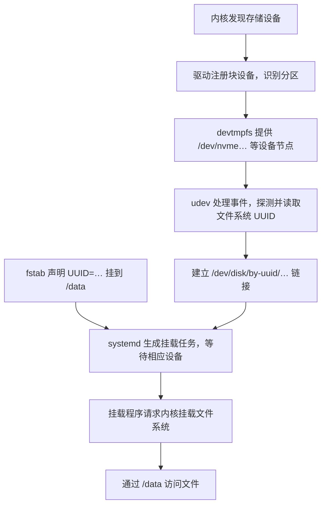

## 1、磁盘IO瓶颈的排查链路

iostat 查看是否为IO瓶颈 需要注意的指标是 `await`(等待时间) 和 `aqu-sz`等待队列长度 确定是否达到了IO瓶颈

接着使用的 podstat -d 查询是哪个进程在疯狂的读写 

> 相关的命令和指标
>
> ## top
>
> ```
> top - 14:30:10 up 12 days, 3:20, 2 users, load average: 8.60, 6.20, 3.10
> Tasks: 320 total, 4 running, 315 sleeping, 0 stopped, 1 zombie
> %Cpu(s): 28.0 us, 12.0 sy, 0.0 ni, 40.0 id, 18.0 wa, 0.0 hi, 2.0 si, 0.0 st
> MiB Mem : 32768.0 total, 2048.0 free, 8192.0 used, 22528.0 buff/cache
> MiB Swap:  8192.0 total, 8192.0 free,    0.0 used. 24576.0 avail Mem
> 
>   PID USER  PR  NI    VIRT    RES    SHR S  %CPU  %MEM     TIME+ COMMAND
>  3812 app   20   0   12.0g   4.0g  20000 S 180.0  12.5  120:30.25 java
> ```
>
> **第一行告诉你运行时间和系统负载。**
>
> | 字段                             | 含义                                   |
> | -------------------------------- | -------------------------------------- |
> | `14:30:10`                       | 当前系统时间                           |
> | `up 12 days, 3:20`               | 系统启动后运行了 12 天 3 小时 20 分钟  |
> | `2 users`                        | 当前登录会话数量，不一定是两个不同的人 |
> | `load average: 8.60, 6.20, 3.10` | 最近 1、5、15 分钟的系统平均负载       |
>
> 理解 `load average`，关键是：**它统计的是“正在运行、等待 CPU，以及处于不可中断等待状态的任务”的平滑平均数量，不是 CPU 使用率。** Linux 中通常可以理解为 `R` 状态和 `D` 状态任务共同影响负载。[负载定义](https://man7.org/linux/man-pages/man1/uptime.1.html)
>
> 例如，一台 **8 个逻辑 CPU** 的机器，如果任务主要在争抢 CPU：
>
> | 持续负载    | 可以怎样理解                                               |
> | ----------- | ---------------------------------------------------------- |
> | `load ≈ 2`  | CPU 整体通常还有余量                                       |
> | `load ≈ 8`  | 大致有 8 个任务处于运行或等待状态，需要结合 CPU 使用率判断 |
> | `load ≈ 16` | 如果主要是 CPU 计算任务，通常已经存在明显排队              |
>
> 但如果大量任务在等待磁盘，可能出现：
>
> ```
> load 很高
> CPU 使用率不高
> D 状态任务较多
> ```
>
> 因此，不能看到 `load > CPU 数量` 就直接认定 CPU 不够用。
>
> 这三个数还能粗略反映趋势：
>
> ```
> 8.60 > 6.20 > 3.10：近期负载在上升
> 2.00 < 5.00 < 9.00：近期负载在下降
> ```
>
> 可以用以下命令辅助查看：
>
> ```
> # 查看当前可用的逻辑 CPU 数
> nproc
> 
> # 查看 CPU 拓扑、逻辑 CPU、物理核心等信息
> lscpu
> 
> # 单独查看负载和运行时间
> uptime
> ```
>
> **第二行是任务数量，需要与进程状态一起看。**
>
> | 字段       | 含义                                     | 排障时怎样看                         |
> | ---------- | ---------------------------------------- | ------------------------------------ |
> | `total`    | 总任务数                                 | 在线程模式下，统计对象变为线程       |
> | `running`  | 正在运行或等待 CPU 的任务数              | 持续很多时关注 CPU 竞争              |
> | `sleeping` | 睡眠、等待事件的任务数                   | 多数服务平时就在睡眠，数量多通常正常 |
> | `stopped`  | 被暂停或调试停止的任务数                 | 结合业务确认原因                     |
> | `zombie`   | 已退出、但父进程尚未回收退出信息的任务数 | 持续存在或增长时检查父进程           |
>
> 进程列表中的 `S` 列，会给出更具体的状态：
>
> | 状态      | 含义               | 常见场景                                       |
> | --------- | ------------------ | ---------------------------------------------- |
> | `R`       | Running / Runnable | 正在执行，或者等待 CPU                         |
> | `S`       | 可中断睡眠         | 等待连接、定时器、锁或其他事件                 |
> | `D`       | 不可中断睡眠       | 常见于存储、文件系统等内核等待，也可能涉及 NFS |
> | `T` / `t` | 暂停或被调试跟踪   | 收到停止信号、调试器控制                       |
> | `Z`       | 僵尸               | 已退出，等待父进程回收                         |
> | `I`       | 空闲内核线程       | 某些版本中可以看到                             |
>
> 旧版 `top` 可能把 `D` 状态也归入汇总中的 `sleeping`；部分新版会单列 `d-sleep`。
>
> 两个判断比较实用：
>
> - **`D` 多且持续不消失**：优先检查 I/O 和具体等待位置。
> - **`Z` 多**：重点检查父进程的子进程回收逻辑。僵尸通常不消耗 CPU，也不会继续保留原来的大量用户态内存。[Linux 进程状态说明](https://gitlab.com/procps-ng/procps/-/raw/master/man/ps.1)
>
> **第三行是 CPU 时间分布。**
>
> ```
> %Cpu(s): 28.0 us, 12.0 sy, 0.0 ni, 40.0 id, 18.0 wa, 0.0 hi, 2.0 si, 0.0 st
> ```
>
> | 指标 | 含义                                   | 偏高时的排查方向                        |
> | ---- | -------------------------------------- | --------------------------------------- |
> | `us` | 普通用户态执行时间                     | 应用计算、压缩、加密、GC、循环等        |
> | `sy` | 内核态执行时间                         | 系统调用、内核处理、内存管理等          |
> | `ni` | 调整过 nice 值的任务在用户态执行的时间 | 看哪些任务调整了调度优先级              |
> | `id` | 空闲时间                               | 越高通常表示 CPU 越有余量，但仍需看单核 |
> | `wa` | 记为等待 I/O 的空闲时间                | 结合磁盘延迟、队列和阻塞任务判断        |
> | `hi` | 硬中断处理时间                         | 查看中断来源及分布                      |
> | `si` | 软中断处理时间                         | 网络收发等软中断处理                    |
> | `st` | 虚拟机被宿主机占用掉的 CPU 时间        | 关注虚拟化平台的 CPU 调度和争抢         |
>
> 这些百分比合计通常约为 `100%`，汇总行反映所有逻辑 CPU 的平均情况。
>
> 其中有三个容易误判的地方。
>
> **一是 `wa` 高，不表示 CPU 在执行磁盘读写。**
>
> 任务等待 I/O 时，CPU 可以执行别的任务；没有其他任务可执行而进入空闲时，其中一部分时间可能记为 `iowait`。这个指标存在多核记账等局限，所以：
>
> ```
> wa 高：值得继续检查 I/O
> wa 低：不能排除存储延迟问题
> ```
>
> 不能把 `wa=30%` 理解成“磁盘使用率 30%”。[内核 CPU 时间与 iowait 说明](https://www.kernel.org/doc/html/latest/filesystems/proc.html)
>
> **二是整机 CPU 不高，也可能存在单核瓶颈。**
>
> 例如 8 个逻辑 CPU 中，只有一个长期跑满，整体使用率可能只有约 `12.5%`。进入 `top` 后按数字 **`1`**，可以展开每个逻辑 CPU。
>
> **三是进程 `%CPU` 超过 `100%` 通常正常。**
>
> 常见默认显示模式下：
>
> ```
> 100%：大约占满一个逻辑 CPU
> 180%：大约消耗 1.8 个逻辑 CPU 的执行能力
> 400%：大约消耗四个逻辑 CPU 的执行能力
> ```
>
> 多线程进程可以超过 `100%`。按大写 `I` 可以切换 CPU 百分比的归一化模式，所以比较不同机器输出时需要留意显示模式。
>
> **内存部分，优先理解 `free`、`buff/cache` 和 `available` 的区别。**
>
> ```
> MiB Mem : 32768.0 total, 2048.0 free, 8192.0 used, 22528.0 buff/cache
> MiB Swap:  8192.0 total, 8192.0 free,    0.0 used. 24576.0 avail Mem
> ```
>
> | 字段                      | 含义                                           |
> | ------------------------- | ---------------------------------------------- |
> | `total`                   | 操作系统可用的物理内存总量                     |
> | `free`                    | 当前完全未使用的内存                           |
> | `used`                    | 已使用内存，具体计算口径随版本变化             |
> | `buff/cache`              | 缓冲、文件页缓存、部分可回收内核缓存等         |
> | `avail Mem` / `available` | 估计在不发生交换的前提下，可供新应用使用的内存 |
> | Swap `total`              | 交换空间总量                                   |
> | Swap `free`               | 未使用的交换空间                               |
> | Swap `used`               | 已使用的交换空间                               |
>
> Linux 会利用空闲内存做缓存，因此：
>
> > **`free` 小不一定是内存不足；判断余量时，通常更应该看 `available`。**
>
> `available` 会考虑缓存中可以回收的部分，但也不是简单地把所有缓存都算成可用内存。较新版本常用 `total - available` 计算 `used`，旧版本可能采用其他口径。[内存字段定义](https://man7.org/linux/man-pages/man1/free.1.html)
>
> 同样，**Swap 已使用，不一定说明现在正在发生内存压力**。可能只是过去换出的一些冷数据还没有换回来。更值得关注的是：
>
> ```
> available 持续偏低
> 同时持续发生较多 swap in / swap out
> 应用延迟明显增加
> ```
>
> 常用辅助命令：
>
> ```
> free -h
> vmstat 1 10
> ```
>
> 在 `vmstat` 中：
>
> - `si`：每秒从交换空间换入内存的数据量。
> - `so`：每秒从内存换出到交换空间的数据量。
>
> 注意：**`top` 的 `si` 是软中断，`vmstat` 的 `si` 是 swap in，含义完全不同。**
>
> **再看下面的进程列表，各列分别是什么。**
>
> | 字段      | 含义                         | 使用时注意                                         |
> | --------- | ---------------------------- | -------------------------------------------------- |
> | `PID`     | 进程 ID                      | 线程模式下对应线程 ID                              |
> | `USER`    | 任务所属的有效用户           | 确认是哪个服务账户                                 |
> | `PR`      | 调度优先级显示值             | 普通任务中数值通常越小优先级越高；实时任务另有规则 |
> | `NI`      | nice 值                      | 通常为 `-20～19`，越小越优先获得 CPU               |
> | `VIRT`    | 虚拟地址空间大小             | 包含映射、预留空间等，不等于实际占用物理内存       |
> | `RES`     | 驻留在物理内存中的大小       | 判断进程物理内存占用的常用入口                     |
> | `SHR`     | `RES` 中被统计为可共享的部分 | 包括共享库、文件映射等，未必真的正被其他进程共享   |
> | `S`       | 任务状态                     | 如 `R`、`S`、`D`、`Z`                              |
> | `%CPU`    | 最近采样区间内的 CPU 使用率  | 多线程进程可超过 `100%`                            |
> | `%MEM`    | `RES` 占物理内存总量的比例   | 通常不是占 `available` 的比例                      |
> | `TIME+`   | 累计消耗的 CPU 时间          | 不是进程启动至今经过的现实时间                     |
> | `COMMAND` | 命令名或命令行               | 按 `c` 切换显示                                    |
>
> 例如上面的 Java 进程：
>
> ```
> VIRT = 12 GiB
> RES  = 4 GiB
> CPU  = 180%
> ```
>
> 可以理解为：它的虚拟地址空间约 12 GiB，当前驻留物理内存约 4 GiB，近期平均消耗约 1.8 个逻辑 CPU。
>
> 另外：
>
> - `RES - SHR` 不能精确得到进程独占内存。
> - 多个进程的 `RES` 直接相加，可能重复计算共享页面。
> - 更精确地分析共享内存分摊时，可以查看 `PSS`。
> - nice 值影响 CPU 竞争时的调度权重，不能把它当作 CPU 使用率上限。[调度优先级说明](https://man7.org/linux/man-pages/man7/sched.7.html)
>
> **工作中，`top` 常用的启动方式如下。**
>
> ```bash
> # 每秒刷新
> top -d 1
> 
> # 只看指定进程
> top -p 1234
> 
> # 同时看多个进程
> top -p 1234,5678
> 
> # 查看指定进程内部的线程
> top -H -p 1234
> 
> # 只看指定用户
> top -u nginx
> 
> # 按 CPU 从高到低排序
> top -o +%CPU
> 
> # 按内存从高到低排序
> top -o +%MEM
> 
> # 非交互模式，每秒采样一次，共输出 60 次，保存到文件
> top -b -d 1 -n 60 -w 512 > top.log
> ```
>
> 这些参数可以这样记：
>
> | 参数 | 作用                                |
> | ---- | ----------------------------------- |
> | `-d` | 刷新间隔，单位秒                    |
> | `-p` | 指定 PID                            |
> | `-H` | 显示线程                            |
> | `-u` | 按用户过滤                          |
> | `-o` | 指定排序字段，前缀 `+` 表示从高到低 |
> | `-b` | 批处理模式，适合保存输出            |
> | `-n` | 输出次数                            |
> | `-w` | 输出宽度                            |
>
> 进入 `top` 后，常用按键是：
>
> | 按键      | 作用                             |
> | --------- | -------------------------------- |
> | `1`       | 切换整体 CPU 与每个逻辑 CPU      |
> | `P`       | 按 CPU 排序                      |
> | `M`       | 按内存排序                       |
> | `T`       | 按累计 CPU 时间排序              |
> | `H`       | 切换进程／线程模式               |
> | `c`       | 切换命令名／完整命令行           |
> | `u`       | 按用户过滤                       |
> | `f`       | 选择显示字段及排序字段           |
> | `E` / `e` | 分别切换汇总区／进程区的内存单位 |
> | `R`       | 反转排序方向                     |
> | `W`       | 保存当前显示配置                 |
> | `h` / `q` | 帮助／退出                       |
>
> 排障时持续观察几轮，通常比只运行一次 `top -b -n 1` 更有价值。[top 参数与交互操作手册](https://gitlab.com/procps-ng/procps/-/raw/master/man/top.1)
>
> ------
>
> ## iostat
>
> 接着看 `iostat`。它属于 `sysstat` 软件包，通常与 `mpstat`、`pidstat` 一起安装：
>
> ```
> # Debian / Ubuntu
> sudo apt install sysstat
> 
> # RHEL / Rocky Linux / AlmaLinux / Fedora
> sudo dnf install sysstat
> ```
>
> **先记住它的采样规则：**
>
> ```
> iostat
> ```
>
> 默认第一份报告通常统计**从系统启动到现在**的数据。
>
> ```
> iostat 1
> ```
>
> 第一份仍通常是开机以来的数据，后续每份才是最近 1 秒的数据。排查当前问题时，常加 `-y` 跳过首份历史报告：
>
> ```
> iostat -x -y 1
> ```
>
> 这一点解释了为什么有时第一次看到的数据与后续差别很大。[sysstat 采样规则说明](https://sysstat.github.io/faq.html)
>
> `iostat` 可以显示 CPU 汇总和设备统计。CPU 部分通常是：
>
> ```
> avg-cpu:  %user  %nice  %system  %iowait  %steal  %idle
>           28.00   0.00    14.00    18.00    0.00  40.00
> ```
>
> | 指标      | 含义                                  |
> | --------- | ------------------------------------- |
> | `%user`   | 普通用户态 CPU 时间                   |
> | `%nice`   | 调整过 nice 值的任务的用户态 CPU 时间 |
> | `%system` | 内核执行时间                          |
> | `%iowait` | 记为等待磁盘 I/O 的空闲时间           |
> | `%steal`  | 虚拟机被宿主机占用掉的 CPU 时间       |
> | `%idle`   | 普通空闲时间                          |
>
> 这些也是整机各逻辑 CPU 的平均值。它们与 `top` 的 CPU 统计来源相近，但展示分类不完全相同。
>
> **普通设备输出里，最常见的是这些字段。**
>
> | 字段                      | 含义                                     |
> | ------------------------- | ---------------------------------------- |
> | `Device`                  | 块设备或分区名称                         |
> | `tps`                     | 每秒设备传输请求数，不是数据库每秒事务数 |
> | `kB_read/s` / `MB_read/s` | 每秒读取的数据量                         |
> | `kB_wrtn/s` / `MB_wrtn/s` | 每秒写入的数据量                         |
> | `kB_read` / `MB_read`     | 本份报告统计范围内的读取总量             |
> | `kB_wrtn` / `MB_wrtn`     | 本份报告统计范围内的写入总量             |
>
> 第一份报告的范围通常是开机以来，后续报告则对应各自采样区间。
>
> 实际排查磁盘性能，更多会用 `-x` 展开指标。下面只保留一些核心列：
>
> ```
> Device   r/s   w/s  rkB/s  wkB/s  r_await  w_await  aqu-sz  rareq-sz  wareq-sz  %util
> sda    100.0 200.0 1600.0 3200.0     15.0     30.0     7.5      16.0      16.0   95.0
> ```
>
> **这些字段可以按“次数、数据量、延迟、并发、忙碌时间”来理解。**
>
> | 指标              | 含义与单位                                    |
> | ----------------- | --------------------------------------------- |
> | `r/s`             | 每秒完成的读请求数，已经过请求合并            |
> | `w/s`             | 每秒完成的写请求数，已经过请求合并            |
> | `rkB/s` / `rMB/s` | 每秒读取数据量                                |
> | `wkB/s` / `wMB/s` | 每秒写入数据量                                |
> | `r_await`         | 读请求平均完成时间，单位毫秒                  |
> | `w_await`         | 写请求平均完成时间，单位毫秒                  |
> | `await`           | 某些版本或输出模式中的总体平均 I/O 完成时间   |
> | `aqu-sz`          | 平均未完成请求数，可理解为平均在途 I/O 并发量 |
> | `rareq-sz`        | 平均每个读请求的大小，单位 KiB                |
> | `wareq-sz`        | 平均每个写请求的大小，单位 KiB                |
> | `%util`           | 采样期间设备被记为有 I/O 活动的时间比例       |
>
> 这里的 `await` **包含排队时间和处理时间**；`aqu-sz` 也包含正在处理的请求，不能只理解成“还没轮到处理的排队数量”。
>
> 单位也要留意：sysstat 中标为 `kB`、`MB` 的数据通常实际采用 KiB、MiB，即以 `1024` 为换算基数。[iostat 字段和单位手册](https://man7.org/linux/man-pages/man1/iostat.1.html)
>
> 拿上面的示例计算，就比较直观了：
>
> ```
> 读 IOPS = 100
> 写 IOPS = 200
> 读写总 IOPS ≈ 300
> 
> 读吞吐量 = 1600 KiB/s
> 写吞吐量 = 3200 KiB/s
> 
> 平均读请求大小 = 1600 ÷ 100 = 16 KiB
> 平均写请求大小 = 3200 ÷ 200 = 16 KiB
> ```
>
> 其中，**IOPS 是每秒多少次，吞吐量是每秒多少数据**。一次请求大小不同，这两个指标就会有很大差异：
>
> ```
> 1000 IOPS × 4 KiB   ≈ 3.9 MiB/s
> 1000 IOPS × 1 MiB   ≈ 1000 MiB/s
> ```
>
> 因此，吞吐量不高，也可能存在大量小块随机 I/O。
>
> 示例中的总体平均读写延迟约为：
>
> ```
> (100 × 15ms + 200 × 30ms) ÷ 300 = 25ms
> ```
>
> 在流量相对稳定、统计口径一致时，可以近似理解：
>
> ```
> 平均未完成请求数 ≈ 每秒完成请求数 × 平均完成时间（秒）
> 
> 7.5 ≈ 300 × 0.025
> ```
>
> 这也说明：**并发较高时，很多请求的处理时间会重叠，不能直接累加成设备忙碌时间。**[内核 I/O 计数方式](https://www.kernel.org/doc/html/latest/admin-guide/iostats.html)
>
> **其他扩展字段，主要涉及请求合并、discard 和 flush。**
>
> | 字段               | 含义                                      |
> | ------------------ | ----------------------------------------- |
> | `rrqm/s`           | 每秒被合并的读请求数                      |
> | `wrqm/s`           | 每秒被合并的写请求数                      |
> | `%rrqm` / `%wrqm`  | 读／写请求合并比例                        |
> | `d/s`              | 每秒完成的 discard 请求数，常与 TRIM 有关 |
> | `dkB/s` / `dMB/s`  | 每秒 discard 涉及的数据量                 |
> | `drqm/s` / `%drqm` | discard 请求合并数量／比例                |
> | `d_await`          | discard 平均完成时间                      |
> | `dareq-sz`         | 平均 discard 请求大小                     |
> | `f/s`              | 每秒完成的设备 flush 请求数               |
> | `f_await`          | flush 平均完成时间                        |
>
> 例如两个相邻的 `4 KiB` 请求，可以被合并为一个 `8 KiB` 请求。合并率高低与访问模式有关，**合并率低不等于性能差**。
>
> flush 与持久化有关，但 `f/s` 不能直接当成应用的 `fsync()` 调用次数。[sysstat 上游字段定义](https://github.com/sysstat/sysstat/blob/master/man/iostat.in)
>
> 旧服务器上还可能看到这些名称：
>
> | 旧字段     | 与新版的关系                                                 |
> | ---------- | ------------------------------------------------------------ |
> | `avgqu-sz` | 新版通常叫 `aqu-sz`                                          |
> | `avgrq-sz` | 旧版平均请求大小，通常以 512 字节扇区为单位；新版 `areq-sz` 以 KiB 为单位 |
> | `svctm`    | 旧版推算的服务时间，已经废弃，不适合据此诊断设备服务时间     |
>
> 不要用 `await - svctm` 精确计算排队时间，并发 I/O 会使这种推算失去可靠性。[旧版 svctm 说明](https://access.redhat.com/solutions/2039133)
>
> **判断磁盘是否存在瓶颈，尤其要避免单看 `%util`。**
>
> `%util=95%` 可以粗略理解为：该采样窗口内，设备大部分时间都有 I/O 活动。
>
> 它不能直接解释成：
>
> ```
> 已经用了 95% 的最大带宽
> 磁盘空间使用了 95%
> 只剩 5% 的性能
> ```
>
> 对串行处理能力较强约束的设备，接近 `100%` 常提示接近饱和；对于 NVMe、现代 SSD、RAID 等并行设备，`100%` 时仍可能有性能余量。
>
> 实际工作中，更有意义的是组合观察：
>
> | 观察结果                              | 判断方向                             |
> | ------------------------------------- | ------------------------------------ |
> | 延迟升高、`aqu-sz` 增大、吞吐不再增长 | 存储处理能力或限额可能成为瓶颈       |
> | `%util` 很高，但延迟稳定、业务正常    | 持续繁忙，未必存在性能问题           |
> | 吞吐不高、IOPS 较高、请求很小         | 可能受小块随机 I/O 能力限制          |
> | 写延迟或 flush 延迟明显升高           | 继续检查写回、同步持久化及存储后端   |
> | 应用慢，但设备指标正常                | 继续查锁、网络、缓存、应用内部排队等 |
>
> 延迟也没有统一的“超过多少毫秒就异常”：要结合设备类型、访问模式、平时基线和业务要求。`await` 是平均值，不能反映所有长尾请求，也不能直接等同于应用端的完整读写耗时。
>
> **工作中最常用的一条 `iostat` 命令是：**
>
> ```
> iostat -dxm -y 1 10
> ```
>
> 它表示：
>
> | 参数 | 作用                   |
> | ---- | ---------------------- |
> | `-d` | 只显示设备统计         |
> | `-x` | 显示扩展指标           |
> | `-m` | 吞吐量采用 MiB/s 显示  |
> | `-y` | 跳过开机以来的首份报告 |
> | `1`  | 每隔 1 秒采样          |
> | `10` | 输出 10 份采样报告     |
>
> 注意，`-m` 不会把所有字段都改成 MB：延迟仍是毫秒，`rareq-sz` 等请求大小字段仍按其规定单位显示。
>
> 其他常用组合：
>
> ```
> # 持续观察，按 Ctrl+C 退出
> iostat -dxm -y 1
> 
> # 同时看 CPU 和设备扩展统计
> iostat -xm -y 1 10
> 
> # 只看某块设备，替换为实际设备名
> iostat -dxm -y nvme0n1 1 10
> 
> # 看 sda 及其分区
> iostat -dxm -y -p sda 1 10
> 
> # 显示所有设备及分区
> iostat -dxm -y -p ALL 1 10
> 
> # 显示 device mapper 名称，便于辨认 LVM
> iostat -dxm -N -y 1 10
> 
> # 每份报告带时间，采样 60 次并保存
> iostat -dxm -y -t 1 60 > iostat.log
> ```
>
> 另外两个常用参数：
>
> ```
> -k：吞吐量以 KiB/s 显示
> -z：隐藏本采样区间没有活动的设备
> ```
>
> 看到 `dm-0`、`sda`、`sda1` 同时出现时，要先确认设备层次。同一次 I/O 可能在逻辑卷、分区和底层设备分别计数，不能直接把所有行相加。
>
> ------
>
> 实际排障时，可以按下面的顺序使用这些命令。
>
> **先确认整机是否存在持续压力：**
>
> ```
> uptime
> top -d 1
> vmstat 1 10
> ```
>
> 在 `vmstat` 中重点看：
>
> | 字段        | 含义                         |
> | ----------- | ---------------------------- |
> | `r`         | 正在运行或等待 CPU 的任务数  |
> | `b`         | 等待 I/O 完成而阻塞的任务数  |
> | `si` / `so` | 换入／换出交换空间的数据速率 |
> | `cs`        | 每秒上下文切换次数           |
>
> `vmstat` 第一行的速率统计通常也是开机以来的平均值，后续才对应采样区间。[vmstat 手册](https://gitlab.com/procps-ng/procps/-/raw/master/man/vmstat.8)
>
> **如果 CPU 高，继续找进程、线程和具体核心：**
>
> ```
> # 每个逻辑 CPU 的使用情况
> mpstat -P ALL 1 10
> 
> # 各进程的 CPU 使用情况
> pidstat -u 1 10
> 
> # 指定进程内部的线程
> top -H -p 1234
> 
> # 持续采样指定进程的各线程
> pidstat -u -t -p 1234 1 10
> ```
>
> **如果怀疑 I/O，先找设备，再找产生读写的进程：**
>
> ```
> # 哪个设备延迟高、队列大
> iostat -dxm -y 1 10
> 
> # 哪些进程产生较多磁盘读写
> pidstat -d 1 10
> 
> # 持续看指定进程
> pidstat -d -p 1234 1 10
> 
> # 查看逻辑卷、磁盘、分区及挂载点
> lsblk -o NAME,TYPE,SIZE,FSTYPE,MOUNTPOINT
> ```
>
> `pidstat -d` 中，`kB_rd/s`、`kB_wr/s` 可帮助定位读写来源。但应用缓存、页缓存、后台写回等会影响归属和时机，因此不一定与 `iostat` 每一秒严格对齐。[pidstat 进程 I/O 统计说明](https://man7.org/linux/man-pages/man1/pidstat.1.html)
>
> **如果内存紧张，观察余量、进程增长和交换活动：**
>
> ```
> free -h
> top -o +%MEM
> vmstat 1 10
> pidstat -r -p 1234 1 10
> ```
>
> **如果遇到“磁盘满”或“无法创建文件”，还要单独检查容量和 inode：**
>
> ```
> # 文件系统容量、类型和使用率
> df -hT
> 
> # inode 使用率
> df -i
> ```
>
> `df` 回答“还能放多少文件和数据”，`iostat` 回答“设备读写表现怎样”。排查服务变慢时，把设备延迟、进程资源消耗和业务延迟放在同一个时间窗口里对照，判断才更可靠。
>
> **`pidstat -d` 可以帮助定位哪些进程正在大量读写磁盘**，配合采样间隔看当前活动：
>
> ```
> # 每秒统计一次，观察各进程的 I/O
> pidstat -d 1
> 
> # 只看指定进程
> pidstat -d -p 1234 1
> 
> # 进一步查看该进程内各线程的 I/O
> pidstat -d -t -p 1234 1
> ```
>
> 重点看这些字段：
>
> | 字段      | 含义                               |
> | --------- | ---------------------------------- |
> | `PID`     | 进程 ID                            |
> | `kB_rd/s` | 该任务每秒引起的磁盘读取量         |
> | `kB_wr/s` | 该任务每秒引起或将引起的磁盘写入量 |
> | `Command` | 进程名称                           |
>
> 实际排查时：
>
> ```
> iostat -dxm -y 1   → 看哪些设备繁忙、延迟升高
> pidstat -d 1       → 找产生大量读写的进程
> ```

## 2、服务器CPU100%但top看很正常？

考察的是恶性进程的对抗机制，恶意进程在后台做了动态躲避和进程名伪装

- 这些进程会监控系统的进程列表，一旦发现类似top，ts这样的诊断工具启动，他就会立刻把自己挂起休眠释放CPU
- 同时查到后  这里可能 也会伪装自己的运行命令是 nginx或者mysql 这样的进程，但是他也不一定是对应的业务进程

> 一个检测思路
>
> - `cp /usr/bin/top /tmp/my_too`l   cp一下原本的top命令 看下内存占用
> - `ps -ef | grep` 进程号
> - `ls -l /proc/1883/exe`    内核会在对应的进程创建一个软链接 指明对应的执行的源文件
> - kill -9  +  rm -rf /xxxxxx 即可

## 3、k8s pending pod的排查逻辑

- kubeclt describe pod xxxxx -n xxxxxx 
  - insuffcient  cpu/mem xxxx
  - 调度规则 taint/nodeSelector/节点亲和性
  - 存储卷未绑定

## 4、K8s如何把服务暴露给外网？

利用service 动态绑定pod IP 

- node port 在集群的物理机器强制打开一个port，不管用户的请求打到哪个节点，底层的kube-proxy 都会吧流量拦截 并转发至对应的pod

- ingress 七层反向代理 和现在shopee的逻辑可以相通

  域名 绑定到集群内的几台主机上 --》 traefik --〉 ingress --> service ---> endpoint ---> 后端service

  > 这是一个简单的实例
  >
  > ### 1、workload + service 
  >
  > ```yaml
  > apiVersion: v1
  > kind: Namespace
  > metadata:
  >   name: ingress-demo
  > ---
  > apiVersion: apps/v1
  > kind: Deployment
  > metadata:
  >   name: web
  >   namespace: ingress-demo
  > spec:
  >   replicas: 2
  >   selector:
  >     matchLabels:
  >       app: web
  >   template:
  >     metadata:
  >       labels:
  >         app: web
  >     spec:
  >       containers:
  >         - name: whoami
  >           image: traefik/whoami:v1.11.0
  >           args:
  >             - --port=8080
  >             - --name=web
  >           ports:
  >             - name: http
  >               containerPort: 8080
  > ---
  > apiVersion: v1
  > kind: Service
  > metadata:
  >   name: web-svc
  >   namespace: ingress-demo
  > spec:
  >   type: ClusterIP
  >   selector:
  >     app: web
  >   ports:
  >     - name: http
  >       port: 80
  >       targetPort: http
  > ---
  > apiVersion: apps/v1
  > kind: Deployment
  > metadata:
  >   name: api
  >   namespace: ingress-demo
  > spec:
  >   replicas: 2
  >   selector:
  >     matchLabels:
  >       app: api
  >   template:
  >     metadata:
  >       labels:
  >         app: api
  >     spec:
  >       containers:
  >         - name: whoami
  >           image: traefik/whoami:v1.11.0
  >           args:
  >             - --port=8080
  >             - --name=api
  >           ports:
  >             - name: http
  >               containerPort: 8080
  > ---
  > apiVersion: v1
  > kind: Service
  > metadata:
  >   name: api-svc
  >   namespace: ingress-demo
  > spec:
  >   type: ClusterIP
  >   selector:
  >     app: api
  >   ports:
  >     - name: http
  >       port: 80
  >       targetPort: http
  > ```
  >
  > > 1、这里重点对应这几个字段：
  > >
  > > ```
  > > Service selector: app=api
  > >               │ 匹配
  > >               ▼
  > > Pod labels: app=api
  > > 
  > > Service port: 80
  > >               │ targetPort: http
  > >               ▼
  > > Pod 端口名 http → 8080
  > > ```
  > >
  > > 2、workload中定义的 containerPort 只是声明，需要你在容器内启动的pod 也使用同样的监听port配置
  > >
  > > 
  >
  > ### 2、ingress 
  >
  > ```yaml
  > apiVersion: networking.k8s.io/v1
  > kind: Ingress
  > metadata:
  >   name: demo
  >   namespace: ingress-demo
  >   annotations:
  >     traefik.ingress.kubernetes.io/router.entrypoints: web
  > spec:
  >   ingressClassName: traefik-demo
  >   rules:
  >     - host: demo.example.com
  >       http:
  >         paths:
  >           - path: /api
  >             pathType: Prefix
  >             backend:
  >               service:
  >                 name: api-svc
  >                 port:
  >                   number: 80
  >           - path: /
  >             pathType: Prefix
  >             backend:
  >               service:
  >                 name: web-svc
  >                 port:
  >                   number: 80
  > ```
  >
  > ### 3、port 转发关系
  >
  > 这里是 Service 使用 `http` 找到 Pod 的端口，Ingress 引用的是 Service 的端口。**完整对应关系如下：
  >
  > ```
  > # Ingress：找 api-svc 的 80 端口
  > backend:
  >   service:
  >     name: api-svc
  >     port:
  >       number: 80
  > # Service：将服务端口 80 对应到 Pod 中名为 http 的端口
  > ports:
  >   - name: http
  >     port: 80
  >     targetPort: http
  > # Pod：名为 http 的端口是 8080
  > ports:
  >   - name: http
  >     containerPort: 8080
  > ```
  >
  > 所以对应关系是：
  >
  > ```
  > Ingress 引用 api-svc:80
  >           ↓
  > Service port: 80
  >           ↓
  > Service targetPort: http
  >           ↓
  > Pod 端口 name: http → containerPort: 8080
  >           ↓
  > 应用实际监听 8080，才能接收请求
  > ```
  >
  > ### 4、ingress controller
  >
  > ingress只是绑定了集群内部的转发逻辑，具体还需要 ingress controller 接收请求 ---》 查询转发规则 ---》 转发到service
  >
  > 这里能够 使用常用的 traefik 作为 ingress controller 自动感知集群 ingress 变动进行转发
  >
  > - `hostnetwork = true` 表示pod共用宿主机网络，这里能够让外部域名/访问直接到宿主机即可
  > - `hostNetwork = false`  再包一层 nodePort Service 绑定一些物理机IP作为入口，让其负载均衡到 traefik pod 再进行转发

  

- 云原生标准的load balancer  阿里云/AWS 这样的云，将service 定义为 LoadBalancer 类型，k8s就会自动呼叫云厂商的API，给分配一个真实的公网IP

## 5、CPU告警却查不到进程？内核级Rootkit排查

服务器CPU告警持续80%以上，top中  us 占比非常高，但是进程列表中 所有的us 加起来都不够 20%

总算力和进程算力对不上，常规工具长期无法对账的问题，就要考虑是不是内核态异常，甚至存在 Rootkit 的可能

整体排查思路如下，常规的top ps 都是获取 proc 的相关参数信息，如果系统被植入了内核级的 Rootkit，他可能会劫持 getdents的相关调用 proc fs 接口，甚至直接在内核层把恶意进程的PID隐藏掉

也就是说，系统总体统计状态可能是真实的，但是操作系统返回的统计工具可能是有问题的

这里建议跳过常规的工具，使用安全检测工具，比如 unhide 或者 chkrootkit，这些工具 通常是暴力遍历系统的PID状态，或者直接去扫描系统调用表

- unhide 暴力遍历系统pid 查找是否有隐藏的PID

  - apt install -y unhide

  - unhide proc  

    Searching for Hidden processes through /proc stat scanning

- chkrootkit  依赖已知库做检查
  - sudo apt install -y chkrootkit
  - chkrootkit | grep "hooked

## 6、容器镜像启动长达15秒，如何压进5秒内？

抛除升级硬件(网络带宽、CPU) 等因素，真正的瓶颈可能在镜像本身，基础镜像太臃肿，导致拉取、解压和文件加载阶段都在额外耗时

核心是减少IO等待和优化层级结构

- 多阶段构建

  传统的构建容易把编译环境的垃圾，例如源码、构建工具一股脑打包进去

  使用多阶段构建、编译阶段使用完整的开发镜像、构建时只把用到的二进制文件加载进去

  这一步通常能把几百兆的镜像压缩至十几兆

  ```dockerfile
  FROM sdk-image AS build
  
  WORKDIR /src
  COPY . .
  RUN build-command
  
  
  FROM runtime-image AS runtime
  
  WORKDIR /app
  COPY --from=build /src/artifact /app/artifact
  CMD ["/app/artifact"]
  ```

  

- 优化镜像层

  镜像的构建是分层的，每层可能会有一部分变更，这样不同的层 cover 在一起形成了最终的FS

  - 把系统依赖安装放在文件最上面 变更频率低 拉取时能够多次复用
  - 变更频繁的业务代码放在最下面
  - 多条run指令合并吗，或者使用工具压缩镜像层

- 针对超大镜像的懒加载机制

  对于 AI 模型这类没法压缩的庞大镜像，传统模式是先全量下载 全量解压 再启动 非常耗时

  引入 nydus 这类 snapshotter 插件，支持按需拉取，容器启动时 会优先拉取元数据和启动所需的关键数据块，业务进程先拉取，剩余数据再在后台按需加载

## 7、100个容器如何动态下发不同配置？Docker配置解耦与底层原理实机剖析

### 1、dockerfile 中 run 和 cmd 都能够执行命令，他们在底层机制上的本质区别是什么

执行阶段完全不一样，run发生在构建镜像的阶段，dockerfile中 每一句run，都是实打实生成一层的只读的文件系统，为了避免镜像臃肿，通常需要合并命令来精简层数

CMD通常发生在容器启动阶段，他只是说明 容器启动时默认要跑什么进程


**`RUN` 负责构建镜像，`CMD` 和 `ENTRYPOINT` 负责决定容器启动时运行什么。**

| 指令         | 什么时候执行              | 主要作用                                     | 常见用途                         |
| ------------ | ------------------------- | -------------------------------------------- | -------------------------------- |
| `RUN`        | `docker build` 构建镜像时 | 执行命令，将文件系统变化保存到镜像层         | 安装软件、编译代码、创建目录     |
| `CMD`        | 容器启动时                | 提供默认命令，或给 `ENTRYPOINT` 提供默认参数 | 默认启动应用                     |
| `ENTRYPOINT` | 容器启动时                | 指定容器的入口程序                           | 把镜像作为某个固定工具或应用运行 |

`CMD` 和 `ENTRYPOINT` 在构建时只记录配置，不执行其中的命令。[Docker 官方文档](https://docs.docker.com/reference/dockerfile/#cmd)

**`CMD` 和 `ENTRYPOINT` 最关键的区别，是启动时如何覆盖它们。**

只有 `CMD` 时：

```
FROM alpine
CMD ["echo", "hello"]
docker run demo
# 执行：echo hello

docker run demo echo world
# 执行：echo world
```

镜像名后面的命令会**整体替换 `CMD`**。

使用 `ENTRYPOINT` 配合 `CMD` 时：

```
FROM alpine

RUN apk add --no-cache curl

ENTRYPOINT ["curl"]
CMD ["--version"]
```

这里：

- `RUN`：构建镜像时安装 curl，启动容器时不会重新安装。
- `ENTRYPOINT`：指定入口程序为 curl。
- `CMD`：给 curl 提供默认参数 `--version`。

假设镜像构建为 `mycurl`：

```
docker run --rm mycurl
# 执行：curl --version

docker run --rm mycurl -I https://example.com
# 执行：curl -I https://example.com
```

第二条命令中，`-I https://example.com` **替换了 `CMD`，再追加到 `ENTRYPOINT` 后面**。若要替换入口程序，需要显式使用 `--entrypoint`：[组合规则](https://docs.docker.com/reference/dockerfile/#understand-how-cmd-and-entrypoint-interact)

```
docker run --rm --entrypoint sh mycurl -c 'echo hello'
# 执行：sh -c 'echo hello'
```

写 Dockerfile 时，再注意两点：

- 同一构建阶段可以有多个 `RUN`；多个 `CMD` 或多个 `ENTRYPOINT`，各自只有最后一个生效。
- `CMD`、`ENTRYPOINT` 通常推荐使用 `["程序", "参数"]` 这种 **exec 形式**。上面的参数拼接规则基于这种形式；`ENTRYPOINT curl` 这样的 shell 形式会忽略 `CMD` 和启动时传入的参数，还可能影响停止信号的传递。[ENTRYPOINT 文档](https://docs.docker.com/reference/dockerfile/#entrypoint)

> 关键看：**你在 `docker run 镜像名` 后面写的内容，是用来替换命令，还是传给已有程序当参数。**
>
> 我们做两个镜像，默认都打印 `hello`。
>
> **镜像 a：用 `CMD`**
>
> ```
> FROM alpine
> CMD ["echo", "hello"]
> ```
>
> 意思是：“如果启动时没指定命令，就执行 `echo hello`。”
>
> ```
> docker run a
> # 执行 echo hello，打印 hello
> 
> docker run a ls
> # 执行 ls，列出文件
> ```
>
> 这里的 `ls` 把整个 `echo hello` 替换掉了。
>
> **镜像 b：用 `ENTRYPOINT` 配合 `CMD`**
>
> ```
> FROM alpine
> ENTRYPOINT ["echo"]
> CMD ["hello"]
> ```
>
> 意思是：“启动时运行 `echo`，默认给它传入参数 `hello`。”
>
> ```
> docker run b
> # 执行 echo hello，打印 hello
> 
> docker run b ls
> # 执行 echo ls，打印字符串 ls
> ```
>
> 这里的 `echo` 仍然保留，`ls` 只替换了默认参数 `hello`。
>
> 把两者放在一起看：
>
> | 启动方式        | 镜像 a：只有 CMD | 镜像 b：ENTRYPOINT + CMD |
> | --------------- | ---------------- | ------------------------ |
> | 不额外写内容    | `echo hello`     | `echo hello`             |
> | 镜像名后写 `ls` | **运行 `ls`**    | **运行 `echo ls`**       |
>
> 所以选择时可以这样想：
>
> - 想让用户方便地换成别的命令 → 用 `CMD`。
> - 想让镜像始终作为某个程序使用，用户主要调整参数 → 用 `ENTRYPOINT` 配合 `CMD`。
>
> `ENTRYPOINT` 也能被替换，只是需要专门使用 `--entrypoint`。

### 2、docker 的 写时复制机制

docker的镜像层都是只读的，容器启动时，系统只会在顶层挂载一个临时的可写层，在容器内的所有的修改，都只发生在这个临时层上，容器一旦销毁，临时层马上被丢弃，底层镜像保持原样。

### 3、如果要让100个文件加载不同的配置文件，你要怎么设计

正确的方式是将配置和镜像解耦

 因此 这里可以想着这么搞，

- 启动时 利用volume 动态挂载外部配置文件 或者通过 环境变量的方式注入 容器启动时动态加载


## 8、K8s业务高峰期升级如何做到零中断？

实现真正的无感知的平滑升级 要从容量底线 流量探测和优雅下线三个维度来说

### 容量底线 - 通过stragety保证

```yaml
stragety:
	type: RollingUpdate
	rollingUpdate:
		maxUnavailable: 0  # 最多不可使用数
		maxSurge: 10%      # 最大增量 就是多出replica的pod数

```

>**先分清三种策略：RollingUpdate、OnDelete、Recreate。**
>
>| 策略            | 修改 Pod 模板后的行为                                        |
>| --------------- | ------------------------------------------------------------ |
>| `RollingUpdate` | 控制器自动、逐步替换旧 Pod                                   |
>| `OnDelete`      | 保留现有 Pod，等旧 Pod 被删除后，才按更新后的模板创建替代 Pod |
>| `Recreate`      | 更新时，先终止全部旧 Pod，再创建新版本 Pod                   |
>
>它们在三种工作负载中的常见配置是：
>
>| 工作负载    | 策略字段              | 常用策略                    | 默认策略        |
>| ----------- | --------------------- | --------------------------- | --------------- |
>| Deployment  | `spec.strategy`       | `RollingUpdate`、`Recreate` | `RollingUpdate` |
>| StatefulSet | `spec.updateStrategy` | `RollingUpdate`、`OnDelete` | `RollingUpdate` |
>| DaemonSet   | `spec.updateStrategy` | `RollingUpdate`、`OnDelete` | `RollingUpdate` |
>
>**先看 Deployment：主要控制“可用副本数量”和“额外副本数量”。**
>
>它最重要的两个参数是：
>
>| 参数             | 含义                                           |
>| ---------------- | ---------------------------------------------- |
>| `maxUnavailable` | 相对于期望副本数，更新时允许缺少多少个可用副本 |
>| `maxSurge`       | 更新时，允许额外创建多少个 Pod                 |
>
>假设期望副本数为 3：
>
>```yaml
>spec:
>  replicas: 3
>  strategy:
>    type: RollingUpdate
>    rollingUpdate:
>      maxUnavailable: 0
>      maxSurge: 1
>```
>
>它表达的意思是：
>
>- 更新操作不能主动把可用副本数降到 3 以下。
>- 允许临时多创建 1 个 Pod。
>
>一种典型更新过程是：
>
>```
>最初：3 个旧 Pod
>          ↓
>额外创建 1 个新 Pod
>          ↓
>等待新 Pod 可用
>          ↓
>删除 1 个旧 Pod
>          ↓
>再次创建新 Pod、等待可用、删除旧 Pod
>          ↓
>最终：3 个新 Pod
>```
>
>所以，**RollingUpdate 不等于固定“先删除，再创建”**，先后顺序受参数约束。
>
>换成下面的配置：
>
>```yaml
>rollingUpdate:
>  maxUnavailable: 1
>  maxSurge: 0
>```
>
>含义就变成：
>
>- 不允许额外增加副本。
>- 更新时允许暂时只有 2 个可用副本。
>
>这时可以先删除一个旧 Pod，再创建一个新 Pod。[Deployment 滚动更新](https://kubernetes.io/docs/concepts/workloads/controllers/deployment/#rolling-update-deployment)
>
>两种配置对照：
>
>| 配置                               | 常见更新方式                       | 特点                   |
>| ---------------------------------- | ---------------------------------- | ---------------------- |
>| `maxUnavailable: 0`、`maxSurge: 1` | 先增加新 Pod，等可用后再删除旧 Pod | 需要额外资源           |
>| `maxUnavailable: 1`、`maxSurge: 0` | 可以先删除旧 Pod，再补新 Pod       | 更新时可用容量可以下降 |
>
>Deployment 中，这两个参数**可以同时大于 0，但不能同时为 0**。
>
>另外，它们是控制器的更新约束，不能保证节点故障、应用崩溃时副本数仍然满足要求；正在终止的 Pod 也可能暂时继续占用资源，所以实际资源消耗不能简单视为硬性不超过 `replicas + maxSurge`。
>
>**Deployment 的百分比和默认值也要记住。**
>
>| 参数             | 默认值 | 百分比取整 |
>| ---------------- | ------ | ---------- |
>| `maxUnavailable` | `25%`  | 向下取整   |
>| `maxSurge`       | `25%`  | 向上取整   |
>
>例如 3 个副本使用默认值：
>
>```
>maxUnavailable = floor(3 × 25%) = 0
>maxSurge       = ceil(3 × 25%)  = 1
>```
>
>所以默认行为相当于前面的“允许多一个，不能主动减少可用容量”。[Deployment 参数](https://kubernetes.io/docs/reference/kubernetes-api/apps/deployment-v1/#DeploymentSpec)
>
>**如果选择 Recreate：**
>
>```yaml
>spec:
>  strategy:
>    type: Recreate
>```
>
>更新过程是：
>
>```
>全部旧 Pod 终止
>       ↓
>创建新版本 Pod
>       ↓
>等待新版本可用
>```
>
>这会出现没有可用副本的时间段，适用于可以接受中断、且更新时需要新旧版本分开运行的场景。它描述的是版本更新过程；平时手动删除某个 Pod，仍然会触发副本补齐。[Recreate 行为](https://kubernetes.io/docs/concepts/workloads/controllers/deployment/#recreate-deployment)
>
>------
>
>**再看 StatefulSet：主要控制“按什么序号更新”和“哪些序号参与更新”。**
>
>假设有三个 Pod：
>
>```
>db-0
>db-1
>db-2
>```
>
>在默认的常见配置下，滚动更新从**大序号向小序号**推进：
>
>```
>删除并重建 db-2
>       ↓
>等待新的 db-2 Ready、满足可用条件
>       ↓
>删除并重建 db-1
>       ↓
>等待新的 db-1 Ready、满足可用条件
>       ↓
>删除并重建 db-0
>```
>
>这里的“重建”意味着新 Pod 的 UID 会变化，但它继续使用对应的固定名称和存储关联。
>
>如果新的 `db-2` 一直无法 Ready，默认更新过程就会停在那里，不继续更新 `db-1`、`db-0`。[StatefulSet 滚动更新](https://kubernetes.io/docs/concepts/workloads/controllers/statefulset/#rolling-updates)
>
>**StatefulSet 特有的关键参数是 `partition`。**
>
>```yaml
>spec:
>  replicas: 3
>  updateStrategy:
>    type: RollingUpdate
>    rollingUpdate:
>      partition: 2
>```
>
>它的含义是：
>
>> **只有序号大于等于 partition 的 Pod，才参与这次模板更新。**
>
>对于序号从 0 开始的三个副本：
>
>| partition   | 参与更新的 Pod         |
>| ----------- | ---------------------- |
>| `0`，默认值 | `db-2`、`db-1`、`db-0` |
>| `1`         | `db-2`、`db-1`         |
>| `2`         | 只有 `db-2`            |
>| `3`         | 都不更新               |
>
>**partition 是序号分界线，不是每批更新几个。**
>
>因此可以分阶段发布：
>
>```
>partition=2：先更新 db-2，观察效果
>      ↓
>partition=1：再放行 db-1
>      ↓
>partition=0：最后放行 db-0
>```
>
>**还有一个容易忽略的规则：在这个分区滚动更新模式下，低于 partition 的 Pod 即便被删除，也会按之前的版本重建**。[分区滚动更新](https://kubernetes.io/docs/concepts/workloads/controllers/statefulset/#partitioned-rolling-updates)
>
>**StatefulSet 也可能支持 `maxUnavailable`，但需要看版本。**
>
>较新的 Kubernetes 提供：
>
>```yaml
>updateStrategy:
>  type: RollingUpdate
>  rollingUpdate:
>    partition: 0
>    maxUnavailable: 1
>```
>
>这个字段在 Kubernetes v1.35 进入 Beta：
>
>- 默认值为 `1`。
>- 不能为 `0`。
>- 百分比向上取整。
>- 已经不可用的 Pod 也会消耗不可用预算。
>
>把它调大是否能实现并发更新，还涉及版本、特性门控和 `podManagementPolicy`；不能只改一个数字，就假设 StatefulSet 一定会并行更新。它也没有 Deployment 那样的 `maxSurge` 参数。[StatefulSet 参数](https://kubernetes.io/docs/reference/kubernetes-api/apps/stateful-set-v1/#RollingUpdateStatefulSetStrategy)
>
>版本方面，官方 v1.37 文档还列出了需要启用 `StatefulSetRecreateStrategy` 的 Alpha `Recreate` 策略；这属于实验能力，不能当作所有集群通用的配置。[StatefulSet 更新策略](https://kubernetes.io/docs/concepts/workloads/controllers/statefulset/#update-strategies)
>
>**如果 StatefulSet 使用 OnDelete，更新节奏由你掌握。**
>
>```
>spec:
>  updateStrategy:
>    type: OnDelete
>```
>
>例如最初是：
>
>```
>db-0:v1   db-1:v1   db-2:v1
>```
>
>把 StatefulSet 模板中的镜像改成 `app:v2` 后：
>
>```
>db-0:v1   db-1:v1   db-2:v1
>```
>
>现有 Pod 保持原样。
>
>随后手动删除：
>
>```
>kubectl delete pod db-2
>```
>
>控制器补建后变成：
>
>```
>db-0:v1   db-1:v1   db-2:v2
>```
>
>然后你可以检查业务状态，再决定什么时候删除 `db-1`。
>
>这里要分清：
>
>- **OnDelete 关闭的是自动替换旧版本 Pod，不会关闭副本补齐。**
>
>- 原 Pod 内部仅仅重启容器，仍然使用这个 Pod 自己的配置，不会自动套用 StatefulSet 中改过的 `app:v2`。
>
>- 手动删除的节奏需要自己控制；不要期待 RollingUpdate 的参数自动约束你一次删除多少个 Pod。[OnDelete 说明](https://v1-35.docs.kubernetes.io/docs/concepts/workloads/controllers/statefulset/#update-strategies)
>
>- 具体对照：
>
>  | 发生的事情                        | 是否创建新 Pod | 使用哪个镜像配置     |
>  | --------------------------------- | -------------- | -------------------- |
>  | 应用崩溃，容器重启                | 否             | 原 Pod 中的 `app:v1` |
>  | 容器 OOM 后重启                   | 否             | 原 Pod 中的 `app:v1` |
>  | liveness 失败后重启容器           | 否             | 原 Pod 中的 `app:v1` |
>  | `kubectl delete pod db-0` 后补建  | 是             | 新模板中的 `app:v2`  |
>  | Pod 被驱逐、移除后补建            | 是             | 新模板中的 `app:v2`  |
>  | 节点故障，旧 Pod 最终被清理后补建 | 是             | 新模板中的 `app:v2`  |
>
>------
>
>**再看 DaemonSet：更新单位与节点关联。**
>
>假设三个节点各有一个日志采集 Pod：
>
>```
>节点 A：agent-v1
>节点 B：agent-v1
>节点 C：agent-v1
>```
>
>默认滚动配置是：
>
>```
>spec:
>  updateStrategy:
>    type: RollingUpdate
>    rollingUpdate:
>      maxUnavailable: 1
>      maxSurge: 0
>```
>
>表示：
>
>- 更新时允许一个节点暂时没有可用的 DaemonSet 实例。
>- 不通过 surge 在节点上额外启动替换实例。
>
>一种可能的更新过程是：
>
>```
>节点 A：旧实例删除 → 新实例启动 → 新实例可用
>                       ↓
>节点 B：旧实例删除 → 新实例启动 → 新实例可用
>                       ↓
>节点 C：旧实例删除 → 新实例启动 → 新实例可用
>```
>
>**节点的处理顺序不保证一定是 A、B、C。**[DaemonSet 更新](https://kubernetes.io/docs/tasks/manage-daemon/update-daemon-set/)
>
>**DaemonSet 也可以先创建新实例，再删除同节点的旧实例。**
>
>```
>updateStrategy:
>  type: RollingUpdate
>  rollingUpdate:
>    maxUnavailable: 0
>    maxSurge: 1
>```
>
>正常情况下可以这样推进：
>
>```
>节点 A 上保留旧实例
>        ↓
>在节点 A 上创建新实例
>        ↓
>等待新实例可用
>        ↓
>删除节点 A 上的旧实例
>```
>
>这时同一个节点上会临时出现新旧两个实例。因此，节点必须有足够资源，程序也要允许两份实例短暂共存；例如使用相同 `hostPort` 就可能阻碍新实例调度。[DaemonSet surge 行为](https://kubernetes.io/docs/reference/kubernetes-api/apps/daemon-set-v1/#DaemonSetUpdateStrategy)
>
>这里有一个和 Deployment 不同的约束：
>
>> **DaemonSet 的 `maxUnavailable` 与 `maxSurge` 必须恰好一个为 0，另一个非 0。**
>
>不能同时为 0，也不能同时大于 0。这一点可直接在 Kubernetes 的参数校验代码中确认。[官方校验实现](https://github.com/kubernetes/kubernetes/blob/v1.35.0/pkg/apis/apps/validation/validation.go#L426-L445)
>
>DaemonSet 的 `OnDelete` 和 StatefulSet 类似：修改模板后保留已有实例，删除某个节点上的旧 Pod 后，控制器才补建该节点的新版本实例。
>
>------
>
>**把最容易混淆的参数放在一起比较。**
>
>| 参数                    | Deployment         | StatefulSet            | DaemonSet          |
>| ----------------------- | ------------------ | ---------------------- | ------------------ |
>| `maxSurge`              | 支持，默认 `25%`   | 无此参数               | 支持，默认 `0`     |
>| `maxUnavailable`        | 默认 `25%`         | 较新版本支持，默认 `1` | 默认 `1`           |
>| `maxUnavailable` 百分比 | 向下取整           | 向上取整               | 向上取整           |
>| `partition`             | 不支持             | 支持，默认 `0`         | 不支持             |
>| `minReadySeconds`       | 支持               | 支持                   | 支持               |
>| 默认更新侧重点          | 副本数量与可用容量 | Pod 序号与身份         | 每个符合条件的节点 |
>
>最后将它和前面学的 readiness 连起来，就能理解“更新为什么会等待”。
>
>三种工作负载都可以设置：
>
>```
>spec:
>  minReadySeconds: 10
>```
>
>它表示新 Pod 需要持续 Ready 达到规定时间，才被控制器认为是 **Available（可用）**，从而影响下一步更新。
>
>```
>新 Pod 启动
>    ↓
>readiness 成功，Pod Ready=True
>    ↓
>Service 可以开始把正常流量转给它
>    ↓
>持续 Ready 满 10 秒
>    ↓
>更新控制器认为它 Available
>    ↓
>根据更新策略，继续删除旧 Pod 或更新下一批
>```
>
>**`minReadySeconds` 控制更新推进时的稳定观察时间，不会让 Service 额外等待这段时间才接流量。**[Deployment 可用条件](https://kubernetes.io/docs/concepts/workloads/controllers/deployment/#min-ready-seconds)、[StatefulSet 更新等待](https://kubernetes.io/docs/concepts/workloads/controllers/statefulset/#rolling-updates)、[DaemonSet 可用条件](https://kubernetes.io/docs/reference/kubernetes-api/apps/daemon-set-v1/#DaemonSetSpec)

### readinessProbe - pod ready 检测，service 只会转发至ready的容器

```yaml
readinessProbe:
  httpGet:
    path: /ready
    port: 8080
  periodSeconds: 5
  timeoutSeconds: 1
  failureThreshold: 3
  successThreshold: 1
```

> 一、Service 如何根据 readiness 决定流量发给谁。
>
> **先分清各个对象的职责。**
>
> | 对象或机制            | 负责什么                                      |
> | --------------------- | --------------------------------------------- |
> | Service               | 提供稳定访问入口，通过标签选择一组 Pod        |
> | Pod 的 `Ready` 状态   | 表示这个 Pod 当前是否适合接收流量             |
> | `readinessProbe`      | 检查容器是否就绪，是判断 Pod Ready 的依据之一 |
> | EndpointSlice         | 记录 Service 后端的 IP、端口、就绪状态等信息  |
> | kube-proxy 等转发组件 | 根据后端信息配置转发规则，把流量送到 Pod      |
>
> 这里有一个关键点：**Service 不会自己请求应用的健康接口。执行探针的是 Pod 所在节点上的 kubelet。**
>
> 状态变化的传播过程大致是：
>
> ```
> 应用响应 readiness 探测
>         ↓
> kubelet 更新容器的就绪状态
>         ↓
> 更新 Pod 的 Ready 状态
>         ↓
> EndpointSlice controller 更新后端信息
>         ↓
> 节点上的转发组件更新规则
>         ↓
> 影响后续流量转发
> ```
>
> Pod 的 Ready 还会综合其他容器的就绪情况，以及可选的 `readinessGates`，所以它并不总是由某一个 readiness 探针单独决定。[Pod 就绪状态](https://kubernetes.io/docs/concepts/workloads/pods/pod-lifecycle/#pod-readiness)
>
> **标签匹配和 Ready，是两道不同的判断。**
>
> 假设 Service 的选择条件是：
>
> ```
> selector:
>   app: web
> ```
>
> 集群里有三个 Pod：
>
> | Pod  | 标签      | Ready | 默认是否作为这个 Service 的正常后端 |
> | ---- | --------- | ----- | ----------------------------------- |
> | A    | `app=web` | True  | 是                                  |
> | B    | `app=web` | False | 暂时不接正常流量                    |
> | C    | `app=api` | True  | 否，标签不匹配                      |
>
> 所以：
>
> - 标签决定：**这个 Pod 是否属于该 Service 的后端范围。**
> - Ready 决定：**它现在是否可以作为正常流量的后端。**
>
> **readiness 解决的是“进程运行”和“业务可用”之间的差别。**
>
> 例如一个应用启动需要 30 秒：
>
> ```
> 第 0 秒：进程启动
> 第 5 秒：HTTP 端口开始监听
> 第 20 秒：加载配置、连接数据库
> 第 30 秒：缓存预热完成，可以处理业务
> ```
>
> 这个过程中，Pod 可能已经是 `Running`，但应用还不能正确处理业务。
>
> 因此：
>
> > **Running 表示容器在运行；Ready 表示当前可以接业务流量。**
>
> 应用可以提供一个 `/ready` 接口：
>
> - 业务准备完成，返回 `200`。
> - 还没准备好，或者暂时不能处理业务，返回 `503`。
>
> 然后在容器上配置：
>
> ```yaml
> readinessProbe:
>   httpGet:
>     path: /ready
>     port: 8080
>   periodSeconds: 5
>   timeoutSeconds: 1
>   failureThreshold: 3
>   successThreshold: 1
> ```
>
> 它表示：
>
> | 配置                  | 含义                                |
> | --------------------- | ----------------------------------- |
> | `periodSeconds: 5`    | 通常每 5 秒检查一次                 |
> | `timeoutSeconds: 1`   | 一次检查最多等待 1 秒               |
> | `failureThreshold: 3` | 连续失败 3 次，判为未就绪           |
> | `successThreshold: 1` | 成功 1 次即可满足恢复就绪的探针条件 |
>
> HTTP 探测中，`200～399` 算成功。`/ready` 的判断逻辑需要应用自己实现，Kubernetes 不会自动知道数据库是否连通、缓存是否预热完成。[探针配置](https://kubernetes.io/docs/tasks/configure-pod-container/configure-liveness-readiness-startup-probes/)
>
> **readiness 在启动之后，也会持续起作用。**
>
> ```
> 启动中
>   ↓ readiness 成功
> 可以接流量
>   ↓ readiness 连续失败达到阈值
> 暂时停止作为可用后端，容器继续运行
>   ↓ readiness 恢复
> 重新接流量
> ```
>
> **readiness 失败本身不会重启容器。**
>
> 为了避免和另外两种探针混淆，可以这样对照：
>
> | 探针             | 判断的问题                   | 达到失败阈值后的主要动作 |
> | ---------------- | ---------------------------- | ------------------------ |
> | `startupProbe`   | 应用启动完成了吗？           | 终止容器，按重启策略处理 |
> | `readinessProbe` | 现在能接业务流量吗？         | 标记未就绪，容器继续运行 |
> | `livenessProbe`  | 应用是否已经卡死，需要重启？ | 终止容器，按重启策略处理 |
>
> 配置了 startup 探针时，它成功之前，readiness 和 liveness 都不会开始检查。**探针负责检查状态，不负责替应用完成初始化。**[三类探针](https://kubernetes.io/docs/concepts/workloads/pods/probes/)
>
> **再回到你最初的问题：Endpoint 里是不是只有 Ready 的 Pod IP？**
>
> 需要区分“记录了 IP”和“使用这个 IP 转发流量”。
>
> | 资源             | 如何记录就绪与未就绪地址                     |
> | ---------------- | -------------------------------------------- |
> | 旧的 `Endpoints` | 分别放在 `addresses`、`notReadyAddresses` 中 |
> | `EndpointSlice`  | 可以都记录，通过 `conditions.ready` 区分     |
>
> 因此，**未 Ready 的 Pod IP 可以出现在资源中，但默认不会被当作正常可用后端。**[Endpoints API](https://kubernetes.io/docs/reference/kubernetes-api/core/endpoints-v1/)、[EndpointSlice 条件](https://kubernetes.io/docs/concepts/services-networking/endpoint-slices/#conditions)
>
> 这里还需要知道两个边界：
>
> - Service 设置 `publishNotReadyAddresses: true` 时，控制器会忽略 Pod 自身的就绪状态，把后端视为就绪。这常用于 StatefulSet 的节点发现。[Service API](https://kubernetes.io/docs/reference/kubernetes-api/core/service-v1/)
> - 状态和转发规则的更新需要传播时间；Ready 变成 False，也不会自动切断已经建立的连接。


### preStop 优雅下限前置hook

防止正在处理中的用户请求被暴力切断，收到停机信号时 让pod停机几秒 或者主动向网关注销

```yaml
lifecycle:
  preStop:
    exec:
      command: ["/app/hooks/pre-stop.sh"]
```

> **lifecycle 如何控制容器启动和停止时的动作。**
>
> 先把名称对应清楚：
>
> | 名称        | Kubernetes 是否提供这种原生钩子 | 含义或替代方式                                   |
> | ----------- | ------------------------------- | ------------------------------------------------ |
> | `preStart`  | 没有                            | 启动前准备通常用普通 initContainer 或入口脚本    |
> | `postStart` | 有                              | 容器创建后执行一个动作                           |
> | `preStop`   | 有                              | 容器被管理性终止时，在发送停止信号前执行动作     |
> | `postStop`  | 没有                            | 退出前清理由应用处理；退出后处理通常交给外部系统 |
>
> 这些钩子配置在**容器**上，例如：
>
> ```yaml
> lifecycle:
>   postStart:
>     exec:
>       command: ["/app/hooks/post-start.sh"]
>   preStop:
>     exec:
>       command: ["/app/hooks/pre-stop.sh"]
> ```
>
> 示例中的两个脚本需要事先存在于镜像内。[生命周期处理器配置](https://kubernetes.io/docs/tasks/configure-pod-container/attach-handler-lifecycle-event/)
>
> **先看启动过程：哪些事情有先后保证？**
>
> 普通 initContainer 的执行顺序是明确的：
>
> ```
> initContainer 1 成功完成
>           ↓
> initContainer 2 成功完成
>           ↓
> 启动业务容器
> ```
>
> 因此，业务容器启动前必须完成的准备工作，例如生成共享配置文件，可以放在普通 initContainer 中。[Init Containers](https://kubernetes.io/docs/concepts/workloads/pods/init-containers/)
>
> 业务容器内部如果也需要严格的先后顺序，可以通过入口脚本保证：
>
> ```
> #!/bin/sh
> set -e
> 
> /app/prepare-config.sh
> exec /app/server
> ```
>
> 这里先准备配置，成功后才启动服务。
>
> **`postStart` 不提供这样的先后保证。**
>
> 它和主程序的关系大致是：
>
> ```
> 创建并启动业务容器
>        ├── 主程序开始运行
>        └── postStart 执行
> ```
>
> **两个分支可能并发。**所以：
>
> - `postStart` 执行时，主程序可能还没准备好。
> - 主程序可能已经开始执行，而 `postStart` 还没完成。
> - 不能让主程序依赖“postStart 一定先生成好某个文件”。
> - `postStart` 失败会导致容器被终止，随后按重启策略处理。[PostStart 行为](https://kubernetes.io/docs/concepts/containers/container-lifecycle-hooks/)
>
> 这也解释了它与 readiness 的区别：
>
> | 机制             | 实际作用                   |
> | ---------------- | -------------------------- |
> | `postStart`      | 执行你指定的动作           |
> | `startupProbe`   | 检查应用是否完成启动       |
> | `readinessProbe` | 持续检查应用能否接业务流量 |
>
> **`postStart` 执行成功，不等于应用 Ready。**
>
> **再看停止过程：`preStop` 在哪里执行？**
>
> 以正常删除 Pod 为例，有两条流程大致同时推进：
>
> ```
> 删除 Pod
>    │
>    ├── 控制面更新后端状态
>    │       ↓
>    │   EndpointSlice 标记正在终止、通常 ready=false
>    │       ↓
>    │   转发组件逐步更新后端列表
>    │
>    └── kubelet 开始停止容器
>            ↓
>        开始计算终止宽限期
>            ↓
>        执行 preStop
>            ↓
>        发送停止信号，通常为 SIGTERM
>            ↓
>        应用处理剩余请求并退出
>            ↓
>        超时仍未退出，则强制 SIGKILL
> ```
>
> **两条分支之间，没有“先完成流量摘除，再执行 preStop”的严格顺序。**
>
> 而在停止容器的这条分支内部，正常顺序是明确的：
>
> > **先执行完 preStop，再发送停止信号。**
>
> `preStop` 也可以在 liveness/startup 探针失败等管理性终止场景中执行，不只用于删除 Pod。[钩子执行顺序](https://kubernetes.io/docs/concepts/containers/container-lifecycle-hooks/)、[Pod 终止流程](https://kubernetes.io/docs/concepts/workloads/pods/pod-lifecycle/#pod-termination-flow)
>
> **“流量摘除”和“优雅退出”需要分别处理。**
>
> 流量摘除解决：
>
> > 后续建立的连接，尽量不要再选中这个 Pod。
>
> 优雅退出解决：
>
> > 已经交给这个 Pod 的请求，尽量处理完成。
>
> 因此，一个 Web 应用收到 SIGTERM 后，通常需要自己执行：
>
> 1. 停止接受新连接。
> 2. 等待正在处理的请求完成。
> 3. 关闭连接池、刷新必要的数据。
> 4. 退出进程。
>
> `preStop` 可以做下线准备，也可以留一段等待时间，让转发规则有机会传播；**它不能代替应用本身的优雅退出逻辑，也不能保证所有转发组件已经更新完成。**[终止时的 Endpoint 行为](https://kubernetes.io/docs/tutorials/services/pods-and-endpoint-termination-flow/)
>
> **最后，停止过程有一个共同的时间预算。**
>
> 例如：
>
> ```
> terminationGracePeriodSeconds: 30
> ```
>
> 这 30 秒包含：
>
> ```
> preStop 执行时间 + 应用收到停止信号后的退出时间
> ```
>
> 如果 `preStop` 用了 10 秒，应用通常只剩约 20 秒完成退出；超出宽限期仍未结束，就可能被强制杀死。
>
> 另外，进程已经崩溃、被 SIGKILL 或节点突然断电时，不能指望 `preStop` 一定执行。钩子也可能重复调用，因此清理脚本应允许重复执行。[终止宽限期](https://kubernetes.io/docs/concepts/workloads/pods/pod-lifecycle/#pod-termination-flow)、[钩子交付保证](https://kubernetes.io/docs/concepts/containers/container-lifecycle-hooks/#hook-delivery-guarantees)

### 程序优雅下线

配置足够的  `terminationGracePeriodSeconds: 30` 和程序支持 让pod能够优雅处理完所有的排队请求 再停止。


## 9、Docker容器通信的真实底层网络解析

本质是docker借助了linux内核，完成了隔离、打通和转发三个步骤

- 内核通过 network namespace 分别创建了独立的网络空间，在这个网络空间中，分别拥有自己的虚拟IP，路由表
- 内核使用 veth pair技术，相当于一根成对存在的虚拟网线，一端放在容器内部，表现为容器的eth0网卡，另一端
- linux 的 bridge，默认在宿主机上创建的docker0，本质上扮演着虚拟交换机的角色，宿主机会把所有留在外面的veth接口，全部挂载在这个docker0网桥上
- 所以当nginx发起请求时，数据包首先从它内部的etho发出，顺着veth pair到达宿主机的docker0网桥，网桥接收到数据后，docker0 根据路由转发表（ARP协议)  转发到对应的容器挂载在宿主机的上的另一端，再通过veth pair数据包送回对应容器的namespace

````bash
 # 创建网络空间
ip netns add web
ip netns add app

# 查看网络空间内的接口
ip netns exec web ip add

ip link add veth-web type veth peer name br-web # 创建一对 veth pair
ip link set veth-web netns web # 将一头挪到对应的网络ns中

ip link add veth-app type veth peer name br-app # 创建一对 veth pair
ip link set veth-app netns app # 将一头挪到对应的网络ns中

# 给ns中网卡绑定ip
ip netns exec web ip addr add 10.0.0.1/24 dev veth-web
# 激活网卡状态
ip netns exec web ip link set veth-web up
ip netns exec web ip link set lo up

# 同理 另外一个ns
ip netns exec ip addr add 10.0.0.3/24 dev veth-app
ip netns exec app ip link set veth-app up
ip netns exec app ip link set lo up 

# 在宿主机创建一个网桥当作虚拟交换机
ip link add br0 type bridge
ip link set br0 up

# 将veth pair 宿主机的这一头插在这个网桥上
ip link set br-web master br0
ip link set br-web up


````


## 10、K8s Pod 无日志神秘重启的真实排查链路

现象 某个微服务的pod经常在没有任何报错日志的情况下重启

- 没有异常日志，大概率是进程触碰到了相关的资源红线 可能直接被内核的 signkill 命令杀了 强制删除进程可能都没法触发日志相关的报错

- `kubectl describe pod xxxxx`   OOMKilled + exit code 137

  > ### 一、服务pod的QOS等级和作用
  >
  > 理解 QoS，需要同时看清三件事：**如何分类、资源如何分配、资源不足时如何处理。**
  >
  > 先看三个等级：
  >
  > | QoS 等级       | 容器级资源配置下的判定条件                                   | 主要意义                                         |
  > | -------------- | ------------------------------------------------------------ | ------------------------------------------------ |
  > | **Guaranteed** | 每个容器都配置 CPU、内存的 request 和 limit；同一种资源的 request = limit，且大于 0 | 资源需求明确，通常有较强的内存压力保护           |
  > | **Burstable**  | 不满足 Guaranteed，但至少一个容器配置了 CPU 或内存的 request 或 limit | 声明部分资源需求，允许利用节点空闲资源           |
  > | **BestEffort** | 所有容器都没有配置 CPU、内存的 request 和 limit              | 没有声明 CPU、内存资源需求，资源紧张时通常最脆弱 |
  >
  > 
  >
  > ### 二、理解这些条件之前，要先区分 **requests 和 limits 的作用**：
  >
  > | 配置              | 调度阶段的作用                   | Linux 节点上运行时的作用                                   |
  > | ----------------- | -------------------------------- | ---------------------------------------------------------- |
  > | `requests.cpu`    | 作为 CPU 需求参与节点容量判断    | CPU 竞争时，通常影响 CPU 时间的分配权重                    |
  > | `limits.cpu`      | 常规资源容量判断主要依据 request | 限制 CPU 时间，达到配额会被节流                            |
  > | `requests.memory` | 作为内存需求参与节点容量判断     | 是内存压力管理的重要基准；不等于提前分配并锁住相应物理内存 |
  > | `limits.memory`   | 常规资源容量判断主要依据 request | 限制内存，无法继续分配或回收时可能触发 OOM Kill            |
  >
  > 
  >
  > ### 三、QoS 最重要的意义，体现在**节点资源紧张时，哪些工作负载更容易受到影响**。
  >
  > 常见说法是：
  >
  > ```
  > 通常更容易被驱逐                 通常更受保护
  > BestEffort  →  Burstable  →  Guaranteed
  > ```
  >
  > 这个顺序适合帮助记忆，但**不能直接作为实际驱逐算法**。
  >
  > 对于内存压力，kubelet 排序主要依次考虑：
  >
  > 1. Pod 的内存用量是否超过 memory request。
  > 2. Pod Priority，优先驱逐较低优先级的 Pod。
  > 3. 内存用量超过 request 的多少。
  >
  > 在统计数据正常的情况下，内存比较使用的是 `usage - request`，也就是超出量。[官方驱逐规则](https://kubernetes.io/docs/concepts/scheduling-eviction/node-pressure-eviction/)、[内存驱逐排序实现](https://github.com/kubernetes/kubernetes/blob/v1.34.0/pkg/kubelet/eviction/helpers.go)
  >
  > 例如，假设三个 Pod 的 Priority 相同：
  >
  > | Pod  | QoS        | 内存 request | 当前用量 | 用量减去 request |
  > | ---- | ---------- | ------------ | -------- | ---------------- |
  > | A    | BestEffort | 0            | 100Mi    | +100Mi           |
  > | B    | Burstable  | 256Mi        | 1024Mi   | +768Mi           |
  > | C    | Burstable  | 2048Mi       | 1024Mi   | −1024Mi          |
  >
  > 按上述规则推导，**B 会排在 A 前面**，因为两者都超过了 request，而 B 的超出量更大；C 则处于更受保护的分组。
  >
  > 这说明，合理设置 memory request 对稳定性很重要。把一个长期使用 `2Gi` 内存的服务只声明成 `128Mi`，即使 limit 设置得很高，节点紧张时仍容易成为驱逐目标。
  >
  > Guaranteed 也有边界：当系统进程占用超出预留、节点必须继续回收资源时，它仍可能被驱逐。磁盘压力和 PID 压力也有各自的处理规则，不能直接套用上述 QoS 顺序。[节点压力驱逐说明](https://kubernetes.io/docs/concepts/scheduling-eviction/node-pressure-eviction/)
  >
  > 
  >
  > ### 四、还需要把 **CPU 节流、容器 OOM、节点 OOM、Pod 驱逐**区分开：
  >
  > | 情况           | 主要触发原因                                   | 常见结果                             |
  > | -------------- | ---------------------------------------------- | ------------------------------------ |
  > | CPU throttling | 容器耗尽 CPU 配额                              | 容器继续运行，但吞吐下降或延迟上升   |
  > | 容器内存 OOM   | 容器受到内存 cgroup 上限约束，无法继续分配内存 | 容器内进程被杀，可能显示 `OOMKilled` |
  > | 节点级 OOM     | 节点整体内存不足，内核先于 kubelet 完成处理    | 内核选择进程执行 OOM Kill            |
  > | kubelet 驱逐   | 节点资源达到驱逐阈值                           | 整个 Pod 终止，常见原因为 `Evicted`  |
  >
  > **Guaranteed 不会豁免自身的 memory limit。** 一个 Guaranteed 容器如果内存配置不足，仍然可能 OOM。
  >
  > OOM 后，容器可以根据 `restartPolicy` 在原 Pod 中重启；Pod 被驱逐后，则需要 Deployment、StatefulSet 等控制器创建替代 Pod。[资源限制机制](https://kubernetes.io/docs/concepts/configuration/manage-resources-containers/)、[OOM 与驱逐的区别](https://kubernetes.io/docs/concepts/scheduling-eviction/node-pressure-eviction/)
  >
  > 在 Linux 节点发生全局 OOM 时，QoS 还会影响 **`oom_score_adj`**。常规配置下：
  >
  > | QoS        | 常见 `oom_score_adj`                              |
  > | ---------- | ------------------------------------------------- |
  > | Guaranteed | `-997`                                            |
  > | Burstable  | 通常在 `2～999`，与内存 request、节点内存容量有关 |
  > | BestEffort | `1000`                                            |
  >
  > 数值越大，通常越容易成为 OOM Kill 的目标。内核还会结合进程实际内存占用等因素，因此它也不是一个固定的 Pod 杀死顺序；`system-node-critical` Pod 还有特殊处理。[官方节点 OOM 行为](https://kubernetes.io/docs/concepts/scheduling-eviction/node-pressure-eviction/)
  >
  > 从调度和性能角度，还需要注意两个容易误解的地方。
  >
  > **QoS 与 PriorityClass 是两个独立维度。** QoS 反映资源声明方式，PriorityClass 表达工作负载的重要程度。调度器选择抢占目标时，不依据 QoS；低优先级的 Guaranteed Pod，也可能被更高优先级 Pod 抢占。[Priority 与 QoS 的关系](https://kubernetes.io/docs/concepts/scheduling-eviction/pod-priority-preemption/)
  >
  > **Guaranteed 也不会自动获得独占 CPU。** 在传统容器级配置下，需要节点启用 CPU Manager 的 `static` 策略，并且容器属于 Guaranteed Pod、CPU request 为整数，才符合分配独占 CPU 的条件。例如 `2 CPU` 与 `500m CPU` 的处理可能不同。[CPU Manager 官方说明](https://kubernetes.io/docs/tasks/administer-cluster/cpu-management-policies/)

> k8s 中 pod 资源管理的底层逻辑
>
> **在 Linux 节点上，Kubernetes 对 Pod、容器的 CPU 和内存限制，主要通过 Linux cgroup 实现。**
>
> 更具体地说：**Kubernetes 负责把资源配置转换成规则，cgroup 负责组织进程并承载这些规则，Linux 内核负责执行限制。**
>
> 先看一段配置：
>
> ```yaml
> resources:
>   requests:
>     cpu: "500m"
>     memory: "256Mi"
>   limits:
>     cpu: "1"
>     memory: "512Mi"
> ```
>
> 这段配置从提交到执行，大致经过：
>
> ```
> Pod 配置
>     │
>     ├─ scheduler：按 requests 等条件选择节点
>     │
>     └─ 节点上的 kubelet：计算 Pod、容器的资源配置
>            │
>            ├─ 管理 QoS、Pod 层的 cgroup
>            │
>            └─ 通过 CRI 将容器资源配置交给 containerd / CRI-O
>                     │
>                     └─ 通过 runc / crun 等 OCI runtime
>                              │
>                              └─ 配置容器 cgroup，并将进程放进去
>                                       │
>                                       └─ Linux 内核执行限制
> ```
>
> 因此，运行时并不需要 kubelet 不断检查“CPU 是否超过 1 核”。规则设置后，内核会在调度、内存分配等路径上执行限制。[Kubernetes 资源执行机制](https://kubernetes.io/docs/concepts/configuration/manage-resources-containers/)、[OCI cgroup 配置规范](https://github.com/opencontainers/runtime-spec/blob/main/config-linux.md)
>
> ### **cgroup 管理的对象，最终是宿主机上的进程。**
>
> 容器中的应用，对宿主机而言仍然是进程。cgroup 将这些进程组织成树，每层都可以配置资源控制规则。
>
> 常见的 `systemd` cgroup driver 布局大致如下，名称做了简化：
>
> ```
> /sys/fs/cgroup/
> ├── system.slice/                       # 系统服务
> │   ├── kubelet.service/
> │   └── containerd.service/
> │
> └── kubepods.slice/                     # Kubernetes 工作负载
>     │
>     ├── kubepods-pod<UID>.slice/         # Guaranteed Pod
>     │   └── cri-containerd-<ID>.scope/   # 容器
>     │
>     ├── kubepods-burstable.slice/
>     │   └── kubepods-burstable-pod<UID>.slice/
>     │       ├── cri-containerd-<ID1>.scope/   # 业务容器
>     │       └── cri-containerd-<ID2>.scope/   # sidecar
>     │
>     └── kubepods-besteffort.slice/
>         └── kubepods-besteffort-pod<UID>.slice/
>             └── cri-containerd-<ID>.scope/
> ```
>
> 这里有两个容易忽略的点：
>
> - **一个 Pod 通常有自己的父 cgroup，各容器再拥有子 cgroup。**
> - Guaranteed Pod 通常直接放在 `kubepods` 下，没有单独的 `guaranteed` 分组目录。
>
> 实际路径受运行时、cgroup driver、kubelet 配置影响。上述结构对应常见的 `cgroupsPerQOS` 布局。[kubelet 的 QoS 分组实现](https://github.com/kubernetes/kubernetes/blob/v1.34.0/pkg/kubelet/cm/qos_container_manager_linux.go)、[Pod cgroup 实现](https://github.com/kubernetes/kubernetes/blob/v1.34.0/pkg/kubelet/cm/pod_container_manager_linux.go)
>
> **父子层级意味着：容器既受自身限制，也受上层总预算限制。**
>
> 例如，一个 Pod 有两个普通容器，没有 init container，也不考虑额外开销：
>
> | 容器    | memory limit |
> | ------- | ------------ |
> | app     | 512Mi        |
> | sidecar | 128Mi        |
>
> 在这种简单配置下，Pod 层可以形成约 `640Mi` 的总内存限制，同时两个容器仍有各自的限制。
>
> 因此：
>
> - app 不能因为 sidecar 没用满，就突破自己的 `512Mi`。
> - 即使某个子 cgroup 没设置限制，也仍受父 cgroup 限制。
> - 排查限制时，需要同时查看容器和祖先 cgroup。
>
> 如果配置了 Pod 级资源预算，或者存在 init container、Pod overhead，Pod 层数值还需要按对应规则计算，不能始终简单相加。[Pod 资源配置计算实现](https://github.com/kubernetes/kubernetes/blob/v1.34.0/pkg/kubelet/cm/helpers_linux.go)、[cgroup 层级约束](https://www.kernel.org/doc/html/latest/admin-guide/cgroup-v2.html)
>
> CPU 和内存如何落到文件上，还要区分 **cgroup v1 与 v2**：
>
> | 控制目标           | cgroup v1 常见接口                      | cgroup v2 常见接口 |
> | ------------------ | --------------------------------------- | ------------------ |
> | CPU 竞争权重       | `cpu.shares`                            | `cpu.weight`       |
> | CPU 配额           | `cpu.cfs_quota_us`、`cpu.cfs_period_us` | `cpu.max`          |
> | CPU 使用、节流统计 | `cpu.stat`，以及 cpuacct 接口           | `cpu.stat`         |
> | 内存硬上限         | `memory.limit_in_bytes`                 | `memory.max`       |
> | 当前内存用量       | `memory.usage_in_bytes`                 | `memory.current`   |
> | 内存详细统计       | `memory.stat`                           | `memory.stat`      |
>
> v1 可以为不同控制器建立不同层级；v2 使用统一层级，CPU、内存等控制器的接口通常出现在同一个 cgroup 目录中。[cgroup v2 说明](https://kubernetes.io/docs/concepts/architecture/cgroups/)、[内存 v1 接口](https://www.kernel.org/doc/html/latest/admin-guide/cgroup-v1/memory.html)
>
> **CPU limit 通常限制的是一段时间内可消耗的 CPU 时间。**
>
> 假设配置：
>
> ```
> limits:
>   cpu: "500m"
> ```
>
> 采用常见的 `100ms` 配额周期时，可以近似理解为：
>
> ```
> 每 100ms，整个容器获得 50ms 的 CPU 时间预算
> ```
>
> 在 cgroup v2 中，对应的 `cpu.max` 可能是：
>
> ```
> 50000 100000
> ```
>
> 两个数的单位都是微秒：
>
> ```
> 允许使用的 CPU 时间 / 周期 = 50000 / 100000 = 0.5 CPU
> ```
>
> 同理：
>
> | CPU limit          | 示例 `cpu.max`  |
> | ------------------ | --------------- |
> | `500m`             | `50000 100000`  |
> | `1`                | `100000 100000` |
> | `2`                | `200000 100000` |
> | 当前层没有配额上限 | `max 100000`    |
>
> 这里的预算由容器里的线程共同消耗。如果多个线程在多个 CPU 上并行运行，预算可能很快耗尽，随后被节流，等待预算补充。
>
> 所以会出现一种现象：**节点整体 CPU 仍有空闲，但某个容器因为自己的 CPU 配额耗尽，响应延迟明显增加。** 父 cgroup 的预算耗尽，也能让子 cgroup 被节流。[Linux CPU 带宽控制](https://www.kernel.org/doc/html/latest/scheduler/sched-bwc.html)
>
> **CPU request 通常影响竞争权重，不会设置同等大小的 CPU 上限。**
>
> 例如：
>
> ```
> requests:
>   cpu: "500m"
> limits:
>   cpu: "2"
> ```
>
> 其作用可以拆成：
>
> - 调度时，声明需要 `0.5 CPU`。
> - 运行时，request 通常参与生成 CPU shares/weight。
> - 节点空闲时，允许尝试使用更多 CPU。
> - 最终仍受 `2 CPU` 的配额，以及祖先 cgroup 的约束。
>
> 权重主要在发生 CPU 竞争时发挥作用，并且沿 cgroup 层级分配。它不能直接解释成“进程每秒必定执行 500ms”。
>
> 另外，**CPU 时间配额和 CPU 绑核是两件事**。固定在哪些 CPU 上运行，涉及 `cpuset` 和 Kubernetes CPU Manager 等机制。[容器资源参数转换实现](https://github.com/kubernetes/kubernetes/blob/v1.34.0/pkg/kubelet/kuberuntime/kuberuntime_container_linux.go)、[CPU Manager](https://kubernetes.io/docs/tasks/administer-cluster/cpu-management-policies/)
>
> **memory limit 则约束 cgroup 的内存记账量。**
>
> 例如：
>
> ```
> limits:
>   memory: "512Mi"
> ```
>
> 在 cgroup v2 中，通常对应：
>
> ```
> memory.max = 536870912
> ```
>
> 也就是 `512 × 1024 × 1024` 字节。
>
> 当继续分配内存会触碰上限时，内核会尝试回收；如果无法将用量控制在范围内，可能在该 cgroup 中触发 OOM Kill。即使宿主机还有空闲内存，也可能发生这种情况。
>
> 这里统计的内存还包括匿名内存、文件页缓存，以及部分内核内存、网络缓冲等，所以容器内存用量不能只看应用堆大小。[Linux 内存控制器说明](https://www.kernel.org/doc/html/latest/admin-guide/cgroup-v2.html)
>
> **memory request 不会自动变成一块提前划给容器的物理内存。**
>
> 例如：
>
> ```
> requests:
>   memory: "256Mi"
> limits:
>   memory: "512Mi"
> ```
>
> 通常意味着：
>
> - 调度器按 `256Mi` 进行容量记账。
> - kubelet 在节点压力管理中参考 request。
> - 容器实际按需申请内存。
> - `512Mi` 对应运行时内存上限。
>
> cgroup v2 还提供更细的内存控制：
>
> | 接口          | 作用                                       |
> | ------------- | ------------------------------------------ |
> | `memory.min`  | 对一定范围内的已用内存提供较强的回收保护   |
> | `memory.low`  | 提供尽力而为的回收保护                     |
> | `memory.high` | 超过后加强回收，并使分配内存的任务受到节流 |
> | `memory.max`  | 内存硬上限，无法控制用量时可能触发 OOM     |
>
> 这些接口是否由 Kubernetes 设置，取决于版本、MemoryQoS、运行时和 kubelet 配置。**不能看到 memory request，就认定对应的 `memory.min` 或 `memory.low` 一定已经设置。** [systemd 对内存控制接口的说明](https://www.freedesktop.org/software/systemd/man/latest/systemd.resource-control.html)、[Kubernetes Memory QoS](https://kubernetes.io/docs/concepts/workloads/pods/pod-qos/)
>
> 这也解释了 **QoS 和 cgroup 的关系**：
>
> | 层面       | 负责什么                                 |
> | ---------- | ---------------------------------------- |
> | QoS        | Kubernetes 根据资源声明划分类别          |
> | cgroup     | 组织进程，承载资源权重、配额、上限等规则 |
> | Linux 内核 | 执行调度、节流、内存回收和 OOM Kill      |
> | kubelet    | 维护配置、监控节点压力、必要时驱逐 Pod   |
>
> **cgroup 的局部 OOM、节点全局 OOM、kubelet 驱逐，触发路径不同。**
>
> - 容器达到自身内存上限：可能发生局部 OOM。
> - 节点整体内存不足：可能触发内核全局 OOM，QoS 相关的 `oom_score_adj` 会影响选择。
> - kubelet 发现节点资源达到驱逐阈值：主动终止 Pod，回收资源。
>
> 因此，容器被限制在 cgroup 中，也不意味着整个节点一定安全。多个容器可能同时增长，而 requests 总量和实际用量并不相等。[节点 OOM 与驱逐机制](https://kubernetes.io/docs/concepts/scheduling-eviction/node-pressure-eviction/)
>
> 对于“每个主机上的 Pod 总体能用多少资源”，还需要看 **Node Allocatable**。
>
> 节点的全部资源通常需要分给三部分：
>
> ```
> 主机资源
> ├── 操作系统、系统服务
> ├── kubelet、容器运行时等 Kubernetes 组件
> └── 可供 Pod 使用的资源：Allocatable
> ```
>
> `systemReserved`、`kubeReserved` 和驱逐预留等配置会影响这个预算。调度器使用 Allocatable 判断节点能否继续容纳 Pod；节点侧再结合 cgroup 和驱逐机制执行资源管理。预留和强制执行哪些范围，取决于 kubelet 的具体配置。[Node Allocatable 官方说明](https://kubernetes.io/docs/tasks/administer-cluster/reserve-compute-resources/)
>
> 实际排查时，最有用的是**在对应 Linux 节点上，找到容器进程的 cgroup 路径，再查看限制和统计**。
>
> 先检查 cgroup 挂载：
>
> ```
> stat -fc %T /sys/fs/cgroup
> ```
>
> 输出 `cgroup2fs` 表示该挂载使用 cgroup v2。
>
> 通过运行时检查信息获取容器进程的**宿主机 PID** 后：
>
> ```
> cat /proc/<宿主机PID>/cgroup
> ```
>
> v2 的输出可能类似：
>
> ```
> 0::/kubepods.slice/kubepods-burstable.slice/.../cri-containerd-xxx.scope
> ```
>
> 在宿主机上，这条相对路径通常对应 `/sys/fs/cgroup` 下的目录。进入对应目录后，可以读取：
>
> ```
> # CPU 配额、权重
> cat cpu.max
> cat cpu.weight
> 
> # CPU 使用和节流统计
> cat cpu.stat
> 
> # 内存上限、当前用量和构成
> cat memory.max
> cat memory.current
> cat memory.stat
> 
> # 内存压力与 OOM 事件
> cat memory.events
> ```
>
> 重点观察：
>
> | 现象                             | 建议检查                                                   |
> | -------------------------------- | ---------------------------------------------------------- |
> | 服务变慢，节点 CPU 仍有空闲      | `cpu.max`，以及 `cpu.stat` 中节流计数的增量                |
> | 容器 OOM，但节点内存仍充足       | `memory.max`、`memory.events`                              |
> | 应用堆不大，但容器内存很高       | `memory.stat` 中的匿名内存、文件缓存等构成                 |
> | 当前容器层显示没有上限，仍受限制 | 向上检查 Pod、QoS 等祖先 cgroup                            |
> | 容器内部显示 `0::/`              | 可能是 cgroup namespace 的相对视图，需要结合宿主机路径判断 |
>
> 读取统计时要看一段时间内的变化；历史上存在节流或 OOM 计数，并不代表此刻仍在发生问题。
>
> 还要区分 **cgroup 版本与 cgroup driver**：v1/v2 决定内核接口，`systemd`/`cgroupfs` 决定 kubelet、运行时如何管理这些接口。kubelet 和运行时的 driver 应保持一致；Kubernetes 对 cgroup v2 推荐使用 `systemd` driver。[cgroup driver 配置要求](https://kubernetes.io/docs/setup/production-environment/container-runtimes/)


## 11、systemd服务管理

systemd 中几个常见概念：

| 类型       | 用途                                               |
| ---------- | -------------------------------------------------- |
| `.service` | 启动、监督一个服务及其进程                         |
| `.slice`   | 将多个服务或进程组放在一起管理资源                 |
| `.scope`   | 管理由外部启动、再交给 systemd 管理的一组进程      |
| `.target`  | 将多个 unit 组织成某种运行目标，例如多用户运行环境 |
| `.timer`   | 定时触发其他 unit                                  |

系统级 service 默认通常进入 `system.slice`，也可以通过 `Slice=` 放进自定义分组。因此，**systemd 管理的服务不一定都在 `system.slice` 下面**。[slice 官方说明](https://www.freedesktop.org/software/systemd/man/latest/systemd.slice.html)

------

**一个服务通常由一个 `.service` 文件描述，分成三个主要部分。**

```
[Unit]
# 服务说明、依赖关系、启动顺序

[Service]
# 如何启动、以谁运行、如何重启、日志和资源限制

[Install]
# enable 时如何挂接到启动目标
```

它们的职责分别是：

| 配置段      | 常见内容                                                     |
| ----------- | ------------------------------------------------------------ |
| `[Unit]`    | `Description`、`After`、`Wants`、`Requires`                  |
| `[Service]` | `Type`、`ExecStart`、`User`、`WorkingDirectory`、`Restart`、资源限制 |
| `[Install]` | `WantedBy`，用于配置开机等自动启动关系                       |

并不是所有字段都必须填写。例如，只有手动启动需求时，可以没有 `[Install]`。

文件位置通常这样选择：

| 路径                       | 用途                                                     |
| -------------------------- | -------------------------------------------------------- |
| `/usr/lib/systemd/system/` | 软件包提供的 unit，部分发行版使用 `/lib/systemd/system/` |
| `/etc/systemd/system/`     | 管理员创建的 unit 和本地覆盖配置                         |
| `/run/systemd/system/`     | 运行期配置，重启后通常消失                               |

自己创建的系统服务，通常放在 **`/etc/systemd/system/`**。[unit 文件格式与搜索路径](https://www.freedesktop.org/software/systemd/man/latest/systemd.unit.html)

------

> **用一个本机 HTTP 服务演示创建过程。**
>
> 这个例子需要 `/usr/bin/python3` 存在，服务监听本机 `127.0.0.1:18080`。
>
> 先准备运行用户和目录：
>
> ```
> # 创建专用系统用户和同名组，只需执行一次
> sudo useradd --system --user-group --no-create-home \
>   --shell /usr/sbin/nologin sre-demo
> 
> # 创建程序工作目录
> sudo install -d -m 0755 /opt/sre-demo
> 
> # 创建示例页面
> printf 'Hello from systemd\n' \
>   | sudo tee /opt/sre-demo/index.html >/dev/null
> ```
>
> 不同发行版的 `nologin` 路径可能不同，可以先用 `command -v nologin` 确认。
>
> 创建服务文件：
>
> ```
> sudoedit /etc/systemd/system/sre-demo.service
> ```
>
> 写入：
>
> ```
> [Unit]
> Description=SRE demo HTTP service
> After=network.target
> StartLimitIntervalSec=60
> StartLimitBurst=5
> 
> [Service]
> Type=simple
> 
> User=sre-demo
> Group=sre-demo
> WorkingDirectory=/opt/sre-demo
> Environment="PORT=18080"
> 
> ExecStart=/usr/bin/python3 -u -m http.server ${PORT} --bind 127.0.0.1
> 
> Restart=on-failure
> RestartSec=3s
> TimeoutStopSec=15s
> 
> StandardOutput=journal
> StandardError=journal
> SyslogIdentifier=sre-demo
> 
> CPUQuota=100%
> MemoryHigh=384M
> MemoryMax=512M
> TasksMax=128
> 
> [Install]
> WantedBy=multi-user.target
> ```
>
> 这里的参数可以分几组理解。
>
> | 参数                                   | 作用                             |
> | -------------------------------------- | -------------------------------- |
> | `Type=simple`                          | 启动一个在前台持续运行的主进程   |
> | `User`、`Group`                        | 指定进程身份                     |
> | `WorkingDirectory`                     | 指定工作目录                     |
> | `Environment`                          | 设置环境变量                     |
> | `ExecStart`                            | 启动命令                         |
> | `Restart=on-failure`                   | 非正常退出时自动重启             |
> | `RestartSec=3s`                        | 自动重启前等待 3 秒              |
> | `TimeoutStopSec=15s`                   | 停止过程的等待时间               |
> | `StandardOutput/StandardError=journal` | 将标准输出、标准错误交给 journal |
> | `WantedBy=multi-user.target`           | enable 后挂接到多用户运行目标    |
>
> `StartLimitIntervalSec` 和 `StartLimitBurst` 用来限制短时间内反复启动，避免服务无限快速失败重试。[service 配置说明](https://www.freedesktop.org/software/systemd/man/latest/systemd.service.html)
>
> 还有两个配置细节：
>
> - `ExecStart=` 默认不会像 shell 那样处理 `|`、`>`、`&&`；需要管道时，应显式调用 shell，或写成独立脚本。
> - 前台服务交给 systemd 管理即可，不需要添加 `nohup` 或 `&`。示例中的 `${PORT}` 是 systemd 支持的环境变量替换。
>
> 对于停止操作，默认的 `KillMode=control-group` 会管理这个服务 cgroup 内的进程。通常先发送 `SIGTERM`，超时仍未退出时再执行强制终止；应用应自行处理好优雅退出。[命令解析规则](https://www.freedesktop.org/software/systemd/man/latest/systemd.service.html)、[服务停止机制](https://www.freedesktop.org/software/systemd/man/latest/systemd.kill.html)

**创建后，先检查配置，再启动。**

```
# 检查 unit 配置，不能替代应用本身的运行验证
sudo systemd-analyze verify /etc/systemd/system/sre-demo.service

# 让 systemd 重新读取 unit 文件
sudo systemctl daemon-reload

# 启动服务
sudo systemctl start sre-demo.service

# 查看状态
systemctl status sre-demo.service --no-pager -l

# 验证实际响应
curl http://127.0.0.1:18080/
```

`systemd-analyze verify` 可以发现部分配置、依赖或命令路径问题，但端口冲突、应用配置错误等仍需要运行验证。[配置验证工具](https://www.freedesktop.org/software/systemd/man/latest/systemd-analyze.html)

确认服务正常后，再配置开机启动：

```
sudo systemctl enable sre-demo.service
```

也可以合并执行：

```
sudo systemctl enable --now sre-demo.service
```

需要明确区分：

| 操作            | 作用                           |
| --------------- | ------------------------------ |
| `start`         | 现在启动                       |
| `stop`          | 现在停止                       |
| `restart`       | 停止后重新启动                 |
| `enable`        | 配置自动启动关系               |
| `disable`       | 移除自动启动关系               |
| `daemon-reload` | 重新读取 systemd 的 unit 配置  |
| `reload`        | 要求应用重载配置，需要服务支持 |

**`enable` 本身不会立即启动，`disable` 本身也不会停止已经运行的服务。**

同样，`daemon-reload` 不会自动重启应用；本例没有配置 `ExecReload`，不能直接用 `reload` 重载这个 HTTP 服务。[systemctl 操作说明](https://www.freedesktop.org/software/systemd/man/latest/systemctl.html)

------

**再验证：资源配置是否真的转换成了 cgroup 文件。**

先查询 systemd 识别到的属性：

```
systemctl show sre-demo.service \
  -p MainPID \
  -p ControlGroup \
  -p MemoryHigh \
  -p MemoryMax \
  -p TasksMax
```

例如，`ControlGroup` 可能是：

```
ControlGroup=/system.slice/sre-demo.service
```

然后读取对应的内核接口：

```
service_cgroup=$(systemctl show sre-demo.service \
  -p ControlGroup --value)

sudo cat "/sys/fs/cgroup${service_cgroup}/cpu.max"
sudo cat "/sys/fs/cgroup${service_cgroup}/memory.high"
sudo cat "/sys/fs/cgroup${service_cgroup}/memory.max"
sudo cat "/sys/fs/cgroup${service_cgroup}/pids.max"
```

按照上面的示例，在默认 CPU 配额周期下，可能看到：

```
cpu.max       → 100000 100000
memory.high   → 402653184
memory.max    → 536870912
pids.max      → 128
```

对应关系是：

| 配置              | 含义                                   |
| ----------------- | -------------------------------------- |
| `CPUQuota=100%`   | 总 CPU 时间预算约等于一个逻辑 CPU      |
| `MemoryHigh=384M` | 超过后加强内存回收、对分配任务施加节流 |
| `MemoryMax=512M`  | 内存硬上限，无法回收时可能触发 OOM     |
| `TasksMax=128`    | 限制任务数量，线程也计入               |

**`CPUQuota=100%` 不是整台机器的 100%。** 在 16 核主机上，它仍约等于一个 CPU 的时间预算；`200%` 则约等于两个 CPU。

另外，`CPUWeight=` 表达竞争权重，不是硬上限；`LimitNOFILE=` 等参数属于进程资源限制，也不能全部解释成 cgroup 配置。[CPU 与内存控制映射](https://www.freedesktop.org/software/systemd/man/latest/systemd.resource-control.html)、[进程执行环境与限制](https://www.freedesktop.org/software/systemd/man/latest/systemd.exec.html)

日常观察还可以使用：

```
# 查看 cgroup 与进程层级
systemd-cgls

# 查看各 cgroup 的资源使用情况
systemd-cgtop

# 查看这个服务的内存及 CPU 累计统计
systemctl show sre-demo.service \
  -p MemoryCurrent -p CPUUsageNSec
```

统计是否完整，还与控制器和 accounting 配置有关。需要时可以显式配置 `CPUAccounting=yes`、`MemoryAccounting=yes`。

------

**日志通常由 journald 收集，再通过 `journalctl` 查询。**

对于本例：

```
HTTP 服务的 stdout / stderr
            ↓
    systemd-journald
            ↓
       journal 文件
            ↓
       journalctl 查询
```

常用命令：

```
# 最近 100 条日志
sudo journalctl -u sre-demo.service -n 100 --no-pager

# 实时跟踪
sudo journalctl -u sre-demo.service -f

# 本次开机以来的日志
sudo journalctl -u sre-demo.service -b

# 最近一小时
sudo journalctl -u sre-demo.service --since "1 hour ago"

# 按时间区间查询
sudo journalctl -u sre-demo.service \
  --since "2026-11-01 10:00:00" \
  --until "2026-11-01 11:00:00"

# 查看保留了哪些启动周期的日志
sudo journalctl --list-boots

# 上一次开机的日志，需要对应历史日志仍然存在
sudo journalctl -u sre-demo.service -b -1
```

`systemctl status` 只展示少量近期日志，完整排障通常要用 `journalctl`。[journalctl 查询说明](https://www.freedesktop.org/software/systemd/man/latest/journalctl.html)

应用也需要配合：

- 应用只写独立日志文件时，journal 不会自动读取那个文件。
- 应用输出有缓冲时，日志可能延迟出现；示例中的 Python `-u` 用于减少这类缓冲。
- systemd 启动服务时不会自动加载交互 shell 的 `.bashrc`，需要的环境变量应明确配置。

------

**是否能在重启后查到日志，取决于 journald 的存储配置。**

常见存储位置是：

```bash
/run/log/journal/       # 临时存储
/var/log/journal/       # 持久化存储
```

需要显式配置持久化时，可以创建：

```bash
sudo mkdir -p /etc/systemd/journald.conf.d
sudoedit /etc/systemd/journald.conf.d/60-storage.conf
```

内容例如：

```bash
[Journal]
Storage=persistent
SystemMaxUse=1G
MaxRetentionSec=14day
```

然后应用配置：

```bash
sudo systemctl restart systemd-journald
sudo journalctl --flush
```

这属于**主机级日志配置**。`SystemMaxUse` 和保留时间等条件都会影响历史日志是否仍存在，不能把 `14day` 理解成保证至少保留 14 天。[journald 存储与保留配置](https://www.freedesktop.org/software/systemd/man/latest/journald.conf.html)

------

**修改已有服务时，优先用 drop-in 覆盖需要调整的字段。**

例如，只调整内存上限：

```
sudo systemctl edit sre-demo.service
```

填入：

```
[Service]
MemoryMax=1G
```

通常生成：

```
/etc/systemd/system/sre-demo.service.d/override.conf
```

`systemctl edit` 保存后会自动重新加载 unit 配置，再重启服务，让新配置用于进程：

```
sudo systemctl restart sre-demo.service
```

查看主文件和覆盖片段：

```
systemctl cat sre-demo.service
```

如果需要覆盖 `ExecStart`，通常应先清空原值：

```
[Service]
ExecStart=
ExecStart=/usr/bin/python3 -u -m http.server 18081 --bind 127.0.0.1
```

这是因为部分字段按列表处理，覆盖时不能一律认为“再写一行就替换原值”。

对于支持在线修改的资源属性，也可以直接调整：

```
sudo systemctl set-property --runtime \
  sre-demo.service CPUQuota=50%
```

该命令会立即调整支持的资源属性，`--runtime` 表示不保存为跨主机重启的配置。省略 `--runtime` 时，`set-property` 默认会持久化修改。[覆盖配置与在线属性修改](https://www.freedesktop.org/software/systemd/man/latest/systemctl.html)

------

**如果要限制多个服务的总资源，可以创建自己的 slice。**

例如创建 `/etc/systemd/system/apps.slice`：

```
[Unit]
Description=Application services

[Slice]
CPUQuota=200%
MemoryMax=2G
```

然后在需要加入的 service 中配置：

```
[Service]
Slice=apps.slice
```

重新加载并重启相关服务后，层级类似：

```
apps.slice                    # 所有子服务共享 2 CPU、2G 总预算
├── service-a.service         # 仍可设置自身限制
└── service-b.service         # 仍可设置自身限制
```

父层预算与各服务自身限制会同时生效。给 `system.slice` 设置上限，则会影响它下面整个系统服务集合；单独建立应用 slice，更方便明确资源管理范围。[slice 层级与资源管理](https://www.freedesktop.org/software/systemd/man/latest/systemd.slice.html)

------

遇到问题时，可以按下面的线索排查：

| 现象                       | 重点检查                                               |
| -------------------------- | ------------------------------------------------------ |
| `203/EXEC`                 | 可执行文件路径、执行权限、脚本解释器，以及相关访问限制 |
| `200/CHDIR`                | `WorkingDirectory` 是否存在、运行用户是否能访问        |
| `217/USER`                 | `User` 配置、用户是否存在、身份切换是否成功            |
| `start-limit-hit`          | 短时间内反复启动失败，先查最初的失败原因               |
| 启动后马上退出             | 程序是否需要前台运行、`Type` 是否匹配                  |
| 服务正常启动，但功能不可用 | 端口、应用配置、依赖服务，以及应用是否真正就绪         |
| 日志没有出现               | 输出位置、应用缓冲、journal 查询条件和日志保留情况     |
| 服务被 OOM Kill            | 服务及祖先 cgroup 的内存限制，同时检查内核日志         |

常用排障组合：

```bash
systemctl status sre-demo.service --no-pager -l
sudo journalctl -u sre-demo.service -b -n 200 --no-pager
systemctl cat sre-demo.service

# 查看本次开机的内核日志，包括可能的 OOM 信息
sudo journalctl -k -b
```

修复反复启动失败的原因后，可以清除失败状态和启动限流计数，再启动：

```bash
sudo systemctl reset-failed sre-demo.service
sudo systemctl start sre-demo.service
```

这些启动阶段错误码可以在目标主机的 `man systemd.exec` 中查询；依赖顺序和应用就绪状态则需要分别判断。例如，`After=network.target` 只是顺序关系，不代表网络或远端数据库已经可用。[执行错误码说明](https://www.freedesktop.org/software/systemd/man/latest/systemd.exec.html)、[unit 依赖关系](https://www.freedesktop.org/software/systemd/man/latest/systemd.unit.html)


## 12、线上紧急变更，1000台服务器10分钟并发推配置

- 面对1000台机器，for循环的串行耗时可能无法接受的
- 多线程的并发，成百上千的进程 栈内存的开销仍然可能有问题 和 频繁cpu上下文切换

核心瓶颈在于网络IO的操作

优先考虑异步协程，遇到ssh网络握手这种耗时操作，协程会自动切换区连接下一台机器，单线程下就能够维持极高的并发，最大限度节约宿主机的内存和调度开销，这里有几个需要关注的点

- 并发限流
- 异常重试 + 指数级回避策略
- 

## 13、线上排障：日志打爆磁盘，别直接用 rm 删

线上目录触发报警，日式目录使用率达到了100%

这里发现，ls -l 查看，日志确实被删除了，但是 df -h 查看，磁盘占用率仍然 100%，报警没有删除

在linux删除一个文件 

- 硬连接数为0
- 没有其他进程占用该文件的句柄IO

当还有进程在向这个文件写入的时候，这里使用rm命令，仅仅是移除了这个文件在目录树下的访问路径 

后台进程的文件描述符仍在紧紧抓着他，磁盘上的数据块仍然没有被回收，这部分空间陷入了被僵尸句柄占用的状态


- 使用 lsof 命令  `lsof | grep deleted` 过滤出所有系统中被删除，但是仍然被活动进程持有的文件

- 这里能够直接定位到对应的进程号

  - 如果业务允许，这里能够通过重启业务进程解决

  - **不能立即重开日志时，可以通过 `/proc` 截断旧文件，应急释放空间。**

    先查找：

    ```bash
    sudo lsof +L1
    ```

    假设找到下面这条记录（示例）：

    ```bash
    COMMAND  PID USER FD TYPE DEVICE    SIZE/OFF NLINK  NODE NAME
    java    1234 app  7w REG     8,1 10737418240     0 56789 /var/log/app.log (deleted)
    ```

    这里进程号是 `1234`，文件描述符是 **`7`**，后面的 `w` 表示以写方式打开。

    Linux 的 `/proc/1234/fd/7` 可以访问这个进程仍然打开着的文件，即使原文件名已经被删除。[Linux `/proc/pid/fd` 手册](https://man7.org/linux/man-pages/man5/proc_pid_fd.5.html)

    执行前重新核对目标，避免进程退出或 FD 被复用：

    ```bash
    sudo readlink /proc/1234/fd/7
    # 预期输出：/var/log/app.log (deleted)
    ```

    **确认是允许丢弃内容的普通日志后**，将它截断为 0：

    ```bash
    sudo truncate -s 0 /proc/1234/fd/7
    # 或者同样的思路
    # > /proc/1234/fd/7
    ```

    > **！注意**，此时文件已经被删除，纯粹靠着文件进程吊着一口气，这里进程重启后所有的东西都会被删除，这里需要在下一次重启前把通过这个 pid + fd 把文件拷贝出来
    >
    > ```bash
    > # 找到已删除但仍被打开的文件
    > sudo lsof +L1
    > 
    > # 核对这个 FD 指向的文件
    > sudo readlink /proc/1234/fd/7
    > # /var/log/app.log (deleted)
    > 
    > # 把内容复制出来；目标目录需要已存在且有足够空间
    > sudo cp -L /proc/1234/fd/7 /mnt/recovery/app.log.recovered
    > # 或者简单一些
    > cp /proc/1234/fd/7 /var/log/new_log.log
    > ```

    这和清空文件的思路一样，只是访问文件的入口换了：

    ```bash
    原来的路径 app.log      → 已删除，无法找到旧文件
    /proc/1234/fd/7         → 仍能访问旧文件 → 清空内容
    ```

    然后通过 `df -h` 检查空间是否释放。

    **这个操作不会关闭业务进程的 FD，也不会恢复文件名。** 进程可能继续向这个“已删除的文件”写日志，所以它只是应急处理，之后仍应安排日志重开或服务重启。

    还有一个细节：截断不会重置业务进程的写入位置。使用 `O_APPEND` 追加写的日志通常能正常继续；非追加写可能从原偏移继续写，形成稀疏文件。因此不能把这种方法直接套用到数据库文件等任意文件上。[truncate 手册](https://man7.org/linux/man-pages/man2/truncate.2.html)、[open 手册](https://man7.org/linux/man-pages/man2/open.2.html)

    **服务不支持日志重开、也不适合直接截断时，安排正常重启。**

    重启后再检查 `lsof +L1` 和 `df -h`；如果还有其他进程持有同一个旧文件，需要让那些进程也释放它。

    

**正确的做法是文件截断 `> app.log`**

> 核心是：**文件名消失了，不代表文件的数据已经从磁盘释放。** 而你最后说的 `> app.log` 有一个关键前提：**原来的日志文件还没有被删除。**
>
> Linux 中，可以把文件关系简化理解为：
>
> ```
> 文件名 app.log ────→ inode（文件本体）────→ 磁盘上的数据
>                         ↑
> 业务进程的文件描述符 fd ───┘
> ```
>
> 进程打开日志后，会通过文件描述符 `fd` 持续写入，不需要每次都通过文件名查找。
>
> **执行 `rm app.log` 时，删除的是文件名与 inode 的关联。** 如果进程仍然打开着这个文件，文件的数据就会继续保留，进程甚至还能继续向里面写日志。[Linux unlink 手册](https://www.man7.org/linux/man-pages/man2/unlink.2.html)
>
> 因此会出现：
>
> - `ls -l`：目录里已经没有这个文件名，所以看不到它。
> - `df -h`：统计文件系统实际占用的空间，旧日志的数据仍然占空间，所以使用率没有下降。
> - 磁盘报警：使用率仍然达到阈值，因此不会恢复。
>
> `lsof | grep deleted` 就是在找这种“文件名已经删除，但进程仍然持有”的文件。也可以用更直接的筛选方式：
>
> ```bash
> sudo lsof +L1
> ```
>
> 它筛选链接数小于 1 的已打开文件。[lsof 手册](https://man7.org/linux/man-pages/man8/lsof.8.html)
>
> 重启业务能解决，是因为进程退出会关闭文件描述符。**当所有持有该文件的进程都释放它后**，这部分空间才可以回收；如果服务支持重新打开日志，也可以通过该机制释放旧文件，不一定需要重启整个业务。
>
> 而在文件**还存在时**执行：
>
> ```bash
> > app.log
> ```
>
> 效果是把原文件长度截断为 0，清掉已有内容，但保留文件名和 inode：
>
> ```
> 文件名 app.log ────→ 原来的 inode ────→ 内容被清空
>                          ↑
> 业务进程的 fd ────────────┘
> ```
>
> 进程仍然持有同一个文件，按追加模式写日志时，可以继续向清空后的文件写入。[Linux truncate 手册](https://man7.org/linux/man-pages/man2/truncate.2.html)
>
> **如果已经执行了 `rm app.log`，再执行 `> app.log`，通常只会创建一个新的同名文件。** 业务进程仍然持有旧文件，因此旧文件占用的空间不会因此释放。
>
> 所以原文更准确的表述是：**对于允许清空的普通日志，应在删除之前截断；已经删除但仍被占用的日志，需要让进程关闭旧文件。** 日常维护则应配置日志轮转，避免依赖手动清空。

## 14、K8s新服务死活打不通？一招查清断点

情况概述

- `kubectl get pod xxxxxx` pod 状态正常
- `Kubectl log xxxxxx` pod 日志正常
- 但是对外的services不通 curl http://<serviceI>:8080

这里最好是去查 endpoint 大多数情况是pod label没有跟上

```bash
kubectl get endpoint xxxx -n xxxx

kubectl label pod xxxxxxxx key=val --overwrite
```


## 15、线上排障：磁盘没满文件却写不进？rm命令失效怎么删百万级小文件？

情况概述

- df -h /  磁盘仍然有空间
- 但是任何的创建都会报错  `no space left on device`

这里的原因是，linux储存文件，不仅要消耗磁盘空间，同时也会消耗一个 inode索引节点，如果某个程序创建了许多小文件，这些文件虽然不占磁盘空间，但是每个文件会占用系统预先分配的inode

```shell
find /inode_bomb type -f | wc -l  # 查看某个文件夹下文件的数量

df -i /  # 查看某个inode占用情况

## 这里如果直接使用 rm -rf ./* 系统会报 Argument list too long 超过了shell展开参数的上限
# 这里能够用 find命令去清理
find /inode_bomb type --delete


```


## 16、线上排障：网关大量 502，CPU、内存正常，如何定位临时源端口不足

网关返回 502 时，CPU、内存正常，并不能说明系统资源和网络都正常。Nginx 连接后端还依赖临时源端口、文件描述符、连接数等资源；这些资源中的任何一项达到限制，都可能导致请求失败。

本案例的关键线索是：**在网关上直接访问后端时，curl 立即返回 `Cannot assign requested address`，同时网关存在大量 TIME_WAIT。应优先验证网关到后端的临时源端口是否不足。**

> 现有截图能够证明直连建连失败，以及整机存在大量 TIME_WAIT；尚未提供端口范围、连接明细和 Nginx 错误日志，所以“临时源端口耗尽”和“上游使用短连接”仍属于待验证的判断。本文中的日志示例和配置示例，不代表现场已经取得的证据或已经完成的修复。

### 16.1、故障现场：先明确报错发生在哪一跳

业务访问链路：


客户端访问网关接口，得到 Nginx 返回的 `502 Bad Gateway`：


随后登录 **192.168.0.88 网关**，直接访问后端：

```bash
curl -v http://192.168.0.106:8080/api/test
```


关键输出：

```text
Trying 192.168.0.106:8080...
Immediate connect fail for 192.168.0.106: Cannot assign requested address
curl: (7) Couldn't connect to server
```

这里的失败发生在 **88 主动建立到 106:8080 的 TCP 连接时**，还没有进入正常的 HTTP 请求处理阶段。`curl: (7)` 是 curl 的错误码，不能把它当成 Linux 的 errno。

排查价值来自“在网关上绕过 Nginx，直接测试后端”与 `-v` 的结合。仅在客户端执行 `curl -v http://192.168.0.88/api/test`，仍然无法直接看到 Nginx 内部连接上游时的系统错误。[curl verbose 文档](https://curl.se/docs/manpage.html#-v)

标题和复盘中应区分 **502** 与 **超时**：502 表示网关处理上游通信时发生错误；等待上游响应超时通常对应 504。截图中的 `Immediate connect fail` 是立即建连失败，不宜描述成“全部连接超时”。实际状态码还要结合代理重试和错误处理配置判断。[HTTP 状态码定义](https://www.rfc-editor.org/rfc/rfc9110.html#name-502-bad-gateway)

### 16.2、连接原理：网关为什么也会消耗临时端口

#### 1、Nginx 反向代理建立的是两条独立连接

以普通 HTTP 反向代理为例，端口号仅作示意：

| 连接 | 源 IP 与源端口 | 目标 IP 与目标端口 |
| --- | --- | --- |
| 客户端访问网关 | `192.168.0.89:51000` | `192.168.0.88:80` |
| 网关访问后端 | `192.168.0.88:40001` | `192.168.0.106:8080` |

在第一条连接中，Nginx 是服务端，使用监听端口 `80`；在第二条连接中，Nginx 是客户端，需要使用本地源端口，例如 `40001`。没有显式绑定端口时，内核通常从临时端口范围自动分配。[Linux IP 文档](https://man7.org/linux/man-pages/man7/ip.7.html)

**一个监听端口可以接收很多连接。** 后端持续监听 `8080`，并不意味着只能处理一个连接；后端通过连接双方的地址和端口区分它们。

#### 2、TCP 用四元组区分连接

```text
源 IP + 源端口 + 目标 IP + 目标端口
```

当网关以同一个源 IP 同时连接同一个后端 IP、同一个后端端口时，不同连接需要不同源端口：

```text
192.168.0.88:40001 → 192.168.0.106:8080
192.168.0.88:40002 → 192.168.0.106:8080
192.168.0.88:40003 → 192.168.0.106:8080
```

实际分配不保证连续递增。若目标 IP 或目标端口不同，内核在允许的条件下可以复用相同的源端口号，因此不能把整台网关的 TCP 连接总数简单限制成“最多 65535 个”。[TCP 标准](https://www.rfc-editor.org/rfc/rfc9293.html)

#### 3、消耗新源端口的关键是新建 TCP 连接

| 访问方式 | 请求与连接的关系 | 对新建连接的需求 |
| --- | --- | --- |
| 每次请求建立并关闭连接 | 请求数与新建连接数接近 | 高 |
| HTTP 长连接复用 | 多个请求可以先后使用同一连接 | 降低 |
| HTTP/2 多路复用 | 支持时，多个请求可以并发使用同一连接 | 进一步降低 |

客户端到网关、网关到后端的复用分别生效。客户端使用长连接，并不能证明 Nginx 到后端也复用了连接。

### 16.3、TIME_WAIT：为什么存在，真正影响什么

#### 1、TIME_WAIT 通常在主动关闭连接的一侧

正常 TCP 关闭流程中，主动关闭的一方通常经历：

```text
ESTABLISHED → FIN_WAIT_1 → FIN_WAIT_2 → TIME_WAIT → CLOSED
```

同时关闭等情况也可能进入 TIME_WAIT。谁发起 TCP 连接，与谁主动关闭，是两个不同的问题：**网关是连接发起方，并不意味着 TIME_WAIT 一定留在网关上。**

TIME_WAIT 的作用包括处理对端 FIN 的重传，以及让旧连接的延迟报文失效，避免干扰后续使用相同四元组的连接。TCP 标准规定主动关闭后保留 2×MSL 的等待时间。[TCP 关闭流程](https://www.rfc-editor.org/rfc/rfc9293.html#section-3.6)

Linux 常见实现中的 TIME_WAIT 定时长度约为 60 秒；实际观察还会受到复用等机制影响，不能直接把所有系统的 2×MSL 都写死成某个数值。[Linux TCP 定时定义](https://github.com/torvalds/linux/blob/master/include/net/tcp.h)

#### 2、TIME_WAIT 通常不再占用进程 FD

应用调用 `close()` 关闭 FD 后，这个 FD 可以重新使用；内核仍可保留 TIME_WAIT 状态。排障时应区分：

| 资源 | 需要关注的问题 |
| --- | --- |
| 进程 FD | 进程仍持有的打开文件和 socket 是否达到限制 |
| 内核 TCP 状态 | 内核保留的连接状态与相关内存 |
| 临时源端口与四元组 | 新连接是否还能分配到满足条件的源端口 |

因此，描述本案例时应写“TIME_WAIT 等连接状态限制了四元组的立即复用，可能造成特定后端方向临时源端口不足”。FD 不足需要通过相应日志和进程限制另行确认。[close(2)](https://man7.org/linux/man-pages/man2/close.2.html)

#### 3、大量 TIME_WAIT 本身不等于故障

网关上可能同时存在：

```text
192.168.0.88:80    → 客户端临时端口       # 下游连接
192.168.0.88:40001 → 192.168.0.106:8080  # 上游连接
```

两类连接都可能出现 TIME_WAIT。本案例需要重点核对第二类，整机 TIME_WAIT 总量不能直接证明它们都在消耗到 `106:8080` 的临时源端口。

#### 4、用一个简化模型理解端口压力

假设现场读取的临时端口范围为 `32768 60999`，则范围内共有：

```text
60999 - 32768 + 1 = 28232 个端口号
```

在“单个源 IP、固定后端 IP:端口、每次请求新建连接、TIME_WAIT 留在网关、没有提前复用”的简化条件下：

```text
TIME_WAIT 数量 ≈ 每秒进入 TIME_WAIT 的连接数 × 平均保留时间

500 条/秒 × 60 秒 ≈ 30000 条
```

这里估算的是维持该连接速率所需的状态容量；若超过可分配端口数，实际新建连接会先失败，并不意味着系统能成功保留 30000 条该方向的连接。每秒几百条短连接就可能带来明显端口压力，即使 CPU、内存仍正常。模型还没有计入 ESTABLISHED、SYN_SENT 等状态和保留端口，实际余量可能更小。

**这是帮助理解数量级的估算，不是本机固定的 QPS 上限。** 连接复用、目标分布、源 IP 数量、端口配置和内核行为都会改变结果。

### 16.4、排查第一步：从 curl 输出判断失败阶段

以下命令按标注在对应 Linux 节点执行。若 Nginx 运行在容器或独立网络命名空间中，连接统计、路由和 sysctl 检查应在对应命名空间内进行，避免把宿主机结果当成容器结果。

在客户端复现网关响应：

```bash
curl -v --noproxy '*' --connect-timeout 3 --max-time 10 \
  http://192.168.0.88/api/test
```

在 **88 网关**直接访问后端：

```bash
curl -v --noproxy '*' --connect-timeout 3 --max-time 10 \
  http://192.168.0.106:8080/api/test
```

`--noproxy '*'` 避免环境中的 HTTP 代理改变测试路径；两个超时参数分别约束连接阶段和整体测试时长。依赖域名路由的服务，还需要携带真实业务 `Host`；HTTPS 服务则要同时保持正确的 SNI 和证书校验条件。[curl 手册](https://curl.se/docs/manpage.html)

结合 `Trying`、`Connected to` 等输出判断阶段：

| 输出或报错 | 含义与下一步 |
| --- | --- |
| `Connection refused` | 连接被拒绝，检查目标监听地址、端口、进程，以及主动拒绝连接的防火墙规则 |
| 建连阶段 `Connection timed out` | 在时限内没有完成建连，检查 SYN 是否发出、丢包、防火墙、回程路径及服务端承载能力 |
| 已出现 `Connected to`，随后整体超时 | TCP 已建立，继续排查 HTTP 请求、应用处理、依赖和响应读取阶段 |
| `Cannot assign requested address` | 优先检查本地临时源端口分配，以及是否绑定了无效的本地源 IP |
| `Network is unreachable` / `No route to host` | 优先检查路由、接口和相关拒绝信息 |

Linux 的 `connect(2)` 文档明确列出了自动分配临时端口失败时的 `EADDRNOTAVAIL`；若报错出现在 `bind()`，非本地源地址也是重要方向。单凭错误文案不能跳过调用阶段和配置检查。[connect(2)](https://man7.org/linux/man-pages/man2/connect.2.html)、[bind(2)](https://man7.org/linux/man-pages/man2/bind.2.html)

### 16.5、排查第二步：读取 Nginx 日志，关联外部 502

在 **88 网关**检查实际生效的 Nginx 配置和错误日志路径：

```bash
sudo nginx -T 2>&1 | rg -n \
  'error_log|upstream|proxy_pass|proxy_bind|keepalive|proxy_http_version|proxy_set_header'
```

上面用于定位配置，判断生效行为时仍需结合完整的 `http`、`server`、`location` 上下文和继承关系。`nginx -T` 读取的是当前配置文件；磁盘上的变更若尚未成功 reload，不代表 worker 已经加载。应结合实例启动参数和最近成功 reload 的记录确认；容器部署还要核对实际实例。

读取实际错误日志，下面路径仅为常见示例：

```bash
sudo tail -n 200 /var/log/nginx/error.log
```

重点查找故障时段是否出现类似内容，以下为**示例日志**：

```text
connect() failed (99: Cannot assign requested address) while connecting to upstream
```

核对同一时段、同一请求或接口、同一 upstream 是否与外部 502 对应。如果只是 curl 直连失败，而 Nginx 实际运行在另一个命名空间或绑定了另一源地址，两者可能不共享相同的端口资源。

日志也能帮助区分其他限制：

| 日志线索 | 优先方向 |
| --- | --- |
| `Cannot assign requested address` | 本地源地址、临时源端口分配 |
| `Too many open files` | 进程 FD 或系统打开文件限制 |
| `worker_connections are not enough` | Nginx worker 连接数限制 |
| `Connection refused` | 后端监听、端口及主动拒绝 |
| `upstream timed out` | 结合 `while connecting`、`while reading` 等上下文定位超时阶段 |

### 16.6、排查第三步：核对端口范围及具体后端的连接分布

#### 1、读取系统配置和实际出站源 IP

在 **88 网关**执行：

```bash
uname -r
sysctl net.ipv4.ip_local_port_range
sysctl net.ipv4.ip_local_reserved_ports
sysctl net.ipv4.tcp_tw_reuse
ip -br addr
ip route get 192.168.0.106
```

重点记录实际临时端口范围、范围内的保留端口，以及路由选择的 `src` 地址。如果配置了 Nginx `proxy_bind` 或策略路由，还要结合相应配置确认真实出站源 IP。

`ip_local_reserved_ports` 中的端口不会被自动分配；估算候选端口数量时，要减去落在临时范围内的保留端口，并考虑其他分配约束。[Linux 端口范围与保留端口说明](https://docs.kernel.org/networking/ip-sysctl.html#ip-variables)

#### 2、先看整机状态，再缩小到目标链路

原来的命令可以用于观察整机 TCP 状态：

```bash
netstat -n | awk '/^tcp/ {++S[$NF]} END {for(a in S) print a, S[a]}'
```


截图中的 `TIME_WAIT 12376` 只是线索。它没有说明这些连接属于哪个后端、使用哪个源 IP，也没有说明故障瞬间还存在哪些其他连接状态。

进一步使用 `ss`。以下假设实际出站源 IP 确认为 `192.168.0.88`，否则应替换成现场值：

```bash
# 到同一个后端、使用同一个源 IP 的全部 TCP 状态
ss -tanH '( src 192.168.0.88 and dst 192.168.0.106 and dport = :8080 )'

# 按状态统计该方向的连接数量
ss -tanH '( src 192.168.0.88 and dst 192.168.0.106 and dport = :8080 )' \
  | awk '{n[$1]++} END {for (s in n) print s, n[s]}'

# 统计该方向的 TIME_WAIT
ss -tanH state time-wait \
  '( src 192.168.0.88 and dst 192.168.0.106 and dport = :8080 )' | wc -l

# 查看 TIME_WAIT 的剩余定时信息
ss -tano state time-wait \
  '( src 192.168.0.88 and dst 192.168.0.106 and dport = :8080 )'
```

不要只统计 TIME_WAIT，ESTABLISHED、SYN_SENT 等状态也会占用该方向的连接四元组。`ss -o` 可以查看相关定时信息；TIME_WAIT 一般没有对应的进程 FD，所以缺少进程信息并不意味着统计异常。[ss 手册](https://man7.org/linux/man-pages/man8/ss.8.html)

#### 3、形成可以解释故障的证据

如果要把根因写成“短连接造成临时源端口不足”，至少要回答：

1. Nginx 和直连测试是否在故障时段出现相符的本地建连错误？
2. 实际源 IP、目标 IP、目标端口、命名空间和临时端口范围分别是什么？
3. 该方向的连接状态与源端口分布是否说明可分配余量不足？采样是否覆盖了报错时刻？
4. 源地址是否有效，是否存在 `proxy_bind`、VIP 漂移或其他绑定约束？
5. 是否通过配置、连接建立速率或抓包确认了上游连接频繁建立、关闭？
6. 降低新建连接压力或改善端口可用性后，建连错误是否同步下降？

如果数量明显对不上，应继续检查采样时间、统计范围、保留端口和绑定方式。仅凭 `12376` 这个数值，不能判定临时端口已经用完。

### 16.7、必要时继续验证：后端监听、系统调用和抓包

#### 1、在 106 后端确认监听和本机访问

```bash
sudo ss -lntp 'sport = :8080'
curl -v --noproxy '*' --connect-timeout 3 --max-time 10 \
  http://192.168.0.106:8080/api/test
```

核对服务是否监听在允许远程访问的地址上。只监听 `127.0.0.1:8080`，无法接收发往 `192.168.0.106:8080` 的远程连接。本机访问成功只能说明本机这条测试路径可用，跨主机链路仍需单独验证。

#### 2、在 88 用 strace 确认失败的调用

如现场已具备 `strace`，可针对一次受控的 curl 测试观察，不必先附加到所有 Nginx worker：

```bash
strace -f -e trace=socket,bind,connect,getsockopt \
  curl -v --noproxy '*' --connect-timeout 3 --max-time 10 \
  http://192.168.0.106:8080/api/test
```

如果看到以下**示意输出**，可确认是 `connect()` 返回的本地错误：

```text
connect(..., 192.168.0.106:8080, ...) = -1 EADDRNOTAVAIL (...)
```

若错误来自 `bind()`，则结合绑定的源地址、端口继续排查。非阻塞连接还可能先返回 `EINPROGRESS`，随后通过 `getsockopt(SO_ERROR)` 得到最终结果。[connect 的非阻塞错误处理](https://man7.org/linux/man-pages/man2/connect.2.html)

#### 3、在 88 对后端方向做短时抓包

```bash
sudo timeout 10s tcpdump -ni any -nn -c 100 \
  'host 192.168.0.106 and tcp port 8080'
```

配合一次可识别的测试连接，观察握手和关闭过程：

| 抓包现象 | 排查方向 |
| --- | --- |
| curl 本地立即失败，没有对应 SYN | 支持建连发包前失败的判断；同时核对抓包接口、命名空间和过滤条件 |
| SYN 多次重传，没有 SYN-ACK | 链路丢包、防火墙丢弃、回程异常或服务端无法及时处理 |
| 对端或中间设备返回 RST | 无监听或主动拒绝，结合两端抓包确认来源 |
| 三次握手完成，请求发出后迟迟无响应 | 继续检查 HTTP、应用和依赖处理 |
| 大量重复握手、很快关闭 | 存在频繁新建连接；结合请求量验证是否缺少连接复用 |

同一网关上可能有大量并发请求，抓包必须与测试的四元组对应，不能把其他请求的 SYN 当成当前失败请求的报文。

如果部署路径还经过 SNAT 或连接跟踪设备，再补查对应节点的连接跟踪表、NAT 端口及丢包指标。NAT 设备自己的端口不足和网关本机的端口分配失败，需要分层定位。

### 16.8、临时恢复：降低新建连接压力，并按证据调整参数

以下操作是针对已经确认的瓶颈选择的措施，应逐项验证效果，而不是把所有参数一起修改。

#### 1、先减少持续进入的新建连接

可以根据现场条件对非核心流量限流、停止异常压测、撤回导致连接复用失效的变更，或把新增流量切到健康网关。减少进入 TIME_WAIT 的速度后，已有状态可以逐步退出。

重启 Nginx 进程不保证清空内核保存的 TIME_WAIT。恢复服务后仍需查清连接为何频繁创建，否则流量回升后可能再次耗尽。

#### 2、评估启用 tcp_tw_reuse

先记录内核版本和原值：

```bash
uname -r
sysctl net.ipv4.tcp_tw_reuse
```

在确认适用的网关网络命名空间中，临时修改：

```bash
sudo sysctl -w net.ipv4.tcp_tw_reuse=1
```

其含义是：**在满足协议安全条件时，允许将 TIME_WAIT 连接用于新连接。** 它不会立刻清空所有 TIME_WAIT，效果还受到时间戳等安全条件和内核实现影响。

支持三种取值的内核中，`0` 表示关闭，`1` 表示全局启用，`2` 表示仅对 loopback 流量启用；当前主线文档默认值为 `2`，现场值和发行版实现应实测确认。`88 → 106` 的跨主机连接不属于 loopback。[tcp_tw_reuse 说明](https://docs.kernel.org/networking/ip-sysctl.html#tcp-tw-reuse-integer)

修改后观察相同负载下的建连成功率、502 和端口余量；需要回滚时恢复变更前记录的原值。验证有效后，再通过系统配置管理持久化。例如专用配置文件的内容可以是：

```ini
# /etc/sysctl.d/99-gateway-network.conf
net.ipv4.tcp_tw_reuse = 1
```

在普通 Linux 主机上，可用 `sudo sysctl -p /etc/sysctl.d/99-gateway-network.conf` 加载该文件。容器环境需要由平台在正确的命名空间配置，不能假定修改宿主机文件就对所有容器生效。

#### 3、评估扩大临时端口范围

如果实际范围偏小，可结合端口规划扩大。例如：

```bash
# 修改前先记录原值与保留端口
sysctl net.ipv4.ip_local_port_range
sysctl net.ipv4.ip_local_reserved_ports

# 仅为示例范围，需结合本机端口规划确定
sudo sysctl -w net.ipv4.ip_local_port_range='10000 65535'
```

应为需要固定使用的业务端口规划保留项。修改 `ip_local_reserved_ports` 会替换整个列表，配置时需要合并已有项，避免覆盖其他业务的端口保留设置。扩大范围增加的是容量余量；持续高频短连接仍可能把新增余量消耗掉。[端口分配配置](https://docs.kernel.org/networking/ip-sysctl.html#ip-variables)

### 16.9、长期解决：让上游连接真正复用

#### 1、先查版本与实际配置

```bash
nginx -v
sudo nginx -T
```

本案例截图显示 `nginx/1.31.2`。按当前官方文档，自 **1.29.7** 起，上游 keepalive 缓存默认启用，上游 HTTP 默认版本也已调整。因此不能照搬旧版本的默认行为，直接认定“未手写 keepalive 就一定走短连接”。需要核对显式关闭项、继承关系及后端行为。[Nginx upstream keepalive](https://nginx.org/en/docs/http/ngx_http_upstream_module.html#keepalive)、[proxy_http_version](https://nginx.org/en/docs/http/ngx_http_proxy_module.html#proxy_http_version)

#### 2、配置 HTTP 上游连接复用

以下为示例，`upstream` 和 `server` 都放在 `http` 上下文中；合并到现有配置时，应核对原有路径、Host 和鉴权等业务要求：

```nginx
upstream backend_api {
    server 192.168.0.106:8080;

    # 每个 worker 最多缓存 32 条空闲上游连接
    keepalive 32;
}

server {
    listen 80;

    location /api/ {
        # 此处不附加 URI，保留 /api/test 请求路径
        proxy_pass http://backend_api;

        proxy_http_version 1.1;
        proxy_set_header Connection "";
    }
}
```

`keepalive 32` 设置每个 worker 缓存的空闲上游连接数，**不是总连接数或并发上限**。后端也必须支持持久连接；若后端主动返回 `Connection: close`，或关闭连接过于频繁，实际复用仍会受限。[Nginx keepalive 配置](https://nginx.org/en/docs/http/ngx_http_upstream_module.html#keepalive)

修改后先检查，再平滑重载：

```bash
sudo nginx -t

# 仅在检查通过后执行；也可使用现场服务管理方式进行 reload
sudo nginx -s reload
```

验证要看实际 TCP 建立速率与请求量的关系，而不仅是配置文件里出现了 `keepalive`。合理配置连接池、空闲超时及请求次数上限，并与后端支持的连接策略匹配。

#### 3、区分几类名称相似的配置

| 配置或机制 | 作用 |
| --- | --- |
| HTTP 上游 `upstream { keepalive ...; }` | 缓存并复用到后端的连接 |
| `http` / `server` 中面向客户端的 keepalive 设置 | 管理客户端到网关的连接 |
| `proxy_socket_keepalive on` | 为上游 socket 开启 TCP 保活探测，不等于启用 HTTP 连接池 |
| `tcp_tw_reuse` | 在安全条件允许时复用 TIME_WAIT，不提供 HTTP 请求级连接复用 |

TCP 保活探测通过 `SO_KEEPALIVE` 实现，解决的是连接存活探测问题。[proxy_socket_keepalive](https://nginx.org/en/docs/http/ngx_http_proxy_module.html#proxy_socket_keepalive)

#### 4、容量仍不足时再分散连接压力

可以结合流量分布增加网关或后端实例，必要时规划多个出站源 IP。评估时应按“源 IP → 后端 IP:端口”查看热点；如果最终仍汇聚到同一个 SNAT 出口，还要验证出口侧容量。

### 16.10、容易误用的处理方式

| 做法或说法 | 应如何修正 |
| --- | --- |
| TIME_WAIT 多，所以 FD 一定不足 | FD、内核 TCP 状态和临时端口需要分别验证 |
| 整机 TIME_WAIT 接近某个数字，就说明端口耗尽 | 按源 IP、后端 IP:端口、命名空间和实际端口范围分析 |
| 客户端使用 keepalive，就说明上游也复用了 | 下游与上游是两条独立连接 |
| 把 `tcp_fin_timeout` 调小，就能缩短 TIME_WAIT | 该参数控制孤儿连接的 FIN_WAIT_2 等待，与 TIME_WAIT 不同 |
| 开启 `tcp_tw_recycle` 加速回收 | 该旧机制存在兼容问题，已从 Linux 4.12 移除 |
| 增大 Nginx `worker_connections` 就能修复 | 先确认是否触及该限制，它无法直接解决临时端口分配失败 |
| 增大连接超时就能修复本次故障 | 本例是立即建连失败，等待更久不会增加可用端口 |

FIN_WAIT_2 和旧 TIME_WAIT 参数的行为可查阅 [Linux TCP 手册](https://man7.org/linux/man-pages/man7/tcp.7.html)。

### 16.11、修复后如何验证与建立监控

修复后在有代表性的流量下持续观察，覆盖连接建立、复用和关闭周期，确认：

1. 网关与直连后端的请求成功率恢复，502/504 和延迟指标符合业务要求。
2. Nginx 日志中该后端方向的 `Cannot assign requested address` 不再持续出现。
3. 相同请求量下，新建上游 TCP 连接速率下降，复用行为符合预期。
4. 固定源 IP 到热点后端的端口分布有余量，TIME_WAIT 不再持续挤占可分配空间。
5. FD、worker 连接数和后端连接池没有成为新的限制。

可以给现有访问日志补充上游信息，以下示例放在 `http` 上下文：

```nginx
log_format upstream_diag
    '$remote_addr [$time_local] "$request_method $uri" '
    'status=$status rt=$request_time '
    'upstream=$upstream_addr us=$upstream_status '
    'uct=$upstream_connect_time '
    'uht=$upstream_header_time urt=$upstream_response_time';

access_log /var/log/nginx/upstream_diag.log upstream_diag;
```

这些字段帮助关联具体后端、建连耗时和响应阶段；系统 errno 仍主要从错误日志获取。发生重试时，上游字段可能包含多个值，不能按单次连接简单解析，也不能仅凭 `uct=0.000` 就认定发生了连接复用。[上游日志变量](https://nginx.org/en/docs/http/ngx_http_upstream_module.html#variables)

监控应同时关注 502/504 比例、建连错误、上游新建连接速率、热点后端方向的端口状态，以及 FD 和连接数余量。TIME_WAIT 总量可以作为辅助趋势，不宜单独设一个固定数字就判定故障。

### 16.12、本案例的复盘表述

**基于当前截图，可以这样记录：**

> 客户端访问 192.168.0.88 网关接口返回 502。在网关上直接访问后端 192.168.0.106:8080 时，curl 立即返回 `Cannot assign requested address`；同时观察到网关整机存在 12,376 个 TIME_WAIT。优先怀疑网关到该后端的临时源端口分配受限，仍需结合故障时段 Nginx 错误日志、实际源 IP、临时端口范围及该后端方向的连接分布确认。现有截图不能单独证明端口已耗尽，也不能证明上游没有复用连接。

**只有补齐证据并验证修复效果后，才能将结论写成：**

> 已确认网关到指定后端频繁建立短连接，且大量 TIME_WAIT 留在网关，导致该源 IP 到后端 IP:端口的可用临时源端口不足。新建连接失败后，Nginx 对外返回 502。通过改善上游连接复用，并按实际内核和端口规划调整相关配置，建连错误消失，代表性流量下的请求成功率与端口余量恢复正常。


## 17、生产实操：Linux 挂载硬盘为什么推荐使用 UUID？

新增数据盘后，可以用设备路径完成一次挂载；但把 `/dev/sdb`、`/dev/nvme0n1p1` 这样的名称长期写进挂载配置，会把配置绑定到可能变化的设备名。生产环境通常使用文件系统 UUID，让系统在每次启动时找到同一个文件系统。[fstab 手册](https://man7.org/linux/man-pages/man5/fstab.5.html)

需要分别解决两个问题：

- **找到哪个文件系统：** 使用 `UUID=` 等合适的持久标识，降低设备名变化导致挂错盘的风险。
- **什么时候、挂到哪里：** 使用 `/etc/fstab` 或挂载单元声明挂载关系，由启动管理器在开机时执行。

临时执行一次 `mount -U UUID /data`，仍然不会自动生成开机挂载配置；把 `/dev/sdb1` 写进 `fstab` 虽然可以开机挂载，设备身份却仍不稳定。“生产环境推荐 UUID”也不等于任何存储场景都只能使用 UUID。

> 本节保留原实操的四张截图。截图展示的是**整盘直接创建 ext4**；推荐流程另以“空数据盘创建 GPT 分区，再在分区上创建 ext4”为例。截图中的 UUID 属于原来的整盘文件系统，不能直接套到后来新建的分区文件系统上。下文命令是 Linux 操作说明，不表示这些操作已在本仓库所在电脑执行。

### 17.1、原实操现场：新增磁盘、创建文件系统、查看 UUID

通过 `lsblk` 查看磁盘拓扑，截图中系统盘是 `sda`，新增的 `sdb` 容量为 20G，尚未显示分区及挂载点：


**没有挂载点，不代表这块盘没有数据，也不代表它没有被 LVM、RAID 等使用。** 初始化前还要核对设备用途、已有签名及实际存储结构。

原操作直接执行了：

```bash
mkfs.ext4 /dev/sdb
```


这条命令的目标是整块 `sdb`，没有创建 `sdb1` 分区。输出中已经出现文件系统 UUID：

```text
98fe2403-243e-4545-8037-059bc382f511
```

随后查询：

```bash
blkid /dev/sdb
```


两处 UUID 相同，说明创建文件系统时已经设置了 UUID，后来的 `blkid` 只是读取它。截图尚不能证明后续按 `fstab` 挂载、重启后的自动挂载已经验证通过。

### 17.2、先分清：磁盘、分区、文件系统、挂载点

普通数据盘可以按下面的层次组织：

```text
物理磁盘 /dev/sdb
├─ GPT 分区表：记录各分区的起止位置、类型和标识
└─ 分区 /dev/sdb1
   └─ ext4 文件系统：管理文件、目录、inode 和数据块，保存文件系统 UUID
      └─ 挂载到 /data：通过这个目录访问该文件系统
```

| 概念 | 例子 | 标识的对象 |
| --- | --- | --- |
| PCI 地址 | `0000:03:00.0` | 设备在当前 PCI 拓扑中的位置 |
| 整盘或命名空间设备路径 | `/dev/sdb`、`/dev/nvme0n1` | 内核当前注册的块设备 |
| 分区设备路径 | `/dev/sdb1`、`/dev/nvme0n1p1` | 块设备上的某个分区 |
| 文件系统 UUID | `98fe2403-243e-4545-8037-059bc382f511` | 本例中的 ext4 文件系统 |
| 分区 PARTUUID | GPT 分区的唯一 GUID | 分区表中的某个分区，与文件系统独立 |
| 挂载点 | `/data` | 文件系统接入目录树的位置 |

分区由 `fdisk`、`parted` 等工具管理；`mkfs.ext4` 在选定的存储空间内创建文件系统；`mount` 再把它接入目录树。这三个操作不能互相替代。[fdisk 手册](https://man7.org/linux/man-pages/man8/fdisk.8.html)、[mke2fs 手册](https://man7.org/linux/man-pages/man8/mke2fs.8.html)、[mount 手册](https://man7.org/linux/man-pages/man8/mount.8.html)

### 17.3、为什么 /dev/sdb、/dev/nvme0n1 不能当成永久身份

这类名称由内核驱动在设备发现、探测和注册过程中分配，顺序会受到硬件拓扑、驱动加载及初始化时序等影响。增减硬盘、调整连接方式，甚至没有移动硬盘的两次启动之间，都不能保证名称与物理盘永远一一对应。[udev 手册](https://man7.org/linux/man-pages/man7/udev.7.html)

对于常见 NVMe 设备：

```text
/dev/nvme0n1p2
         │ │ └─ 第 2 个分区
         │ └─── 命名空间对应的块设备编号
         └───── NVMe 实例编号，常见单路径场景下与控制器实例相关
```

NVMe 命名空间是控制器提供给操作系统的逻辑存储空间，与 `p1`、`p2` 这样的分区不同。常见消费级 NVMe SSD 只有一个命名空间，所以经常看到 `n1`。

这些数字不是 PCI 地址的直接转换，也不是硬盘出厂序列号。严格来说，Linux 命名中的命名空间编号不能一概当作硬件 NSID；多路径情况下，前缀编号也存在实现差异。[Linux NVMe 驱动源码](https://github.com/torvalds/linux/blob/master/drivers/nvme/host/core.c)

假设两个文件系统分别用 `U_A`、`U_B` 简写其 UUID：

| 文件系统 | 第一次启动时的路径 | 下一次启动时可能的路径 | 文件系统 UUID |
| --- | --- | --- | --- |
| A：业务数据 | `/dev/nvme0n1p1` | `/dev/nvme1n1p1` | `U_A` |
| B：备份数据 | `/dev/nvme1n1p1` | `/dev/nvme0n1p1` | `U_B` |

如果配置为：

```fstab
/dev/nvme0n1p1  /data  ext4  defaults  0  2
```

系统会使用**本次启动时**该路径指向的设备。名称交换后，可能把 B 挂到 `/data`；也可能因为文件系统类型不匹配而挂载失败。系统不会记录“这个名字以前对应 A”，也不会根据旧配置记住当时的 PCI 位置。

如果改为 A 的文件系统 UUID，系统就可以根据该标识查找它这次对应的设备路径。**设备编号受发现和注册顺序影响，不能概括成纯随机；但它也不构成稳定身份保证。**

### 17.4、UUID 存在哪里，为什么换插槽后通常不变

以 ext4 为例，创建文件系统时设置 UUID，并将其写入文件系统元数据。ext4 超级块中有 `s_uuid[16]` 字段，保存 128 位的文件系统 UUID。[ext4 超级块文档](https://www.kernel.org/doc/html/latest/filesystems/ext4/super.html)

换插槽或更换设备名，通常没有修改文件系统的这段内容，所以 UUID 保持不变。这里的 UUID 标识文件系统，不能简单叫作“硬盘本体的永久编号”。

| 操作 | 文件系统 UUID 的常见结果 |
| --- | --- |
| 重启、改变 `/dev` 名称、换插槽 | 保持不变 |
| 普通文件读写、卸载后重新挂载 | 保持不变 |
| 重新创建文件系统，即重新格式化 | 通常生成新 UUID，原挂载配置需要重新核对 |
| 使用文件系统工具主动修改 UUID | 会改变，需要同步核对引用该 UUID 的配置 |
| 对文件系统做逐块克隆或原样恢复 | 可能复制出相同 UUID，导致标识冲突 |

例如 ext4 的 `tune2fs` 支持修改 UUID。因此不能把“正常使用时稳定”理解成“永远无法改变”。克隆盘与原盘同时连接时，要先确认是否出现重复 UUID，再按文件系统类型和迁移方案处理。[tune2fs 手册](https://man7.org/linux/man-pages/man8/tune2fs.8.html)

`UUID` 与 `PARTUUID` 的区别也很重要：

- **UUID：** 本例中属于 ext4 文件系统，重新格式化通常会改变。
- **PARTUUID：** 属于分区表中的分区。对已有分区普通执行 `mkfs`，不会因此自动改变 PARTUUID；删除重建分区或修改分区 GUID 则可能改变它。

原截图是整盘文件系统，没有对应 GPT 分区的 PARTUUID，但文件系统本身仍然有 UUID。

### 17.5、从识盘到挂载：内核、udev、fstab 分别做什么

常见使用 devtmpfs、udev 和 systemd 的 Linux 系统中，可以把关系画成：



这里的配置处理和设备探测可以并行进行，关键是挂载任务需要等所需设备就绪。

| 组件 | 主要职责 |
| --- | --- |
| 内核及存储驱动 | 发现硬件、注册块设备、分配基本设备名、执行实际文件系统挂载 |
| devtmpfs | 为已注册设备提供基本设备节点 |
| udev | 处理内核设备事件，管理权限、属性及持久标识链接 |
| blkid / libblkid | 探测块设备中的文件系统类型、UUID 等元数据 |
| `/etc/fstab` | 保存挂载来源、挂载点、类型及选项等静态配置 |
| systemd / mount | 读取或转换配置、解析目标设备、安排和发起挂载 |

内核的 devtmpfs 说明明确区分了基本设备节点与用户空间增加的链接；systemd 存储规则则会探测元数据，再建立 `by-uuid` 等链接。[devtmpfs 说明](https://github.com/torvalds/linux/blob/master/drivers/base/Kconfig)、[systemd 存储规则](https://github.com/systemd/systemd/blob/main/rules.d/60-persistent-storage.rules.in)

例如同一个 UUID 的链接在两次启动中可能分别是：

```text
第一次：/dev/disk/by-uuid/同一个UUID → ../../nvme0n1p1
第二次：/dev/disk/by-uuid/同一个UUID → ../../nvme1n1p1
```

**UUID 已经保存在磁盘里；每次启动重新建立的是“UUID 到当前设备路径”的对应关系。** udev 不负责在每次开机时生成文件系统 UUID，也不会因为建立了链接就自动把文件系统挂到 `/data`。

在 systemd 系统上，`systemd-fstab-generator` 会把 `fstab` 转换成挂载单元，相应挂载单元依赖所需的设备单元。因此不是内核直接读取 `fstab` 并照表执行。[fstab generator 文档](https://www.freedesktop.org/software/systemd/man/latest/systemd-fstab-generator.html)、[设备单元文档](https://www.freedesktop.org/software/systemd/man/latest/systemd.device.html)

自制 initramfs 时，如果脚本依赖 `by-uuid` 链接，却在设备事件处理完成前查找链接，就可能找不到路径。此时未就绪的是链接或设备状态，不能说成“磁盘上的 UUID 尚未初始化”。

读取 UUID 本身也不必须依靠 udev：已知当前设备路径时，可以用 `sudo blkid -p /dev/sdb1` 直接探测。libblkid 支持通过 udev 链接和扫描块设备等方式查找，具体取决于工具与环境。[blkid 手册](https://man7.org/linux/man-pages/man8/blkid.8.html)

根文件系统 `/` 通常需要在 initramfs 阶段先找到并挂载，才能进入主系统；普通数据盘则通常在后续启动阶段挂载。根盘迁移时，还需要核对启动参数及 initramfs，不能只修改主系统的 `fstab`。[Linux 启动流程](https://www.freedesktop.org/software/systemd/man/latest/bootup.html)

### 17.6、新增空数据盘的推荐流程：先分区，再创建文件系统

以下以**已经确认可以初始化的空数据盘 `/dev/sdb`** 为例，创建一个占据几乎全部可用空间的 GPT 分区。设备名仅作示例，实际操作前用型号、序列号和用途辨认目标盘。

**已经存在有效文件系统和业务数据的磁盘，应从识别、核验和挂载开始，不要为了符合这个流程重新分区或格式化。** 原截图中的整盘 ext4 布局也是可用布局，不能直接在其上新建 GPT；需要改变布局时，应按数据迁移方案处理。

#### 1、确认目标盘身份、已有结构及使用情况

```bash
# 查看磁盘、分区、LVM 等层次，以及文件系统和挂载点
lsblk -o NAME,SIZE,TYPE,FSTYPE,UUID,PARTUUID,MOUNTPOINTS

# 辅助辨认物理盘；虚拟机中某些字段可能为空
lsblk -d -o NAME,SIZE,MODEL,SERIAL

# 查看目标盘的分区表
sudo fdisk -l /dev/sdb

# 直接探测目标盘已有的存储签名
sudo blkid -p /dev/sdb
```

`lsblk` 读取 sysfs 和 udev 数据库等信息，`blkid -p` 直接探测指定设备。无输出不能单独证明“没有重要数据”；还要结合资产信息和 LVM、RAID 等实际用途核对。[lsblk 手册](https://man7.org/linux/man-pages/man8/lsblk.8.html)

#### 2、创建 GPT 分区表和分区

```bash
sudo fdisk /dev/sdb
```

在交互界面按实际提示操作：

| 输入 | 含义 |
| --- | --- |
| `g` | 新建 GPT 分区表，仅用于本例允许初始化的目标盘 |
| `n` | 新建分区；单分区示例通常接受分区号、起始扇区和结束扇区的默认值 |
| `p` | 打印待写入的分区方案，核对目标与容量 |
| `w` | 写入变更并退出 |

使用工具默认的对齐位置，不要强行从第一个扇区开始划分。现代 `fdisk` 会根据设备属性安排对齐。[fdisk 手册](https://man7.org/linux/man-pages/man8/fdisk.8.html)

等待当前 udev 事件处理后，确认新分区已经出现：

```bash
sudo udevadm settle
lsblk -o NAME,SIZE,TYPE,FSTYPE,MOUNTPOINTS /dev/sdb
```

只有看到预期的 `/dev/sdb1`，并确认它尚未挂载、允许初始化，才继续创建文件系统。`udevadm settle` 等待的是当前事件队列处理完成，不能代替检查分区结果。[udevadm 文档](https://www.freedesktop.org/software/systemd/man/latest/udevadm.html)

#### 3、在分区上创建 ext4 文件系统

```bash
sudo mkfs.ext4 -L data /dev/sdb1
```

`-L data` 设置便于识别的文件系统标签，但标签也可能重复。此时新建的文件系统会有自己的 UUID；它与原截图 `/dev/sdb` 上的 UUID 没有必然关系。

对 NVMe，同样的目标层级通常是：

```bash
# 示例：在第一个分区上创建文件系统
sudo mkfs.ext4 -L data /dev/nvme0n1p1
```

**分区后的目标应是 `/dev/sdb1` 或 `/dev/nvme0n1p1`。误写成整盘路径，会对整个设备操作，可能破坏已有布局和数据。**

直接在整盘创建文件系统在技术上可行；普通数据盘采用分区表，则便于明确布局、划分多个用途和使用分区标识。使用 LVM、软件 RAID、加密映射等方案时，应在存储方案指定的最终块设备上创建文件系统，不能照搬“对底层盘分区执行 mkfs”。

#### 4、创建目录并做一次临时挂载

```bash
sudo mkdir -p /data
sudo ls -la /data

# 确认目录没有需要继续直接访问的原有业务文件，再挂载
sudo mount /dev/sdb1 /data

# 精确检查 /data 本身是不是挂载点，以及挂载来源
findmnt --mountpoint /data -o SOURCE,TARGET,FSTYPE,OPTIONS
df -hT /data
```

挂载会遮住挂载点目录原来可见的内容，不会自动迁移或删除那些文件；卸载后原内容通常会重新可见。业务用户的目录属主、权限应在挂载完成后按服务需求配置。

这次挂载关系存在于当前系统的挂载状态中。重启后需要由启动配置重新建立，单次执行 `mount` 不会自动写入 `fstab`。

### 17.7、使用文件系统 UUID 配置 /etc/fstab

#### 1、查询实际 UUID，备份并编辑配置

对于上面新建的分区文件系统：

```bash
sudo blkid /dev/sdb1
sudo blkid -s UUID -o value /dev/sdb1

# 备份现有配置，再编辑；已有 /data 条目时核对并修改，避免重复
sudo cp -a /etc/fstab "/etc/fstab.bak.$(date +%Y%m%d-%H%M%S)"
sudoedit /etc/fstab
```

假设查询到的 UUID 为下面的**示意值**，可增加一条 ext4 数据盘配置；实际必须使用现场查到的完整 UUID：

```fstab
UUID=a3e8a0b4-8f9b-4e31-a9cb-0e4b66fb53db  /data  ext4  defaults  0  2
```

对于原截图中保留下来的整盘 ext4，查询目标应仍是 `/dev/sdb`，对应 UUID 则是截图里的 `98fe2403-243e-4545-8037-059bc382f511`。两种布局都能使用 UUID；不要把整盘旧 UUID 和新分区 UUID 混用。

#### 2、理解六个字段

| 字段 | 本例 | 含义 |
| --- | --- | --- |
| 挂载来源 | `UUID=...` | 通过文件系统 UUID 识别来源 |
| 挂载点 | `/data` | 接入目录树的位置 |
| 文件系统类型 | `ext4` | 与实际文件系统一致 |
| 挂载选项 | `defaults` | 使用默认挂载选项，通常包含自动挂载、读写等行为 |
| dump 字段 | `0` | 不由传统 `dump` 工具按该字段安排备份 |
| fsck 字段 | `2` | 普通 ext4 数据文件系统通常设为 2，纳入启动检查安排；根文件系统通常为 1，0 表示不按该项安排启动检查 |

最后一列的具体检查行为还受文件系统、检查工具及启动管理器影响；不要把 ext4 的 `0 2` 原样套到 XFS、网络文件系统等所有场景。[fstab 字段说明](https://man7.org/linux/man-pages/man5/fstab.5.html)

原截图通过命令替换和追加重定向写入配置：


这种写法适合解释“从 blkid 取 UUID 再生成配置”的思路，但生产操作中应先检查查询结果、已有条目及配置差异，再写入，避免空 UUID 和重复追加。截图中的 `0 0` 不影响使用 UUID 挂载，但会关闭该条目对应的启动 fsck 检查安排，需要明确是否符合要求。

#### 3、按磁盘用途决定是否使用 nofail

必须存在的业务数据盘，可以保留对挂载失败的启动依赖，并让相关服务明确依赖 `/data`。

对于允许缺失、且希望不影响主机正常启动的可选备份盘，systemd 环境中可以按需求采用：

```fstab
# 示例：可选备份盘，UUID 需替换为备份文件系统的实际值
UUID=b4f9b1c5-9a0c-4f42-badc-1f5c77ac64ec  /backup  ext4  defaults,nofail,x-systemd.device-timeout=10s  0  2
```

`nofail` 允许启动目标不等待该挂载成功；`x-systemd.device-timeout=10s` 设置设备等待时间，不能保证磁盘会在 10 秒内准备好。这两个选项不适合不加区分地复制到所有数据盘。[systemd 挂载选项](https://www.freedesktop.org/software/systemd/man/latest/systemd.mount.html)

### 17.8、验证配置：检查 fstab、按配置挂载、核对真实来源

修改后先检查配置：

```bash
sudo findmnt --verify --verbose

# 使用 systemd 的主机：重新生成和读取挂载配置
sudo systemctl daemon-reload
```

`findmnt --verify` 检查 `fstab` 的可解析性和可用性，不执行实际挂载；`daemon-reload` 重新加载配置，也不会自动卸载或替换已经存在的挂载。[findmnt 手册](https://man7.org/linux/man-pages/man8/findmnt.8.html)

对**本例刚新增、尚未投入业务使用的挂载点**，可以验证从未挂载状态按 `fstab` 挂载的完整过程：

```bash
# 仅在确认没有业务使用该文件系统时卸载；如果失败，先查占用原因
sudo umount /data

# 只给挂载点，让 mount 从 fstab 获取 UUID、类型和选项
sudo mount /data

# 检查 /data 自身的挂载状态
findmnt --mountpoint /data -o SOURCE,TARGET,FSTYPE,OPTIONS
lsblk -o NAME,FSTYPE,UUID,MOUNTPOINTS
df -hT /data
```

如果目标原本尚未挂载，直接从 `mount /data` 开始；如果已经承载业务，应保留当前挂载，按维护安排验证，不要为测试直接卸载。

**不要把 `mount /dev/sdb1 /data` 当成对 UUID 配置的验证。** 直接给出来源和目标的普通挂载命令，不能验证新写入的 `fstab` 条目是否正确。

原笔记中的 `mount -a` 会处理 `fstab` 中符合条件的所有挂载项，通常跳过已经挂载的文件系统。它会实际改变挂载状态，不能替代只读的配置检查；如果 `/data` 已经挂载，它也不能充分证明从未挂载状态读取新配置一定成功。单点变更通常先验证 `mount /data` 更容易定位问题。[mount -a 说明](https://man7.org/linux/man-pages/man8/mount.8.html)

还有两个检查细节：

- **UUID 配置成功后，`findmnt` 的来源仍可能显示 `/dev/sdb1`。** UUID 用于查找设备，运行时显示解析后的设备路径是正常现象。
- **`df -hT /data` 有输出，不代表数据盘已挂载。** 未挂载时它可能显示 `/data` 所在的根文件系统；需要先用 `findmnt --mountpoint /data` 或 `mountpoint /data` 确认这个目录本身是挂载点。

条件允许时，在维护安排中补做一次真实重启验证，确认自动挂载、设备身份、目录权限及业务读写结果。普通 `mount` 测试不能完全覆盖启动时的设备准备和服务依赖问题。

### 17.9、生产上的另一种风险：挂载失败，应用却写入系统盘

假设 `/data` 原本是根文件系统中的普通目录，数据盘挂载成功后，这个路径才指向数据盘。

如果开机挂载失败，目录本身仍然可能存在；应用继续向 `/data` 写文件，实际消耗的是根文件系统空间，可能把系统盘写满。后来数据盘成功挂载，还会把这些误写到根盘的文件遮住，造成“文件不见了，但根盘空间仍被占用”的现象。

因此，关键业务除了使用 UUID，还需要声明对挂载点的依赖。对于由 systemd 管理的服务，可以在现有服务的 drop-in 中按需求增加：

```ini
[Unit]
RequiresMountsFor=/data

[Service]
ExecStartPre=/usr/bin/mountpoint -q /data
```

`RequiresMountsFor` 为访问该路径所需的挂载单元添加依赖和启动顺序；启动前检查进一步确认 `/data` 自身确实是挂载点。`mountpoint` 的实际路径以本机 `command -v mountpoint` 为准。[systemd 依赖说明](https://www.freedesktop.org/software/systemd/man/latest/systemd.unit.html#RequiresMountsFor=)、[mountpoint 手册](https://man7.org/linux/man-pages/man1/mountpoint.1.html)

这不能代替来源身份核验：`mountpoint` 只验证“这里是否有挂载”，不验证“是不是预期 UUID”。还需要在部署与监控中核对实际来源、读写状态和剩余空间。`RequiresMountsFor` 也不应被当成运行中磁盘故障的完整处理方案。

### 17.10、挂载失败时，按哪条链路排查

先确认“设备是否出现”，再确认“标识是否正确”，最后检查挂载配置、文件系统和启动依赖：

```bash
lsblk -o NAME,SIZE,TYPE,FSTYPE,UUID,PARTUUID,MOUNTPOINTS
ls -l /dev/disk/by-uuid/

# 已根据当前拓扑确认设备路径后，再直接探测
sudo blkid -p /dev/sdb1

sudo findmnt --verify --verbose
findmnt --mountpoint /data -o SOURCE,TARGET,FSTYPE,OPTIONS

# systemd 主机中，/data 对应 data.mount
systemctl status data.mount --no-pager -l
sudo journalctl -u data.mount -b --no-pager -n 100
sudo journalctl -k -b --no-pager -n 100
```

| 现象 | 优先检查 |
| --- | --- |
| 找不到原来的 `/dev/sdb1` | 用完整拓扑、型号、序列号确认是否改名，或设备根本未出现 |
| 提示找不到某个 UUID | UUID 拼写、设备是否接入、是否格式化后更换 UUID、加密或卷管理层是否就绪 |
| 两个设备出现相同 UUID | 是否把原盘和逐块克隆盘同时接入；确认后按迁移方案处理冲突 |
| 文件系统类型不匹配或超级块报错 | 实际 FSTYPE、驱动支持、内核日志及文件系统健康状态，不要直接重新 mkfs |
| 手动挂载正常，开机失败 | fstab、设备等待、udev / initramfs 和服务启动依赖 |
| 目录存在，但容量显示成根盘 | 数据盘可能没有挂载，检查精确挂载点与业务误写 |
| 设备路径和 UUID 都正确，业务仍无法写 | 是否只读、目录权限、容量和 inode，以及应用实际所在的挂载命名空间 |

容器或受隔离服务看到的挂载状态可能与宿主机不同，排查时应在发生问题的挂载命名空间中确认结果。不要仅凭宿主机 `/data` 正常就认定容器内同名路径一定正常。

### 17.11、常见误解与持久标识的选择

| 说法 | 更准确的理解 |
| --- | --- |
| `nvme0n1` 是固定 PCI 地址对应的名称 | 它由内核驱动命名，不能等同于固定插槽身份 |
| 设备名是纯随机分配 | 受发现、探测和注册顺序影响，系统没有承诺其永久稳定 |
| UUID 是硬盘出厂后永不改变的编号 | 本例中是文件系统标识，可因重建或主动修改而改变，也可能被克隆 |
| udev 开机生成文件系统 UUID | udev 读取已有 UUID，建立属性和查找链接 |
| 没有 udev，就不可能读取 UUID | blkid 等工具可以直接探测；具体启动方案是否依赖链接是另一回事 |
| 用 UUID 手动挂一次就能开机自动挂载 | 还需要 fstab、挂载单元等启动配置 |
| 生产挂载只能用 UUID | 应按要追踪的对象选择合适的持久标识 |
| 数据盘都加 nofail 更好 | 是否允许缺盘继续启动取决于用途，关键服务还要有挂载依赖 |
| mount -a 没报错就证明重启一定成功 | 还需核对真实来源，考虑已挂载跳过、启动时序和业务依赖 |

常见选择如下：

| 希望稳定找到的对象 | 通常考虑的标识 | 需要注意 |
| --- | --- | --- |
| 某个文件系统 | `UUID=` | 格式化可能改变，克隆可能重复 |
| 某个 GPT 分区 | `PARTUUID=` | 与文件系统独立，重新格式化后仍可能指向这个分区 |
| 便于人工识别的文件系统 | `LABEL=` | 标签可修改，也可能重复 |
| 某块盘或某个 NVMe 命名空间 | 合适的 `/dev/disk/by-id/…` | 取决于序列号、WWN 等属性和 udev 规则，不能盲信所有硬件报告的值 |
| 当前拓扑中的连接位置 | `/dev/disk/by-path/…` | 路径随拓扑变化，不保证追踪到同一块物理盘 |

这些链接的建立依据可以在 [systemd 存储规则](https://github.com/systemd/systemd/blob/main/rules.d/60-persistent-storage.rules.in) 中查看。对普通 ext4 数据盘，使用文件系统 UUID 通常符合“继续挂载同一个文件系统”的目标。

补充一个 UUID 格式细节：**UUIDv4 的 128 位由 122 位随机数据、4 位版本字段和 2 位变体字段组成**，不是“最后 6 位全是版本号”。其他 UUID 版本有不同生成方式；Linux 工具显示的 UUID 字段也不保证都是这种 128 位格式，例如 FAT 常显示短卷标识。[RFC 9562 §5.4](https://www.rfc-editor.org/rfc/rfc9562.html#section-5.4)、[fstab 标识格式](https://man7.org/linux/man-pages/man5/fstab.5.html)

### 17.12、复盘或面试时如何回答

> Linux 的 `/dev/sdb`、`/dev/nvme0n1` 等设备名受内核发现和注册顺序影响，增减设备或启动时序变化后，名称与实际磁盘的对应关系可能改变。如果把这种路径写死在挂载配置里，就可能挂错文件系统或挂载失败。
>
> 对普通数据盘，我通常先确认设备身份及用途，对新空盘按方案分区，在目标分区上创建文件系统，再查询文件系统 UUID，用 `UUID=...` 配置 `/etc/fstab`。UUID 保存在文件系统元数据中，通常不会随着设备名和插槽变化而改变。
>
> 配置后先检查 fstab，再验证按配置挂载及实际来源；关键业务还要声明对挂载点的依赖，避免缺盘时写入根盘。UUID 不是绝对不变或绝对唯一，格式化、克隆和迁移后需要重新核对，根盘迁移还要检查启动参数和 initramfs。


## 9、主网卡宕机，为什么业务没断？双网卡Bond主备实战


