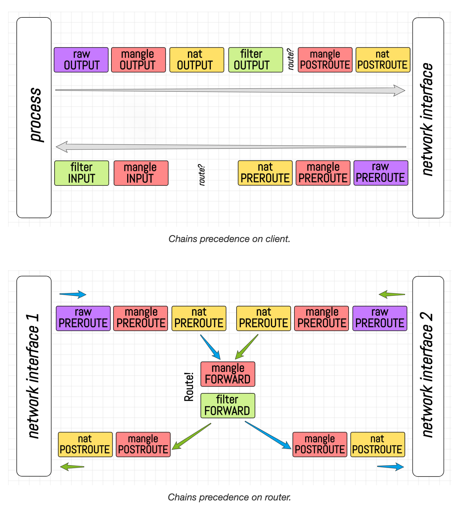

# Docker 容器网络原理与实践：从 Network Namespace、veth 到 Bridge、NAT

> 本文根据 Ivan Velichko 的文章 *How Container Networking Works: Building a Bridge Network From Scratch* 重新整理，并补充了 Linux 网络原理、完整实验、Docker 对照、生产实践和排障方法。
>
> 本文讨论的是 Linux 单机容器网络。实验会直接修改网络接口、路由和防火墙规则，请在可销毁的 Linux 虚拟机中操作，不要直接在重要服务器上照抄执行。

## 1. 学习目标

完成本文后，应当能够回答以下问题：

1. 容器为什么能拥有独立的网卡、IP、路由表和端口空间？
2. `ip link`、`ip addr`、`ip route` 分别管理什么？
3. veth pair 如何连接两个 Network Namespace？
4. 为什么多个容器需要 Linux Bridge，而不能简单地给每个 veth 配置同一个网段？
5. 容器如何访问宿主机、其他容器以及互联网？
6. Docker 的 `-p 8080:80` 底层做了什么？
7. 实际工作中如何定位容器网络不通的问题？

最终搭建的网络如下：

```text
                             Linux 宿主机（root netns）

      ns1                                                   ns2
┌─────────────────┐                                  ┌─────────────────┐
│ eth0            │                                  │ eth0            │
│ 172.30.0.10/24  │                                  │ 172.30.0.20/24  │
└────────┬────────┘                                  └────────┬────────┘
         │ veth pair                                           │ veth pair
         │                                                     │
     veth1                                                  veth2
         └──────────────────┐                 ┌────────────────┘
                            │                 │
                       ┌────┴─────────────────┴────┐
                       │ Linux Bridge: br-demo     │
                       │ Gateway: 172.30.0.1/24    │
                       └─────────────┬─────────────┘
                                     │ 路由、转发、NAT
                                  宿主机 eth0
                                     │
                                  外部网络
```

## 2. 先建立正确的心智模型

### 2.1 容器不是一台虚拟机

容器本质上仍然是宿主机上的 Linux 进程。它和宿主机共享同一个 Linux 内核，只是通过多种 Namespace 获得了彼此隔离的系统视图：

| Namespace | 主要隔离内容 |
| --- | --- |
| Network | 网卡、IP、路由表、邻居表、端口、netfilter 规则 |
| PID | 进程号和进程树 |
| Mount | 挂载点和文件系统视图 |
| UTS | hostname 和 domain name |
| IPC | 共享内存、消息队列、信号量 |
| User | UID、GID 和权限映射 |
| Cgroup | cgroup 层级视图 |
| Time | 单调时钟和启动时间偏移 |

Namespace 解决的是“进程能看到什么”，cgroup 解决的是“进程最多能使用多少资源”。容器通常还会结合 capabilities、seccomp、SELinux/AppArmor 和独立 root filesystem。

### 2.2 Network Namespace 隔离了什么

一个 Network Namespace 可以理解为一份独立的网络上下文，其中主要包含：

- 网络接口，例如 `lo`、`eth0`；
- IPv4 和 IPv6 地址；
- 路由表和策略路由；
- ARP/NDP 邻居表；
- TCP/UDP 端口空间；
- netfilter/iptables/nftables 规则；
- 网络相关的部分 sysctl 参数。

因此，两个容器都可以监听自己的 `0.0.0.0:80`，不会因为端口相同而冲突。它们的 `80` 端口位于不同的 Network Namespace 中。

### 2.3 `ip` 命令各子命令的职责

可以用下面的方式记忆：

| 命令 | 管理对象 | 常见操作 |
| --- | --- | --- |
| `ip netns` | Network Namespace | 创建、删除、进入 namespace |
| `ip link` | 网络接口/二层链路 | 创建、删除、改名、启停、迁移接口 |
| `ip addr` | 接口上的三层地址 | 添加、删除、查看 IP 地址 |
| `ip route` | 路由表 | 添加网关、选择出口接口 |
| `ip neigh` | 邻居表 | 查看 ARP/NDP 解析结果 |
| `bridge` | Linux Bridge | 查看端口、FDB、VLAN 等信息 |

一个接口可以没有 IP，也可以拥有多个 IP。`ip link set eth0 up` 只是启用接口，并不会自动给它分配地址；`ip addr add ... dev eth0` 只是绑定地址，也不保证接口已经启用。

## 3. 实验前准备

### 3.1 环境要求

- Linux 虚拟机，建议 Ubuntu 22.04/24.04；
- root 权限或 `sudo`；
- 已安装 `iproute2`、`iputils-ping`、`iptables`；
- 可选工具：`tcpdump`、`ethtool`、`conntrack`、`bridge`。

如果宿主机是 macOS 或 Windows，并且使用 Docker Desktop，那么容器实际运行在 Docker Desktop 管理的 Linux 虚拟机中。本文命令必须在 Linux 虚拟机里运行，不能直接在 macOS 网络栈上运行。

安装常用工具：

```bash
sudo apt update
sudo apt install -y iproute2 iputils-ping iptables tcpdump ethtool conntrack
```

### 3.2 避免网段冲突

本文使用 `172.30.0.0/24`。操作前先确认它没有和宿主机、VPN、Docker 或公司内网的已有路由冲突：

```bash
ip route
ip route get 172.30.0.10
```

如果已经存在相关路由，请换一个未使用的 RFC 1918 私网段，例如 `10.200.0.0/24`。

## 4. 观察宿主机的网络上下文

在创建 namespace 之前，先观察宿主机：

```bash
ip -br link
ip -br addr
ip route
ip neigh
sudo iptables -S
sudo iptables -t nat -S
```

其中：

- `ip -br link` 查看接口状态；
- `ip -br addr` 查看接口和 IP；
- `ip route` 查看内核如何选择下一跳；
- `ip neigh` 查看 IP 到 MAC 的解析结果；
- iptables/nftables 决定哪些流量允许通过以及是否进行地址转换。

## 5. 创建第一个 Network Namespace

创建名为 `ns1` 的 namespace：

```bash
sudo ip netns add ns1
sudo ip netns list
```

查看其中的网络环境：

```bash
sudo ip -n ns1 link
sudo ip -n ns1 addr
sudo ip -n ns1 route
```

也可以通过 `ip netns exec` 在 namespace 中执行任意命令：

```bash
sudo ip netns exec ns1 ip link
sudo ip netns exec ns1 bash
```

刚创建的 namespace 通常只有一个处于 `DOWN` 状态的 loopback 接口：

```bash
sudo ip -n ns1 link set lo up
```

`ip netns add` 会在 `/run/netns/` 下维护一个 namespace 引用。Docker 创建的容器 namespace 通常不会直接出现在 `ip netns list` 中，后文会介绍如何通过容器 PID 进入。

## 6. 用 veth pair 连接宿主机和 namespace

### 6.1 veth pair 是什么

veth 是成对出现的虚拟以太网接口，可以把它理解成一根虚拟网线的两端：

```text
veth1  <============================>  ceth1
       从一端发出的以太网帧会在另一端收到
```

veth 的重要特征：

- 永远成对创建；
- 每端都有独立的 ifindex 和 MAC 地址；
- 两端可以位于不同的 Network Namespace；
- 删除任意一端，另一端也会消失；
- 一端 `DOWN` 时，另一端通常也无法正常传输。

### 6.2 创建 veth pair

在宿主机 namespace 中执行：

```bash
sudo ip link add veth1 type veth peer name ceth1
```

命令含义：

```text
ip link add veth1       创建名为 veth1 的接口
type veth               接口类型为 veth
peer name ceth1         将配对端命名为 ceth1
```

查看结果：

```bash
ip link show veth1
ip link show ceth1
```

如果执行 `ip link add veth1 type veth` 而不显式指定 `peer name`，现代内核和 iproute2 通常仍会创建配对端，但名称由系统自动生成。veth 不可能只创建一端。实验和自动化中应当显式命名，避免后续难以定位。

### 6.3 将一端迁移到 ns1

```bash
sudo ip link set ceth1 netns ns1
```

此时宿主机直接执行 `ip link show ceth1` 会找不到它，因为它已经属于另一个网络上下文：

```bash
ip link show veth1
sudo ip -n ns1 link show ceth1
```

namespace 之间允许存在同名接口，所以可以把容器侧接口改成更符合日常习惯的 `eth0`：

```bash
sudo ip -n ns1 link set ceth1 name eth0
```

### 6.4 给两端配置地址并启用

先做一个最小的宿主机直连实验：

```bash
sudo ip addr add 172.30.0.1/24 dev veth1
sudo ip link set veth1 up

sudo ip -n ns1 addr add 172.30.0.10/24 dev eth0
sudo ip -n ns1 link set eth0 up
sudo ip -n ns1 link set lo up
```

查看状态：

```bash
ip -br addr show veth1
sudo ip -n ns1 -br addr
ip route
sudo ip -n ns1 route
```

配置 `172.30.0.10/24` 后，内核会自动产生一条直连路由：

```text
172.30.0.0/24 dev eth0 proto kernel scope link src 172.30.0.10
```

这条路由表达的是：目标地址如果属于 `172.30.0.0/24`，无需寻找路由器，直接从 `eth0` 发送并通过 ARP 查找目标 MAC。

### 6.5 检测是否连通

宿主机访问 ns1：

```bash
ping -c 3 172.30.0.10
```

ns1 访问宿主机：

```bash
sudo ip netns exec ns1 ping -c 3 172.30.0.1
```

进一步观察 ARP 和报文：

```bash
ip neigh show dev veth1
sudo ip -n ns1 neigh show dev eth0
sudo tcpdump -ni veth1 icmp or arp
```

`ping` 成功证明三层 ICMP 双向通信正常，但不代表 DNS、TCP 端口或应用服务一定正常。

### 6.6 为什么两端通常要在同一子网

`172.30.0.1/24` 和 `172.30.0.10/24` 都属于 `172.30.0.0/24`。因此两边都会自动产生直连路由，不需要额外路由器。

不同子网并非绝对不能通信。例如一端为 `10.0.0.1/24`，另一端为 `192.168.0.1/24`，仍可为对端添加 `/32` 直连路由。但这增加了配置复杂度，普通 Ethernet 直连实验没有必要这样设计。

### 6.7 两端设置相同 IP 会怎样

如果 veth 两端都配置 `172.30.0.1/24`，两个 namespace 都会把这个地址视为自己的本地地址：

```bash
ping 172.30.0.1
```

这个 ping 很可能只命中本 namespace 的本地协议栈，根本不会穿过 veth。因此即便成功，也不能证明链路连通。在更大的二层网络中，重复 IP 还会造成 ARP 抖动、连接时断时续和流量发往错误的 MAC。

原则是：同一二层网络中的接口可以位于同一子网，但地址必须唯一。

## 7. 为什么多个容器需要 Bridge

### 7.1 直接为多个宿主机 veth 配置同一网段的问题

假设再创建一个 namespace，并且仍然直接把宿主机侧 veth 配置为 `172.30.0.0/24`：

```text
172.30.0.0/24 dev veth1
172.30.0.0/24 dev veth2
```

宿主机出现两个指向相同前缀、但出口不同的直连路由。内核无法仅凭目标 IP 稳定判断应该从哪根“虚拟网线”发送，ARP 也会在错误的接口上发出。

根因在于：多个容器属于同一个二层广播域时，宿主机不应该为每个容器创建一个独立的三层网段出口，而应该先把这些二层端口接入同一台交换机。

### 7.2 Linux Bridge 是一台软件交换机

Linux Bridge 工作在二层，主要根据 MAC 地址转发以太网帧：

```text
                  Linux Bridge br-demo
               ┌────────────────────────┐
veth1 ──────────┤ port 1            FDB  │
veth2 ──────────┤ port 2                 │
               └────────────────────────┘
```

Bridge 会学习“某个源 MAC 从哪个端口出现”，并写入 FDB（Forwarding Database）：

```bash
bridge fdb show
```

已知单播会发往对应端口；广播、未知单播和部分组播会在其他端口泛洪。这个行为和物理交换机基本一致。

## 8. 从零搭建双容器 Bridge 网络

下面重新搭建一个结构清晰的完整实验。

### 8.1 清理上一节的直连实验

删除 `ns1` 时，namespace 中的 veth 端会被删除，它在宿主机上的 peer 通常也随之消失：

```bash
sudo ip netns del ns1
```

确认没有遗留：

```bash
ip link show veth1
```

如果接口仍然存在，再针对明确的接口执行：

```bash
sudo ip link del veth1
```

### 8.2 创建两个 namespace 和两对 veth

```bash
sudo ip netns add ns1
sudo ip netns add ns2

sudo ip link add veth1 type veth peer name ceth1
sudo ip link add veth2 type veth peer name ceth2

sudo ip link set ceth1 netns ns1
sudo ip link set ceth2 netns ns2

sudo ip -n ns1 link set ceth1 name eth0
sudo ip -n ns2 link set ceth2 name eth0
```

### 8.3 创建 Bridge 并接入宿主机侧 veth

```bash
sudo ip link add br-demo type bridge
sudo ip link set br-demo up

sudo ip link set veth1 master br-demo
sudo ip link set veth2 master br-demo

sudo ip link set veth1 up
sudo ip link set veth2 up
```

注意：`veth1` 和 `veth2` 作为 Bridge 的二层端口，通常不配置 IP。三层网关 IP 应该配置在 `br-demo` 上。这和物理交换机上的 access port 不配置主机 IP 是同一个思路。

查看 Bridge 结构：

```bash
bridge link
ip -d link show br-demo
```

### 8.4 配置两个 namespace

```bash
sudo ip -n ns1 link set lo up
sudo ip -n ns1 link set eth0 up
sudo ip -n ns1 addr add 172.30.0.10/24 dev eth0

sudo ip -n ns2 link set lo up
sudo ip -n ns2 link set eth0 up
sudo ip -n ns2 addr add 172.30.0.20/24 dev eth0
```

此时两个 namespace 已处于同一个二层网络，可以直接通信：

```bash
sudo ip netns exec ns1 ping -c 3 172.30.0.20
sudo ip netns exec ns2 ping -c 3 172.30.0.10
```

检查二层学习结果：

```bash
bridge fdb show br br-demo
sudo ip -n ns1 neigh
sudo ip -n ns2 neigh
```

### 8.5 让宿主机成为这个网络的网关

把网关地址配置在 Bridge 本身：

```bash
sudo ip addr add 172.30.0.1/24 dev br-demo
```

宿主机会自动增加：

```text
172.30.0.0/24 dev br-demo proto kernel scope link src 172.30.0.1
```

现在宿主机和两个 namespace 可以互相访问：

```bash
ping -c 3 172.30.0.10
ping -c 3 172.30.0.20

sudo ip netns exec ns1 ping -c 3 172.30.0.1
sudo ip netns exec ns2 ping -c 3 172.30.0.1
```

### 8.6 为容器添加默认路由

namespace 目前只知道 `172.30.0.0/24`，不知道其他目标应该交给谁，因此需要把宿主机 Bridge 地址设为默认网关：

```bash
sudo ip -n ns1 route add default via 172.30.0.1
sudo ip -n ns2 route add default via 172.30.0.1
```

验证内核选路：

```bash
sudo ip -n ns1 route
sudo ip -n ns1 route get 8.8.8.8
```

注意：添加默认路由只说明 namespace 知道把外部流量交给 `172.30.0.1`，并不代表宿主机已经允许转发，也不代表外部网络知道如何返回 `172.30.0.0/24`。

#### 默认路由到底表示什么

例如：

```text
default via 172.30.0.1 dev eth0
172.30.0.0/24 dev eth0 proto kernel scope link src 172.30.0.10
```

访问 `172.30.0.20` 时，会匹配更具体的直连路由，直接从 `eth0` 发出；访问 `172.16.0.2` 或 `8.8.8.8` 时，才会匹配 `default`：

```text
目标不属于 172.30.0.0/24
  → 下一跳选择 172.30.0.1
  → 通过 eth0 发出二层帧
```

这里的 `172.30.0.1` 是宿主机 `br-demo` 的地址。namespace 会先通过 ARP 找到网关的 MAC，再把报文交给 Bridge。默认路由并不是“把报文发往某个抽象的 br-demo”，而是“把不匹配更具体路由的报文交给下一跳 `172.30.0.1`，从指定接口发出”。

报文到达宿主机后，宿主机还会重新进行一次路由判断：

- 目标是宿主机自己的地址，例如 `172.16.0.2`：报文在宿主机本地交付，不会继续走宿主机的默认网关；
- 目标是互联网地址，例如 `8.8.8.8`：宿主机才会使用自己的 `default via 172.16.0.1 dev eth0`，把报文继续转发到上游网关。

可以分别让内核展示两次选路结果：

```bash
sudo ip -n ns1 route get 172.16.0.2
sudo ip -n ns1 route get 8.8.8.8
ip route get 172.16.0.2
ip route get 8.8.8.8
```

## 9. 让 namespace 访问互联网

完整的出站路径是：

```text
ns1:172.30.0.10
  → eth0
  → veth1
  → br-demo:172.30.0.1
  → 宿主机路由
  → SNAT/MASQUERADE
  → 宿主机外网接口
  → Internet
```

需要同时满足三个条件：

1. namespace 有默认路由；
2. 宿主机开启 IPv4 转发并允许 FORWARD；
3. 上游有返回路由，或者宿主机执行 SNAT/MASQUERADE。

### 9.1 开启 IPv4 转发

临时开启：

```bash
sudo sysctl -w net.ipv4.ip_forward=1
```

查看：

```bash
sysctl net.ipv4.ip_forward
```

生产环境如需持久化，应通过 `/etc/sysctl.d/*.conf` 纳入配置管理，而不是只写 `/proc/sys/net/ipv4/ip_forward`。

`ip_forward=1` 只开启宿主机的三层转发能力，并不会自动创建路由、放行防火墙或配置 NAT。不开启时，宿主机通常只处理目标是本机地址的报文；即使路由表中存在到外网的默认路由，来自 `br-demo`、目标为 `8.8.8.8` 的报文也可能在宿主机被丢弃。开启后，宿主机才会在 `br-demo` 和 `eth0` 之间执行路由转发。

如果使用 shell 重定向直接写 `/proc`，不要误以为下面的 `sudo` 会提升重定向权限：

```bash
# 可能失败：重定向由当前 shell 执行
sudo echo 1 > /proc/sys/net/ipv4/ip_forward
```

推荐使用：

```bash
sudo sysctl -w net.ipv4.ip_forward=1
```

### 9.2 配置 FORWARD 放行

先找出宿主机默认出口：

```bash
ip route show default
```

假设出口接口为 `eth0`，放行容器主动发出的流量以及对应返回流量：

```bash
sudo iptables -A FORWARD -i br-demo -o eth0 -j ACCEPT
sudo iptables -A FORWARD -i eth0 -o br-demo \
  -m conntrack --ctstate ESTABLISHED,RELATED -j ACCEPT
```

如果真实出口叫 `ens3`、`enp0s3` 等，应替换为真实名称。

### 9.3 配置源地址转换

`172.30.0.10` 是私网地址。互联网路由器通常不知道如何将响应送回这个地址，因此需要在离开宿主机时把源地址转换成宿主机外网地址：

```bash
sudo iptables -t nat -A POSTROUTING \
  -s 172.30.0.0/24 -o eth0 -j MASQUERADE
```

MASQUERADE 是一种适合出口地址可能变化的 SNAT。若服务器拥有固定公网地址，也可以使用显式 SNAT：

```bash
sudo iptables -t nat -A POSTROUTING \
  -s 172.30.0.0/24 -o eth0 -j SNAT --to-source 192.0.2.10
```

其中 `192.0.2.10` 只是文档示例地址，不能原样用于真实环境。

连接跟踪 conntrack 会记录转换关系，使返回报文能够恢复为原始目的地址，再转发回对应 namespace。

这条规则可以逐项读作：

```bash
iptables -t nat -A POSTROUTING \
  -s 172.30.0.0/24 \
  ! -o br-demo \
  -j MASQUERADE
```

- `-t nat`：操作 NAT 表；
- `-A POSTROUTING`：在路由已经决定出口、报文即将离开本机时处理；
- `-s 172.30.0.0/24`：只匹配容器网段作为源地址的报文；
- `! -o br-demo`：排除仍然要从容器 Bridge 发出的流量，避免容器到容器通信被改写；
- `-j MASQUERADE`：把源地址伪装成实际出口接口的地址。

例如容器访问 `8.8.8.8` 时，NAT 前源地址是 `172.30.0.10`，从宿主机 `eth0` 离开时可能被转换成宿主机的外网地址。响应到达宿主机后，conntrack 根据连接映射执行反向转换，再把响应送回 `172.30.0.10`。

`! -o br-demo` 是一个通用写法，会对所有非 Bridge 出口执行 NAT；生产环境如果只允许容器访问某个明确的公网接口，通常更安全地写成 `-o eth0` 或实际出口名，避免容器访问其他内部网络时被意外 NAT。NAT 本身也不会开启转发或放行防火墙，必须和 `ip_forward` 及 `FORWARD` 规则配合。

### 9.4 验证出站访问

先测试 IP 连通性：

```bash
sudo ip netns exec ns1 ping -c 3 1.1.1.1
```

再测试 DNS：

```bash
sudo ip netns exec ns1 getent hosts example.com
```

仅 `ping 1.1.1.1` 成功而域名失败，通常是 DNS 配置问题，不是 veth、Bridge 或 NAT 问题。

### 9.5 iptables 与 nftables

现代发行版逐渐使用 nftables。很多系统中的 `iptables` 实际上是 `iptables-nft` 兼容前端：

```bash
iptables --version
sudo nft list ruleset
```

生产环境应选择系统当前采用的一套防火墙管理方式，并与 firewalld、ufw、Docker、Kubernetes 等组件协调。不要同时用多套工具随意修改同一组 hook，否则规则顺序很难预测。

## 10. 实现 Docker 风格的端口发布

假设 ns1 中有服务监听 `172.30.0.10:8000`：

```bash
sudo ip netns exec ns1 \
  python3 -m http.server 8000 --bind 0.0.0.0
```

宿主机可以直接访问容器地址：

```bash
curl http://172.30.0.10:8000
```

但外部用户通常只知道宿主机地址。要实现类似：

```bash
docker run -p 8080:8000 image
```

需要把发往“宿主机 `8080`”的流量改写到“ns1 的 `8000`”。

### 10.1 外部流量的 DNAT

假设宿主机外网接口为 `eth0`，宿主机该接口地址为 `172.16.0.2`：

```bash
sudo iptables -t nat -A PREROUTING \
  -i eth0 -d 172.16.0.2 -p tcp --dport 8080 \
  -j DNAT --to-destination 172.30.0.10:8000
```

`172.16.0.2` 只是本文实验地址，实际操作时替换成宿主机外部接口的真实 IP。

允许新连接进入容器：

```bash
sudo iptables -A FORWARD \
  -i eth0 -o br-demo -p tcp \
  -d 172.30.0.10 --dport 8000 \
  -m conntrack --ctstate NEW,ESTABLISHED -j ACCEPT
```

客户端访问：

```text
宿主机IP:8080 → DNAT → 172.30.0.10:8000
```

DNAT 的处理顺序是：报文从外部接口进入 `PREROUTING`，先把目标从宿主机地址改成容器地址，再重新查路由，最后从 `br-demo` 发往容器：

```text
外部客户端
  → eth0
  → nat/PREROUTING
  → 目标 172.16.0.2:8080 改为 172.30.0.10:8000
  → 重新路由到 br-demo
  → filter/FORWARD
  → 容器服务
```

其中 `-d 172.16.0.2` 只匹配宿主机这个特定 IP，`-p tcp --dport 8080` 只匹配 TCP 的目标端口。若宿主机有多个入口地址，需按需要增加规则或去掉 `-d`。建议增加 `-i eth0`，明确只发布外部接口收到的流量。

`-m tcp` 在现代 iptables 中通常可以省略：指定 `-p tcp` 后直接使用 `--dport` 即可。

### 10.2 为什么宿主机本地访问还可能需要 OUTPUT DNAT

外部进入的报文经过 `PREROUTING`，但宿主机本地产生的报文通常从 `OUTPUT` 开始，不经过 `PREROUTING`。如果希望在宿主机执行 `curl 宿主机IP:8080` 也命中相同映射，可增加 OUTPUT 规则：

```bash
sudo iptables -t nat -A OUTPUT \
  -p tcp -m addrtype --dst-type LOCAL --dport 8080 \
  -j DNAT --to-destination 172.30.0.10:8000
```

真实 Docker 的规则比上述示例复杂，还要处理隔离链、回环地址、hairpin NAT、IPv6、用户自定义网络和安全策略。部分场景也可能使用用户态代理。

宿主机本地执行 `curl 宿主机IP:8080` 时，连接由本机进程产生，通常从 `OUTPUT` 链开始，不经过 `PREROUTING`。如果需要让本地访问也命中端口映射，可以增加：

```bash
sudo iptables -t nat -A OUTPUT \
  -d 172.16.0.2 -p tcp --dport 8080 \
  -j DNAT --to-destination 172.30.0.10:8000
```

可记忆为：外部进入的报文使用 `PREROUTING`，宿主机本地产生的报文使用 `OUTPUT`。两类流量经过 DNAT 后都会重新选路；本机产生的这类报文通常不经过 `FORWARD` 链。

### 10.3 DNAT、SNAT 和 MASQUERADE 的区别

| 类型 | 修改字段 | 常见用途 |
| --- | --- | --- |
| DNAT | 目的地址/端口 | 端口发布、负载均衡入口 |
| SNAT | 源地址 | 使用固定出口地址访问外部网络 |
| MASQUERADE | 动态源地址 | DHCP、拨号或地址可能变化的出口 |

记忆方式：

- 去哪里发生变化：DNAT；
- 从哪里来发生变化：SNAT；
- SNAT 的出口地址动态变化：MASQUERADE。

### 10.4 实战：不启动代理进程发布本机所有 IP 的端口

假设宿主机有一个 dummy 接口，其地址为 `192.168.0.2`，HTTP 服务只监听：

```text
192.168.0.2:5000
```

现在要求在不修改、不重启服务，也不启动额外监听进程的情况下，实现：

```text
宿主机任意本地 IPv4 地址:6000
                ↓ DNAT
         192.168.0.2:5000
```

这里所谓的 `0.0.0.0:6000` 是服务端的通配语义：宿主机当前以及之后新增的所有本地 IPv4 地址，其 `6000` 端口都应该可用。客户端实际访问的是某个具体地址，而不是把 `0.0.0.0` 当作正常的远程目标地址。

#### 为什么 REDIRECT 不够

最直观的尝试可能是：

```bash
sudo iptables -t nat -A PREROUTING \
  -p tcp --dport 6000 \
  -j REDIRECT --to-ports 5000
```

`REDIRECT` 是一种特殊 DNAT，它把流量重定向到本机，但不能显式选择任意目标 IP。外部报文通常会被重定向到入口接口的本地地址，例如：

```text
172.16.0.2:6000 → 172.16.0.2:5000
```

题目中的服务却只绑定 `192.168.0.2:5000`，不会接收发往 `172.16.0.2:5000` 或 `127.0.0.1:5000` 的连接。如果服务监听的是 `0.0.0.0:5000`，REDIRECT 才可能满足这个场景。

因此这里必须使用普通 DNAT，明确指定：

```text
--to-destination 192.168.0.2:5000
```

#### 为什么不能固定 `-d`

下面的规则只发布了一个固定地址：

```bash
sudo iptables -t nat -A OUTPUT \
  -d 172.16.0.2 -p tcp --dport 6000 \
  -j DNAT --to-destination 192.168.0.2:5000
```

它可以匹配 `172.16.0.2:6000`，却无法匹配之后新增的本地地址，例如检查程序临时创建的：

```text
10.123.45.67:6000
```

不写 `-d` 相当于不限制目标地址，也可以理解成匹配 `0.0.0.0/0`。

#### 挑战环境的通用规则

外部进入宿主机的流量经过 `PREROUTING`：

```bash
sudo iptables -t nat -A PREROUTING \
  -p tcp --dport 6000 \
  -j DNAT --to-destination 192.168.0.2:5000
```

宿主机本地产生的流量经过 `OUTPUT`：

```bash
sudo iptables -t nat -A OUTPUT \
  -p tcp --dport 6000 \
  -j DNAT --to-destination 192.168.0.2:5000
```

两条规则分别覆盖：

```text
外部客户端 → 宿主机任意IP:6000 → PREROUTING DNAT
宿主机进程 → 宿主机任意IP:6000 → OUTPUT DNAT
```

#### 实际环境更严谨的规则

完全省略 `-d` 也会匹配原本需要经过本机转发、目标端口恰好为 `6000` 的报文。实际环境如果只想发布本机地址，可以动态匹配本地地址类型：

```bash
sudo iptables -t nat -A PREROUTING \
  -p tcp --dport 6000 \
  -m addrtype --dst-type LOCAL \
  -j DNAT --to-destination 192.168.0.2:5000

sudo iptables -t nat -A OUTPUT \
  -p tcp --dport 6000 \
  -m addrtype --dst-type LOCAL \
  -j DNAT --to-destination 192.168.0.2:5000
```

`--dst-type LOCAL` 会根据当前路由信息匹配宿主机拥有的本地地址，也能覆盖之后新增的接口 IP，同时避免改写发往其他主机的普通转发流量。

#### 验证和排障

先确认原服务正常：

```bash
ip -br addr
ss -lntp | grep ':5000'
curl -v http://192.168.0.2:5000
```

再测试映射：

```bash
curl -v http://127.0.0.1:6000
curl -v http://172.16.0.2:6000
```

查看两个方向分别命中了哪条规则：

```bash
sudo iptables -t nat -L OUTPUT -n -v --line-numbers
sudo iptables -t nat -L PREROUTING -n -v --line-numbers
```

抓取改写前后的端口：

```bash
sudo tcpdump -ni any 'tcp port 5000 or tcp port 6000'
```

DNAT 不会创建一个真正监听 `6000` 的 socket，因此 `ss -lntp` 看不到 `:6000` 是正常现象。内核只是在报文路径中把目标地址和端口改写为已有服务的 socket。

这个例子的 DNAT 目标仍是宿主机自己的地址，因此最终是本地交付，通常不需要 `ip_forward`，也不经过 `FORWARD` 链。如果宿主机的 `INPUT` 策略较严格，需要注意 filter 表看到的通常已经是 DNAT 后的目标 `192.168.0.2:5000`。

添加正确规则前，应先删除排在前面的错误 DNAT 规则，否则旧规则可能首先匹配并把连接改写到错误地址：

```bash
sudo iptables -t nat -L OUTPUT -n -v --line-numbers
sudo iptables -t nat -L PREROUTING -n -v --line-numbers
```

确认编号后从较大的编号开始删除，避免删除一条后其余编号发生变化。

## 11. iptables 基础与 Docker 规则

前面的 NAT 和端口发布命令依赖 netfilter。`iptables` 不是一个独立的转发程序，而是操作 Linux 内核 netfilter 规则的命令行工具。现代发行版可能让 `iptables` 作为 `iptables-nft` 兼容前端运行，底层实际由 nftables 执行；学习时仍然可以先掌握表、链、匹配条件和动作这套模型。

### 11.1 先区分 netfilter、iptables 和 nftables

```text
Linux 内核
  └── netfilter：在报文路径上提供 hook
        ├── iptables：传统规则管理命令
        └── nftables：现代规则管理框架
```

- **netfilter**：内核中的报文拦截、过滤、修改和连接跟踪框架；
- **iptables**：配置 IPv4 netfilter 规则的传统命令；
- **ip6tables**：配置 IPv6 规则的传统命令；
- **nftables**：更现代的规则语言和命令，支持 IPv4/IPv6 统一管理。

先确认当前系统使用的后端：

```bash
iptables --version
sudo nft list ruleset
```

如果输出包含 `iptables v1.8.x (nf_tables)`，说明 `iptables` 命令通常是在操作 nftables 兼容层。生产环境应选定一套管理方式，避免 iptables、nftables、firewalld、ufw 和 Docker 同时无协调地修改规则。

### 11.2 报文经过哪些链

理解链最重要的方法是先记住报文路径。下面是简化的 IPv4 路径：

```text
外部报文进入接口
  ↓
raw PREROUTING
  ↓
mangle PREROUTING
  ↓
nat PREROUTING（DNAT）
  ↓
第一次路由判断
  ├── 目标是本机
  │     ↓
  │   filter INPUT
  │     ↓
  │   本机进程
  │
  └── 目标不是本机
        ↓
      filter FORWARD
        ↓
      mangle POSTROUTING
        ↓
      nat POSTROUTING（SNAT/MASQUERADE）
        ↓
      出口接口
```

宿主机本地产生的报文不经过 `PREROUTING`，而是：

```text
本机进程
  ↓
raw OUTPUT
  ↓
mangle OUTPUT
  ↓
nat OUTPUT（本地 DNAT）
  ↓
路由判断
  ↓
filter OUTPUT
  ↓
nat POSTROUTING（必要时 SNAT/MASQUERADE）
  ↓
出口接口
```

因此可以记忆为：

```text
外部进入：PREROUTING
发给本机：INPUT
经过本机转发：FORWARD
本机产生：OUTPUT
离开本机：POSTROUTING
```

实际 hook 顺序会受到内核版本、连接跟踪和其他模块影响，但这个模型足以解释 Docker 的大多数规则。

下面这张图把两类路径放在一起，确实很直观：上半部分是本机进程收发报文，下半部分是主机充当路由器时在两个网络接口之间转发报文。



阅读时注意箭头方向：

- 上半部分从 `process` 指向 `network interface`：本机进程产生的报文经过各表的 `OUTPUT`，然后经过 `POSTROUTING` 离开接口；
- 上半部分从 `network interface` 指向 `process`：外部报文先经过各表的 `PREROUTING`，路由判断目标是本机后，再经过 `INPUT` 到达进程；
- 下半部分从一个接口指向另一个接口：报文经过 `PREROUTING`，路由判断需要转发后进入 `FORWARD`，最后经过 `POSTROUTING` 离开另一接口；
- 图中的 `PREROUTE`、`POSTROUTE` 是 `PREROUTING`、`POSTROUTING` 的缩写。

它适合帮助记忆“报文在哪些 hook 上遇到哪些表”，但仍是简化图：路由可能因为 DNAT、策略路由或 packet mark 再次计算；Bridge netfilter、conntrack、security 表、IPv6 和 nftables 的实际路径也可能增加额外细节。另外，`nat` 表通常只为连接的首个报文决定 NAT 映射，后续报文由 conntrack 按已有状态处理，并不是每个报文都重新创建映射。

### 11.3 表（table）是什么

表表示规则的主要用途：

| 表 | 主要用途 | 常见链 |
| --- | --- | --- |
| `filter` | 允许、丢弃、拒绝报文 | `INPUT`、`FORWARD`、`OUTPUT` |
| `nat` | DNAT、SNAT、MASQUERADE | `PREROUTING`、`OUTPUT`、`POSTROUTING` |
| `mangle` | 修改报文标记、TTL、服务字段等 | 多数 hook |
| `raw` | 在连接跟踪前处理报文 | `PREROUTING`、`OUTPUT` |
| `security` | 与安全模块集成 | 依发行版和模块而定 |

过滤和地址转换是两个不同问题：

```text
filter：允许不允许通过？
nat：地址和端口要不要改写？
```

例如：

```bash
# 允许容器流量经过宿主机
sudo iptables -A FORWARD -i br-demo -o eth0 -j ACCEPT

# 把容器源地址改成出口地址
sudo iptables -t nat -A POSTROUTING \
  -s 172.30.0.0/24 -o eth0 -j MASQUERADE
```

第一条是 `filter` 表的放行，第二条是 `nat` 表的地址转换，不能互相替代。

### 11.4 链（chain）是什么

链是按顺序执行的规则列表。内置链由内核在对应 hook 上调用，常见内置链包括：

```text
INPUT       目标是本机的入站流量
OUTPUT      本机产生的流量
FORWARD     经过本机路由转发的流量
PREROUTING  路由前的入站流量
POSTROUTING 路由后的出站流量
```

也可以创建用户自定义链，把复杂规则拆开：

```bash
sudo iptables -N MY_CONTAINER_RULES
sudo iptables -A FORWARD -j MY_CONTAINER_RULES
sudo iptables -A MY_CONTAINER_RULES -i br-demo -o eth0 -j ACCEPT
```

自定义链中的 `RETURN` 表示返回调用它的上一条链继续执行：

```bash
sudo iptables -A MY_CONTAINER_RULES -j RETURN
```

Docker 自己会创建和维护多个链，例如：

```text
DOCKER
DOCKER-USER
DOCKER-FORWARD
DOCKER-ISOLATION-STAGE-1
DOCKER-ISOLATION-STAGE-2
```

不同 Docker 和发行版版本的具体链名可能不同，应以实际输出为准。

### 11.5 一条规则由哪些部分组成

以这条规则为例：

```bash
sudo iptables -A FORWARD \
  -i br-demo -o eth0 \
  -s 172.30.0.0/24 \
  -p tcp --dport 443 \
  -m conntrack --ctstate NEW,ESTABLISHED \
  -j ACCEPT
```

可以拆成：

```text
-A FORWARD                  加到哪条链
-i br-demo                  入接口
-o eth0                     出接口
-s 172.30.0.0/24            源地址
-p tcp --dport 443          协议和目标端口
-m conntrack --ctstate ...  连接状态
-j ACCEPT                   匹配后的动作
```

常用匹配条件：

| 参数 | 含义 |
| --- | --- |
| `-s` | 源 IP 或网段 |
| `-d` | 目标 IP 或网段 |
| `-i` | 入接口，只在入站路径可用 |
| `-o` | 出接口，在路由确定后可用 |
| `-p` | 协议，如 `tcp`、`udp`、`icmp` |
| `--sport` | 源端口 |
| `--dport` | 目标端口 |
| `-m conntrack --ctstate` | 连接状态 |
| `-m addrtype` | 是否为本机地址、组播地址等 |

常用动作：

| 动作 | 行为 |
| --- | --- |
| `ACCEPT` | 允许继续处理 |
| `DROP` | 静默丢弃 |
| `REJECT` | 丢弃并返回错误（例如 TCP reset 或 ICMP） |
| `LOG` | 写入内核日志后继续 |
| `DNAT` | 修改目标地址/端口 |
| `SNAT` | 修改源地址 |
| `MASQUERADE` | 用出口接口地址执行动态 SNAT |
| `RETURN` | 返回调用链 |

规则按顺序匹配，通常第一条命中的终止性动作会决定结果。因此规则顺序很重要：一条过早的 `ACCEPT` 或 `DROP` 可能使后面的规则永远没有机会匹配。

`nat` 表通常只为一个连接的第一个报文做 NAT 决策，后续报文由 conntrack 按照已经建立的映射自动处理。这也是为什么 NAT 规则需要和连接跟踪一起理解。

### 11.6 连接跟踪与状态匹配

Linux 的 conntrack 会记录连接状态，常见状态包括：

| 状态 | 含义 |
| --- | --- |
| `NEW` | 新连接的第一个或初始报文 |
| `ESTABLISHED` | 已建立连接的后续报文 |
| `RELATED` | 与已有连接相关的辅助连接 |
| `INVALID` | 无法识别或状态异常 |

典型的有状态防火墙写法是只允许新连接从容器出网，并允许对应返回流量：

```bash
sudo iptables -A FORWARD \
  -i br-demo -o eth0 \
  -m conntrack --ctstate NEW,ESTABLISHED,RELATED \
  -j ACCEPT

sudo iptables -A FORWARD \
  -i eth0 -o br-demo \
  -m conntrack --ctstate ESTABLISHED,RELATED \
  -j ACCEPT
```

不要简单地把所有 `eth0 → br-demo` 流量都放行，否则外部网络可能主动访问所有容器端口。对外发布服务时，应限制目标容器、目标端口和入口接口。

### 11.7 Docker 启动容器时会修改什么

以默认 Bridge 网络为例，Docker 通常会自动维护：

```text
docker0 Bridge
容器 veth 和容器 IP
容器默认路由
FORWARD 放行和隔离规则
容器出网的 MASQUERADE
-p 发布端口的 DNAT
DOCKER-USER 等管理链
```

例如：

```bash
docker run -d --name web -p 8080:80 nginx
```

概念上会产生两类 NAT：

```text
容器 → 外部网络：POSTROUTING MASQUERADE
外部/本机 → 容器：PREROUTING 或 OUTPUT DNAT
```

容器删除或网络断开时，Docker 会清理对应的动态规则。`--network host` 通常不需要为容器创建 veth 和 DNAT；`--network none` 通常不需要出网 NAT；用户自定义 Bridge 则会对应自己的 `br-<network-id>` 和规则。

检查 Docker 自动创建的规则：

```bash
sudo iptables -nvL
sudo iptables -t nat -nvL
sudo iptables -nvL DOCKER-USER
sudo iptables-save
docker network inspect bridge
```

如果系统使用 nftables，还应检查：

```bash
sudo nft list ruleset
```

### 11.8 `DOCKER-USER` 和防火墙安全边界

Docker 可能在自己的链中动态增删规则。需要添加长期自定义策略时，通常应优先考虑 `DOCKER-USER`，而不是直接改 `DOCKER` 链：

```bash
sudo iptables -I DOCKER-USER 1 \
  -i eth0 -o br-demo \
  -s 203.0.113.0/24 \
  -d 172.30.0.10 -p tcp --dport 8000 \
  -j ACCEPT
```

上面的示例允许指定来源网段访问容器端口，但单独添加 `ACCEPT` 并不会自动禁止其他来源。若安全策略要求只允许该来源，还需要在后面增加匹配同一目标的 `DROP`，并根据现有默认策略添加必要的 `RETURN`，避免误伤其他 Docker 流量。

`DOCKER-USER` 通常看到的已经是 DNAT 后的目标地址。如果需要按端口发布前的宿主机地址和端口过滤，可以使用 conntrack 的原始目标匹配，例如：

```bash
sudo iptables -I DOCKER-USER 1 \
  -i eth0 -p tcp --dport 8080 \
  -m conntrack --ctorigdst 172.16.0.2 --ctorigdstport 8080 \
  -j ACCEPT
```

不要随意设置：

```json
{"iptables": false}
```

关闭 Docker 自动管理 iptables 后，默认网络的 NAT、端口发布和转发可能失效，需要自行完整接管网络规则。

### 11.9 规则查看、计数器和排障

常用查看命令：

```bash
sudo iptables -L -n -v --line-numbers
sudo iptables -t nat -L -n -v --line-numbers
sudo iptables -S
sudo iptables -t nat -S
```

其中：

- `-L`：按链列表查看；
- `-n`：不做 DNS 反向解析；
- `-v`：显示接口和数据包计数器；
- `--line-numbers`：显示规则编号；
- `-S`：以可复制的命令格式显示规则。

规则计数器不增加时，可能是：

- 报文没有经过这条链；
- 接口名、地址或端口条件写错；
- 前面的规则已经接受或丢弃；
- 实际系统由 nftables、firewalld 或其他组件管理。

删除规则时应使用完全相同的匹配条件，把 `-A` 改为 `-D`；或者按编号删除，但删除前必须确认编号：

```bash
sudo iptables -L FORWARD --line-numbers
sudo iptables -D FORWARD <规则编号>
```

不要在远程服务器上随意执行 `iptables -F`、`iptables -t nat -F` 或修改默认策略，它们可能立即切断 SSH、破坏 Docker/Kubernetes 网络，且难以恢复。

### 11.10 推荐学习顺序

建议按以下顺序学习，而不是一开始背大量参数：

1. 先理解 `INPUT`、`OUTPUT`、`FORWARD` 三条 filter 链；
2. 学会用 `-s`、`-d`、`-i`、`-o`、`-p`、端口条件描述流量；
3. 学习 `ACCEPT`、`DROP`、`REJECT` 和规则顺序；
4. 学习 conntrack 和 `ESTABLISHED,RELATED`；
5. 再学习 `PREROUTING`/`POSTROUTING` 中的 DNAT、SNAT、MASQUERADE；
6. 最后观察 Docker 自动生成的规则，并用 `tcpdump` 和计数器验证路径。

推荐先查本机手册：

```bash
man iptables
man iptables-extensions
man iptables-restore
man nft
```

进一步阅读可以选择 Netfilter 项目的官方文档和 nftables wiki；旧版 iptables 教程可以用来理解概念，但执行命令前应结合当前发行版的 `iptables --version` 和实际后端进行验证。

阅读任何规则时，都先回答四个问题：报文从哪里来、要到哪里去、经过哪条链、命中后执行什么动作。

## 12. 报文到底如何流动

### 12.1 ns1 访问 ns2

```text
应用发送到 172.30.0.20
  → ns1 路由判断为同一子网
  → ARP 获取 ns2 eth0 的 MAC
  → ns1 eth0
  → veth1
  → br-demo 根据 FDB 转发
  → veth2
  → ns2 eth0
  → ns2 协议栈和应用
```

这主要是二层交换，不经过默认网关，也不需要 NAT。

### 12.2 ns1 访问互联网

```text
应用发送到 1.1.1.1
  → ns1 路由选择 default via 172.30.0.1
  → ARP 获取 br-demo 的 MAC
  → veth1 → br-demo
  → 宿主机开启 ip_forward 后执行三层转发
  → FORWARD 防火墙检查
  → POSTROUTING MASQUERADE
  → 外网接口
```

### 12.3 外部访问宿主机发布端口

```text
客户端 → 宿主机IP:8080
  → nat/PREROUTING DNAT 为 172.30.0.10:8000
  → 路由选择 br-demo
  → filter/FORWARD 检查
  → br-demo → veth1 → ns1 eth0
  → 服务进程
```

返回报文由 conntrack 自动执行反向地址转换，客户端看到的对端仍然是宿主机 IP 和 `8080` 端口。

## 13. Docker 网络模式与这些组件的对应关系

### 13.1 默认 bridge 模式

```bash
docker run --network bridge nginx
```

概念上对应：

- 为容器创建独立 Network Namespace；
- 创建 veth pair；
- 将一端放进容器并通常命名为 `eth0`；
- 将宿主机端加入 `docker0` 或用户自定义 Bridge；
- 为容器分配 IP、默认路由和 DNS；
- 配置转发、隔离、NAT 和端口发布规则。

默认的 `bridge` 网络通常对应宿主机上的 `docker0`：它是 Docker 创建的 Linux Bridge，作用类似一台软件交换机。连接到默认 `bridge` 网络的容器会通过 veth 接入 `docker0`，容器之间的同网段流量由它做二层转发，宿主机也可以通过 `docker0` 上的网关地址访问容器。容器访问外部网络时，仍然依赖宿主机的路由、IPv4 转发、防火墙和 NAT。

需要注意，`docker0` 不是“所有容器网络的总交换机”：

- `--network host` 的容器不经过 `docker0`，因为它直接共享宿主机 Network Namespace；
- `--network none` 的容器没有接入 `docker0`；
- 用户自定义 Bridge 通常使用另一个 `br-<network-id>` 接口；
- `docker0` 只解决当前节点上的默认 Bridge 网络，不直接连接其他物理主机或 Kubernetes 节点。

### 13.2 host 模式

```bash
docker run --network host nginx
```

容器共享宿主机 Network Namespace：

- 直接看到宿主机网卡和 IP；
- 和宿主机共享端口空间；
- 容器监听 `0.0.0.0:80` 就会占用宿主机的 `80`；
- 通常不再需要 `-p` 做端口映射。

### 13.3 none 模式

```bash
docker run --network none nginx
```

容器拥有独立 Network Namespace，但通常只有 loopback，没有可用于外部通信的接口。

### 13.4 container 模式

```bash
docker run --network container:another-container image
```

两个容器共享同一个 Network Namespace，因此共享网卡、IP、路由和端口空间，但仍可拥有不同的 Mount、PID 等 namespace。

### 13.5 Docker Network 不等于 Network Namespace

- Linux Network Namespace 是内核的隔离机制；
- Docker Network 是容器运行时提供的网络管理抽象；
- 一个 Docker bridge network 通常把多个容器的 Network Namespace 接入同一个 Linux Bridge；
- overlay、macvlan、ipvlan 等 driver 会组合使用其他 Linux 网络能力。

### 13.6 为什么更推荐用户自定义 Bridge

实际使用中通常更推荐创建用户自定义网络，而不是长期依赖默认 `bridge`：

```bash
docker network create app-net
docker run -d --name api --network app-net api-image
docker run -d --name web --network app-net web-image
```

用户自定义 Bridge 通常提供更清晰的隔离边界、容器名 DNS 解析以及更容易控制的连接关系。`web` 可以通过 `api` 这个容器名访问后端，而不应该依赖容易变化的容器 IP。

### 13.7 Kubernetes Pod 与 Network Namespace

Kubernetes 的基本网络单位是 Pod，不是单个业务容器。同一个 Pod 中的多个容器通常共享一份 Network Namespace：

- 共享 Pod IP 和路由表；
- 可以通过 `localhost` 互相访问；
- 不能监听相同的 IP/端口组合；
- CNI 插件负责创建或配置 veth、路由、Bridge、隧道或 eBPF 数据路径。

不同 CNI 的实现差异很大：有的使用 Linux Bridge，有的主要依赖三层路由，有的使用 VXLAN/IP-in-IP 隧道，还有的使用 eBPF 替代部分传统 iptables 路径。但 Network Namespace、接口、路由和策略仍然是排障时的重要观察点。

## 14. 实际工作中的查看方法

### 14.1 查看 Docker 容器的 Network Namespace

Docker namespace 通常不会直接显示在 `ip netns list`。可以先获取容器在宿主机上的 PID：

```bash
docker inspect -f '{{.State.Pid}}' <容器名或ID>
```

假设 PID 为 `12345`：

```bash
sudo nsenter -t 12345 -n ip -br addr
sudo nsenter -t 12345 -n ip route
sudo nsenter -t 12345 -n ip neigh
sudo ls -l /proc/12345/ns/net
```

查看宿主机侧信息：

```bash
docker network inspect bridge
ip -br link
bridge link
bridge fdb show
sudo iptables -nvL
sudo iptables -t nat -nvL
sudo nft list ruleset
```

### 14.2 通过 ifindex 找 veth 的配对端

接口输出中的 `eth0@if10` 表示该接口的 peer ifindex 是 `10`。可以在另一个 namespace 中寻找 ifindex 为 `10` 的接口。

部分驱动和 ethtool 版本还支持：

```bash
sudo ethtool -S veth1 | grep peer_ifindex
```

### 14.3 用 `ip route get` 判断真实路径

不要只盯着整张路由表，直接询问内核某个目标会怎么走：

```bash
ip route get 172.30.0.10
sudo ip -n ns1 route get 1.1.1.1
```

这通常能快速发现出口接口、源地址、下一跳或策略路由是否错误。

## 15. 容器网络排障方法

建议按照从底层到上层的顺序排查，而不是一开始就修改 iptables。

### 第 1 层：Network Namespace 是否正确

```bash
sudo ip netns list
sudo ip -n ns1 link
ls -l /proc/<PID>/ns/net
```

确认进程和网卡是否真的处于预期 namespace。

### 第 2 层：接口是否存在并启用

```bash
ip -br link
sudo ip -n ns1 -br link
```

关注：

- `UP`：管理状态已启用；
- `LOWER_UP`：底层链路可用；
- `NO-CARRIER` 或 `LOWERLAYERDOWN`：peer、Bridge 端口或底层链路可能未启用；
- MTU 是否一致。

### 第 3 层：IP 和掩码是否正确

```bash
ip -br addr
sudo ip -n ns1 -br addr
```

检查：

- 两端是否误用了同一个 IP；
- 掩码是否造成错误的直连范围；
- 接口上是否残留多个地址；
- 容器网段是否和宿主机、VPN 或其他容器网络重叠。

遇到：

```text
RTNETLINK answers: File exists
```

通常表示地址、路由或对象已经存在。先查看，不要盲目重复添加：

```bash
sudo ip -n ns1 addr show dev eth0
sudo ip -n ns1 route
```

修改单个地址时，优先精确删除：

```bash
sudo ip -n ns1 addr del 172.30.0.99/24 dev eth0
sudo ip -n ns1 addr add 172.30.0.10/24 dev eth0
```

`ip addr replace` 能覆盖相同前缀的配置，但不会自动删除接口上其他无关 IP。`ip addr flush` 会批量删除地址，生产环境必须谨慎。

### 第 4 层：路由是否完整

```bash
ip route
sudo ip -n ns1 route
sudo ip -n ns1 route get 1.1.1.1
```

典型错误：

- `Network is unreachable`：通常没有匹配路由；
- 目标同网段却走默认网关：掩码或策略路由可能错误；
- 相同前缀同时指向多个独立 veth：路由设计错误，应考虑 Bridge。

### 第 5 层：ARP/FDB 是否正常

```bash
ip neigh
sudo ip -n ns1 neigh
bridge fdb show br br-demo
bridge link
```

邻居长期为 `INCOMPLETE` 或 `FAILED`，说明 ARP 请求没有得到响应，常见原因包括接口未启用、peer 放错 namespace、Bridge 未接入、VLAN 不一致或对端地址错误。

### 第 6 层：逐跳抓包

按照报文路径同时抓包：

```bash
sudo ip netns exec ns1 tcpdump -ni eth0 icmp
sudo tcpdump -ni veth1 icmp
sudo tcpdump -ni br-demo icmp
sudo tcpdump -ni eth0 icmp
```

观察报文在哪个点消失：

- ns1 的 eth0 没有包：应用、路由或本地防火墙问题；
- ns1 有包但 veth1 没有：veth 状态或配对关系问题；
- br-demo 有包但外网口没有：转发、路由或 FORWARD 规则问题；
- 请求出去但响应没回来：上游路由、NAT 或外部防火墙问题；
- 响应到宿主机但没回 namespace：conntrack、FORWARD 或反向路由问题。

### 第 7 层：检查防火墙、NAT 和 conntrack

```bash
sudo iptables -nvL INPUT
sudo iptables -nvL FORWARD
sudo iptables -t nat -nvL
sudo nft list ruleset
sudo conntrack -L
```

重点查看规则计数器是否增长。规则存在但计数始终为零，通常说明报文根本没有经过该链、匹配条件错误，或者更前面的规则已经处理了报文。

### 第 8 层：检查传输层和应用层

```bash
sudo ip netns exec ns1 ss -lntup
curl -v http://172.30.0.10:8000
nc -vz 172.30.0.10 8000
```

常见情况：

- ping 通但 TCP 不通：服务没监听、监听错地址、端口防火墙阻止；
- `127.0.0.1:8000` 监听：只能在本 namespace 内访问；
- IP 可达但域名失败：DNS 配置问题；
- 小包正常、大包异常：MTU、PMTUD 或隧道封装问题。

## 16. 生产环境容易忽略的问题

### 16.1 防火墙策略

实验环境常使用默认 `ACCEPT`，生产环境应该采用明确的最小放行策略。需要同时考虑：

- 容器到外网；
- 外网到已发布端口；
- 容器之间是否允许横向访问；
- 宿主机到容器；
- ESTABLISHED/RELATED 返回流量；
- IPv4 和 IPv6 是否采用一致策略。

Docker 会维护自己的链。不要随意清空整个 iptables/nftables ruleset，否则可能同时破坏容器网络、主机防火墙和远程连接。

### 16.2 网段规划

容器网段与以下网络重叠时，选路很容易出错：

- 公司内网；
- VPN；
- 云 VPC；
- Kubernetes Pod/Service CIDR；
- 其他 Docker 网络。

生产前应集中规划地址空间，不能让每台机器随意选择 `172.16.0.0/12` 中的网段。

### 16.3 MTU

普通 Ethernet MTU 常为 `1500`。VXLAN 等隧道会增加封装头，如果容器仍使用 `1500`，底层网络又不支持更大的帧，可能出现大包丢失、HTTPS 卡住等问题。

检查：

```bash
ip link show
sudo ip -n ns1 link show eth0
ping -M do -s 1472 <目标IPv4地址>
```

隧道网络通常需要适当降低容器接口 MTU，例如 `1450`，实际值取决于封装方式和底层网络。

### 16.4 `rp_filter`

反向路径过滤会检查数据包源地址是否应该从当前接口返回。在多出口、策略路由、非对称路由场景中，严格模式可能丢弃原本合法的流量：

```bash
sysctl net.ipv4.conf.all.rp_filter
sysctl net.ipv4.conf.default.rp_filter
```

不要为了“先通再说”全局关闭它。应先确认真实路由设计，再按接口和安全要求配置。

### 16.5 Bridge netfilter

加载 `br_netfilter` 后，桥接流量可以进入部分 netfilter 路径：

```bash
sudo modprobe br_netfilter
sysctl net.bridge.bridge-nf-call-iptables
```

这会影响容器之间流量是否被 iptables 观察和过滤。Docker/Kubernetes 可能依赖相关设置，但纯二层 Bridge 实验并不总是需要它。生产环境应理解现有网络插件的要求，避免重复或相互冲突的过滤。

### 16.6 配置持久化和并发管理

手工 `ip`、`iptables` 命令大多不会在重启后自动恢复。生产环境应交给明确的管理层，例如：

- systemd-networkd、NetworkManager、netplan；
- nftables/firewalld；
- Docker、containerd 和 CNI 插件；
- Ansible、Terraform 等配置管理工具。

不要让多个管理组件同时“拥有”同一个 Bridge、接口或防火墙链。

### 16.7 Rootless 容器的差异

Rootless Docker/Podman 无法像 root 一样随意创建宿主机 Bridge、veth 和防火墙规则，常通过 `slirp4netns`、`pasta` 等用户态网络方案提供连接。因此在 rootless 环境中，宿主机上看到的链路和 NAT 路径可能与本文实验不同，吞吐、源地址保留和端口发布行为也可能有所差异。

## 17. 常用命令速查

### Namespace

```bash
ip netns add ns1
ip netns list
ip netns exec ns1 <command>
ip -n ns1 <object> <command>
ip netns del ns1
nsenter -t <PID> -n <command>
```

### Link 和地址

```bash
ip -br link
ip -br addr
ip link add veth1 type veth peer name ceth1
ip link set ceth1 netns ns1
ip link set veth1 up
ip addr add 172.30.0.1/24 dev veth1
ip addr del 172.30.0.1/24 dev veth1
```

### Bridge

```bash
ip link add br-demo type bridge
ip link set br-demo up
ip link set veth1 master br-demo
bridge link
bridge fdb show br br-demo
```

### 路由和邻居

```bash
ip route
ip route get 1.1.1.1
ip route add default via 172.30.0.1
ip neigh
```

### 抓包和套接字

```bash
tcpdump -ni any
tcpdump -ni br-demo arp or icmp
ss -lntup
```

## 18. 实验清理

清理前先确认名称，避免删除其他业务接口和规则。

删除本文示例中的端口映射和 NAT 规则时，应使用与添加时完全相同的匹配条件，只把 `-A` 改成 `-D`：

```bash
sudo iptables -t nat -D OUTPUT \
  -p tcp -m addrtype --dst-type LOCAL --dport 8080 \
  -j DNAT --to-destination 172.30.0.10:8000

sudo iptables -t nat -D PREROUTING \
  -i eth0 -p tcp --dport 8080 \
  -j DNAT --to-destination 172.30.0.10:8000

sudo iptables -D FORWARD \
  -i eth0 -o br-demo -p tcp \
  -d 172.30.0.10 --dport 8000 \
  -m conntrack --ctstate NEW,ESTABLISHED -j ACCEPT

sudo iptables -t nat -D POSTROUTING \
  -s 172.30.0.0/24 -o eth0 -j MASQUERADE

sudo iptables -D FORWARD -i br-demo -o eth0 -j ACCEPT
sudo iptables -D FORWARD -i eth0 -o br-demo \
  -m conntrack --ctstate ESTABLISHED,RELATED -j ACCEPT
```

如果真实外网接口不是 `eth0`，删除规则时也必须使用添加规则时的真实接口名。

删除 namespace 和 Bridge：

```bash
sudo ip netns del ns1
sudo ip netns del ns2
sudo ip link del br-demo
```

不要盲目把 `net.ipv4.ip_forward` 改回 `0`。如果操作前它已经开启，或者宿主机还有 Docker、Kubernetes、VPN、虚拟机网络等功能依赖转发，关闭后会破坏现有业务。应恢复为实验前记录的值。

## 19. 总结

单机容器网络并不是一种独立的“魔法网络”，而是多种 Linux 能力的组合：

```text
Network Namespace  提供独立网络视图
veth pair          连接不同网络上下文
Linux Bridge       把多个容器接入同一二层网络
IP route           决定报文下一跳和出口
ip_forward         让宿主机承担路由器角色
iptables/nftables  完成过滤、NAT 和端口发布
conntrack          维护连接状态和 NAT 映射
```

Docker 默认 Bridge 网络做的核心工作，正是自动创建和管理这些对象。理解这些底层组件之后，再看 Docker 网络、Kubernetes CNI、Service、NetworkPolicy、VXLAN、Calico 或 Cilium，就能沿着“namespace → link → bridge/路由 → 防火墙/NAT → 应用”这条路径逐层分析，而不是把容器网络当成一个不可解释的黑盒。
