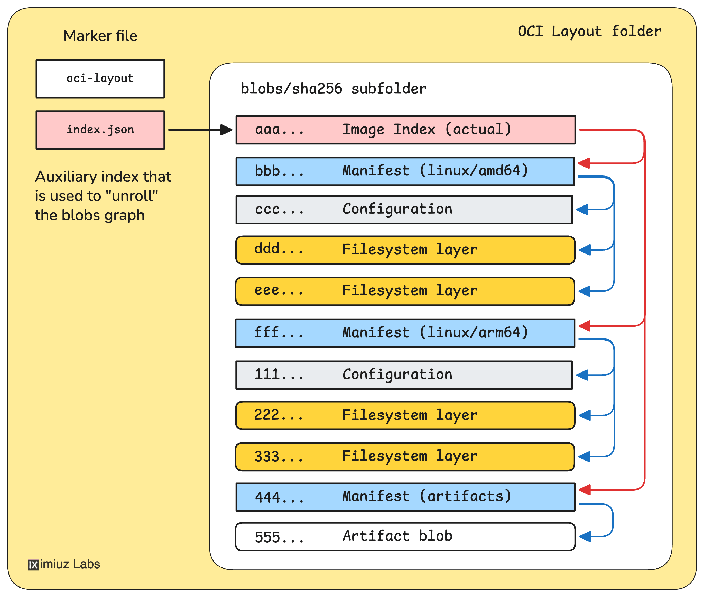

# 容器镜像内部结构详解

本文主要整理自 Ivan Velichko 的《How Container Images Actually Work: Layers, Configs, Manifests, Indexes, and More》和《How Container Registries Work: Pushing and Pulling Images By Hand》，并结合 OCI Image Spec、Distribution Spec 和 Runtime Spec 补充容易混淆的细节。

这篇教程最重要的价值，是把容器镜像从一个模糊的 `docker pull nginx:alpine` 拆成一组可以追踪的对象：

```text
镜像引用 tag/digest
  |
  v
Image Manifest 或 Image Index
  |
  +-- Image Config
  +-- Filesystem Layers
```

如果只用一句大白话概括，这篇博客讲的是：

> 容器镜像不是一个“大压缩包”，而是一张由 JSON 清单和文件系统 blob 组成的内容寻址图；不同对象分别负责运行、分发、平台选择和完整性校验。

可以把它类比成一套物流系统：

| OCI 对象 | 类比 | 真正保存的内容 |
| :--- | :--- | :--- |
| tag | 经常可以改指向的商品名 | 指向某个 manifest 或 index |
| Image Index | 多规格商品目录 | 不同 OS/CPU 对应哪个 manifest |
| Image Manifest | 一张装箱清单 | 要取哪个 config、哪些 layer blob |
| Image Config | 产品说明书 | 平台、启动默认值、未压缩层的身份 |
| Layer | 一个增量包裹 | 相对下层新增、修改或删除的文件 |
| digest | 内容指纹 | 对对象原始字节计算出的哈希 |

因此，文章不是在讲五个互不相关的术语，而是在回答三个连续的问题：

1. **运行问题**：启动容器需要怎样的 rootfs 和默认运行参数？
2. **分发问题**：registry 如何独立存储、校验、复用和传输 config 与 layers？
3. **平台问题**：同一个名称如何在 amd64、arm64 等机器上选择不同镜像？

理解这棵引用树后，下面这些问题会变得清楚：

- 为什么同一个 tag 在 `linux/amd64` 和 `linux/arm64` 机器上可能拉到不同镜像。
- 为什么同一个镜像换一种压缩方式推送后，repository digest 可能变化。
- 为什么 ImageID 和 repository digest 不是同一个概念。
- 为什么镜像层可以复用，删除文件又需要 whiteout。
- 为什么 SBOM、provenance、Helm chart 等非容器内容也能放进 OCI registry。

---

## 1. 总体心智模型

容器镜像不是一个单独的大 tar 包，而是一组通过 digest 互相引用的内容对象。

单平台镜像：

```text
image reference
  |
  v
OCI Image Manifest
  |
  +-- OCI Image Configuration
  |
  +-- layer blob
  +-- layer blob
  +-- ...
```

多平台镜像：

```text
image reference
  |
  v
OCI Image Index
  |
  +-- linux/amd64 manifest
  |     |
  |     +-- amd64 config
  |     +-- amd64 layers
  |
  +-- linux/arm64 manifest
        |
        +-- arm64 config
        +-- arm64 layers
```

几个对象的分工：

| 对象 | 解决的问题 | 是否单平台 |
| :--- | :--- | :--- |
| Filesystem Layer | 描述 rootfs 的一段文件系统变化 | 是，跟某个 config 配套使用 |
| Image Configuration | 描述平台、rootfs diff IDs、默认运行参数 | 是 |
| Image Manifest | 把 config 和 registry 中的 layer blob 绑定起来 | 是 |
| Image Index | 把多个平台的 manifest 绑定到一个入口 | 否 |
| OCI Image Layout | 把 registry 的内容寻址模型保存成本地目录 | 可单平台，也可多平台 |

一句话：

```text
config 定义“这是什么镜像”，manifest 定义“怎么分发这个镜像”，index 定义“不同平台该选哪个 manifest”。
```

### 1.1 Descriptor：串起所有对象的“指针”

Manifest 和 Index 不是直接把下级对象嵌进自己的 JSON，而是使用 descriptor 引用它们：

```json
{
  "mediaType": "application/vnd.oci.image.manifest.v1+json",
  "digest": "sha256:...",
  "size": 1234,
  "platform": {
    "os": "linux",
    "architecture": "amd64"
  }
}
```

常见字段含义：

| 字段 | 作用 |
| :--- | :--- |
| `mediaType` | 告诉客户端对象是什么格式、应该怎样解释 |
| `digest` | 告诉客户端对象内容的哈希，可用于寻址和校验 |
| `size` | 预期字节数，可用于校验和下载规划 |
| `platform` | Index 中常见，说明目标 OS、架构、variant 等 |
| `annotations` | 可选的人类或工具元数据 |

Descriptor 是理解 OCI 的关键抽象。Index、Manifest、Config 和 Layer 共同组成了一张有向图，边就是 descriptor，节点则是按 digest 存储的 blob。

```text
tag（可变引用）
  |
  v
index / manifest（不可变内容对象）
  |
  +-- descriptor --> config blob
  +-- descriptor --> layer blob
  +-- descriptor --> 其他 manifest 或 artifact
```

只要拿到正确的顶层 digest，就可以沿 descriptor 一层层找出整张对象图，并对每个对象重新计算 digest 验证内容是否被篡改。

---

## 2. Image Configuration

Image Configuration 是一个 JSON 文档，核心字段类似：

```json
{
  "architecture": "amd64",
  "os": "linux",
  "rootfs": {
    "type": "layers",
    "diff_ids": [
      "sha256:<uncompressed-layer-1>",
      "sha256:<uncompressed-layer-2>"
    ]
  },
  "config": {
    "Cmd": ["/bin/my-app"],
    "Env": [
      "PATH=/usr/local/sbin:/usr/local/bin:/usr/sbin:/usr/bin:/sbin:/bin",
      "FOO=bar"
    ],
    "User": "alice"
  }
}
```

关键点：

- `architecture` 和 `os` 是必需字段，所以 config 天然是单平台对象。
- `rootfs.diff_ids` 记录的是 layer **未压缩 tar 内容的 digest**。
- `config` 字段保存容器运行默认值，比如 `Entrypoint`、`Cmd`、`Env`、`User`、`WorkingDir`。
- `history` 字段常见于 Docker/BuildKit 构建出来的镜像，用来记录构建历史，但它本身不是运行容器所需的 rootfs。

需要注意：

```text
Image Configuration 不是单纯的“运行参数配置”。
它同时绑定了运行参数和 rootfs diff IDs。
```

所以两个镜像即使 `Cmd` 一样，只要 rootfs layer 的 diff IDs 不一样，它们的 config digest 也会不一样。

### 2.1 Config 同时绑定“平台”和“文件系统”

Image Configuration 有两个不能忽略的性质。

第一，它天然是单平台对象。一份 config 只有一组 `os` 和 `architecture`：

```text
linux/amd64 config
linux/arm64 config
```

多平台镜像不是“一份 config 同时支持多个平台”，而是每个平台分别拥有自己的 manifest、config 和 layers。

第二，它不只记录启动参数，还通过**有序的** `rootfs.diff_ids` 绑定了一套未压缩文件系统变化历史。因此它表达的完整语义是：

```text
使用这套 rootfs layers，
并按照这些 Cmd、Entrypoint、Env、User 等默认值运行。
```

`rootfs.diff_ids` 不是 Registry 中压缩 layer blob 的下载地址。它标识解压后的 changeset；真正告诉客户端去 Registry 下载哪些 blob 的是 Image Manifest。

---

## 3. Filesystem Layers

Layer 是文件系统变化集，也就是 OCI spec 里说的 filesystem changeset。

为了理解 layer，可以先把镜像文件系统想成一棵普通目录树。最简单的静态编译程序可能只需要：

```text
rootfs/
└── app
```

真实容器通常还需要 `/etc/passwd`、时区数据、动态链接库，或 Python、Node.js 等语言运行时。但 `/proc`、`/sys`、`/dev`、`/etc/hosts` 和 `/etc/resolv.conf` 等内容通常由容器运行时动态挂载或生成，不属于镜像的静态 layer。

一个最简单的单层镜像可以理解成：

```bash
tar --numeric-owner -C rootfs -cf layer.tar .
sha256sum layer.tar
```

这个 tar 的 digest 会进入 config 的：

```json
{
  "rootfs": {
    "type": "layers",
    "diff_ids": [
      "sha256:<uncompressed-layer-tar-digest>"
    ]
  }
}
```

真实镜像通常有多层。每一层只记录相对上一层的变化：

- 新增文件。
- 修改文件。
- 删除文件。

删除文件不能真的去改下面的只读 layer，所以用 whiteout 表示。

例如 lower layer 里有：

```text
/var/log/bootstrap.log
```

上层想删除它，会在 layer tar 里放一个特殊文件：

```text
/var/log/.wh.bootstrap.log
```

含义是：

```text
应用这一层时，把 lower layer 里的 /var/log/bootstrap.log 从合并视图中隐藏掉。
```

Layer 机制带来的好处：

- 多个镜像可以共享相同 base layers。
- registry 和本地 runtime 可以按 digest 去重。
- push/pull 时只需要传缺失的 layer。
- 构建缓存可以复用未变化的 layer。

### 3.1 Layer 是如何叠成最终 rootfs 的

假设有三层：

```text
L1: 添加 /etc/os-release 和 /bin/sh
L2: 添加 /usr/local/bin/app
L3: 修改 /etc/os-release，whiteout 删除 /bin/sh
```

运行时看到的不是三个目录，而是按 `L1 -> L2 -> L3` 顺序应用后的合并结果：

```text
/etc/os-release          来自 L3
/usr/local/bin/app       来自 L2
/bin/sh                  不可见，被 L3 的 whiteout 隐藏
```

顺序非常重要。即使 layer 集合完全相同，只要顺序不同，最终 rootfs 就可能不同，所以 `rootfs.diff_ids` 是有序数组，而不是集合。

容器启动后，镜像层通常保持只读，运行时会在最上面增加一个可写层：

```text
container writable layer   <- 容器运行期间的写入
image layer N              <- 只读
...
image layer 1              <- 只读
```

删除下层文件只是让它在合并视图中不可见，并不会从下层 blob 中抹掉。因此，某一层先加入 500 MB 文件、下一层再删除它，镜像通常仍然包含那 500 MB。要真正减小镜像，需要避免在前面的层中写入它，或把创建和清理放进同一个构建步骤。

### 3.2 Dockerfile 指令和 layer 不是严格一一对应

常见经验是“每条 Dockerfile 指令产生一层”，但这只是近似说法：

- `RUN`、`COPY`、`ADD` 通常会产生文件系统变化层。
- `ENV`、`CMD`、`ENTRYPOINT`、`USER` 等主要修改 image config，可能只留下 history 记录而没有新的 rootfs diff。
- BuildKit 可能复用缓存、生成空历史项，具体结果应以 config 的 `rootfs.diff_ids`、`history` 和 manifest 的 `layers` 为准。

因此，`docker history` 展示的是构建历史视角，不等于 registry 中 layer blob 的精确清单。

### 3.3 diff_id 和 layer digest 的区别

这是镜像格式里最容易混淆的点之一。

| 概念 | 位置 | 计算对象 |
| :--- | :--- | :--- |
| `diff_id` | image config 的 `rootfs.diff_ids` | 未压缩 layer tar |
| layer `digest` | image manifest 的 `layers[].digest` | registry 实际存储的 blob，通常是压缩后的 tar |

也就是说：

```text
config.rootfs.diff_ids[]  看未压缩内容
manifest.layers[].digest  看分发时的实际 blob
```

如果同一个 layer 内容用 gzip 和 zstd 分别压缩：

- 未压缩 tar 内容不变，`diff_id` 不变。
- 压缩 blob 字节不同，manifest 里的 layer digest 会变。
- manifest JSON 内容随之改变，repository digest 也会变。

### 3.4 Blob 不等于“压缩文件”

Blob 只是 Registry 中按 digest 寻址的一段原始字节，它可以是：

- 未压缩的 Image Configuration JSON。
- gzip、zstd 压缩或未压缩的 layer tar。
- SBOM、provenance、Helm chart 或其他 artifact payload。

Blob 是什么、是否压缩，由 descriptor 中的 `mediaType` 决定。Registry 对 blob 通常只需要做按 digest 存储和传输，不需要理解其中语义。

对一个常见的压缩 layer，完整链路是：

```text
文件系统 changeset
      |
      v
未压缩 layer.tar --sha256--> config.rootfs.diff_ids[i]
      |
      v gzip/zstd
压缩 layer blob   --sha256--> manifest.layers[i].digest
```

Pull 时先用 manifest digest 校验下载到的压缩字节，再解压并用 config 中的 `diff_id` 校验未压缩 changeset。

---

## 4. ImageID

OCI Image Spec 里的 ImageID 是 image configuration JSON 的 digest。

也就是：

```text
ImageID = sha256(image-config-json-bytes)
```

因为 config 里包含：

- `os`
- `architecture`
- `rootfs.diff_ids`
- 默认运行参数
- 构建历史等元数据

所以只要这些内容变化，ImageID 就会变化。

它的性质：

- ImageID 是单平台概念。
- ImageID 不依赖 tag。
- ImageID 不依赖 manifest/index annotation。
- ImageID 不依赖 layer 的压缩方式，因为 config 里记录的是未压缩 `diff_ids`。
- ImageID 依赖 config JSON 的精确内容，语义上差不多但 JSON 字节不同的 config 会得到不同 ImageID。

注意工具差异：

```text
一些工具的 IMAGE ID / ID 列不一定严格显示 OCI spec 里的 ImageID。
遇到疑问时，应该明确自己比较的是 config digest、manifest digest，还是 index digest。
```

还要区分“文件系统最终长得一样”和“ImageID 一样”。Config 里通常还包含 `created`、`history`、环境变量等字段，所以两个镜像即使解包后的最终文件完全相同，只要 config JSON 的任意字节不同，ImageID 仍然不同。

### 4.1 ImageID 记录在哪里

Image Configuration 不会把自己的 digest 写进自己；OCI ImageID 就是对 config 原始 JSON 字节计算得到的 digest。它会作为上级 Manifest 的 config descriptor 被记录：

```text
manifest.config.digest
        =
OCI ImageID
        =
sha256(image configuration bytes)
```

对多平台镜像，每个平台 Manifest 都有自己的 config，因此也有自己的 ImageID；不存在一个同时代表所有平台 config 的单一 ImageID。

ImageID 的常见用途包括：

- 定址和校验 Image Configuration blob。
- 标识本地单平台镜像的精确 config 和未压缩 layer 历史。
- 比较重压缩前后是否仍是同一份 config + `diff_ids`。

`docker pull repo@sha256:...` 通常不能使用 ImageID，因为 `@digest` 通过 Registry 的 `manifests/<digest>` 端点解析 Manifest 或 Index，而 Image Configuration 是通过 `blobs/<config-digest>` 获取的下级 blob。

---

## 5. Image Manifest

Image Manifest 是为分发而设计的清单文件。

简化结构：

```json
{
  "schemaVersion": 2,
  "mediaType": "application/vnd.oci.image.manifest.v1+json",
  "config": {
    "mediaType": "application/vnd.oci.image.config.v1+json",
    "digest": "sha256:<config-digest>",
    "size": 7023
  },
  "layers": [
    {
      "mediaType": "application/vnd.oci.image.layer.v1.tar+gzip",
      "digest": "sha256:<compressed-layer-digest>",
      "size": 32654
    }
  ]
}
```

Manifest 解决的问题：

```text
一个 tag 或 digest 需要指向一个入口对象；
这个入口对象需要告诉客户端应该下载哪个 config 和哪些 layer。
```

它不能直接用 image config 代替，因为：

- config 里的 `diff_ids` 是未压缩 layer digest。
- registry 分发时通常存压缩 blob。
- manifest 还需要记录 blob 的 `mediaType`、`size`、annotations 等分发元数据。

Manifest 的性质：

- 一个 manifest 指向一个 config。
- 一个 manifest 指向一组 layer blob。
- manifest 自身通常是单平台对象，因为它指向的 config 是单平台的。
- manifest 的 digest 是 manifest JSON 内容本身的 digest。

Manifest 不会在 JSON 中记录自己的 digest。如果把自己的 digest 写进内容，JSON 字节发生变化后 digest 也会继续变化，会形成自引用问题。Manifest digest 由上级 Index descriptor、Registry 的 tag 映射或 `Docker-Content-Digest` HTTP 响应头记录，也可以对 Registry 返回的原始 Manifest 字节重新计算。

可以把一份 Manifest 理解成“可分拆的装箱清单”：它不直接嵌入 Config 和 Layers，而是用 descriptor 引用各个独立 blob。这样客户端可以并行下载、跳过本地已有 blob，Registry 也可以在多个镜像之间复用相同 layer。

### manifest 里的 `layers` 可以为空吗

按 OCI Image Manifest 规范，`layers` 是必需数组，并且至少要有一个 descriptor。对于没有实际文件系统内容的特殊镜像或 artifact，通常使用规范定义的空 tar blob，或放入相应 artifact payload，而不是省略 `layers` 或使用空数组。

还要区分两件事：

- 容器镜像的 `layers` 通常指 filesystem changeset。
- OCI artifact 复用 manifest 结构时，`layers` 可以指 SBOM、Helm chart 等非 rootfs payload，其 `mediaType` 会说明内容类型。

所以“至少有一个 descriptor”是结构约束，但“至少有一个非空文件系统层”不是所有 OCI artifact 的语义约束。

---

## 6. Image Index

Image Index 是多平台镜像的入口。

简化结构：

```json
{
  "schemaVersion": 2,
  "mediaType": "application/vnd.oci.image.index.v1+json",
  "manifests": [
    {
      "mediaType": "application/vnd.oci.image.manifest.v1+json",
      "digest": "sha256:<amd64-manifest>",
      "size": 1234,
      "platform": {
        "os": "linux",
        "architecture": "amd64"
      }
    },
    {
      "mediaType": "application/vnd.oci.image.manifest.v1+json",
      "digest": "sha256:<arm64-manifest>",
      "size": 1234,
      "platform": {
        "os": "linux",
        "architecture": "arm64"
      }
    }
  ]
}
```

当执行：

```bash
docker pull nginx:alpine
```

简化流程是：

```text
1. 客户端请求 nginx:alpine。
2. registry 返回 manifest 或 index。
3. 如果返回 index，客户端根据本机平台选择匹配的 manifest。
4. 客户端下载该 manifest。
5. 客户端下载 manifest 引用的 config 和 layers。
```

所以多平台镜像不是一个同时包含所有 CPU 架构 rootfs 的大镜像，而是：

```text
一个 index + 多个单平台 manifest
```

每个平台 manifest 背后都有自己的 config 和 layers。

平台选择也不一定只比较 `os` 和 `architecture`。Descriptor 还可能出现：

- `variant`，例如 ARM 的 `v7`、ARM64 的 `v8`。
- `os.version`，Windows 容器尤其需要关注宿主与镜像版本兼容性。
- `os.features` 等更细粒度约束。

如果没有匹配的平台 manifest，客户端通常会报类似 `no matching manifest for ...`，而不是自动把 amd64 二进制变成 arm64 二进制。Docker Desktop 能借助 QEMU 模拟运行异构镜像，是运行环境额外提供的能力，不是 OCI Index 本身完成了 CPU 模拟。

---

## 7. Repository Digest

日常工具里说的 image digest 或 repository digest，通常指：

```text
镜像引用解析到的顶层 JSON 文档的 digest
```

如果引用指向单平台 manifest：

```text
repository digest = manifest digest
```

如果引用指向多平台 index：

```text
repository digest = index digest
```

它和 ImageID 的区别：

| 概念 | 哈希对象 | 常见用途 |
| :--- | :--- | :--- |
| ImageID | image config JSON | 标识一个单平台镜像配置和 rootfs diff history |
| Repository Digest | manifest 或 index JSON | 标识 registry 中某个 tag 当前解析到的分发入口 |

为什么同一个 ImageID 可能对应多个 repository digest？

因为 manifest/index 可以变化，而 config 不变：

- layer 从 gzip 改成 zstd，config 的 `diff_ids` 不变，但 manifest 的 `layers[].digest` 变。
- manifest/index 增删 annotations，config 不变，但顶层 JSON digest 变。
- Docker schema2 和 OCI mediaType 之间转换，可能导致 manifest JSON 变化。
- 多平台 index 增加 SBOM/provenance descriptor，某个平台的 config 不变，但 index digest 变。

需要纠正一个常见说法：

```text
“同一个镜像从一个 registry 搬到另一个 registry，digest 一定会变”是不准确的。
```

更准确的说法是：

```text
如果复制过程保持 manifest/index JSON 字节完全不变，digest 不会变。
如果复制过程发生重压缩、mediaType 转换、annotation 改写、index 重写等，digest 才会变。
```

所以 digest 适合用于固定一次具体发布结果：

```bash
docker pull nginx@sha256:<digest>
```

但看到两个 repository digest 不同，不应该立刻断定 rootfs 一定不同。还要继续比较 config digest / ImageID / diff IDs。

### 7.1 tag、digest 与可变性

`nginx:alpine` 中的 tag 是仓库里的可变引用。维护者再次推送后，同一个 tag 可以指向新的 manifest 或 index：

```text
昨天：nginx:alpine -> sha256:aaa...
今天：nginx:alpine -> sha256:bbb...
```

而 `nginx@sha256:aaa...` 是按内容寻址的不可变引用：内容只要改一个字节，digest 就对不上。生产部署用 digest pinning 可以避免 tag 漂移，但如果顶层是多平台 index，pin 的是整个平台集合；如果 pin 的是某个平台 manifest，则只固定那个单平台分发对象。两者含义不同。

Tag 是 Registry 维护的“名字到 digest”映射，并不存在于 Manifest JSON 内部。因此同一 Manifest 可以同时拥有多个 tag，而重新 push 相同 tag 只是移动这个映射：

```text
时间 T1：v1 -> sha256:111... -> Manifest A
时间 T2：v1 -> sha256:222... -> Manifest B
```

Manifest A 和它的 blobs 不会因 tag 移动而立即消失。它们可能还被其他 tag、index 或 manifest 引用，也可能保留到 Registry 后续执行垃圾回收。

### 7.2 `repo@sha256:...` 究竟指向什么

更精确的规则不是“多平台一定算 Index，单平台一定算 Manifest”，而是看镜像引用解析到的顶层文档：

```text
tag/digest -> Manifest    顶层 digest 就是 Manifest Digest
tag/digest -> Image Index 顶层 digest 就是 Index Digest
```

一个只有一个可运行平台的发布也可能被包在 Index 里，例如 Index 同时引用一个 `linux/amd64` Manifest 和 provenance。此时顶层仍然是 Index Digest。

```bash
docker pull repo@sha256:<index-digest>
```

固定整个 Index，客户端仍会在其中选择当前平台。

```bash
docker pull repo@sha256:<manifest-digest>
```

则直接固定某个单平台 Manifest。`@digest` 通常不能填 Config Digest / ImageID，因为 Config 不是 Registry 中的镜像顶层入口。

| 名称 | 哈希对象 | 上级记录位置 | 可否直接用于 `docker pull repo@...` |
| :--- | :--- | :--- | :--- |
| Index Digest | Image Index JSON | tag 映射或 layout 入口 | 可以 |
| Manifest Digest | Image Manifest JSON | Index descriptor 或 tag 映射 | 可以 |
| ImageID / Config Digest | Image Configuration JSON | `manifest.config.digest` | 通常不可以 |

---

## 8. Registry 里如何取这些对象

可以用 `crane` 查看：

```bash
crane manifest registry.iximiuz.com/single:latest
crane config registry.iximiuz.com/single:latest
```

也可以用 Docker：

```bash
docker buildx imagetools inspect --raw registry.iximiuz.com/multi:latest
```

通过 registry API 时，核心是对 manifest 或 blob 发请求。

查看 manifest/index：

```bash
curl -s \
  -H "Accept: application/vnd.oci.image.index.v1+json, application/vnd.oci.image.manifest.v1+json" \
  https://registry.example.com/v2/repo/name/manifests/latest | jq .
```

下载 blob：

```bash
curl -s \
  https://registry.example.com/v2/repo/name/blobs/sha256:<digest>
```

注意：

- `manifests/<reference>` 用于按 tag 或 digest 获取 manifest/index。
- `blobs/<digest>` 用于获取 config、layer 和 artifact payload 等普通 blob。
- 虽然 OCI layout 会把 manifest/index 也放在 `blobs/` 目录，但 Distribution API 为它们定义的是 `manifests` 端点，不能把两种存储视图混为一谈。
- 真实 registry 还会涉及鉴权、Accept header、Docker mediaType 兼容等问题。

### 8.1 Registry 中的 Blob API

Registry 核心上是一个内容寻址 blob store。已知 digest 时，Config、Layer 和 artifact payload 通过下面的端点下载：

```http
GET /v2/<repo>/blobs/<digest>
```

上传一个小 blob 的简化流程是：

```http
POST /v2/<repo>/blobs/uploads/
     -> Location: <upload-url>

PUT <upload-url>?digest=sha256:<digest>
```

大 blob 可以使用 `POST + PATCH + PUT` 分块上传。Push 前客户端还可以先用 `HEAD /blobs/<digest>` 检查对象是否已存在；这就是 Docker Push 显示 `Layer already exists` 的基础。

Distribution API 的 blob 访问仍带有 repository 路径和权限边界。同一 repository 内相同 digest 可以直接复用；跨 repository 时可能使用 cross-repository blob mount，而 Registry 底层是否全局去重属于实现细节，不应仅根据 digest 相同就假设任意 repository 都自动可读。

### 8.2 一次 pull 到底发生了什么

把各对象连起来，一次典型的多平台 pull 可以概括为：

```text
解析 registry/repository:tag
        |
        v
GET /v2/<name>/manifests/<tag>
        |
        v
收到 Index，校验其 digest
        |
        v
根据宿主平台选择 Manifest descriptor
        |
        v
下载并校验 Manifest
        |
        +-- 下载并校验 Config digest/size
        |
        +-- 查询本地是否已有各 Layer digest
                 |
                 +-- 已有：直接复用
                 +-- 没有：并行下载压缩 layer blobs
                              |
                              +-- 用 manifest digest/size 校验压缩字节
                              +-- 解压后用 config diff_id 校验 changeset
                              +-- 按顺序应用 layers，准备 snapshot
```

这里体现了内容寻址的三个直接收益：

- **完整性校验**：收到 blob 后重新计算 digest，发现传输损坏或内容不匹配。
- **去重**：本地或 registry 已有相同 digest 时，无需再存一份。
- **并行下载**：Manifest 给出了完整 layer 列表，不同 blob 可以并发获取。

Layers 逻辑上有严格顺序，但下载可以并行。解压应用时要处理文件新增、覆盖、元数据和 whiteout。现代实现通常使用 OverlayFS 或 snapshotter 保存快照链，不一定提前复制出一棵完整的平铺目录。

### 8.3 `docker pull` 和 `docker run` 的边界

典型 `docker pull` 会完成 Manifest/Index、Config 和 Layers 的下载与校验，并通常解压 layer、准备本地 snapshot。某些 lazy pulling、remote snapshotter 或 `no-unpack` 实现可以把部分解压延迟到容器创建或运行时。

Pull 下载的 Image Configuration 不是 runc 直接使用的 Runtime `config.json`：

| 对象 | 规范 | 产生时机 | 主要内容 |
| :--- | :--- | :--- | :--- |
| Image Configuration | OCI Image Spec | build/pull | 平台、默认 Cmd/Env/User、`diff_ids` |
| Runtime `config.json` | OCI Runtime Spec | create/run | process、mounts、namespaces、cgroup、capabilities、seccomp、rootfs 路径 |

`docker run` 可以理解为 `docker create + docker start`。在 create/run 阶段，Docker/containerd 会：

```text
读取 Image Configuration
        |
        +-- 合并 docker run 覆盖的命令、环境变量、mounts 和资源限制
        +-- 基于镜像 snapshot 创建容器可写层
        +-- 挂载形成容器 rootfs 视图
        +-- 准备 /proc、/sys、/dev 等动态内容
        +-- 生成 OCI Runtime config.json
        +-- 调用 runc 创建并启动容器
```

因此：

```text
docker pull 准备可复用的镜像模板。
docker run  从模板创建一个具体容器实例和 Runtime Bundle。
```

Registry 负责保存和分发 blob；containerd、Docker Engine、CRI-O 等本地镜像服务负责缓存、解压和 snapshot；`runc` 最终消费 Runtime Bundle 中的 `config.json` 和 `rootfs`，它通常不亲自拉取镜像。

### 8.4 一次 push 到底发生了什么

Push 与 Pull 基本相反，但顺序很重要：

```text
计算 Config 和各压缩 Layer blob 的 digest
        |
        +-- HEAD 检查 Registry 是否已有 blob
        +-- 上传缺失的 Layers，可以并行或分块
        +-- 上传 Image Configuration blob
        +-- 构造引用这些 blobs 的 Manifest
        +-- PUT /v2/<repo>/manifests/<tag> 最后发布
```

Manifest 必须在它引用的 blobs 已经存在后再提交，因此最后一次 Manifest PUT 很像“发布/提交”操作：之前上传的 blobs 只是未被顶层引用的内容，Manifest 成功绑定 tag 后镜像才有了统一入口。

多平台 Push 多一层：先确保各平台 Manifest 可以按 digest 访问，再上传引用它们的 Image Index，最后让 tag 指向这份 Index。Registry 仍使用同一组 `manifests/<reference>` API，客户端通过 media type 区分返回的是 Manifest 还是 Index。

### 8.5 鉴权、删除与垃圾回收

一个 repository 当前暴露的 tags 可以通过下面的 API 枚举，数量较大时要按 Registry 返回的链接做分页：

```http
GET /v2/<repo>/tags/list
```

现实 Registry 常见的鉴权不只是 Basic Auth，更常见的是 Bearer Token challenge：

```text
请求 /v2/ -> 401 + WWW-Authenticate
            -> 向认证服务申请带 repository scope 的 token
            -> Authorization: Bearer <token>
            -> 重试 Registry API
```

Basic Auth 可能用于简单私有 Registry，或用于向 token service 证明用户身份。两种方式都应基于 HTTPS。

删除 tag、Manifest 和 Blob 不是同一件事：

```text
移除 tag   只是删除或移动一个可变引用
删除 manifest 移除一份分发清单
删除 blob     真正删除 Config、Layer 或 artifact 字节
```

同一 Layer 可能被多份 Manifest 复用，直接删除 blob 可能损坏其他镜像。安全清理通常是先移除 tag/manifest 引用，再由 Registry 垃圾回收扫描不再可达的 blobs。删除 API、无 tag Manifest 保留和 GC 时机都依赖具体 Registry 产品，不能把“删 tag”等同于“立即释放存储”。

标准 Distribution API 中 Manifest/Index 应通过 `manifests/<reference>` 端点访问，不应依赖 `blobs/<manifest-digest>`。某些 Registry 底层虽然也把 Manifest 当内容 blob 保存，但是否允许从 Blob API 获取、是否支持按 tag 删除，都是实现细节。

---

## 9. OCI Artifact、SBOM 和 Provenance

OCI manifest 最初服务于容器镜像分发，但后来也被广泛用于分发非容器 artifact。

常见 artifact：

- SBOM
- provenance attestation
- vulnerability scan result
- Helm chart
- WASM module
- 任意构建产物

基本思路：

```text
payload 存为 blob
manifest 描述这些 blob
mediaType 表明 artifact 类型
```

Registry 并不要求 Manifest 引用的 payload 一定是 Linux rootfs。对 Registry 来说，Image Config JSON、压缩 layer、SBOM JSON 和 provenance statement 都只是按 digest 存储的 blob；客户端根据 descriptor 的 `mediaType` 或 artifact manifest 的 `artifactType` 解释其含义。

一个把平台镜像和供应链资料绑在一起的逻辑图可以是：

```text
Image Index
  |
  +-- linux/amd64 Image Manifest
  |      +-- amd64 Config
  |      +-- amd64 Layers
  |
  +-- linux/arm64 Image Manifest
  |      +-- arm64 Config
  |      +-- arm64 Layers
  |
  +-- Provenance Manifest -> provenance blob
  +-- SBOM Manifest       -> SBOM blob
  +-- Scan Manifest       -> vulnerability report blob
```

这些 artifact 分别回答：

- provenance：谁在什么 builder 上，使用哪个源码 commit、输入和构建参数产生了该镜像。
- SBOM：镜像包含哪些系统包、库和应用依赖。
- vulnerability report：某个扫描器在某个漏洞数据库版本下得到的扫描结果。

这里要注意一个现实差异：

```text
供应链附件不一定总是放在同一个 image index 里。
```

常见形态包括：

- index / manifest list 里出现 `unknown/unknown` 的 attestation descriptor。
- artifact manifest 通过 `subject` 指向被附加的镜像。
- registry 通过 Referrers API 查询某个 digest 的附件。

把 artifact descriptor 直接放进同一 Index 时，增删附件会改变 Index JSON，因此顶层 Index Digest 也会变。使用 `subject + Referrers API` 时，artifact manifest 从外部引用目标 Manifest/Index digest，可以在不改写目标对象的情况下添加附件。

所以排查多平台镜像时，看到 index 里有 `unknown/unknown` 不一定是坏镜像，它可能是 attestation、SBOM 或其他附加元数据。

统计真实平台时要过滤：

```bash
jq '[.manifests[]
  | select(.platform.os != "unknown" and .platform.architecture != "unknown")
] | length'
```

更稳妥一点，还要允许有些 descriptor 没有 `platform` 字段：

```bash
jq '[.manifests[]
  | select(.platform? and .platform.os != "unknown" and .platform.architecture != "unknown")
] | length'
```

Digest 只能证明附件字节没有在传输中被改写，不能自动证明 provenance 值得信任或 SBOM 一定准确。供应链验证还需要校验签名、签发者身份、证书链和构建策略。

---

## 10. OCI Image Layout

OCI Image Layout 是把 registry 的内容寻址模型保存成本地目录。



典型结构：

```text
layout/
├── oci-layout
├── index.json
└── blobs/
    └── sha256/
        ├── <digest-a>
        ├── <digest-b>
        └── <digest-c>
```

文件含义：

| 文件/目录 | 说明 |
| :--- | :--- |
| `oci-layout` | 标记 layout 版本 |
| `index.json` | 本地 layout 的入口 index |
| `blobs/sha256/*` | 内容寻址 blob，可能是 config、layer、manifest、index、artifact |

OCI Layout 的核心是：

```text
物理上：所有内容对象按 digest 平级保存。
逻辑上：通过 descriptor 组成 Index -> Manifest -> Config/Layers 的有向图。
```

例如：

```text
layout/index.json
        |
        v
blobs/sha256/<actual-image-index>
        |
        +-- amd64 manifest -> amd64 config + amd64 layers
        +-- arm64 manifest -> arm64 config + arm64 layers
        +-- artifact manifest -> artifact blob
```

`sha256:abc...` 在 descriptor 中包含算法和哈希值；在磁盘上则被拆成：

```text
sha256:abc...
      |
      v
blobs/sha256/abc...
```

因此文件名不包含 `sha256:` 前缀。可以使用 `sha256sum blobs/sha256/<hex>` 重新计算文件 digest，用 `wc -c` 对照 descriptor 中的 `size`。

打开 OCI layout 的方法：

```text
1. 读 index.json。
2. 找到 manifests[].digest。
3. 去 blobs/sha256/<digest-without-sha256-prefix> 打开下一个对象。
4. 如果是 index，继续选平台 manifest。
5. 如果是 manifest，继续打开 config 和 layers。
```

注意这里有两个容易混淆的 index：

| 名称 | 位置 | 作用 |
| :--- | :--- | :--- |
| layout `index.json` | OCI layout 根目录 | 本地 layout 的入口 |
| OCI Image Index blob | `blobs/sha256/*` | 多平台镜像的平台索引 |

它们结构相似，但概念不同。

Layout 根目录的 `index.json` 是本地入口或目录，可以通过 `org.opencontainers.image.ref.name` 等 annotation 保留 `latest` 之类的本地引用名。它可以直接引用单平台 Manifest，也可以引用位于 `blobs/` 中的实际多平台 Image Index，因此出现“Index 引用 Index”完全正常。

### 10.1 导出和检查 OCI Layout

要明确复制一个远程镜像的所有平台到标准 OCI Layout，更稳定的方式是：

```bash
skopeo copy --all \
  docker://registry.iximiuz.com/multi:latest \
  oci:multi-layout:latest
```

`--all` 表示复制 Image Index 中的全部平台，而不是只复制当前平台。然后从 `multi-layout/index.json` 开始沿 descriptor digest 递归读取 `blobs/sha256/*`。

`docker save` 的输出格式取决于 Docker 版本和 image store 后端：

```text
包含 oci-layout + index.json + blobs/  -> 标准 OCI Layout
包含 manifest.json + repositories    -> 传统 Docker Archive
```

某些环境可以先分别 `docker pull --platform linux/amd64` 和 `linux/arm64`，再用 `docker save` 导出。但本地是否能在同一 tag 下保留多平台对象、导出时是否保留 Index 和 artifacts，均依赖具体 Docker 实现，不应把这套流程当作所有版本的通用保证。

导出后能看到的是“这次导出所包含的可达 OCI 对象图”，不是整个 Registry repository 中的所有历史 tag、无引用 blob 和已删除对象。它也不是已经组装好的 Runtime Bundle：Layers 仍然是有序 changesets，需要处理解压、覆盖和 whiteout 才能得到最终 rootfs，Runtime `config.json` 也要到容器 create/run 时才生成。

还要注意：OCI Image Layout 是一种标准交换格式，不代表 Docker 或 containerd 的内部目录必须原样长成这样。具体实现可能使用自己的 metadata database、content store、snapshotter 和垃圾回收机制。不要手工修改 `/var/lib/docker` 或 containerd 数据目录来“编辑镜像”；研究和交换镜像时应使用 OCI layout、registry API 或相应 CLI。

---

## 11. 常用检查命令

查看远程镜像顶层文档：

```bash
docker buildx imagetools inspect --raw nginx:alpine | jq .
```

查看远程 manifest/index：

```bash
crane manifest nginx:alpine | jq .
```

查看 config：

```bash
crane config nginx:alpine | jq .
```

读取单平台 manifest 中的 config digest，也就是 OCI spec 意义上的 ImageID：

```bash
crane manifest registry.iximiuz.com/single:latest | jq -r '.config.digest'
```

查看引用当前解析到的顶层 manifest/index digest：

```bash
crane digest nginx:alpine
```

不建议把经过 `jq` 格式化的 JSON 再交给 `sha256sum` 计算对象 digest，因为空白、字段顺序或末尾换行发生变化都会产生不同哈希。优先读取 descriptor 已记录的 digest，或使用能对 registry 原始响应计算 digest 的命令。

查看多平台列表：

```bash
docker buildx imagetools inspect nginx:alpine
```

保存多平台镜像为 OCI layout：

```bash
skopeo copy --all docker://nginx:alpine oci:nginx-layout:alpine
```

沿 OCI Layout 的 digest 查看对象：

```bash
jq . nginx-layout/index.json
jq . nginx-layout/blobs/sha256/<index-or-manifest-digest-without-prefix>
sha256sum nginx-layout/blobs/sha256/<digest-without-prefix>
wc -c nginx-layout/blobs/sha256/<digest-without-prefix>
```

也可以用 Docker 导出 archive 研究本地对象。具体归档布局取决于 Docker 版本和 image store 后端，不应默认把 `docker save` 产物等同于标准 OCI Image Layout：

```bash
docker pull nginx:alpine
docker save nginx:alpine -o nginx.tar
mkdir nginx-save
tar -xf nginx.tar -C nginx-save
```

---

## 12. 教程主线评价

这组教程的主线是正确且很适合建立心智模型的：

- 先讲 config 和 layers，因为它们决定一个单平台镜像的运行内容。
- 再讲 manifest，因为 registry 需要一个分发清单。
- 再讲 index，因为多平台镜像需要再加一层平台选择。
- 再用 Distribution API 把 blob、Manifest、tag 串成 Push/Pull 流程。
- 最后讲 ImageID、repository digest、OCI layout 和 Runtime Bundle，帮助解释日常命令里的现象。

最值得保留的几个结论：

- Image Configuration 是单平台对象。
- Image Manifest 通常也是单平台对象。
- Image Index 才是多平台入口。
- `rootfs.diff_ids` 是未压缩 layer digest。
- manifest 里的 layer digest 是 registry 实际存储 blob 的 digest。
- ImageID 和 repository digest 不是一回事。
- 多平台镜像不是一个万能 rootfs，而是多个单平台镜像的集合。

---

## 13. 需要补充或纠正的地方

### 13.1 “镜像就是一个 archive”只是入门说法

教程开头说镜像本质上是一个 archive，这适合入门，但严格说不够准确。

更准确：

```text
镜像是一个内容寻址对象图。
它可以被导出成 tar 或 OCI layout，但 registry 里的镜像不是一个单独 archive。
```

### 13.2 “config + layers 就足够让 runc 启动容器”需要补一句

config 和 layers 足够还原 image rootfs，并生成运行配置的主要输入。

但 OCI runtime 真正启动容器需要的是 OCI runtime bundle：

```text
rootfs/
config.json
```

而且容器运行时还会注入：

- `/proc`
- `/sys`
- `/dev`
- `/etc/hosts`
- `/etc/resolv.conf`
- namespace、cgroup、mount、capabilities 等运行时设置

所以更严谨的表达是：

```text
image config + layers 是生成 runtime bundle 的核心输入，但不是 runc 看到的全部输入。
```

### 13.3 “至少一个 layer”要区分结构与语义

OCI Image Manifest 的 `layers` 数组至少要有一个 descriptor，这是结构要求。但该 descriptor 不一定代表非空容器 rootfs：空镜像可以引用空 tar，artifact 也可以引用非文件系统 payload。

更准确的记法是：

```text
Manifest 至少描述一个 layer/payload blob；
这个 blob 是否构成可运行容器 rootfs，要结合 config、mediaType 和 artifactType 判断。
```

### 13.4 “同一镜像换 registry digest 会变”要加条件

digest 是否变化取决于被 hash 的 JSON 字节是否变化。

如果复制过程完全保持 manifest/index JSON 不变，digest 不会变。

如果发生以下变化，digest 才会变：

- layer 重压缩。
- Docker mediaType 和 OCI mediaType 转换。
- annotation 改写。
- index 增删附件 descriptor。
- 工具重新序列化顶层 JSON。

### 13.5 ImageID 的 1:1 关系要限定在精确 config blob

可以说：

```text
一个精确的 image config blob 只有一个 ImageID。
```

但不要理解成：

```text
两个语义相同的镜像一定有同一个 ImageID。
```

因为 JSON 字节、history、created time 等字段变化都可能导致 config digest 变化。

### 13.6 attestation / SBOM 不一定都在 index 里

现代 OCI 生态里，附件可以通过多种方式表示：

- index 里的额外 descriptor。
- artifact manifest 的 `subject` 字段。
- registry referrers。

所以看到 `unknown/unknown` descriptor 时，要结合 mediaType 和 annotations 判断它是不是 provenance/SBOM，而不是简单认为它是一个平台镜像。

---

## 14. 最后总结

可以把容器镜像内部结构压缩成这几句话：

```text
Layer 是 rootfs 的差异 tar。
Config 描述平台、运行默认值和未压缩 layer diff_ids。
Manifest 描述 registry 里要分发哪些 config/layer blob。
Index 描述多个平台分别对应哪个 manifest。
ImageID 是 config digest。
Repository digest 通常是 manifest 或 index digest。
OCI layout 是把这些对象保存到本地目录的标准格式。
Pull 先解析 Index/Manifest，再下载、校验和准备 Config/Layers。
Push 先上传 blobs，最后提交 Manifest/Index 并绑定 tag。
Run 才会创建容器可写层、Runtime config.json 并调用 runc。
```

排查镜像问题时，先问清楚自己正在比较什么：

```text
比较 tag？       可能随时变。
比较 index？     多平台入口是否相同。
比较 manifest？  单个平台分发清单是否相同。
比较 config？    ImageID 是否相同。
比较 diff_ids？  未压缩 rootfs 历史是否相同。
比较 layer blob？registry 实际存储内容是否相同。
```

这比单纯看 `docker images` 里的 `IMAGE ID` 或 `docker pull` 输出要可靠得多。

---

## 15. 参考资料

- OCI Image Configuration: <https://specs.opencontainers.org/image-spec/config/>
- OCI Image Manifest: <https://specs.opencontainers.org/image-spec/manifest/>
- OCI Image Index: <https://specs.opencontainers.org/image-spec/image-index/>
- OCI Image Layer: <https://specs.opencontainers.org/image-spec/layer/>
- OCI Image Layout: <https://specs.opencontainers.org/image-spec/image-layout/>
- OCI Descriptor: <https://specs.opencontainers.org/image-spec/descriptor/>
- OCI Distribution Spec: <https://specs.opencontainers.org/distribution-spec/>
- OCI Runtime Spec: <https://specs.opencontainers.org/runtime-spec/>
