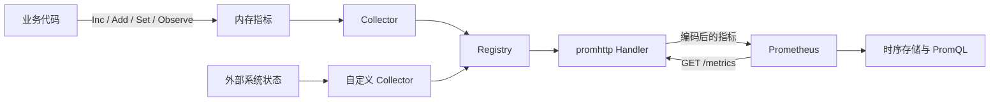

# Go 与 Prometheus：指标埋点、采集链路及工程实现详解

整理日期：2026-11-09。

本文回答：Go 程序通常怎样接入 Prometheus，为什么常见做法是“埋点 + `/metrics`”，如何实现，以及它与 Pushgateway、OpenTelemetry、StatsD、日志聚合等方案有什么取舍。

本文讨论通用工程设计，不代表已经审计某个现有项目的代码或生产配置。示例中的 `demo`、`manager` 都是说明用的名称；采集周期、桶边界、超时和告警阈值需要按实际系统调整。

## 阅读导航

- 第 1～4 节：整体架构、指标的工作方式、Pull 与 Push 的区别。
- 第 5～8 节：指标类型、Histogram、标签与命名。
- 第 9～11 节：完整 Go 示例、实现解释、业务埋点位置。
- 第 12～14 节：exporter、外部 API 采集、缓存及数据完整性。
- 第 15～17 节：Prometheus 配置、Kubernetes、PromQL 与告警。
- 第 18～21 节：替代方案、运行成本、故障处理、工程落地步骤。
- 第 22～24 节：常见问题、验证范围与官方资料。

## 1. 先回答核心问题：通常就是埋点，再通过 `/metrics` 暴露

对于一个持续运行的 Go HTTP 服务、RPC 服务或后台 worker，推荐起点通常是：

```text
业务事件发生
    ↓
Go 程序更新进程内的 Counter / Gauge / Histogram
    ↓
HTTP /metrics 暴露当前指标
    ↑ 定时发起 HTTP 抓取
Prometheus 或支持 Prometheus 协议的采集 agent
    ↓
本地时间序列存储，或 remote_write 到中心存储
    ↓
PromQL 查询、Grafana 展示、告警规则、Alertmanager
```

这里有一个关键点：调用 `counter.Inc()` 通常只是在进程内更新计数，**不会因此向 Prometheus 发一次 HTTP 请求**。

业务每秒执行 10 万次，可以在内存里累计 10 万次；Prometheus 仍然可以每 15 秒抓取一次。网络交互频率主要由抓取周期决定，而不是直接等于业务请求频率。

Prometheus 的经典模式是 HTTP Pull：由采集方主动抓取目标。服务发现解决“要抓哪些实例”，时序数据库保存历史，PromQL负责计算速率、比例和分位数。[官方架构概览](https://prometheus.io/docs/introduction/overview/)

一个比较合理的默认组合是：

| 层次 | 默认实现 | 负责什么 |
| --- | --- | --- |
| 业务指标 | Go 官方客户端 `client_golang` | 记录业务次数、结果、耗时 |
| 通用 HTTP 指标 | 框架 middleware 或 `promhttp` | 请求数、状态码、延迟、并发量 |
| 运行时指标 | Go / Process Collector | goroutine、GC、进程资源等 |
| 暴露入口 | 独立 registry + `/metrics` | 汇总并编码指标 |
| 抓取 | Prometheus / 采集 agent | 周期抓取、服务发现、目标状态 |
| 长期存储 | 按规模选本地 TSDB 或远端后端 | 保存历史和跨集群查询 |
| 使用 | PromQL、Grafana、告警规则 | 解释指标并采取行动 |

不必一开始就搭齐全部组件。单个服务接入已有监控平台，往往只需要前四层和一份抓取配置。

## 2. 一条指标从业务代码到图表，经历了什么

### 2.1 指标不是一张不断追加行的业务明细表

例如业务代码执行：

```go
requests.WithLabelValues("/v1/items/{id}", "get", "200").Inc()
```

内存中的一组计数可能从 `1024` 变为 `1025`。抓取时输出类似：

```text
# HELP demo_http_requests_total Number of completed HTTP requests.
# TYPE demo_http_requests_total counter
demo_http_requests_total{route="/v1/items/{id}",method="get",code="200"} 1025
```

Prometheus 再为这个观测值附上采集时间，并通常补充 `job`、`instance` 等目标标签。

```text
时间       值
10:00:00   1025
10:00:15   1175
10:00:30   1355
```

指标表示的是聚合状态。它没有保存这 330 个请求分别属于哪个用户、请求参数是什么、每一次究竟在何时发生。

因此：

| 需求 | 更合适的数据 |
| --- | --- |
| 最近 5 分钟错误率、P99、CPU 利用情况 | Metrics |
| 某次请求为什么失败、错误详情是什么 | Logs |
| 一次跨服务请求在哪个调用环节慢 | Traces |
| 订单对账、收费、不可丢失的审计 | 业务数据库或持久事件记录 |

这些数据可以关联，但不能互相完整替代。

### 2.2 `/metrics` 是当前观测面的出口，不是历史查询接口

对于直接埋点，客户端一般保存累计值和分布统计，`/metrics` 将其序列化。历史窗口、趋势图、昨日同比等由 Prometheus 或其他时序后端计算。

业务进程通常不需要为 Prometheus 维护“最近一小时所有请求”的数组，也不需要每 15 秒把 Counter 清零。

抓取后清零会破坏累计计数语义：两个 Prometheus 抓取时会互相干扰，抓取失败也可能导致整个周期的数据丢失。

### 2.3 Registry、Collector、Metric、Handler 的关系



用 Go 客户端的概念解释：

- **Metric**：一次可被编码的指标观测。
- **Collector**：在采集时提供一组指标；普通 Counter、Gauge 等也实现了 Collector。
- **Registry**：登记 Collector，并在抓取时收集它们的输出。
- **`promhttp.HandlerFor`**：把指定 registry 接到 HTTP 上。

Registry 不会自动理解你的订单、任务或集群，也不会替你查询业务数据库。需要什么业务语义，就由对应代码提供什么语义。

Go 客户端的常规指标操作支持并发；但自定义 Collector 和它读取的业务状态仍由实现者保证并发安全。[Go 客户端 API](https://pkg.go.dev/github.com/prometheus/client_golang/prometheus)

并发安全也不等于所有指标在同一个瞬间原子采样。例如业务刚给成功计数加一，但总数尚未更新，抓取可能看到短暂的不一致。如果多个值必须来自同一份业务快照，应在自定义 Collector 中一次读取并统一输出，而不是依赖多个独立 Gauge 的更新顺序。

### 2.4 暴露格式交给库处理

调试时常见的是上述文本格式，但真实抓取还涉及内容协商、OpenMetrics、Protobuf 和 Native Histogram 支持。

使用 `promhttp` 可以统一处理编码、内容类型和协商。手写拼接字符串容易遗漏标签转义、类型信息、格式细节及错误处理。`/metrics` 这个路径本身可以配置，协议也不要求只能使用这个名字。[指标暴露格式](https://prometheus.io/docs/instrumenting/exposition_formats/)

## 3. 为什么常驻 Go 服务通常优先使用 Pull

### 3.1 业务代码与监控网络链路解耦

业务只负责更新内存指标。即使 Prometheus 暂时不可达，业务请求也不需要等待网络重试或远端确认。

这可以减少以下工程负担：

- 不必在每个服务里实现发送队列、重试、退避和远端认证。
- Prometheus 地址变化通常不要求修改每个业务服务。
- 抓取周期和超时可以由监控平台统一管理。
- 监控平台维护不会直接把远端网络延迟加入业务请求。

但埋点并非没有成本：标签查找、原子操作、锁竞争、Histogram 更新及指标编码都消耗 CPU 和内存。这个成本通常更容易控制，但仍需要在高吞吐服务里测量。

### 3.2 抓取方可以直接观察“目标是否可抓取”

Prometheus 会为抓取生成 `up`：

```promql
up{job="demo-api"}
```

- `1`：本次抓取成功。
- `0`：本次抓取失败，例如连接、超时、解析或采集限制问题。
- 没有这条时序：目标可能未被发现、被移除，或标签查询不匹配。

`up=1` 只说明抓取成功，不能证明业务接口、数据库或 exporter 的上游 API 正常。对于缓存型 exporter，它甚至不能证明返回的数据是新的。

### 3.3 多个监控系统可以读取同一个指标出口

例如两个 Prometheus 副本同时抓取同一进程，业务 Counter 不需要分别维护两份，也不会因一个抓取方读取而清空。

代价是抓取、编码和外部 Collector 查询的负载会增加。如果两个副本都写中心存储，必须处理 HA 副本标签与后端去重，不能直接把两份观测相加。

### 3.4 Pull 的边界也要清楚

Pull 并不在所有条件下占优：

| 条件 | 问题 | 常见处理 |
| --- | --- | --- |
| 程序几秒就结束 | 可能完全错过抓取 | 常驻调度器观测、服务级批处理结果、合适时使用 Pushgateway |
| 中心无法访问目标网络 | 不能直接抓取 | 同网络部署 agent，再向中心发送 |
| 需要近乎实时逐事件处理 | 周期采样不合适 | 事件流或日志链路 |
| 指标数量极大 | 抓取和存储成本上升 | 降低标签基数、分片、合理周期 |
| 重启前的增量尚未被抓取 | 部分数据可能丢失 | 接受监控语义，关键业务计数另行持久化 |

“Pull 更合适”指的是特定系统下整体复杂度较低，并不意味着所有 Push 都不合理。

## 4. Pull、Push、remote_write、OpenTelemetry 不在同一个维度

很多讨论把不同层次混在一起。可以拆成三个问题：

1. **埋点 API 用什么？** `client_golang`、OpenTelemetry API、StatsD 客户端等。
2. **应用到采集层怎么传输？** HTTP Pull、OTLP Push、StatsD 等。
3. **采集层到中心怎么传输？** remote_write、OTLP、其他后端协议等。

因此，下面的结构完全合理：

```text
Go 应用 --提供 /metrics--> 本地 Prometheus agent
                                  |
                                  +-- remote_write --> 中心指标存储
```

应用侧仍然是 Pull，跨网络传输使用 Push。

同样，OpenTelemetry 也不等于只能 Push。它可以通过 Prometheus exporter 提供可抓取的指标端点；或者使用 OTLP 导出给 Collector。需要分别确认 Go SDK、具体 exporter 和 Collector 组件的版本与稳定性。本文核对的 Go 官方导出器文档仍将 Prometheus exporter 标为 Experimental，这不等于整个 OTel Metrics SDK 都处于实验阶段。[OTel Go exporters](https://opentelemetry.io/docs/languages/go/exporters/)

## 5. 指标类型怎么选

### 5.1 Counter：累计发生了多少次

适合请求次数、失败次数、处理字节数、重试次数等累计量。

```go
requests.Inc()
processedBytes.Add(float64(n))
```

Counter 在同一生命周期内只增加；进程重启等生命周期变化可以导致重置。通常用 `rate()` 或 `increase()` 解释其变化，而不是只看一个很大的累计数字。

不适合表示：当前队列长度、当前可用 CPU、当前连接数。这些值可以下降。

### 5.2 Gauge：现在是多少

适合队列长度、正在处理的任务数、可用容量、最近一次成功时间戳。

```go
queueDepth.Set(float64(depth))
inFlight.Inc()
defer inFlight.Dec()
lastSuccess.SetToCurrentTime()
```

常见错误是对“可用 CPU 核数”调用 `Inc()`，或者对一个会减少的量使用 Counter。

如果某个值已有权威来源，例如队列自身的长度、数据库连接池统计，优先读取权威状态，避免在多处维护第二份容易失配的计数。

### 5.3 Histogram：分布是什么样

适合请求耗时、任务耗时、响应大小、批次大小。

```go
started := time.Now()
defer func() {
    duration.Observe(time.Since(started).Seconds())
}()
```

注意 `defer` 需要闭包。下面这种写法会在注册 defer 时计算参数，通常测不到真正的完整耗时：

```go
// 错误：time.Since(started) 在这一行就求值。
defer duration.Observe(time.Since(started).Seconds())
```

Histogram 保存分布的统计表示，而不是每一次请求的完整明细。它允许服务端按时间窗口计算分位数，也便于跨实例聚合。

### 5.4 Summary：客户端计算预设分位数

Summary 可在应用内计算预先指定的分位数和窗口；Go 客户端需要配置分位数目标，不能假设声明一个 Summary 就自然有 P99。

主要限制是：**不同实例的 P99 不能直接平均成整个服务的 P99**。

Summary 的 `_sum` 和 `_count` 仍可以用于聚合平均值。不能聚合的是客户端已经计算好的分位数值。

| 你想回答的问题 | 优先类型 |
| --- | --- |
| 每秒处理多少请求 | Counter + `rate()` |
| 当前堆积多少任务 | Gauge |
| 整个服务的 P95/P99 | Histogram，链路支持时优先评估 Native Histogram |
| 有多少比例请求在 300ms 内完成 | 包含相应边界的 Classic Histogram，或有明确精度方案的 Native Histogram |
| 单进程特定窗口的预设分位数 | 特定需求下使用 Summary |

## 6. Classic Histogram、Native Histogram 和 Summary 的深入取舍

### 6.1 Classic Histogram 的桶是累计桶

假设配置边界：

```text
0.1s、0.3s、1s
```

观察到四次耗时：`0.05s、0.2s、0.8s、2s`。

输出大致为：

```text
request_duration_seconds_bucket{le="0.1"} 1
request_duration_seconds_bucket{le="0.3"} 2
request_duration_seconds_bucket{le="1"} 3
request_duration_seconds_bucket{le="+Inf"} 4
request_duration_seconds_sum 3.05
request_duration_seconds_count 4
```

`le="0.3"` 表示“小于等于 0.3 秒的累计次数”，不是“0.1 到 0.3 秒之间的次数”。不同桶不能再无脑求和，否则会重复计数。

### 6.2 桶边界应服务于业务问题

假设用户体验要求 95% 的请求不超过 300ms，至少应能可靠查询这个阈值附近的分布。

一个起点可以是：

```go
Buckets: []float64{0.005, 0.01, 0.025, 0.05, 0.1, 0.3, 0.5, 1, 2.5, 5}
```

这是本文演示 API 的配置，不能直接套到执行十几分钟的 batch job。后者应该使用秒到小时量级的边界。

桶太少，分位数估计粗；桶太多，每个标签组合产生的时序更多。阈值恰好落在 Classic Histogram 的桶边界时，可以直接利用该桶求阈值内比例；任意 P99 通常仍是估计值。

### 6.3 Native Histogram 为什么值得优先评估

Native Histogram 用一个直方图样本表达分布，通常采用指数桶，能够覆盖更宽的取值范围，减轻手工设置固定桶和经典桶时序扩张的问题。

截至本文核对的官方说明，Prometheus 已将 Native Histogram 作为稳定支持的能力，并在直方图实践文档中优先推荐。但它需要客户端、抓取端、传输、存储和查询整条链路支持。[Histogram 选型建议](https://prometheus.io/docs/practices/histograms/)

它不是“免费消除成本”：一个直方图样本可能包含许多桶，标签基数依然存在，样本体积、解码和查询仍有成本。

### 6.4 Go 端启用示例

在支持相关字段的 `client_golang` 中，可以使用：

```go
prometheus.HistogramOpts{
    Name:                            "demo_rpc_duration_seconds",
    Help:                            "RPC duration in seconds.",
    NativeHistogramBucketFactor:     1.1,
    NativeHistogramMaxBucketNumber:  160,
    NativeHistogramMinResetDuration: time.Hour,
}
```

这些参数是示例预算，不是通用最佳数值。桶增长因子影响分辨率；桶数限制和重置策略用于控制极端取值范围下的资源消耗。需要通过实际分布验证精度和开销。[HistogramOpts 定义](https://pkg.go.dev/github.com/prometheus/client_golang/prometheus#HistogramOpts)

采集端还需要按实际 Prometheus 版本设置 Native Histogram 抓取支持。当前文档使用 `scrape_native_histograms`；旧版本可能依赖 feature flag。remote_write 的 Native Histogram 发送与接收能力也需要单独核对，不能只改 Go 代码就认为完成迁移。[Native Histogram 规范与配置](https://prometheus.io/docs/specs/native_histograms/)

### 6.5 为什么本文完整示例仍采用 Classic Histogram

它便于直接用 `curl` 查看桶，也方便解释 PromQL 和跨实例聚合；同时不假定用户的现有采集与存储链路已经支持 Native Histogram。

对于新建且已验证整条链路的系统，优先评估 Native Histogram。对于已有 Classic Histogram，迁移还要检查仪表盘、录制规则和告警对 `_bucket`、`le` 的依赖。

**Breaking change 提醒：**从只提供经典桶切换为只提供原生直方图，可能让原来的 `_bucket` 查询失效。应准备新查询、验证后再切换；若临时双路暴露，要明确额外成本与退出时间。

## 7. 标签设计往往比选择哪个 SDK 更重要

### 7.1 一组标签值就是一条独立时序

下面两条是两条时序：

```text
demo_http_requests_total{route="/v1/items/{id}",method="get",code="200"}
demo_http_requests_total{route="/v1/items/{id}",method="get",code="500"}
```

假设有 50 个路由、4 种方法、6 种状态码、100 个实例，理论上可能达到：

```text
50 × 4 × 6 × 100 = 120,000 条 Counter 时序
```

实际值取决于哪些组合真正出现。高基数不仅增加服务端存储和查询成本，也可能让业务进程里的指标向量不断增长。

### 7.2 Histogram 会进一步放大成本

假设有 B 个有限边界，Classic Histogram 每组标签通常至少产生：

```text
B 个有限桶 + 1 个 +Inf 桶 + _sum + _count = B + 3 条时序
```

若 B=10，对上述 120,000 组标签应用同样维度，约为 1,560,000 条时序。这个估算不包括可能额外暴露的创建时间等信息。

因此并非所有指标都要带同一组标签。本文请求 Counter 带 `code`，延迟 Histogram 只带 `route`、`method`。如果确实需要按成功/失败拆延迟，可以评估一个有限集合的 `outcome` 标签，而不必默认复制所有状态码维度。

### 7.3 标签应有明确、受控的值域

| 标签 | 一般建议 | 原因 |
| --- | --- | --- |
| 路由模板 `/v1/items/{id}` | 推荐 | 数量受接口定义约束 |
| 原始路径 `/v1/items/123456` | 避免 | 每个资源 ID 可能生成一组时序 |
| `method` | 使用标准方法集合并归一化未知值 | 外部输入不能无限扩张 |
| `result=success/timeout/rejected` | 推荐 | 可稳定分类、可聚合 |
| 原始错误字符串 | 避免 | 参数、地址和动态文本导致高基数 |
| `request_id` / `trace_id` / `user_id` | 避免作为普通指标标签 | 随事件增长，适合日志或 trace |
| `cluster` / `tenant` | 按规模评估 | 不是天然禁止，也不是天然安全 |
| `pod` / `instance` | 通常由采集层附加 | 避免业务层重复定义 |

命名与标签实践明确强调避免无界、高基数维度。[官方命名与标签建议](https://prometheus.io/docs/practices/naming/)

### 7.4 Cluster、Tenant、Host 标签怎么判断能不能用

例如一个容量 exporter 的确需要按集群和租户展示资源。

应先计算：

```text
集群数 × 每集群租户数 × 资源种类 × 其他状态维度 × 采集副本影响
```

再问：

- 值域是否受管理？是否有持续增长的临时对象？
- 看板和告警真的需要每一个维度吗？
- 对象删除后，其时序是否停止暴露？
- 是需要所有 host 明细，还是只需要按集群汇总？
- 是否把每个任务运行 ID、临时 Pod UID 加进去了？

标签设计最终要对应实际查询，不应为了“以后可能用到”无限加入字段。

还应区分“exporter 部署在哪个 Kubernetes 集群”和“它正在观测哪个业务集群”。如果采集层和 exporter 都使用 `cluster` 且含义不同，会发生标签冲突。默认的冲突处理可能把被采集标签改名为 `exported_cluster`；更稳妥的是预先约定如 `k8s_cluster`、`observed_cluster` 等不同语义的名称，并检查实际入库标签。不要通过盲目开启 `honor_labels` 来掩盖设计冲突。

### 7.5 Exemplars 适合关联 trace

如果要从慢请求指标跳转到具体 trace，可以在链路支持的情况下使用 exemplar。它可以为部分观测附加 trace 关联信息，而不把每个 trace ID 变成新的主时序。

这仍需要客户端、抓取格式、存储与 Grafana 数据源共同支持；不能仅添加一个 `trace_id` 普通标签来代替。

## 8. 命名、单位和语义必须一致

推荐风格：

```text
demo_http_requests_total
demo_http_request_duration_seconds
demo_queue_depth
demo_jobs_in_flight
manager_cluster_available_cpu_cores
manager_cluster_available_memory_bytes
manager_exporter_last_success_timestamp_seconds
```

约定与理由：

| 项目 | 建议 | 好处 |
| --- | --- | --- |
| 计数 | `_total` | 容易识别累计量 |
| 时间长度 | 秒，`_seconds` | 跨库和查询统一单位 |
| 数据大小 | 字节，`_bytes` | 避免 MB/MiB 混淆 |
| 时间点 | `_timestamp_seconds` | 可用 `time() - metric` 求年龄 |
| 比率 | 通常用 0～1，说明单位 | 与百分比展示分离 |
| CPU 容量 | 明确是 cores、millicores 还是比例 | 避免 1000 倍误差 |
| 帮助文本 | 解释统计边界和含义 | 避免同名不同义 |

“available CPU”还需要说明是“allocatable 减 requests”“物理空闲量”“配额剩余量”中的哪一种。名称近似不代表口径一致。

同一指标的不同标签值应该表示同一种量，能够进行有意义的聚合。不要用一个模糊的 `resource_value{type=...}` 把字节、核数、请求次数混成同一指标。

## 9. 一个完整的 Go HTTP 服务接入示例

### 9.1 示例覆盖范围

以下程序提供：

- 业务入口：默认 `127.0.0.1:8080`。
- 指标入口：默认 `127.0.0.1:9091/metrics`。
- 请求 Counter：按路由模板、方法、状态码区分。
- 请求耗时 Classic Histogram：按路由模板、方法区分。
- 正在执行的请求 Gauge。
- 按业务结果区分的 Counter。
- Go 运行时、进程 Collector，以及指标接口自身的基础统计。
- 信号退出、HTTP 超时和有界的关闭等待。

示例接口只校验正整数 ID 并返回 JSON，不访问真实数据库，也不代表一次真实的商品查询。将其替换成现有业务逻辑时，应同步定义成功、失败和耗时的边界。

### 9.2 初始化和安装依赖

在一个新的示例目录里执行：

```bash
go mod init example.com/prometheus-demo
go get github.com/prometheus/client_golang@latest
```

把下一段保存为 `main.go`，再运行：

```bash
go mod tidy
go run .
```

使用官方命令维护 `go.mod` 和 `go.sum`。最新客户端可能要求比现有项目更高的 Go 版本；安装时应查看工具链要求，并遵循项目依赖策略。路径参数 API 需要 Go 1.22 或更新版本，但依赖自身的最低要求可能更高。

### 9.3 完整代码

```go
package main

import (
	"context"
	"errors"
	"flag"
	"fmt"
	"log"
	"net/http"
	"os"
	"os/signal"
	"strconv"
	"syscall"
	"time"

	"github.com/prometheus/client_golang/prometheus"
	"github.com/prometheus/client_golang/prometheus/collectors"
	"github.com/prometheus/client_golang/prometheus/promhttp"
)

type appMetrics struct {
	registry *prometheus.Registry
	requests *prometheus.CounterVec
	duration *prometheus.HistogramVec
	inFlight *prometheus.GaugeVec
	lookups  *prometheus.CounterVec
}

func newAppMetrics() *appMetrics {
	m := &appMetrics{
		registry: prometheus.NewRegistry(),
		requests: prometheus.NewCounterVec(prometheus.CounterOpts{
			Name: "demo_http_requests_total",
			Help: "Number of completed HTTP requests.",
		}, []string{"route", "method", "code"}),
		duration: prometheus.NewHistogramVec(prometheus.HistogramOpts{
			Name:    "demo_http_request_duration_seconds",
			Help:    "HTTP handler duration in seconds.",
			Buckets: []float64{0.005, 0.01, 0.025, 0.05, 0.1, 0.3, 0.5, 1, 2.5, 5},
		}, []string{"route", "method"}),
		inFlight: prometheus.NewGaugeVec(prometheus.GaugeOpts{
			Name: "demo_http_requests_in_flight",
			Help: "Number of HTTP requests currently being handled.",
		}, []string{"route"}),
		lookups: prometheus.NewCounterVec(prometheus.CounterOpts{
			Name: "demo_item_lookups_total",
			Help: "Number of item lookup attempts by business result.",
		}, []string{"result"}),
	}
	m.registry.MustRegister(
		m.requests, m.duration, m.inFlight, m.lookups,
		collectors.NewGoCollector(),
		collectors.NewProcessCollector(collectors.ProcessCollectorOpts{}),
	)
	for _, result := range []string{"success", "invalid_id"} {
		m.lookups.WithLabelValues(result)
	}
	return m
}

func (m *appMetrics) instrument(route string, next http.Handler) http.Handler {
	labels := prometheus.Labels{"route": route}
	return promhttp.InstrumentHandlerInFlight(
		m.inFlight.With(labels),
		promhttp.InstrumentHandlerDuration(
			m.duration.MustCurryWith(labels),
			promhttp.InstrumentHandlerCounter(m.requests.MustCurryWith(labels), next),
		),
	)
}

func newAPIMux(m *appMetrics) *http.ServeMux {
	mux := http.NewServeMux()
	mux.Handle("/v1/items/{id}", m.instrument("/v1/items/{id}", http.HandlerFunc(
		func(w http.ResponseWriter, r *http.Request) {
			if r.Method != http.MethodGet {
				w.Header().Set("Allow", http.MethodGet)
				http.Error(w, "method not allowed", http.StatusMethodNotAllowed)
				return
			}
			id, err := strconv.ParseInt(r.PathValue("id"), 10, 64)
			if err != nil || id <= 0 {
				m.lookups.WithLabelValues("invalid_id").Inc()
				http.Error(w, "invalid item id", http.StatusBadRequest)
				return
			}
			// Demonstration response; a real lookup belongs here.
			m.lookups.WithLabelValues("success").Inc()
			w.Header().Set("Content-Type", "application/json")
			fmt.Fprintf(w, "{\"id\":%d}\n", id)
		},
	)))
	mux.HandleFunc("/healthz", func(w http.ResponseWriter, r *http.Request) {
		w.WriteHeader(http.StatusNoContent)
	})
	mux.Handle("/", m.instrument("__unmatched__", http.NotFoundHandler()))
	return mux
}

func run() error {
	apiAddr := flag.String("listen", "127.0.0.1:8080", "API listen address")
	metricsAddr := flag.String("metrics-listen", "127.0.0.1:9091", "Metrics listen address")
	flag.Parse()
	m := newAppMetrics()
	metricsMux := http.NewServeMux()
	metricsMux.Handle("/metrics", promhttp.InstrumentMetricHandler(
		m.registry,
		promhttp.HandlerFor(m.registry, promhttp.HandlerOpts{
			ErrorLog:            log.Default(),
			MaxRequestsInFlight: 4,
			Timeout:             4 * time.Second,
		}),
	))
	servers := []*http.Server{
		{
			Addr: *apiAddr, Handler: newAPIMux(m),
			ReadHeaderTimeout: 3 * time.Second,
			WriteTimeout:      10 * time.Second,
			IdleTimeout:       60 * time.Second,
		},
		{
			Addr: *metricsAddr, Handler: metricsMux,
			ReadHeaderTimeout: 3 * time.Second,
			WriteTimeout:      5 * time.Second,
			IdleTimeout:       60 * time.Second,
		},
	}
	ctx, stop := signal.NotifyContext(context.Background(), os.Interrupt, syscall.SIGTERM)
	defer stop()
	serverErrors := make(chan error, len(servers))
	for _, server := range servers {
		go func(s *http.Server) {
			log.Printf("listening on %s", s.Addr)
			if err := s.ListenAndServe(); err != nil && !errors.Is(err, http.ErrServerClosed) {
				serverErrors <- fmt.Errorf("listen %s: %w", s.Addr, err)
			}
		}(server)
	}
	var runErr error
	select {
	case <-ctx.Done():
	case runErr = <-serverErrors:
	}
	shutdownCtx, cancel := context.WithTimeout(context.Background(), 10*time.Second)
	defer cancel()
	for _, server := range servers {
		if err := server.Shutdown(shutdownCtx); err != nil {
			runErr = errors.Join(runErr, err)
			_ = server.Close()
		}
	}
	return runErr
}

func main() {
	if err := run(); err != nil {
		log.Fatal(err)
	}
}
```

### 9.4 发出请求并查看结果

```bash
curl -i http://127.0.0.1:8080/v1/items/123
curl -i http://127.0.0.1:8080/v1/items/not-a-number
curl -i -X POST http://127.0.0.1:8080/v1/items/123
curl -i http://127.0.0.1:8080/not-found
curl -sS http://127.0.0.1:9091/metrics
```

分别对应成功、参数错误、不支持的方法和未匹配路由。

部分输出应类似：

```text
demo_http_requests_total{code="200",method="get",route="/v1/items/{id}"} 1
demo_http_requests_total{code="400",method="get",route="/v1/items/{id}"} 1
demo_http_requests_total{code="405",method="post",route="/v1/items/{id}"} 1
demo_http_requests_total{code="404",method="get",route="__unmatched__"} 1
demo_item_lookups_total{result="success"} 1
demo_item_lookups_total{result="invalid_id"} 1
demo_http_requests_in_flight{route="/v1/items/{id}"} 0
```

实际还有 Histogram、Go、Process 和 `promhttp` 自监控指标。标签顺序不属于业务契约，不应依赖文本中的排列顺序。

## 10. 这个 Go 实现为什么这样组织

### 10.1 使用独立 Registry，而不是默认全局状态

两种写法都合法：

```go
// 默认全局 registry。
prometheus.MustRegister(myMetric)
http.Handle("/metrics", promhttp.Handler())
```

```go
// 显式 registry。
registry := prometheus.NewRegistry()
registry.MustRegister(myMetric)
handler := promhttp.HandlerFor(registry, promhttp.HandlerOpts{})
```

小程序用默认 registry 足够。持续演进的项目通常更适合显式 registry，因为测试可以独立创建实例，指标所有权清晰，重复注册和包初始化副作用更容易定位。

自建 registry 不会自动包含默认 registry 上的 Collector，所以示例显式注册 Go / Process Collector。具体能暴露哪些进程指标与操作系统有关。

不要在每个请求里创建和注册同一个指标。指标定义通常随组件初始化一次，业务路径只更新它。

### 10.2 `MustRegister` 的 panic 应发生在初始化阶段

重复名称、冲突描述等一般属于程序配置错误。应用启动阶段直接失败，通常比悄悄缺少关键指标更容易发现问题。

如果在编写可复用库，应由宿主决定如何处理注册错误，可以接受 `prometheus.Registerer` 并返回 `error`，不要替宿主决定整个进程必须退出。

`promauto` 是自动注册的便利 API，适合已有这种风格的项目；它不会替代指标语义设计，也不会自动启动 `/metrics` HTTP 服务。

### 10.3 使用路由模板，并为未匹配路径使用固定标签

请求 `/v1/items/123` 和 `/v1/items/456` 都被归到：

```text
route="/v1/items/{id}"
```

未知路径统一归到 `__unmatched__`。否则外部访问任意随机 URL，就可能在监控进程里产生大量新时序。

真实项目如果使用 Gin、Echo、Chi 或其他框架，优先获取框架的“匹配路由模板”，不要使用 `URL.Path` 直接充当 route。

### 10.4 为什么需要 `MustCurryWith`

`promhttp` 的请求 middleware 对未固定标签有约束，通常只直接处理 `method`、`code`。示例提前固定当前路由，让 middleware 只需要填充它理解的维度。

```go
m.requests.MustCurryWith(prometheus.Labels{"route": route})
```

这是固定标签值，不是复制一份独立 Counter。

`promhttp` 能处理 HTTP 状态码和方法归一化，避免自己实现 `ResponseWriter` 包装时遗漏流式响应、接口能力或默认状态码等细节。[promhttp API](https://pkg.go.dev/github.com/prometheus/client_golang/prometheus/promhttp)

### 10.5 HTTP 成功和业务成功分别统计

如果一个接口用 HTTP 200 返回：

```json
{"errNo": 1, "message": "dependency timeout"}
```

只看 HTTP 5xx 会认为它没有失败。应该在明确知道业务结果的层次记录：

```text
service_operations_total{operation="create_job",result="timeout"}
```

HTTP 指标告诉你协议层行为，业务指标告诉你操作结果。异步任务还要进一步区分“提交成功”和“执行完成成功”。

### 10.6 为什么监控端口独立

独立端口便于分别配置路由、访问范围、超时和并发限制，也避免给 `/metrics` 套业务认证、租户路由等不合适的 middleware。

但它仍然与业务共享同一个进程、CPU、内存和调度器。业务进程 OOM 或严重阻塞时，独立端口也不能保证存活。对于需要跨故障边界的观测，仍需外部探测或独立 exporter。

如果现有服务已经有稳定的内部管理端口，直接复用即可；没有必要仅为了指标再引入一套通用管理框架。

### 10.7 示例的生产边界

- `/healthz` 未纳入业务流量统计，避免探活请求稀释业务错误率。
- Handler 耗时不是用户感知的端到端耗时，它不包含所有代理排队、网络传输和客户端处理。
- 标准路由器的自动路径重定向可能发生在具体 Handler 之前；若要覆盖全部入口事件，应使用框架支持的统一 middleware，并归一化路由标签。
- 如果 Handler panic，官方计数和延迟 middleware 不一定记录这次完成。应让项目的 recovery 位于指标 middleware 内侧，使其转成受控响应；已写出响应后的 panic 不能简单“改成 500”。
- SSE、WebSocket、长连接应单独定义连接数、生命周期和消息指标；不能直接套示例的请求超时及延迟桶。
- HTTP 服务器退出只处理服务生命周期，不保证最后一段尚未被抓取的指标一定落库。

### 10.8 目录结构不必过度设计

对于已有 Go 服务，可以采用：

```text
cmd/api/main.go                  # 初始化 registry 和服务
internal/httpapi/metrics.go      # HTTP middleware 指标
internal/jobs/metrics.go         # 任务指标，贴近任务模块
internal/exporter/collector.go  # 只有确实存在外部采集需求才增加
```

不建议一开始就设计支持所有 SDK 和所有后端的巨大 `MetricsManager`。明确的类型、有限的标签和清楚的所有权，通常比通用 `Report(name, labels, value)` 更易维护。

## 11. 业务埋点究竟放在哪一层

### 11.1 HTTP / RPC 层：流量、错误、延迟

适合通过 middleware 或 interceptor 统一采集：

- 请求完成总数。
- HTTP 状态码 / RPC status。
- 处理延迟。
- 当前并发请求数。
- 必要时加入请求或响应大小。

RPC 流式调用要区分“流生命周期”和“每条消息处理”，不要把它们混为一种请求。

### 11.2 业务层：结果与状态转换

例如任务创建、调度、执行：

```text
task_submissions_total{result="accepted|rejected"}
task_executions_total{result="success|failed|canceled"}
task_execution_duration_seconds
task_queue_depth
task_workers_busy
```

请求收到 202 只说明已经接受，不代表任务最终成功。如果任务可能重试，还应区分逻辑任务数与执行 attempt 数。

同一个业务事件只选择一个明确的计数位置，避免 controller、service、worker 每一层都给同一“成功任务”加一次。

### 11.3 依赖调用层：观察调用方实际体验

调用数据库、缓存、其他 HTTP 服务时，记录有界的依赖名、操作类型、结果和耗时。

```text
dependency_requests_total{dependency="manager",operation="list_nodes",result="timeout"}
dependency_request_duration_seconds{dependency="manager",operation="list_nodes"}
```

重试会让“底层请求失败次数”高于“最终业务失败次数”，两者都可能有价值，但名称与 HELP 必须说明统计边界。

### 11.4 资源与运行状态：直接读取权威状态

例如 `database/sql` 的连接池统计、内存队列深度、工作池大小。短小、无远端 I/O、线程安全的读取可以用 `GaugeFunc` 或自定义 Collector。

不要为了“监控方便”，让 `/metrics` 遍历一个巨大的业务 map 并长时间持有业务写锁。

## 12. 业务直接埋点与 exporter 是两种不同实现

### 12.1 直接埋点：事件发生时更新

你掌握业务代码，知道一次请求何时结束，就在那个位置执行 `Inc()` 或 `Observe()`。

适合：Go API、worker、调度器、内部库。

### 12.2 Exporter：把已有系统状态翻译成指标

例如数据库本身、网络设备、某个管理 API 并不直接输出 Prometheus 格式，于是需要：

```text
Prometheus 抓取 exporter
        ↓
exporter 调用管理 API / 数据库统计接口
        ↓
解析、校验、转换单位与标签
        ↓
输出 Prometheus 指标
```

exporter 不是另一种传输协议，它仍可以通过 `/metrics` 被 Pull。

### 12.3 为什么外部状态常用自定义 Collector

假设本次 API 返回集群 A 和 B，下次只返回 A。

如果一直对全局 `GaugeVec` 执行 `Set()`，但从不删除 B，B 可能永远留在输出里。每次抓取前 `Reset()` 再 `Set()` 也可能让并发抓取看到空数据或半份数据。

对于这种外部状态转换，适合在 `Collect()` 中根据一次完整结果创建临时 Metric。没有出现在新结果里的对象，自然不会继续被暴露。

官方 exporter 指南也推荐这种方式，而不是每次抓取时刷新一组长期存在的全局指标向量。[Writing exporters](https://prometheus.io/docs/instrumenting/writing_exporters/)

### 12.4 一个可复用的外部资源 Collector

下面的代码是 Collector 部分。`fetch` 是待接入的业务数据源，必须满足后文契约；此段本身没有调用真实管理 API。

```go
package main

import (
	"context"
	"time"

	"github.com/prometheus/client_golang/prometheus"
)

type clusterResources struct {
	Cluster              string
	AvailableCPUCores    float64
	AvailableMemoryBytes float64
}

// fetch must return a complete, validated snapshot or an error.
type resourceCollector struct {
	fetch    func(context.Context) ([]clusterResources, error)
	timeout  time.Duration
	cpu      *prometheus.Desc
	memory   *prometheus.Desc
	success  *prometheus.Desc
	duration *prometheus.Desc
}

func newResourceCollector(
	fetch func(context.Context) ([]clusterResources, error),
	timeout time.Duration,
) *resourceCollector {
	return &resourceCollector{
		fetch:   fetch,
		timeout: timeout,
		cpu: prometheus.NewDesc("manager_cluster_available_cpu_cores",
			"Available CPU cores from a complete source snapshot.", []string{"cluster"}, nil),
		memory: prometheus.NewDesc("manager_cluster_available_memory_bytes",
			"Available memory in bytes from a complete source snapshot.", []string{"cluster"}, nil),
		success: prometheus.NewDesc("manager_exporter_collect_success",
			"Whether the current resource collection succeeded.", nil, nil),
		duration: prometheus.NewDesc("manager_exporter_collect_duration_seconds",
			"Duration of the current resource collection in seconds.", nil, nil),
	}
}

func (c *resourceCollector) Describe(ch chan<- *prometheus.Desc) {
	ch <- c.cpu
	ch <- c.memory
	ch <- c.success
	ch <- c.duration
}

func (c *resourceCollector) Collect(ch chan<- prometheus.Metric) {
	started := time.Now()
	defer func() {
		ch <- prometheus.MustNewConstMetric(c.duration, prometheus.GaugeValue,
			time.Since(started).Seconds())
	}()
	ctx, cancel := context.WithTimeout(context.Background(), c.timeout)
	defer cancel()
	resources, err := c.fetch(ctx)
	if err != nil {
		ch <- prometheus.MustNewConstMetric(c.success, prometheus.GaugeValue, 0)
		return
	}
	ch <- prometheus.MustNewConstMetric(c.success, prometheus.GaugeValue, 1)
	for _, resource := range resources {
		ch <- prometheus.MustNewConstMetric(c.cpu, prometheus.GaugeValue,
			resource.AvailableCPUCores, resource.Cluster)
		ch <- prometheus.MustNewConstMetric(c.memory, prometheus.GaugeValue,
			resource.AvailableMemoryBytes, resource.Cluster)
	}
}
```

接入应用时，在实际项目中提供 `fetchResources` 后注册：

```go
registry.MustRegister(newResourceCollector(fetchResources, 3*time.Second))
```

该实现选择了明确的失败语义：

- 当前采集成功：输出完整资源数据，`collect_success=1`。
- 当前采集失败：只输出采集状态和耗时，`collect_success=0`，不把资源值伪造成零。
- HTTP `/metrics` 仍可成功，所以可能同时看到 `up=1`、`collect_success=0`。

这个选择适合将 exporter 存活和上游失败分别监控。另一种选择是让整个抓取失败，两种都可行，但要统一仪表盘与告警的解释。

### 12.5 `fetchResources` 的职责比 JSON 解码更多

必须处理：

1. HTTP 连接和读取超时，并真正将 `ctx` 传给请求。
2. HTTP 状态码与 API 业务错误码；HTTP 200 不保证业务成功。
3. 分页、游标、最大页数和重复页保护。
4. 必需字段、单位、数值有效性、重复对象检查。
5. 是否拿到了完整结果，而非第一页或部分集群。
6. 同一批采集内的共享数据查询，避免一个字段就重新请求一次 API。
7. 合理的有限重试；总预算不能突破 Collector 超时。
8. 失败日志的可定位信息，并避免记录凭据或完整敏感响应。

`context.WithTimeout` 不是强制终止线程。若 `fetch` 不检查 context、使用不支持取消的阻塞调用，仍可能超时后继续运行。

标准 `Collector.Collect` 没有 HTTP request context 参数，不能假设 promhttp 的外层超时会取消所有上游操作。Collector 自己需要设置并传递 I/O 超时。

## 13. 外部采集应该同步执行，还是后台定时缓存

### 13.1 默认先考虑同步采集

```text
一次 scrape → 一次有界的上游采集 → 一份结果
```

如果数据源读取成本低、延迟稳定、没有严苛配额，同步方式的结构简单：抓取结果与采集动作对应，不需要额外维护缓存时效与刷新状态。

Prometheus 的 exporter 指南默认推荐在抓取时同步读取，昂贵采集可以使用有说明的缓存。**后台定时刷新不是所有 exporter 的通用默认模板。**[官方采集调度建议](https://prometheus.io/docs/instrumenting/writing_exporters/#scheduling)

### 13.2 哪些条件值得引入缓存

例如：

- 一次查询要遍历数百个集群或分页 API。
- API 有明显限流，多个 Prometheus 副本会重复访问。
- 上游数据本来就每分钟才更新一次。
- 外部查询时延接近或超过 scrape timeout。
- 同一份昂贵结果被多个指标族共享。

此时可以选择“按需刷新 + 有界 TTL”，或在明确需求下使用“后台刷新 + 读快照”。缓存需要额外复杂度，但可能换来可控的上游负载。

### 13.3 缓存设计的关键是整份快照

推荐的数据流是：

```text
拉取完整数据
  → 校验分页和覆盖范围
  → 在局部变量里构建新快照
  → 原子替换快照指针
  → /metrics 只读取当前快照
```

可使用互斥锁保护短暂的指针替换，或 `atomic.Pointer` 发布不可变快照。发布后不要继续修改其 map、slice 和对象；“指针替换是原子的”不等于“指针指向的数据自动线程安全”。

不要一边持有全局锁调用远端 API，一边让业务读取或 `/metrics` 等待。也不要逐项修改共享快照，让读者看见半旧半新的数据。

### 13.4 缓存必须暴露新鲜度

例如：

```text
manager_exporter_refresh_success 0
manager_exporter_last_success_timestamp_seconds 1794200000
manager_exporter_snapshot_valid 1
```

这里的含义可以是：最近刷新失败，但仍保留一份以前成功的快照。仪表盘和规则应结合数据年龄：

```promql
time() - manager_exporter_last_success_timestamp_seconds
```

需要预先定义：

- 启动后尚未成功采集：没有可用快照，不能默认当成空集群。
- 最近一次刷新失败但未超 TTL：是否保留上次数据，并显示降级状态。
- 超过 TTL：停止暴露资源样本，或要求所有使用方显式过滤无效快照。
- 首次成功时间、源系统数据时间与本地采集成功时间：是否分别需要指标。

即使 Prometheus 每次都抓到新的样本时间戳，也不代表缓存中的业务数据是新的。因此通常要导出“源数据/成功采集的时间戳”作为 Gauge，而不是给陈旧业务值手工伪装一个新的业务更新时间。

### 13.5 如何估算负载与时延

同步采集上游请求量的粗估：

```text
每秒上游请求数 ≈ 抓取方数量 × 每次采集 API 请求数 ÷ 抓取周期秒数
```

例如两个 Prometheus、每次 30 个分页请求、15 秒一次，平均约为 4 次上游请求/秒；抓取可能集中到达，峰值还要单独评估。

缓存链路的最坏可见延迟应考虑：

```text
源系统更新延迟 + 缓存刷新间隔 + 刷新耗时 + 抓取间隔 + 规则评估等待
```

这不是固定精确等式，但它能避免只看“scrape 每 15 秒”就宣称监控延迟最多 15 秒。

## 14. Exporter 容易出错的是数据语义

### 14.1 缺失、零、失败、陈旧是不同状态

| 状态 | 可能含义 | 不应做的事 |
| --- | --- | --- |
| 值为 0 | 已成功观测，确实没有容量/事件 | 与未采集混淆 |
| 没有时序 | 对象不存在、未初始化、抓取缺失等 | 一律显示为正常或零 |
| 采集失败 | 不知道当前真实值 | 把所有资源 `Set(0)` |
| 陈旧快照 | 只知道上一次的值 | 当作刚刚更新的数据 |
| 部分结果 | 只知道部分对象 | 当作全部对象的总和 |

### 14.2 分页失败不能产生“完整总量”

假设有 100 个集群，前 80 个查询成功，后 20 个超时。把前 80 个求和并标记为“全平台可用 CPU”，会低估资源，也会让数据看起来精确可靠。

有两种合理策略：

- **整体成功才发布全局快照**：适合完整总量和一致性要求较强的场景。
- **逐集群独立发布并暴露覆盖情况**：适合部分结果仍有价值的场景。

第二种至少要有每集群采集状态/新鲜度，并在汇总时说明覆盖范围。若使用覆盖率，期望对象数应来自权威清单，不能拿同一份失败分页结果当作分母。

### 14.3 重复采集不等于新增资源

假设两个 exporter 都采集同一整套集群资源，它们输出的是同一事实的两份观测。简单 `sum()` 会把容量翻倍。

更合理的设计包括明确分片所有权、单一活动采集者，或在后端采用有定义的去重方案。随手用 `max()` 也不是通用解法：新鲜的低值可能被陈旧的高值覆盖。

对于每个业务实例自己的请求 Counter，跨实例求和通常有意义；对于多个采集副本重复读取的全局 Gauge，求和可能完全错误。

### 14.4 Collector 的并发与删除

- `Collect()` 可能被并发调用，`fetch` 及其依赖必须支持并发或进行合理限流。
- 单个 scrape 内一次取回共享数据，避免 CPU、内存指标分别查询造成时间不一致和成倍负载。
- 对固定描述符显式实现 `Describe()`，避免注册阶段意外触发昂贵外部查询。
- 不要在 `Collect()` 里新注册 Collector。
- 长期存在的动态 `GaugeVec` 应有标签删除策略；对完整快照型资源，临时 Metric 通常更自然。
- 同名指标下出现完全相同的标签组合是数据错误，应在发布前检查重复对象。

### 14.5 状态型采集与事件累计不能混用

一个 API 返回“截至目前处理了 10000 条”，exporter 应输出这个累计观测值，而不是每抓一次执行 `counter.Add(10000)`。

如果源系统提供的是累计计数，可在自定义 Collector 中以 `CounterValue` 输出。只有 exporter 自己真实发生的调用次数、采集失败次数等事件，才在本进程累计。

## 15. Prometheus 和 Kubernetes 怎么配置

### 15.1 本地 Prometheus 最小配置

将以下内容保存为 `prometheus.yml`：

```yaml
global:
  scrape_interval: 15s
  scrape_timeout: 5s
  evaluation_interval: 15s

scrape_configs:
  - job_name: demo-api
    metrics_path: /metrics
    static_configs:
      - targets:
          - 127.0.0.1:9091
        labels:
          environment: local
```

这份配置假设 Prometheus 和示例进程运行在同一个网络命名空间。如果 Prometheus 在容器或 Pod 中，`127.0.0.1` 指向它自己；需要改成从采集端实际可访问的应用地址。

启动已安装的 Prometheus：

```bash
prometheus --config.file=prometheus.yml
```

在 Prometheus 的 Targets 页面确认目标存在、抓取成功，再查询 `up{job="demo-api"}` 和业务指标。

`scrape_timeout` 不能大于 `scrape_interval`。两者都应根据数据新鲜度与采集成本设定，而不是机械照抄默认值。[Prometheus 配置说明](https://prometheus.io/docs/prometheus/latest/configuration/configuration/)

### 15.2 多实例必须逐个抓取

错误的常见思路是：

```text
Prometheus → 负载均衡 VIP → 本次随机选中的某个业务实例
```

这样每次抓到的 Counter 可能属于不同进程，既漏掉其他实例，又导致计数跳变和重置解释混乱。

正确方向是让服务发现找到每个实例的 endpoint，并分别抓取：

```text
Prometheus → Pod A:9091
           → Pod B:9091
           → Pod C:9091
```

最后在查询层按服务、路由等维度聚合。

### 15.3 使用 Prometheus Operator 的 Kubernetes 示例

以下前提需已存在：Prometheus Operator、相应 CRD、运行中的 Prometheus，以及选中这些监控对象所需的配置和权限。

应用 Pod 的配置片段：

```yaml
spec:
  template:
    metadata:
      labels:
        app: demo-api
    spec:
      containers:
        - name: api
          image: your-registry/demo-api:your-reviewed-tag
          args:
            - -listen=:8080
            - -metrics-listen=:9091
          ports:
            - name: http
              containerPort: 8080
            - name: metrics
              containerPort: 9091
```

这是 Deployment 的局部结构，镜像是待替换占位值，不能直接作为完整 Deployment 应用。示例在容器里改成监听 Pod 网络可达的地址，而不再仅监听 loopback。

Service 与 ServiceMonitor：

```yaml
apiVersion: v1
kind: Service
metadata:
  name: demo-api-metrics
  namespace: apps
  labels:
    app: demo-api
spec:
  selector:
    app: demo-api
  ports:
    - name: metrics
      port: 9091
      targetPort: metrics
---
apiVersion: monitoring.coreos.com/v1
kind: ServiceMonitor
metadata:
  name: demo-api
  namespace: monitoring
  labels:
    team: platform
spec:
  namespaceSelector:
    matchNames:
      - apps
  selector:
    matchLabels:
      app: demo-api
  endpoints:
    - port: metrics
      path: /metrics
      interval: 15s
      scrapeTimeout: 5s
```

选择链路有四层，排查时逐层确认：

1. Prometheus 的 namespace selector 是否选择 `monitoring` 里的 ServiceMonitor。
2. Prometheus 的 `serviceMonitorSelector` 是否匹配该对象标签；这里的 `team: platform` 只是例子。
3. ServiceMonitor 是否选中 `apps` 里的目标 Service。
4. Service 是否选中业务 Pod，命名端口是否正确，网络是否可达。

`endpoints.port` 引用的是 Service 端口名称。ServiceMonitor 通过服务发现找到后端端点，并不是把 Service VIP 当作一个随机负载均衡的单目标。

PodMonitor 可以直接选择 Pod。两者都需要 Prometheus 的相应 selector 接纳；不是创建对象后就一定生效。[Operator 接入指南](https://prometheus-operator.dev/docs/developer/getting-started/)

Operator 生成的 `job` 标签不一定等于本地示例中的 `demo-api`。后文查询用于演示，迁到集群时应先查看真实标签，按平台规范调整选择器。

### 15.4 注解并不是 Prometheus 的自动魔法

`prometheus.io/scrape: "true"` 等注解是否有效，取决于平台是否配置了读取这些注解的服务发现和 relabel 规则。

不要同时无意中启用注解抓取和 ServiceMonitor 抓取，导致同一 endpoint 被重复采集。

### 15.5 管理端点的访问范围

`/metrics` 可能含内部路由、租户、集群名与容量信息，应通过已有的内部网络、NetworkPolicy、代理或认证方案限制访问。业务服务通常不需要拿到中心存储的写入凭据。

这也是独立管理端口的实际价值：让平台按监控流量的需求配置访问，而不影响业务接口的调用方式。

## 16. 指标收集之后，PromQL 怎么写

下面的查询默认讨论单一服务作用域。跨环境、跨集群查询时，应增加筛选或保留 `environment`、`cluster` 等维度，避免把不应混合的流量放在一起。

### 16.1 按路由统计 QPS

```promql
sum by (job, route) (
  rate(demo_http_requests_total{job="demo-api"}[5m])
)
```

先对每条进程时序求速率，再聚合。先把多个实例的 Counter 相加后再求速率，会妨碍正确识别某个实例的重置。

`rate()` 给出窗口平均的每秒速率，并会处理可观察到的 Counter 重置与时间边界外推；它不能恢复从未抓到的数据。[rate 与 increase 语义](https://prometheus.io/docs/prometheus/latest/querying/functions/#rate)

### 16.2 最近 1 小时的请求增量

```promql
sum by (job) (
  increase(demo_http_requests_total{job="demo-api"}[1h])
)
```

由于时间边界外推，即使底层是整数计数，结果也可能不是整数。它适合监控估计，不应用作严格账单。

### 16.3 5xx 比率：处理“错误时序尚未出现”

最直接的逻辑是“5xx 速率 / 总速率”。但 Go 的动态 CounterVec 可能还没创建任何 5xx 标签组合，这时分子会是空向量，而不是数值零。

下面的写法只在总流量时序存在时，为缺失的错误计数补零：

```promql
(
  sum by (job, route) (
    rate(demo_http_requests_total{job="demo-api", code=~"5.."}[5m])
  )
  or on (job, route)
  (
    0 * sum by (job, route) (
      rate(demo_http_requests_total{job="demo-api"}[5m])
    )
  )
)
/
sum by (job, route) (
  rate(demo_http_requests_total{job="demo-api"}[5m])
)
```

前提是同一 CounterVec 的状态码维度被正常暴露、采集，没有把 5xx 时序单独过滤掉。完整性未知时，不能用补零证明没有错误。

如果总请求速率为零，比例没有定义，可以显示“无流量”，或在告警中加入最低流量条件。不要为了让图变绿就一律把无数据转成 0。

### 16.4 Classic Histogram：整个服务按路由的 P99

```promql
histogram_quantile(
  0.99,
  sum by (job, route, le) (
    rate(demo_http_request_duration_seconds_bucket{job="demo-api"}[5m])
  )
)
```

Classic Histogram 的 `le` 必须保留。应先聚合桶，再求分位数；不能对各 Pod 的 P99 做平均。

参与聚合的实例还应使用一致的经典桶边界。滚动升级时变更桶边界，需要考虑新旧实例混合期间的查询语义。

### 16.5 Native Histogram 的查询

假设已将同一 HTTP 指标启用并成功采集为 Native Histogram：

```promql
histogram_quantile(
  0.99,
  sum by (job, route) (
    rate(demo_http_request_duration_seconds{job="demo-api"}[5m])
  )
)
```

这里使用直方图指标本身，不再使用 `_bucket` 和 `le`。[分位数函数与聚合说明](https://prometheus.io/docs/prometheus/latest/querying/functions/#histogram_quantile)

### 16.6 平均耗时必须加权

```promql
sum by (job, route) (
  rate(demo_http_request_duration_seconds_sum{job="demo-api"}[5m])
)
/
sum by (job, route) (
  rate(demo_http_request_duration_seconds_count{job="demo-api"}[5m])
)
```

这个表达式等价于“总耗时 / 总请求数”。直接平均各实例平均值，会让只处理 1 个请求的实例与处理 10000 个请求的实例获得相同权重。

### 16.7 300ms 内请求比例

示例已配置 `0.3` 秒桶：

```promql
sum by (job, route) (
  rate(demo_http_request_duration_seconds_bucket{job="demo-api", le="0.3"}[5m])
)
/
sum by (job, route) (
  rate(demo_http_request_duration_seconds_count{job="demo-api"}[5m])
)
```

这回答的是所记录请求的延迟达标比例。若业务 SLO 同时要求“成功且足够快”，还需要让指标维度和分母范围支持该定义，不能把快速失败算成成功体验。

### 16.8 数据新鲜度与成功门控

对采用缓存且定义了这些指标的 exporter，可先查询：

```promql
time() - manager_exporter_last_success_timestamp_seconds
```

如果资源指标与状态指标共享 `job`、`instance`，且资源还带 `cluster`，可以按以下方式只展示近期成功快照：

```promql
manager_cluster_available_cpu_cores
and on (job, instance)
(
  manager_exporter_snapshot_valid == 1
)
and on (job, instance)
(
  time() - manager_exporter_last_success_timestamp_seconds < 120
)
```

`120` 秒是示例阈值。多集群分批刷新的系统需要按集群匹配各自的新鲜度，不能用一个全局成功时间掩盖局部失败。

### 16.9 抓取失败与目标消失要分别看

```promql
up{job="demo-api"} == 0
```

用于发现已知目标抓取失败。它不能发现完全没被服务发现的目标。

```promql
absent(up{job="demo-api"})
```

用于检测整个选择范围内没有任何 `up` 时序。它不能证明“预期 10 个 Pod，当前只发现 9 个”中的那一个消失；这需要与部署副本数或权威目标清单对照。

时序停止暴露或目标消失后，Prometheus 会按 staleness 机制让其不再出现在后续即时查询中。这不是把最后值改成 0，历史数据也不会因此立即删除。[Staleness 说明](https://prometheus.io/docs/prometheus/latest/querying/basics/#staleness)

## 17. 告警与 Recording Rules 怎么落地

### 17.1 先把常用查询变成命名明确的录制规则

例如将以下内容保存为 `rules.yml`：

```yaml
groups:
  - name: demo-api
    interval: 15s
    rules:
      - record: job_route:demo_http_requests:rate5m
        expr: |
          sum by (job, route) (
            rate(demo_http_requests_total{job="demo-api"}[5m])
          )

      - record: job_route:demo_http_errors:ratio5m
        expr: |
          (
            sum by (job, route) (
              rate(demo_http_requests_total{job="demo-api", code=~"5.."}[5m])
            )
            or on (job, route)
            (0 * job_route:demo_http_requests:rate5m)
          )
          / job_route:demo_http_requests:rate5m

      - alert: DemoAPIScrapeFailed
        expr: up{job="demo-api"} == 0
        for: 2m
        labels:
          severity: warning
        annotations:
          summary: "Demo API metrics scrape failed"
          description: "Target {{ $labels.instance }} cannot be scraped."

      - alert: DemoAPITargetsMissing
        expr: absent(up{job="demo-api"})
        for: 5m
        labels:
          severity: warning
        annotations:
          summary: "No Demo API scrape target is visible"

      - alert: DemoAPIHighErrorRatio
        expr: |
          (job_route:demo_http_errors:ratio5m > 0.05)
          and on (job, route)
          (job_route:demo_http_requests:rate5m > 1)
        for: 10m
        labels:
          severity: warning
        annotations:
          summary: "Demo API 5xx ratio is high"
          description: "Route {{ $labels.route }} has sustained elevated errors."
```

在 `prometheus.yml` 的顶层添加：

```yaml
rule_files:
  - rules.yml
```

同组规则按顺序评估，因此第二条录制规则可以使用前一条的结果。录制规则适合高频复用或代价较高的查询，但也会创建新的时序。[Recording Rules](https://prometheus.io/docs/prometheus/latest/configuration/recording_rules/)

### 17.2 这些阈值只是教学起点

5% 错误率、1 QPS、持续 10 分钟并非适合所有服务。低流量关键接口可以用失败次数、合成探测或更长窗口；高流量且有 SLO 的服务可以使用多窗口错误预算消耗率。

`for: 10m` 的含义是表达式在每次评估时持续满足条件，经过相应时间后进入 firing；它不是查询最近 10 分钟数据的另一种写法。[告警规则语义](https://prometheus.io/docs/prometheus/latest/configuration/alerting_rules/)

此外，`absent` 告警适用于“该服务应该始终存在”的环境；合法缩容到零的任务不应该照抄。

### 17.3 业务告警和采集告警分别定义

至少需要区分：

| 告警 | 回答的问题 |
| --- | --- |
| 请求错误率或延迟恶化 | 用户是否受影响 |
| 队列积压且处理停滞 | 后台任务是否在推进 |
| `up=0` | 指标端点是否可抓取 |
| `collect_success=0` | exporter 是否成功读取上游 |
| 数据年龄超标 | 当前观测是否过旧 |
| 覆盖率下降 | 是否只看到部分对象 |

不必因为“队列长度不为零”就告警；队列可能正常吸收流量。将容量、持续时间、处理速率和业务延迟结合起来更有操作价值。

### 17.4 Alertmanager 的职责

Prometheus 规则负责计算告警状态，Alertmanager 负责分组、路由、静默、抑制和通知。仅配置规则不代表已经配置通知接收人。

上线前还应在实际平台验证规则选择器、Alertmanager 路由和接收端配置。本文没有向任何人发送告警或修改生产规则。

## 18. 与其他方案逐一比较

### 18.1 方案总览

| 方案 | 更适合什么场景 | 主要收益 | 主要代价或限制 |
| --- | --- | --- | --- |
| Go `client_golang` + `/metrics` | 常驻 Go 服务、既有 Prometheus 平台 | 链路直接、生态成熟、低接入复杂度 | 需要服务发现和可达网络，进程内数据非持久 |
| 自定义 exporter + `/metrics` | 外部系统、旧系统、管理 API | 不必改目标系统，集中做协议转换 | 数据完整性、超时、分页、权限与标签生命周期 |
| 本地 agent Pull + remote_write | 多集群、跨网络、中心存储 | 保留应用 Pull，统一远端传输治理 | agent 运维、队列/WAL、后端去重与容量 |
| OTel SDK + OTLP + Collector | 多语言、统一可观测平台、多后端 | 统一资源语义、集中处理与导出 | SDK/Collector 配置、语义映射、队列和版本管理 |
| OTel Prometheus exporter | 希望使用 OTel API 又保留 Pull | 埋点 API 与暴露方式分离 | 具体 exporter 稳定性与映射需要核对 |
| Pushgateway | 特定服务级短生命周期批处理结果 | 进程退出后仍可暴露最近结果 | 删除与新鲜度管理，不等价于任务存活 |
| node_exporter textfile | 与主机绑定的 cron、脚本结果 | 复用节点采集、无需独立 HTTP 服务 | 文件原子更新、陈旧文件、主机生命周期 |
| StatsD + exporter | 已有 StatsD 埋点体系 | 接入既有应用、缓冲迁移 | UDP 可能丢包、映射规则和聚合层 |
| 日志派生指标 | 无法改代码、已有结构化事件 | 复用日志，可回查具体事件 | 日志成本、延迟、采样/重复影响计数 |
| 应用直接 remote_write | 特殊采集设备/客户端需求 | 应用控制发送 | 应用承担协议、重试、缓存、认证和时序身份 |

这些选项可以组合。Exporter 是数据适配角色，OTel 是 API/SDK/协议体系，remote_write 是采集之后的发送协议，不能简单排成一条“谁替代谁”的升级路线。

### 18.2 为什么不让每个 Go 服务直接 remote_write

这在技术上可以实现，但通常会把以下责任推给业务进程：

- 序列身份和标签规范。
- 序列化、批处理、压缩和网络发送。
- 重试、退避、队列上限和背压。
- 进程退出时 flush，崩溃时尚未发送的数据。
- 远端鉴权、地址轮换、限流及错误处理。
- 样本顺序、重复、时间戳和后端兼容性。

这些能力多数业务服务并不需要各自实现一遍。让 agent 或 Collector 处理，可以集中运维与升级。

Prometheus 的 remote_write 本身使用 WAL、队列和分片发送；它也有资源与积压限制，不能因此承诺无限断网不丢数据。[remote_write 运行机制](https://prometheus.io/docs/practices/remote_write/)

### 18.3 Pushgateway 为什么不适合替代所有 `/metrics`

它的典型链路是：

```text
短任务 --推送聚合结果--> Pushgateway <--抓取-- Prometheus
```

进程已经退出，但最近一次批处理结果仍保留，Prometheus 有机会抓取。

需要理解它保留的是指标分组的状态，**不是可靠的任务事件队列**。把多个短任务都推到同一 grouping key，不能期待自动累计成所有运行次数，也不能保证保留每次运行详情。

重要设计点：

- 用有限的、语义稳定的 grouping key；避免每次运行生成一个新的 job ID 标签。
- 记录最近成功时间、耗时和结果，定义长期未运行如何告警。
- 对已停用任务明确执行指标清理；任务每次成功后立刻删除，又可能让 Prometheus 来不及抓到。
- 同一分组存在并发运行时，明确覆盖与写入顺序，否则较早运行的完成可能覆盖较新的状态。
- `up` 反映 gateway 是否可抓取，不能代表原始任务活着。

官方建议将 Pushgateway 限定在少数适合的服务级批处理场景，特别强调时序清理和生命周期问题。[何时使用 Pushgateway](https://prometheus.io/docs/practices/pushing/)

### 18.4 短任务也不一定需要 Pushgateway

先看是否已有一个常驻调度器或控制器能够记录任务结果：

```text
常驻调度器维护任务状态
    ├─ 启动短任务
    ├─ 观察退出结果
    └─ 自身暴露 /metrics
```

这种情况下，监控调度器可能比每个任务引入一套推送逻辑更简单。

如果是与某台主机绑定的 cron，node_exporter 的 textfile collector 通常更自然。脚本写临时文件后原子替换 `.prom` 文件，避免抓到半份内容，并输出最近成功时间。[node_exporter textfile collector](https://github.com/prometheus/node_exporter#textfile-collector)

对于高频、必须保留每次执行记录的任务，使用持久任务状态或事件表，再从中导出聚合指标更符合要求。

### 18.5 OpenTelemetry 什么时候比直接 client_golang 更有价值

当团队已有这些需求时，OTel 的价值会更明显：

- 多语言服务统一埋点规范。
- 指标、trace、日志使用统一的资源身份。
- 向不同后端导出，或未来需要切换后端。
- 在 Collector 做属性处理、路由、过滤和导出治理。
- 有平台团队维护 SDK、Collector 发行版与可观测基础设施。

常见架构：

```text
Go / Java / Python
       ↓ OTel API / SDK，通常在进程内聚合指标
       ↓ OTLP
Agent 或 Gateway Collector
       ├─ 指标 → Prometheus 兼容后端
       ├─ Trace → Trace 后端
       └─ 日志 → 日志后端
```

这里“统一”不表示所有数据都存入 Prometheus。Prometheus 的 OTLP 接收主要用于指标，不会因此变成通用 trace 和日志数据库。

OTLP SDK 也通常按周期导出聚合数据，不能把它误解成“每次 `Add()` 都同步发网络请求”。

### 18.6 OTel 的代价有哪些

需要理解并配置：

- MeterProvider、Reader、Exporter 的生命周期。
- Instrument 类型、属性基数和 View。
- Resource 属性如何映射到时序标签。
- Cumulative / Delta temporality，以及转换发生在哪里。
- Collector 各组件的版本、发行版是否包含所需组件。
- flush / shutdown、发送失败、队列上限和持久化。

尤其是 Delta 转累计或跨 Collector 负载均衡时，要确保同一数据流的状态和归属正确。不能因为统一使用 OTLP 就忽略指标语义。

Collector 的队列与重试可以提高韧性，持久队列能覆盖部分重启场景，但队列满、磁盘故障和超出重试预算仍可能丢数据。[Collector 韧性设计](https://opentelemetry.io/docs/collector/resiliency/)

如果当前只是给一个 Go 服务增加几个业务指标，而平台已经使用 Prometheus Pull，直接 `client_golang` 往往更轻。若公司已规定 OTel 标准，则优先复用已有平台，不必再建立第二套平行体系。

### 18.7 Prometheus 能不能直接接收 OTLP

可以，当前 Prometheus 支持通过 HTTP 接收 OTLP 指标，需显式启用相关 receiver。其接收端点、资源属性提升和乱序等配置应按部署版本处理。[Prometheus OTLP 接入指南](https://prometheus.io/docs/guides/opentelemetry/)

这提供了另一条可选链路，并不意味着所有应用都应绕过 Collector。多后端路由、传输重试、属性处理和网络边界仍然可能需要 Collector。

### 18.8 StatsD 的取舍

StatsD 常见方式是应用发送小报文给聚合器，再由 statsd_exporter 转成 Prometheus 指标。

优势是可以复用已有埋点，应用侧接口简单；代价是额外聚合层、名称映射以及传输语义。UDP 报文可能丢失，不能获得可靠交付保证；使用其他传输也要评估背压和重连行为。

对于已经采用 StatsD 的系统，平滑接入 exporter 可能比大规模重写埋点更合理。对于新建 Go 服务且没有相关历史约束，通常没有必要仅为 Prometheus 再加一层 StatsD。[statsd_exporter 项目](https://github.com/prometheus/statsd_exporter)

### 18.9 日志派生指标为什么通常作为补充

假设每个请求都写一条结构化日志，日志系统再统计 QPS 和错误率。这种方式能关联明细，但需要处理：

- 日志采样导致低估。
- 重试投递导致重复。
- 采集积压导致迟到。
- 解析规则与字段格式变化。
- 大量明细存储与查询成本。

直接 Metrics 在进程内先聚合，通常用较少数据就能回答趋势和告警问题；日志保留事件上下文。对于无法修改的遗留系统，日志派生指标仍然很实用，但应标注其采样、延迟和完整性边界。

### 18.10 eBPF 或自动插桩能否省掉所有埋点

自动观测能够补充网络、系统调用、部分 HTTP/RPC 等通用信号，适合快速获得基础覆盖。

但“某个任务是否完成业务目标”“容量计算的业务口径”“HTTP 200 中的业务错误”需要领域语义。自动观测不能可靠猜出这些含义，因此业务指标仍应由业务代码或权威状态提供。

## 19. 性能、成本与可靠性怎么权衡

### 19.1 埋点热路径

对于固定且高频的标签组合，可以在初始化时取得子指标引用，减少重复查找：

```go
success := operations.WithLabelValues("success")
// 后续热路径复用 success.Inc()。
```

仅用于值域稳定的组合。若对应向量会执行删除或 Reset，缓存的旧子指标引用可能不再被暴露，需要额外生命周期管理。

不要为每次 `Inc()` 启动一个 goroutine。常规指标更新已经支持并发，增加 goroutine 往往只会增加调度、分配和退出复杂度。

### 19.2 先降低维度，再考虑降低采集频率

采集间隔变长能降低采样数量，但无法解决应用内无界标签 map，也不能恢复被标签污染的查询体验。

粗略容量模型：

```text
每秒样本量 ≈ 活跃时序数 ÷ scrape_interval
每日样本量 ≈ 活跃时序数 × 86400 ÷ scrape_interval
```

例如 10 万条普通数值时序、15 秒采一次，每天约 5.76 亿个样本。实际磁盘占用还取决于压缩、标签索引、WAL、保留期和时序 churn；不能简单用一个固定“每样本字节数”承诺存储需求。

Native Histogram 样本大小可变，这个样本数估算不能直接当作它的字节成本估算。

### 19.3 更短抓取周期不等于更好的监控

| 周期变化 | 可能收益 | 代价 |
| --- | --- | --- |
| 从 60s 到 15s | 更快发现变化，更多窗口样本 | 约 4 倍采样量及更多抓取负载 |
| 从 15s 到 1s | 更细时间分辨率 | 较大存储与采集成本，仍可能漏过瞬时 Gauge 尖峰 |
| 对慢变容量使用 60s | 降低昂贵 API 负载 | 新变化可见更晚 |

Counter 在两次抓取间累计，通常不需要为捕捉每个事件把周期调到毫秒级。Gauge 表示瞬时状态，瞬间上涨又回落则可能被错过。

若确实需要观察短暂拥塞，可以另外记录等待时间分布、队列满事件次数、拒绝次数，或定义清楚窗口语义的峰值，而不只是盲目缩短周期。

### 19.4 抓取超时应该有预算层次

一个同步 exporter 的示例预算：

```text
上游请求总预算 3s
    < 指标 Handler 超时 4s
    < HTTP 写超时 / Prometheus 抓取预算约 5s
    < 抓取周期 15s
```

实际还要留网络和编码余量。重试、分页和并发 fan-out 都消耗同一个总预算，不能给每一页都独立 3 秒却声称整个采集最多 3 秒。

只调大 scrape timeout 可能掩盖慢查询、无界分页或锁竞争；应该先找到耗时来源。

### 19.5 Prometheus 挂了，业务会怎样

直接埋点仍然更新内存。如果进程持续存活，后续抓取能看到累计 Counter 的更大值，但中间的精细时间分布已经不可恢复。

如果这期间进程重启，重启前尚未抓到的增量会丢失。Gauge 的中间状态同样无法通过事后的一次抓取补齐。

即使使用 Push，内存队列、发送间隔、后端故障和进程崩溃也存在丢失窗口。需要强持久保证的业务事实，应先写到业务系统或持久事件链路。

### 19.6 观察监控系统自身

至少关注这些维度：

- 目标是否被发现，`up` 是否稳定。
- `scrape_duration_seconds` 是否接近超时。
- 每次抓取的样本数与时序数量是否突然增长。
- 指标 HTTP 端点的失败、并发和耗时。
- exporter 上游成功率、快照新鲜度、覆盖范围。
- 远端发送队列、延迟、失败与磁盘状态。
- 规则评估耗时、失败与通知链路。

如果只看业务看板，不看采集链路，可能把“监控坏了”解释成“业务平静”。

## 20. 常见故障排查路径

| 现象 | 优先检查 | 常见原因 |
| --- | --- | --- |
| 本地 `/metrics` 没有某条指标 | 是否注册、是否使用了同一个 registry、标签子指标是否创建 | 注册到默认 registry，但暴露的是独立 registry |
| 本地有，Prometheus 没有 | Targets、服务发现、地址、端口、relabel | 目标未选中、网络不可达、指标被过滤 |
| 有数据，但 `rate()` 为空 | 时间窗口内样本数量、标签是否变化 | 首次抓取、窗口太短、重启/实例替换 |
| 错误率面板为空 | 分子时序是否存在、向量标签是否匹配 | 从未产生 5xx、分母为零或标签不一致 |
| QPS 乱跳 | 是否抓负载均衡地址、Counter 是否被清零 | 抓到了不同进程或使用了错误累计方式 |
| P99 看起来过于平滑或封顶 | 桶边界、流量、聚合方式 | 桶过粗、最高有限桶太低、误用实例分位数平均 |
| exporter `up=1` 但数据不更新 | 上游采集状态、成功时间、缓存 TTL | API 失败后无限使用旧快照 |
| 资源突然减半 | 采集覆盖、分页、标签变化 | 部分集群缺失却仍输出全局总量 |
| 资源突然翻倍 | exporter 副本和 Prometheus HA 去重 | 同一全局事实被多次相加 |
| 进程内存持续增长 | 标签值增长、Histogram 桶数 | 原始 URL、用户 ID、动态错误文本 |
| 删除对象仍在看板 | 指标端是否仍暴露、查询时间范围 | GaugeVec 未删除、旧缓存或历史窗口 |
| metrics 偶发 500 | Gather 错误日志、重复标签组合、Collector 错误 | 指标描述或输出不一致 |

排查顺序一般是：

```text
业务是否真的执行
  → 本地指标值是否变化
  → /metrics 是否输出
  → Prometheus 是否发现目标
  → 抓取是否成功
  → 标签是否符合查询
  → PromQL 聚合是否正确
  → Grafana 时间范围和显示配置是否正确
```

不要一上来就在 Grafana 改“空值显示为零”。这可能把问题隐藏得更深。

## 21. 实际项目怎样分阶段落地

### 21.1 第一步：先确定想回答的问题

例如一个 Go API 服务：

- 流量是否变化？
- 错误率是否变高？
- 慢在哪里？
- 依赖是否超时？
- 是否出现请求排队或 worker 饱和？

一个资源 exporter 则应该问：

- 数据来自哪个权威接口？
- 返回值的单位和资源口径是什么？
- 需要按哪个维度汇总？
- 如何确认完整性、新鲜度和采集成功？

先定义问题，可以避免“导出很多数字，但没有任何数字能支持决策”。

### 21.2 第二步：建立小而清晰的指标集合

Go API 起点可以是 HTTP 请求数、耗时、in-flight、核心业务结果和运行时指标。

Exporter 起点可以是资源值、采集成功、采集耗时；引入缓存时再加成功时间和有效性，存在部分覆盖时再加覆盖信息。

每条指标记录：名称、类型、单位、标签值域、更新位置、成功/失败语义、聚合方式和责任模块。

### 21.3 第三步：接入已有采集平台

复用当前平台的 registry 风格、管理端口、服务发现和标签规范。项目已有 OTel、框架 middleware 或统一 SDK 时，先评估现有能力，避免重复采集同一语义。

### 21.4 第四步：验证对外行为

高价值验证包括：

- 成功、失败、超时是否各自正确计数。
- 一次业务事件是否只统计一次。
- 动态 ID 是否被归一化。
- 请求完成后 in-flight 是否回零。
- 并发更新与抓取是否安全。
- exporter 上游失败是否错误输出零。
- 删除对象是否停止暴露。
- 分页失败是否拒绝发布完整总量。
- 指标名称、类型和单位是否符合约定。

这些是外部可观察契约，比锁定内部函数调用顺序更有价值。

### 21.5 第五步：用看板和告警反向检查指标设计

尝试真实写出 QPS、错误率、延迟和新鲜度查询。如果写不出来，或必须使用复杂且脆弱的标签拼接，通常说明指标语义或标签设计需要调整。

发布后观察抓取负载和新增时序规模，再决定是否增加细分维度。

### 21.6 指标也是对外接口

下列变更都可能构成 **breaking change**：

- 改名、删指标或改变单位。
- 改 Counter/Gauge 类型。
- 增删标签，或更改标签含义。
- 改变成功和失败的计数边界。
- 改变 Histogram 桶或只保留 Native Histogram。

迁移要更新查询、仪表盘和告警，必要时提供有期限的双指标过渡，并明确退出条件。本文只新建说明文档，没有修改任何已有业务指标接口。

## 22. 常见问题速查

### Q1：没有 HTTP 服务的 Go worker 怎么办？

启动一个轻量内部 HTTP server 专门提供 `/metrics` 即可。worker 是常驻进程时，通常不需要因为它“不是 Web 服务”就改用 Pushgateway。

### Q2：每次调用 `Inc()` 都会发网络请求吗？

`client_golang` 常规指标更新不会。它更新进程内状态，抓取时才编码和返回。OTel SDK 也通常聚合后周期导出，具体行为取决于 Reader/Exporter 配置。

### Q3：`/metrics` 一定只能读取内存吗？

不是。直接业务指标主要读取内存；自定义 Collector 可以在抓取时读取外部状态。后者必须控制时延、并发和失败语义。

### Q4：Counter 重启归零是不是坏了？

不是。查询函数能够处理可观察到的计数重置，但不能补回重启前没抓到的数据。应分别识别实例，先求 rate 再聚合。

### Q5：要不要把 Counter 持久化到数据库？

普通进程监控通常不需要。若业务要求严格累计，应将权威计数放在业务数据库，再从中导出；不要让监控计数反过来成为业务账本。

### Q6：没出现过的错误应该预初始化为零吗？

对于有明确有限集合的业务结果，预初始化有助于区分“已支持但尚无事件”和“根本没暴露”。不要为了初始化把所有动态路径、租户和状态码做笛卡尔积展开。

### Q7：`up=1` 就说明服务健康吗？

只能说明抓取成功。业务成功率、依赖状态、数据新鲜度和外部探测可能仍然失败。

### Q8：多个 Pod 的 Gauge 能直接相加吗？

取决于语义。每个 Pod 独立持有的队列数量可以求和；多个 Pod 重复读取同一全局容量，求和会重复计算。

### Q9：为什么不用 Summary，直接在 Go 里算好 P99？

可以用于特定单实例需求，但其预计算分位数难以跨实例聚合或更换时间窗口。分布型指标一般优先考虑 Histogram，链路支持时优先评估 Native Histogram。

### Q10：改成 Push 就不会丢指标吗？

不会自动获得这个保证。发送间隔、内存队列、进程崩溃、网络和后端失败仍可能造成丢失。需要分别评估缓冲、持久化和恢复机制。

### Q11：现在最推荐怎样选？

| 你的实际情况 | 推荐起点 |
| --- | --- |
| 新增一个常驻 Go 服务，平台使用 Prometheus | `client_golang` + 清晰埋点 + `/metrics` + 服务发现 |
| 公司已有统一 OTel 平台 | 复用 OTel 规范及 Collector 链路 |
| 读取管理 API、数据库或旧系统状态 | 自定义 exporter；先考虑有界同步采集 |
| 上游昂贵、配额严格 | 在明确新鲜度契约后引入缓存 |
| 多网络、多集群、中心存储 | 本地 Pull，采集层集中 remote_write / OTLP |
| 短任务 | 先看常驻控制器、主机 textfile；特定服务级批处理再选 Pushgateway |
| 必须精确记录每一事件 | 业务持久化或事件链路，Metrics 用于聚合观测 |

## 23. 本文示例的验证范围

本地验证日期：2026-11-09。示例代码在临时目录中构建与测试，未修改现有业务仓库。

| 项目 | 结果与范围 |
| --- | --- |
| 依赖 | 通过 `go get github.com/prometheus/client_golang@latest` 获取；本次解析为 v1.25.0 |
| Go 工具链 | 依赖要求 Go ≥1.26；本次编译/测试使用 Go 1.26.0，darwin/arm64 |
| 完整 HTTP 示例与 Collector | `go build`、`go vet` 通过 |
| 并发检查 | `go test -race` 通过；覆盖并发请求、指标采集和 Collector 并发调用 |
| HTTP 对外行为 | 本机实际启动两个端口，验证 200/400/404/405、100 个并发成功请求、指标端点返回及 SIGTERM 正常退出 |
| 指标语义 | 验证固定路由标签、Counter 数值、业务结果、Histogram 次数、in-flight 归零 |
| Collector 行为 | 使用受控数据源验证成功、对象消失、失败、超时、恢复；未连接真实管理 API |
| Native Histogram | 验证示例 Go 配置可以产生原生直方图数据；未验证生产抓取/远端存储链路 |
| Markdown 与 YAML | 解析文档代码块，检查代码占位符已替换、顶层章节完整；YAML 代码块通过语法解析 |

PromQL、Prometheus 配置和 Kubernetes 示例已按官方文档整理，但本次未启动 Prometheus、未使用 `promtool` 做规则求值、未向 Kubernetes 提交资源，也未验证 Grafana 或生产告警通知。

示例的本地成功不能替代实际部署中对服务发现、网络、权限、数据口径、时序规模和告警效果的验证。

## 24. 官方资料索引

以下资料用于核对协议、库行为和当前能力状态；本文的参数和示例架构是面向具体场景的工程建议。

| 主题 | 官方资料 |
| --- | --- |
| 总体架构 | [Prometheus Overview](https://prometheus.io/docs/introduction/overview/) |
| 业务埋点 | [Instrumentation](https://prometheus.io/docs/practices/instrumentation/) |
| 命名与标签 | [Metric and label naming](https://prometheus.io/docs/practices/naming/) |
| Histogram / Summary | [Histograms and summaries](https://prometheus.io/docs/practices/histograms/) |
| 原生直方图 | [Native Histograms](https://prometheus.io/docs/specs/native_histograms/) |
| Go 客户端 | [client_golang prometheus](https://pkg.go.dev/github.com/prometheus/client_golang/prometheus) |
| Go HTTP 接入 | [promhttp](https://pkg.go.dev/github.com/prometheus/client_golang/prometheus/promhttp) |
| 自定义采集 | [Writing exporters](https://prometheus.io/docs/instrumenting/writing_exporters/) |
| 暴露格式 | [Exposition formats](https://prometheus.io/docs/instrumenting/exposition_formats/) |
| 抓取配置 | [Prometheus configuration](https://prometheus.io/docs/prometheus/latest/configuration/configuration/) |
| K8s 服务发现 | [Prometheus Operator Getting Started](https://prometheus-operator.dev/docs/developer/getting-started/) |
| PromQL 函数 | [Query functions](https://prometheus.io/docs/prometheus/latest/querying/functions/) |
| 数据过期语义 | [Querying basics / Staleness](https://prometheus.io/docs/prometheus/latest/querying/basics/#staleness) |
| 录制规则 | [Recording rules](https://prometheus.io/docs/prometheus/latest/configuration/recording_rules/) |
| 告警规则 | [Alerting rules](https://prometheus.io/docs/prometheus/latest/configuration/alerting_rules/) |
| 推送网关 | [When to use the Pushgateway](https://prometheus.io/docs/practices/pushing/) |
| 远端写入 | [Remote write tuning](https://prometheus.io/docs/practices/remote_write/) |
| OTel Go 导出 | [Go exporters](https://opentelemetry.io/docs/languages/go/exporters/) |
| OTel 接入 Prometheus | [Using Prometheus as your OpenTelemetry backend](https://prometheus.io/docs/guides/opentelemetry/) |
| Collector 可靠性 | [Collector resiliency](https://opentelemetry.io/docs/collector/resiliency/) |
| StatsD 兼容 | [statsd_exporter](https://github.com/prometheus/statsd_exporter) |
| 主机脚本指标 | [node_exporter textfile collector](https://github.com/prometheus/node_exporter#textfile-collector) |
