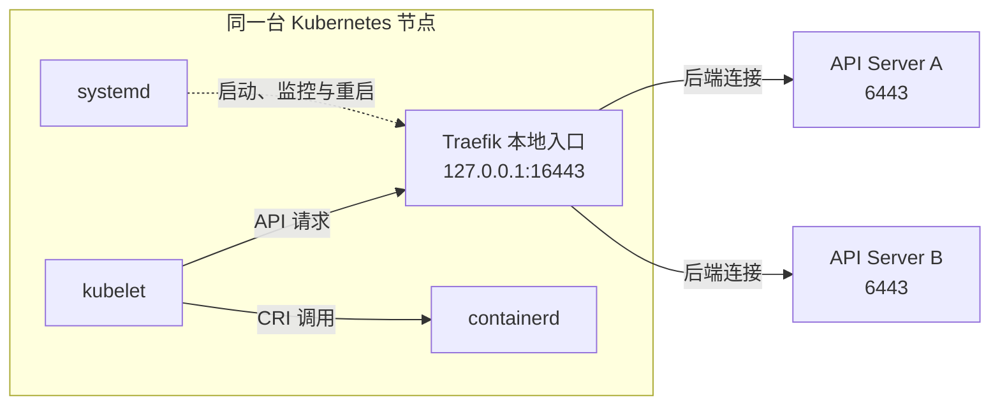
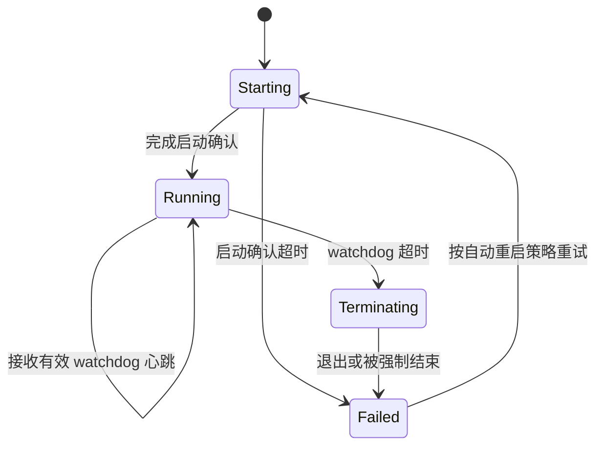
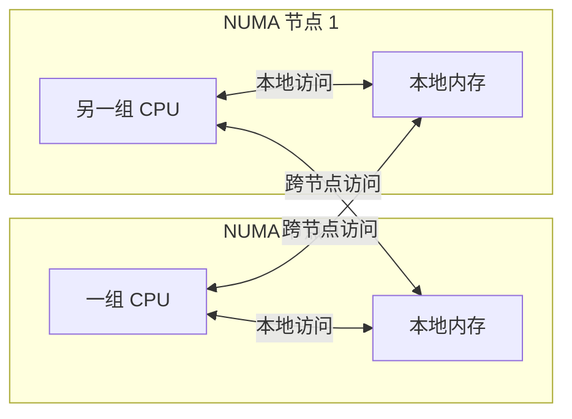
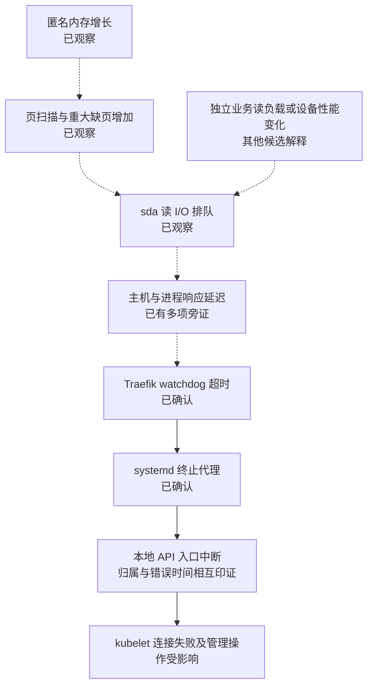

# Kubernetes 节点本地 API 失联排查：Traefik watchdog、内存回收与 I/O 拥塞

> 事件日期：2026-10-14，时间统一为 Asia/Shanghai（北京时间）。  
> 笔记整理日期：2026-10-22。  
> 主要对象：`10.68.123.165`；对照节点：`10.68.23.25`。  
> 性质：基于一次真实日志排查整理的学习笔记，保留尚未闭合的假设，便于继续补充。本文没有执行远程变更，也不包含已实施的修复方案。

这次问题的入口是 kubelet 反复报告无法连接 `127.0.0.1:16443`。排查逐步经过 kubelet 日志、整机 journal、本地监听进程、systemd 服务配置、历史内存与磁盘统计，最终确认了本地代理被 watchdog 终止的直接故障链，并发现了更深一层的主机资源异常。

学习重点不仅是认识几个命令，而是建立三种区分：**现象与原因、局部限制与整机资源、同时发生与已经证明的因果关系。**

建议先读第 1—4 节复盘，再按第 5—9 节补充机制；第 10—11 节用于继续验证和现场查阅，第 12—14 节用于复习与后续补充。

## 1. 先明确结论的边界

### 1.1 已有直接证据的事实

| 事实 | 本次证据 | 可以得到的结论 |
| --- | --- | --- |
| kubelet 访问本机 `16443` 失败 | URL、`connection reset by peer`、`connection refused` | 故障涉及节点本地 API 入口 |
| `16443` 由 Traefik 监听 | `ss` 显示 `traefik`、PID 3863、监听 `127.0.0.1:16443` | 本地入口的进程归属已确认 |
| Traefik 被 systemd 终止 | `Watchdog timeout (limit 1s)`，随后发送 SIGABRT | 直接终止来源是服务 watchdog |
| Traefik 会自动重启 | unit 中 `Restart=always`，journal 中有自动重启记录 | 重启由服务管理器按策略执行 |
| 故障期间存在明显 I/O 排队 | `sda` 的延迟、队列、读取量升高，主机 iowait 和阻塞任务增加 | 主机存在实际的 I/O 响应问题 |
| 内存回收和重大缺页增加 | `sar -B` 中页扫描、重大缺页和页面读入速率升高 | 内存与文件页访问行为发生了显著变化 |
| logrotate 发生 cgroup OOM | `CONSTRAINT_MEMCG`，限额 512 MiB，被杀进程为 logrotate | 该容器的 137 退出有 OOM 证据 |
| 机器发生过重启 | journal 出现 `-- Reboot --`，随后记录新一轮内核启动 | 不能只解释为 kubelet 或 Traefik 的进程重启 |

直接故障链可以表述为：**Traefik watchdog 超时 → systemd 终止 Traefik → 本地 API 入口中断 → kubelet 连接重置或拒绝 → Traefik 被自动重启，但多次无法稳定恢复。**

这里的“入口中断”由已确认的监听归属、服务退出和紧随其后的连接错误相互印证；没有在每一次故障瞬间额外保存完整的监听快照。

### 1.2 有较强线索，但还没有完全证明的解释

当前优先追查的资源链路是：匿名内存增长，伴随页回收和缺页读取增多，进而与 `sda` I/O 排队、主机响应延迟及 Traefik 心跳超时发生关联。

这些变化有时间先后和多项指标支持，但仍缺少两个关键环节：

1. 哪些进程或 Pod 增加了匿名内存、产生了对 `sda` 的读取？
2. Traefik 的健康检查或喂狗线程，具体在哪个等待点错过了期限？

因此，“I/O 拥塞导致 Traefik 漏心跳”是重点假设，不能直接写成已经证明的唯一深层根因。也可能存在共同负载、局部资源限制或多个因素的反馈放大。

### 1.3 目前不能下的结论

- 不能将“内存使用约 83%”直接等同于物理内存耗尽或内存条损坏。
- 不能将 logrotate 的容器 OOM 推广为主机全局 OOM。
- 不能仅凭磁盘 `%util=100%` 判断设备性能耗尽，更不能直接判断坏盘。
- 不能仅凭整机还有可用内存，排除 cgroup 或 NUMA 局部约束。
- 不能将 Traefik 服务 watchdog 超时直接等同于整机重启的原因。
- 不能将两台机器的相似症状自动合并成同一个已确认根因。

## 2. 先认识涉及的组件

### 2.1 kubelet、本地代理与 API Server

本次节点采用本地 API 代理部署方式。kubelet 日志中的目标是 `127.0.0.1:16443`，而 Traefik 日志中能看到后端 `10.68.26.94:6443`、`10.68.26.66:6443` 的健康检查记录。



图示表达组件作用。**完整的 entryPoint、router、service 配置尚未提供**，因此具体的转发绑定、负载均衡算法、健康检查参数与完整后端列表仍需配置核验。已有健康检查失败并移除服务器的日志，可以证明存在后端健康管理行为，不能代替完整的故障切换效果验证。

这里的本地代理不是 Kubernetes 对所有节点的强制要求，也不能将这套部署方式推广到所有集群。Traefik 还可以承担业务反向代理或 Ingress 等角色，本次重点是它在该节点上的 API 入口作用。

`127.0.0.1` 指向节点自己的网络空间。访问这个地址被拒绝时，应先定位本机监听与代理状态，再继续追查远端 API Server，不能一开始就把它认定为整个控制面故障。

### 2.2 `traefik.service` 中的 service 指什么

`traefik.service` 是 Linux systemd 的服务管理单元，负责描述进程如何启动、何时算启动完成、如何监控、退出后是否重启。

它与 Kubernetes 的 `Service` API 对象是两套概念：前者管理主机上的进程，后者描述集群内的服务访问抽象。文件名带有 `.service`，不代表它本身就是一个 Kubernetes Service 对象。

本次已经取得的关键配置如下，摘录不代表整个 unit：

```ini
[Service]
Type=notify
EnvironmentFile=-/etc/default/traefik
ExecStart=/usr/local/bin/traefik --configFile=/etc/traefik/traefik.yaml $TRAEFIK_EXTRA_ARGS
Restart=always
WatchdogSec=1s
```

额外参数可能来自环境文件，因此仅看 `ExecStart` 的固定部分还不一定包含最终全部参数。分享配置时也应避免直接导出可能包含认证信息的完整环境。

### 2.3 containerd 与 PLEG 为什么也出现在排查中

kubelet 通过 CRI 与容器运行时交互，例如创建 sandbox、启动容器和查询状态。PLEG 是 kubelet 内负责观察 Pod/容器生命周期变化的机制；本次日志里的长期未更新和跳过 Pod 同步，说明本地容器状态同步也没有正常推进。

本次还观察到：

- containerd 对 26 个 task 记录了 904 条 `stat task ... context deadline exceeded`。
- dockerd 连接本机 containerd Unix socket 超时。
- kubelet housekeeping 最长耗时约 298.7 秒。
- 多个节点组件的健康检查超时。

这些现象将排查范围从一个网络入口扩展到本地运行时和主机响应能力，但不能据此断定“所有运行时异常都是 Traefik 引起的”。它们可能有共同的资源原因。

## 3. 原始资料与关键时间线

### 3.1 本次使用的资料

| 文件 | 对象与内容 | 排查价值 |
| --- | --- | --- |
| [331165787.log](/Users/liwu.xing/Downloads/331165787.log) | `10.68.23.25` 的 kubelet 日志 | 最早发现本地 API 入口失败，作为对照节点 |
| [331166825.log](/Users/liwu.xing/Downloads/331166825.log) | `10.68.123.165` 的 kubelet 日志 | 发现 PLEG 卡顿和整机重启 |
| [331167668.log](/Users/liwu.xing/Downloads/331167668.log) | 第二台机器的整机 journal | 关联 systemd、Traefik、内核 OOM、运行时和重启 |
| [331168548.log](/Users/liwu.xing/Downloads/331168548.log) | Traefik 单服务日志 | 聚焦服务退出、自动重启和启动超时 |
| [331168791.log](/Users/liwu.xing/Downloads/331168791.log) | 再次采集的 Traefik 单服务日志 | 服务事件与上一份逐行相同，仅外层采集信息变化 |
| [331168957.log](/Users/liwu.xing/Downloads/331168957.log) | `ss` 与 systemd unit 输出 | 确认监听归属和 1 秒 watchdog 配置 |
| [331170096.log](/Users/liwu.xing/Downloads/331170096.log) | 较短区间的内存、swap、分页统计 | 看到故障期间的回收活动，但缺少足够故障前基线 |
| [331170243.log](/Users/liwu.xing/Downloads/331170243.log) | 扩展区间的内存、swap、分页统计 | 将资源变化向前追到首次 watchdog 之前 |
| [331170901.log](/Users/liwu.xing/Downloads/331170901.log) | CPU、队列和磁盘历史统计 | 确认 `sda` 排队及主机 I/O 等待 |

上述链接指向整理时本机的 Downloads。以后若移动原始资料，应更新链接；正文保留了关键摘录和数值，避免学习笔记完全依赖下载目录。

这些文件不是原生逐行 journal，而是任务执行器包装的输出。外层约 30 行，实际日志大多放在一个很长的 `stdout` 字段里，用字面量 `\n` 表示换行。

处理时要先恢复这一层包装，再统计实际日志行。外层内容虽然类似 JSON，本次部分内部引号并未完整转义，不能默认整段可以直接交给 JSON 解析器。也不能不分层级地替换业务内容里的所有转义字符。

### 3.2 第二台机器的时间线

| 时间 | 观测 | 结论或限制 |
| --- | --- | --- |
| 18:55:01 | 匿名内存约 367.7 GiB，可用约 121.7 GiB | 故障前的参考点 |
| 19:15:01 | 匿名内存约 402.9 GiB，free 约 6.8 GiB | 匿名内存已明显增长 |
| 19:25:03 | blocked=29，后台扫描和重大缺页已增加 | 早于首次 watchdog 约 5 秒，资源异常已有先行迹象 |
| 19:25:08 | Traefik watchdog 超时，systemd 发送 SIGABRT | 直接触发点 |
| 19:25:12 | Traefik 退出；kubelet 开始连接重置、拒绝 | 与本地入口失联相互印证 |
| 19:26:09、19:27:42 | 新启动的 Traefik 再次 watchdog 超时 | 自动重启未能稳定恢复 |
| 19:29:16 起 | 多轮 Traefik 启动超时，常见约 90 秒 | 启动阶段也受影响，不能只分析运行期 watchdog |
| 19:29:40 起 | containerd 出现大量 task 状态查询超时 | 本地运行时链路受影响 |
| 19:35:41 | `sda` await=65 ms，平均队列约 160 | I/O 排队明显加重 |
| 19:38:13 | PLEG 超过 3 分钟未更新，跳过 Pod 同步 | kubelet 本地同步能力受影响 |
| 19:42:59 | Traefik 再次 watchdog 超时，之后退出也很慢 | 需要区分停止阶段和运行阶段 |
| 19:46:02—19:46:31 | systemd 发送 SIGKILL，随后记录进程退出 | 日志延迟本身不能证明线程处于某个特定内核等待点 |
| 19:48:05 | `sda` 平均队列约 210，blocked=72，iowait=25.06% | 主机响应异常仍在持续 |
| 19:48:58 之后 | 旧启动日志结束，接着出现 `-- Reboot --` | 存在日志间隔，不能据此精确确定关机时刻或发起者 |
| 19:54:25 起 | 新一轮内核启动记录 | 整机已重新启动 |
| 19:54:38 | Traefik 启动成功 | 本地代理恢复阶段 |
| 19:54:45、19:54:55 | kubelet 注册成功，随后记录 NodeReady | API 通信及节点状态出现恢复证据 |

本次窗口内统计到 4 次 Traefik watchdog 超时、10 次启动超时、14 次自动重启调度。它们是不同类型的事件，不能相加后当作“14 个不同根因”，也不是机器全生命周期的完整重启次数。

对照节点 `10.68.23.25` 的本地入口错误约从 19:05:59 开始，两台节点并非同时发生。第一台当时提供的 kubelet 日志没有第二台这样的 PLEG 卡顿与整机重启记录；不能直接把第二台的资源分析复制为第一台的最终归因。

## 4. 排查流程：每一步在排除什么

### 4.1 先校准对象、时间和采集边界

首先确认节点 IP、节点名、日志来源、时区、事件发生时间和是否跨过整机重启。

本次需要特别避免三个误读：

1. `RESULT_SUCCESS` 和 `return_code=0` 表示采集命令成功，不代表节点健康。
2. `Logs begin at ...` 反映 journal 保存范围，不能当作本次查询选出的第一条业务日志时间。
3. 下载文件的修改时间显示 1970 年，不是事件日期。应以日志内部时间和 sar 文件头为依据。

事件对齐时还要区分任务创建时间、日志外层时间和程序消息中的内部时间。程序记录、日志传输或落盘可能延迟，不要忽略它们的差异。

### 4.2 从实际失败地址判断故障层级

`dial tcp 127.0.0.1:16443` 先告诉我们客户端正在访问本地入口。接下来区分错误类型：

| 现象 | 常见含义 | 不能直接认定的事情 |
| --- | --- | --- |
| connection refused | 没有有效监听，或本机规则主动拒绝等 | 不能仅凭它认定远端 API Server 宕机 |
| connection reset by peer | 已有连接被重置或关闭 | 不能单独确定是进程退出、代理重启还是其他连接处理原因 |
| timeout / deadline exceeded | 在期限内未完成某个阶段 | 不能把所有超时都当成网络丢包 |
| TLS、401、403 等响应 | 通信已推进到相应协议层 | 不能与 TCP 连接拒绝混为一谈 |

本次“先重置、后拒绝”的序列与代理被终止相符，但真正建立归因还要补上进程归属和服务退出证据。

### 4.3 找到端口背后的实际进程

本次补充的监听输出为：

```text
LISTEN 0 65535 127.0.0.1:16443 0.0.0.0:* users:(("traefik",pid=3863,fd=7))
```

这一步将“某个本地端口异常”收敛为“Traefik 的入口异常”。PID 3863 是重启后采样时的值，不应在后续排查中当作永远有效的 PID。

进一步验证完整请求链，需要同时看：kubelet 实际 kubeconfig 的 `server`、Traefik 的入口与后端路由配置，以及当时存在的连接。连接快照与配置分别提供运行态和设计态证据，两者不能互相代替。

### 4.4 扩大到整机 journal，找到消费者之外的日志

kubelet 只能告诉我们“我连接失败了”，未必能告诉我们代理为什么停止。因此需要整机 journal，关联 systemd、Traefik、内核、containerd、定时任务等来源。

本次最关键的一组记录是：

```text
19:25:08 traefik.service: Watchdog timeout (limit 1s)!
19:25:08 traefik.service: Killing process 320115 (traefik) with signal SIGABRT.
19:25:12 traefik.service: Main process exited, code=exited, status=2/INVALIDARGUMENT
19:25:12 traefik.service: Failed with result 'watchdog'.
19:25:12 kubelet: ...127.0.0.1:16443...connection reset/refused...
```

这里应以 `Failed with result 'watchdog'` 和前面的信号来源解释退出，而不是看到 `INVALIDARGUMENT` 就转去修启动参数。它在这一条记录里是 systemd 对退出码 2 的名称。

重复采集相同日志不会自动增加证据。本次两份 Traefik 单服务输出的实际事件完全相同，只有采集截止信息更新；缺少的是配置和资源统计，而不是更多同样的 traceback。

### 4.5 将主故障与并行异常分开，再追查关联

最初日志中还有 logrotate CrashLoopBackOff、137 退出、镜像 GC 失败。它们确实需要处理，但不能因为错误多、出现早，就直接把它们放进 API 失联的因果链。

建立关联至少需要相应证据，例如：全局 OOM 杀掉代理、某个进程造成明显磁盘压力、文件持续增长占满承载路径，或者时间和调用链能证明依赖关系。本次 logrotate OOM 的范围与 Traefik 的终止来源已经分别找到，应作为两条问题线保留。

### 4.6 先建立基线，再比较资源变化

只截取故障后的高值，很容易把后果当原因。首次较短 sar 输出的基线不足，所以又补采了更长时间段。

扩展区间让我们看到：匿名内存先增长，19:25:03 前的统计区间已经出现回收、缺页和磁盘延迟变化，随后才记录第一次 watchdog。这个先后关系提高了资源假设的可信度，但仍不能取代进程级归因。

### 4.7 用恢复现象检查解释是否自洽

重启后 kubelet 注册成功、相关 Pod readiness 恢复，而 logrotate 继续发生 OOM。这支持“logrotate CrashLoop 本身不足以解释本地 API 入口必然失联”。

但是，重启会同时重建进程、连接、缓存、运行时状态等许多条件。**重启后恢复只能说明恢复出现，不能定位究竟是哪一个状态被重置后解决了问题。**

## 5. 深入理解 systemd watchdog 与重启

### 5.1 启动就绪通知和存活通知是两回事

`Type=notify` 用于让服务主动报告启动就绪，典型消息为 `READY=1`；`WatchdogSec=` 则规定运行期间的心跳期限，典型消息为 `WATCHDOG=1`。前者回答“是否已完成启动”，后者回答“是否持续按约定报告存活”。

因此，仅配置 `Type=notify` 不能推导出已经启用了 1 秒 watchdog；本次期限由 unit 中的 `WatchdogSec=1s` 和运行日志共同确认。消息如何发送、是否受健康检查结果约束，还要检查对应版本的程序实现。

相关协议可参考 [sd_notify 文档](https://www.freedesktop.org/software/systemd/man/latest/sd_notify.html)。

### 5.2 本次为什么会被自动终止、自动重启

systemd 在服务启动完成后按 watchdog 约定监控通知。超过期限时会按配置采取终止动作，默认 watchdog 信号为 SIGABRT；本次日志也明确记录了这个信号。之后由 `Restart=always` 驱动自动重启。



实际重试还可能受到重启间隔、启动频率限制等约束。显式执行停止服务，也不意味着 `Restart=always` 必须立刻把它拉起。判断具体行为应读取有效属性与对应日志，而不是只记住一个配置名称。见 [systemd.service 文档](https://www.freedesktop.org/software/systemd/man/latest/systemd.service.html)。

### 5.3 一秒 watchdog 对延迟意味着什么

服务必须给心跳间隔留出余量：定时器触发、健康检查、goroutine 调度、系统调用和通知处理都可能产生延迟。若逻辑将健康检查与喂狗串行执行，还要检查该检查的超时是否接近或超过 watchdog 预算。

但不能由 `WatchdogSec=1s` 直接得出“配置一定错误”。是否合理取决于服务预期、实现、资源保障和故障响应目标；扩大期限可能缓解误触发，也可能延后真实故障发现。

本次已有 `healthcheck.Do`、`main.runCmd.func1`、`SdNotify` 等堆栈线索，但没有获得对应构建版本的完整源码和心跳时序。因此还不能确定是健康检查阻塞、调度延迟、通知处理问题，还是其他实现原因。

### 5.4 三类超时应分开分析

| 阶段 | 关注点 | 本次证据 |
| --- | --- | --- |
| 启动阶段 | 是否及时完成启动确认，前后置命令和依赖是否推进 | 多轮约 90 秒启动超时 |
| 运行阶段 | 是否及时发送并被接受 watchdog 心跳 | 4 次 1 秒 watchdog 超时 |
| 终止阶段 | 收到信号后是否退出，是否升级强制终止 | stop-watchdog、stop-sigterm 超时和最终 SIGKILL |

unit 摘录没有显式配置启动、停止、abort 超时，所以“约 90 秒”首先是日志观测，不能不查有效属性就断言某个默认值。启动超时也不等于进程完全没有创建，它可能已经运行但未完成就绪确认。

### 5.5 怎样解读 SIGABRT、Go traceback 和 SIGKILL

本次 Go traceback 出现在 systemd 明确发送 SIGABRT 之后。它可以帮助定位当时的 goroutine，但不是程序主动 panic 的充分证据。

一个 goroutine 显示 `idle`、`runnable` 或 `chan receive`，都不能单独证明整个程序空闲、死锁或 CPU 跑满。要结合完整堆栈、时间、对应版本源码和主机状态解释。

SIGKILL 无法被用户态信号处理器捕获，但不可中断内核等待可能延后任务的最终消失。本次“发送 SIGKILL 到记录退出之间有间隔”仅提示继续调查，尚不能直接证明该进程当时就在磁盘 D 状态；日志记录本身也可能延迟。

### 5.6 服务 watchdog 与整机 watchdog 不应混用

本文确定的是 Traefik 的 systemd 服务 watchdog。硬件/BMC watchdog、内核 lockup 检测和整机重启策略属于其他机制。是否存在 `FailureAction`、`StartLimitAction` 等整机动作，需要读取配置。

重启后的文件系统 journal recovery 和未正常卸载提示，不能直接确定重启由人工、硬件、内核崩溃还是其他策略发起。需要额外的启动历史、内核转储、BMC/RAID 事件或操作记录。

## 6. 深入理解内存：为什么 83% 既不能定罪，也不能排除压力

### 6.1 free、available、匿名内存与文件页不是一个量

| 指标或概念 | 含义 | 常见误读 |
| --- | --- | --- |
| MemFree / `kbmemfree` | 当前完全空闲的内存页 | free 小就一定发生 OOM |
| MemAvailable / `kbavail` | 内核估计可供新分配使用、通常不需交换的内存 | available 大就保证所有访问没有延迟 |
| AnonPages / `kbanonpg` | 匿名内存，例如堆、栈、匿名映射 | 与某一个进程的 RSS 或所有进程 RSS 简单相等 |
| 文件页缓存 | 缓存文件内容，也参与映射文件访问 | 全部都是无代价、可立即释放的内存 |
| RSS | 进程当前驻留页，可能含匿名、文件映射和共享部分 | 全部都是不可回收的私有堆 |

`MemAvailable` 是估计值，不是访问延迟承诺。相关定义可查阅 [Linux /proc 内存字段文档](https://docs.kernel.org/filesystems/proc.html)。

本次匿名内存增长是全机统计，不能直接归给某一个 Pod。共享页、计费方式和内核版本也会影响不同层级之间的对照，应分别使用进程、cgroup 与主机口径。

### 6.2 这次内存变化的实数

| 采样时刻 | free GiB | available GiB | 匿名内存 GiB | 文件缓存 GiB |
| --- | ---: | ---: | ---: | ---: |
| 18:55:01 | 43.27 | 121.71 | 367.67 | 78.19 |
| 19:05:01 | 27.45 | 106.80 | 382.51 | 79.10 |
| 19:15:01 | 6.81 | 86.36 | 402.87 | 79.31 |
| 19:25:03 | 6.03 | 81.64 | 407.80 | 76.42 |
| 19:35:41 | 6.66 | 81.74 | 407.76 | 75.84 |
| 19:48:05 | 6.61 | 81.40 | 407.67 | 76.19 |

18:55—19:25 的匿名内存增加约 40.13 GiB，free 减少约 37.24 GiB。之后匿名内存大致稳定，但缺页和 I/O 活动继续增大。

这说明“内存增长”和“之后越来越慢”不是一个简单的、始终同步上升的数值关系。需要继续找出谁分配了内存、谁在读取文件，以及工作集和缓存是否发生了竞争。

### 6.3 回收、缺页与 swap 的区别

内核可以回收不再需要的文件缓存页；再次访问已经不在内存中的文件内容，可能需要重新读取。匿名页通常没有可直接重读的普通文件后备，其释放、交换或回收受到不同条件约束。

minor fault 常常可以不经磁盘读取解决；major fault 则涉及需要 I/O 的缺页处理。`fault/s` 包含两者，所以不能看到高 fault/s 就等同于磁盘压力。

`kswapd` 执行后台回收；分配路径上的直接回收可能让请求内存的任务参与扫描、承受延迟。**看到后台扫描，只能直接证明回收活动，不能自动证明全机分配失败或每个服务都被卡住。**

本次 swap in/out 均显示 `0.00`，说明这些统计区间没有可见的交换活动，不等于证明系统没有配置 swap、从来没有用过 swap，或者根本不可能有低于显示精度的活动。结合重大缺页和读取量，更值得追查文件页访问与缓存行为。指标口径见 [sar 手册](https://man7.org/linux/man-pages/man1/sar.1.html)。

### 6.4 回收和缺页如何随时间变化

下表的速率是区间平均值，时间列表示区间结束时刻；它们不是该时刻一秒钟的峰值。

| 区间结束时刻 | 页面读入 MiB/s | major fault/s | 后台扫描页/s | 直接扫描页/s |
| --- | ---: | ---: | ---: | ---: |
| 18:55:01 | 63.82 | 0.06 | 0.00 | 0.00 |
| 19:05:01 | 62.49 | 1.39 | 0.00 | 0.00 |
| 19:15:01 | 69.86 | 0.07 | 0.00 | 0.00 |
| 19:25:03 | 83.49 | 83.70 | 12,938.18 | 0.00 |
| 19:35:41 | 290.30 | 701.15 | 69,067.12 | 0.00 |
| 19:48:05 | 524.75 | 1,971.32 | 375,024.19 | 76.78 |

按 4 KiB 页估算，375,024 页/s 对应约 1.43 GiB/s 的**扫描量**，不是释放了这么多内存，也不是磁盘吞吐。页大小应按目标环境确认。

本例 `%vmeff` 还出现 252.73%、172.70% 等值，暂不按字面解释为准确的回收效率。若要研究这个派生比率，需要核对本机 sysstat 与内核计数器实现，不能仅凭比率异常就编造一个已确认的软件缺陷。

### 6.5 为什么 available 还有约 80 GiB，仍需要查回收

整体可用内存不直接回答以下问题：某个进程的工作集是否持续缺页、某个 cgroup 是否达到限额、某个 NUMA 节点或 zone 是否触及局部水位，以及回收和重新访问是否产生了可观的时间成本。

但反过来也不能跳过约 80 GiB available 这个事实，直接宣布“整机内存已经耗尽”。本次应保留较窄的结论：**有明显的回收与缺页活动变化，是否形成影响关键服务的压力，还需要分层和延迟证据。**

### 6.6 logrotate 的 cgroup OOM 为什么是另一层问题

本次内核记录了：

```text
memory: usage 524288kB, limit 524288kB
oom-kill:constraint=CONSTRAINT_MEMCG ... task=logrotate
Memory cgroup out of memory: Killed process ... (logrotate)
```

512 MiB 是这个 cgroup 的限额，不是主机剩余内存。一个示例中，匿名内存约 2.3 MiB，而文件页约 510 MiB，说明触及限额的内容主要是文件页；不能仅凭 OOM 就断定程序堆发生泄漏。

cgroup 内存计费可以包含匿名页和文件缓存等内容，具体字段、回收行为与 v1/v2 版本有关。可结合目标内核参考 [memory controller 文档](https://docs.kernel.org/admin-guide/cgroup-v1/memory.html)，其中的旧版本说明不能替代本机实现核验。

在提供的整机日志窗口中，34 条 OOM 记录的被杀进程全部是 logrotate，没有发现 Traefik 或 containerd 被全局 OOM 杀掉的记录。没有记录不等于对所有历史事件作绝对排除，但不支持把这次 Traefik 退出改写为 OOM。

logrotate 自身 512 MiB 的限额也不足以直接解释全机约 40 GiB 的匿名内存增长；要建立间接 I/O 影响，仍需它自己的读写、文件和时间证据。

## 7. 深入理解 NUMA：同一台机器里也有“局部”

NUMA 是 Non-Uniform Memory Access，即非均匀内存访问。它关注的是 CPU 与内存之间的拓扑位置：访问较近的本地内存通常更快，访问远端节点的内存需要经过互连。

下面是一个两节点示意，不代表所有双路机器都严格是一颗 CPU 对应一个 NUMA 节点：



NUMA 不会把一台机器变成两台，也不意味着 CPU 永远不能使用其他节点的内存。Linux 的默认局部分配与回退机制、进程内存策略和 cpuset 约束共同决定了实际分配位置。不同 CPU 架构和固件设置下，socket 与 NUMA 节点也不一定一一对应。参见 [Linux NUMA Memory Policy](https://docs.kernel.org/admin-guide/mm/numa_memory_policy.html)。

排查中要分别回答：

1. 内存容量是否在节点间分布不均，空闲和文件页分布如何？
2. 业务线程在哪些 CPU 上运行，页又主要分配在哪些节点？
3. 是否存在内存绑定、cpuset 节点限制、局部回收策略等约束？
4. 故障当时是否真的出现局部回收、远端访问或迁移代价上升？

本次没有收到故障当时的 NUMA 分节点数据，因此 NUMA 只能列为待验证因素。不能从“available 约 80 GiB，但有回收”直接推导为 NUMA 故障，更不应直接修改绑定或回收参数。

还要区分三个词：**内存容量不足**是工作负载与容量的问题，**NUMA 局部压力**是拓扑和分配的问题，**内存条硬件故障**则要看 MCE、EDAC、不可纠正错误和硬件事件。它们需要不同证据。

## 8. 深入理解 I/O 与 CPU：为什么 load 很高却不是 CPU 打满

### 8.1 本次最突出的设备变化在 `sda`

| 区间结束时刻 | `sda` 读取 MiB/s | `sda` await ms | `sda` 平均队列 | `sda` util % | 主机 blocked | 主机 iowait % |
| --- | ---: | ---: | ---: | ---: | ---: | ---: |
| 18:55:01 | 0.00 | 0.19 | 0.00 | 1.07 | 0 | 0.54 |
| 19:05:01 | 0.29 | 0.84 | 0.02 | 1.59 | 3 | 0.52 |
| 19:15:01 | 0.00 | 0.24 | 0.00 | 1.10 | 2 | 0.55 |
| 19:25:03 | 14.18 | 10.93 | 3.26 | 23.96 | 29 | 1.22 |
| 19:35:41 | 141.57 | 65.00 | 159.66 | 90.59 | 61 | 19.14 |
| 19:48:05 | 367.40 | 31.12 | 209.74 | 98.59 | 72 | 25.06 |

表中磁盘吞吐、延迟、队列及 CPU iowait 是区间统计；blocked 是对应采样的任务状态统计，不要将整行所有量都当成完全同口径的瞬时值。

这些数值共同说明明显的块设备排队和主机 I/O 等待，比只看磁盘使用空间或错误日志更能解释“系统越来越慢”。但尚未确认这些读取属于哪个进程、哪组文件，也未证明磁盘硬件发生了故障。

### 8.2 吞吐、延迟、队列分别回答什么

吞吐表示单位时间处理了多少数据；`await` 是观测到的 I/O 平均完成时间，包含等待和服务时间；`aqu-sz` 是平均未完成请求数量。设备有很多并发请求时，可以有较高吞吐，同时也有很长的等待。

本例可做一个口径自检：19:35:41 的 `tps=2456.45`、`await=65 ms`，计算 `2456.45 × 0.065 ≈ 159.67`，与平均队列 `159.66` 接近。这是同一区间吞吐与等待量级相互一致的例子，不是通用的硬件最大性能公式。

`await=65 ms` 也不能证明每次请求都小于一秒。平均值没有给出尾延迟，而一次应用操作还可能串联多次 I/O、缺页、锁或健康检查。相关指标定义见 [iostat 手册](https://man7.org/linux/man-pages/man1/iostat.1.html)。

### 8.3 为什么 NVMe 的 100% util 没有直接成为结论

本例 NVMe 在故障前 `%util` 就接近 100%，但平均延迟只有约 0.13—0.22 ms，故障期间最高约 0.68 ms。不能把 `%util` 机械理解为所有设备都通用的“带宽容量使用百分比”。

对于并行设备，持续有未完成 I/O 不等于已经耗尽全部处理能力。应比较同一设备的基线、延迟、队列和业务效果，再结合设备类型分析。

启动日志将 `sda` 识别为 INSPUR RAID-1 逻辑卷，不能从一个逻辑设备的繁忙值定位到某一块物理盘损坏。若要判断硬件问题，还需 RAID 控制器、成员盘和错误事件证据。

### 8.4 CPU idle、iowait 和 load average 的区别

本机 sar 文件头显示 96 个逻辑 CPU。19:48 区间仍有 39.18% idle、25.06% iowait，用户态、系统态及中断等执行时间合计约 35.75%。这不支持“整机计算能力已经全部用完”。

load average 同时受可运行任务和不可中断等待任务影响。blocked 从 2 增至 72，load 从约 32 增至 144，并不等价于 144 个线程一直在争用 CPU。iowait 也不是 CPU 在执行某种“等待运算”，而是 CPU 时间记账中的等待相关分类，其多核归属和含义需要谨慎解释。

不过，整体有 idle 仍不能排除单核热点、绑核、CPU quota、短时调度延迟。它只能帮助降低“整体 CPU 持续打满”这个假设的优先级。

### 8.5 网络代理为什么可能被 I/O 延迟影响

网络代理不需要处理每一笔业务磁盘 I/O，但仍可能受文件映射缺页、配置读取、健康检查依赖、锁和共享系统路径延迟影响。主机资源异常也可能同时影响代理和运行时。

这不意味着“磁盘一忙，所有进程都必然卡住”。要将某个设备的排队归到 Traefik 漏心跳上，需要该进程的堆栈、缺页、调度或健康检查时序证据。

还存在反馈的可能：资源延迟使代理被频繁终止，反复启动又需要加载代码、配置和建立连接，可能进一步增加负担。这是需要验证的反馈模型，不是本次已经证实的全部过程。

## 9. 时间与指标口径：本次最容易忽略的一层

### 9.1 sar 表头时间不等于一条已展示的数据

较短区间的内存报告里，`07:25:03 PM` 出现在列名那一行，真正的数据从 `07:35:41 PM` 开始。不能把列名所在行当作 19:25:03 的内存数值。

更长区间的报告则真正展示了 19:25:03 的数据。这是补采基线的价值之一。

### 9.2 区分状态量、速率与平滑值

| 数据类型 | 本例 | 正确使用方式 |
| --- | --- | --- |
| 状态量 | available、匿名内存、runq、blocked | 对应采样时刻的状态，不能当成整个十分钟都不变 |
| 区间平均速率或时间比例 | major faults/s、pgscank/s、磁盘吞吐、CPU iowait | 表示两个采样记录之间的统计，不能当作秒级峰值 |
| 区间平均延迟或队列 | await、aqu-sz | 表示区间中的平均情况，不直接给出尾延迟 |
| 时间平滑值 | load average 的 1/5/15 分钟值 | 不能与某一时刻的 runq 或 blocked 简单相加对账 |
| 累计计数器 | `/proc/vmstat`、PSI total | 要计算同一启动内的增量，不能直接当作速率 |

19:25:03 的分页速率覆盖前一个采样区间，结束于首次 watchdog 前约 5 秒。这证明相关活动并非全部在第一次代理退出之后产生，但并不能精确指出活动是在 19:16、19:24，还是区间内其他时刻开始。

19:35:41 与 19:48:05 之间也不是严格十分钟。本次定时任务本身出现延迟：原本 19:35 附近的采集到 19:35:34 才记录启动，19:45 附近的任务到 19:47:41 才记录启动。这是主机或日志处理响应延迟的旁证；它不能单独定位某个内核等待点。

### 9.3 不要从长区间平均值推导一秒内的精确因果

本例是 1 秒 watchdog，而 sar 的采样间隔约十分钟。两种时间分辨率相差很大：十分钟内可能只有少数几次长暂停，却足以触发 watchdog；较高的十分钟平均吞吐，也不代表每一秒都发生了同样的等待。

所以 sar 用来定位异常时段、设备和资源方向；秒级心跳为什么漏掉，则需要更细粒度的进程、健康检查或压力数据。

### 9.4 对齐时区、日期、启动边界和统计范围

- `07:25:03 PM` 是 19:25:03；带 `Z` 的程序时间是 UTC，本次需换算为北京时间。
- `sa14` 通常只包含日号，并不是一个永远对应 2026-10-14 的文件。月度覆盖和保留策略可能使它消失或被替换，应先看文件头日期。
- 文件名也可能采用 `saYYYYMMDD`，路径随发行版或配置变化，不能机械套用本机示例。
- 跨重启的累计计数器不能直接做差；看到 Linux restart 标记，应分别分析启动前后。
- 采样间隔不均时，整体 Average 不能简单由展示行做等权平均得到，应按工具的计数器和时间口径理解。
- 多个错误日志行可能来自同一请求、重试或不同处理层，错误条数不等于独立故障次数。

## 10. 怎样继续验证，而不是停在一条“看起来合理”的故事上

### 10.1 当前证据关系图

实线表示已有较直接的故障关联；虚线表示仍需要验证的资源因果关系。



把“节点”观察清楚，不代表连接节点的每一条因果边都已证明。特别是缺页读取也可能是业务主动访问新文件的结果，而不是缓存被回收后的重复访问。

### 10.2 每个假设需要补什么证据

| 待验证问题 | 优先补充的证据 | 什么结果会改变当前判断 |
| --- | --- | --- |
| 谁增加了约 40 GiB 匿名内存？ | 18:55—19:25 的进程、Pod、cgroup 匿名内存或 RSS 历史曲线，负载变更记录 | 内存增长分散或与疑似业务无关时，需要重新划分负载范围 |
| 谁在读 `sda`，读什么文件？ | 历史进程 I/O、容器文件系统指标、设备与目录映射、应用读文件日志 | 若读取来自独立任务，应分别解释它与内存增长的关系 |
| 回收是否造成了实际停顿？ | memory PSI、直接回收、任务缺页与等待、工作集 refault 的同口径历史变化 | 只有后台扫描而无相应停顿时，应降低“回收直接卡住代理”的优先级 |
| Traefik 为什么漏心跳？ | 版本对应源码、喂狗间隔、健康检查超时、通知权限、故障时线程栈和时序 | 若发现心跳逻辑自身错误或服务限流，应优先修正解释 |
| 是否为 CPU 局部问题？ | per-CPU 数据、绑核、CPU quota、cgroup throttling、调度延迟 | 整机 idle 不能否定局部受限；若局部证据明显，则不能只归 I/O |
| 是否为 NUMA 或 zone 局部压力？ | 故障时节点/zone 水位、分配策略、cpuset、进程节点分布 | 当前没有分节点历史证据，不能先下结论再改参数 |
| 是否为磁盘或 RAID 硬件异常？ | 控制器事件、成员盘状态、错误计数、延迟基线和其他同类主机对照 | 若硬件正常而负载异常，应按资源竞争继续排查 |
| 是什么触发了整机重启？ | 操作记录、BMC 事件、故障动作配置、内核转储和准确 boot ID | 服务 watchdog、人工重启和硬件复位需要分别归因 |

### 10.3 如何验证“本机 Traefik 就是 kubelet 的 API 入口”

验证顺序应为配置、监听、连接和已有行为记录：

1. 读取 kubelet 实际使用的 kubeconfig，确认 `server` 是否为本地地址。本次启动参数指向 `/etc/k8s/kubelet.conf`，不能照抄其他集群的路径。
2. 用 `ss` 确认该端口由哪个 PID 监听；这一步本次已经取得证据。
3. 读取 Traefik 的 `entryPoints`，沿 router 引用追到实际 service 和后端；若使用动态文件 provider，还要按配置引用继续读取，而不是猜文件路径。
4. 查看已经存在的连接，确认 kubelet 到本地入口、Traefik 到后端的运行态。没有快照结果不等于没有配置，也可能只是当时没有相应连接。
5. 对照健康检查移除后端的已有日志。它能证明剔除行为，但完整切换效果还需业务/API 请求和健康后端连接的证据。

只看监听不能知道完整后端；只看配置不能保证进程已经加载并按配置运行。需要把两者对上。

### 10.4 如何验证 watchdog 是主动通知机制

unit 和有效属性确认了监控协议与期限，故障日志确认了 systemd 实际采取的动作。若再连续读取两次 `WatchdogTimestamp`，观察其更新，可进一步确认服务管理器正在接收 watchdog 通知。

但心跳持续更新不等于所有代理请求或业务路径都健康。健康检查覆盖范围、是否健康检查成功才喂狗、内部调用顺序，都要检查对应版本的实现。本次没有完成这些源码与运行时验证，笔记不能把它们写成事实。

## 11. 可复用的只读排查命令

以下示例在**目标 Linux 节点**执行，使用的是本次已经确认的路径和事故时间。以后复用前先核对主机、时区、文件头日期和工具版本；不是要求现在原样重新执行所有命令。

这组命令不修改业务数据、服务配置或持久化采集设置。`sudo` 和采集平台可能产生正常审计/任务日志，读取也有少量资源开销，不能将“只读”理解为绝对零写入、零开销。

### 11.1 历史 journal：先全局，再按服务聚焦

```bash
hostname
date -Is
uname -r
systemctl --version
sudo journalctl --list-boots

sudo journalctl \
  --since "2026-10-14 18:45:00" \
  --until "2026-10-14 20:10:00" \
  --no-pager -o short-precise

sudo journalctl -u traefik.service \
  --since "2026-10-14 18:45:00" \
  --until "2026-10-14 20:10:00" \
  --no-pager -o short-precise
```

不加 `-b 0` 的时间查询可以涵盖已保留的跨启动日志。能否看到重启前记录，取决于 journal 是否持久化和保留完整。

单独使用 `journalctl -k` 时要注意其启动范围。若要看事故对应启动的内核日志，应先从 `--list-boots` 中选取实际 boot ID，再指定该 ID。`-b -1` 只表示现在的上一轮启动，几天以后未必仍是事故前那轮。

整机 journal 也不是所有日志的全集：未写入 journal 的容器业务日志、独立文件和硬件事件仍要按实际路径获取。

### 11.2 本地入口、kubelet 配置与代理路由

```bash
sudo ss -lntp '( sport = :16443 )'
sudo ss -ntp '( dport = :16443 or dport = :6443 )'

sudo sed -n '/^[[:space:]]*server:/p' /etc/k8s/kubelet.conf

sudo systemctl cat traefik.service
sudo cat /etc/traefik/traefik.yaml
```

这里对 kubeconfig 只提取 `server` 字段，不需要导出私钥、客户端证书或 token。分享 Traefik 配置时，也只保留必要的入口、provider、路由、后端与健康检查信息，并处理认证字段。

如果静态配置通过 `providers.file` 引用其他文件或目录，按实际引用继续查看。不要假设所有后端都写在主配置中。

### 11.3 有效服务属性与心跳时间

```bash
sudo systemctl show traefik.service \
  -p MainPID -p Type -p NotifyAccess \
  -p WatchdogUSec -p WatchdogSignal \
  -p WatchdogTimestamp -p WatchdogTimestampMonotonic \
  -p Restart -p NRestarts -p Result \
  -p TimeoutStartUSec -p TimeoutStopUSec -p TimeoutAbortUSec \
  -p FailureAction -p StartLimitAction
```

间隔几秒再次执行，比较心跳时间是否推进。属性不存在或为空时，先确认 systemd 版本和支持情况，不要自动解读为数值零。

`Result`、`NRestarts`、MainPID 等是当前服务状态，不能取代历史 journal。手工 unit、drop-in、有效属性和实际进程也应相互核验，特别要考虑事故后是否发生过配置变更。

### 11.4 历史资源：内存、分页、CPU、队列、磁盘一起看

先确认原始历史文件仍存在，且输出文件头日期为事故当天。本例路径为 `/var/log/sysstat/sa14`：

```bash
sar -V
ls -lh /var/log/sysstat/

sudo sar -r ALL -f /var/log/sysstat/sa14 -s 18:45:00 -e 19:50:00
sudo sar -W     -f /var/log/sysstat/sa14 -s 18:45:00 -e 19:50:00
sudo sar -B     -f /var/log/sysstat/sa14 -s 18:45:00 -e 19:50:00
sudo sar -u ALL -f /var/log/sysstat/sa14 -s 18:45:00 -e 19:50:00
sudo sar -q     -f /var/log/sysstat/sa14 -s 18:45:00 -e 19:50:00
sudo sar -d -p  -f /var/log/sysstat/sa14 -s 18:45:00 -e 19:50:00
```

其中 `-f` 是读取已有历史文件；这些命令没有 `-o` 保存新统计的动作。若需要判断 swap 是否已经占用，还可以查看同区间 `sar -S`，而不只看交换速率。

聚合 CPU 不能解释局部热点时，再增加同区间的 `sar -P ALL -u ALL`，不必一开始就展开所有 CPU 的大输出。

### 11.5 设备与目录映射

```bash
lsblk -o NAME,TYPE,SIZE,FSTYPE,MOUNTPOINT
findmnt -T /
findmnt -T /usr/local/bin/traefik
findmnt -T /var/log
findmnt -T /data/containerd
```

本次启动日志显示 `nvme0n1` 挂载 `/data`，并出现 `sda4` 文件系统挂载记录；完整的关键目录归属还应由上述输出确认。目录名相似不等于落在同一块设备，符号链接、绑定挂载和容器卷也可能改变路径关系。

这些命令确认逻辑设备与文件系统关系，不直接给出 RAID 成员盘健康状态。

### 11.6 NUMA、水位和服务资源约束

工具已经安装时，可先进行以下只读检查；不应为了临时排查自动安装工具或修改参数。

```bash
numactl --hardware
numastat -m

sysctl vm.min_free_kbytes \
  vm.watermark_scale_factor \
  vm.watermark_boost_factor \
  vm.zone_reclaim_mode

findmnt -t cgroup,cgroup2

sudo systemctl show traefik.service \
  -p ControlGroup -p CPUQuotaPerSecUSec \
  -p AllowedCPUs -p CPUAffinity \
  -p MemoryMax -p TasksMax
```

`sysctl` 后面只有参数名，没有赋值或 `-w`，因此是读取。节点、zone 水位和 cgroup 限制会影响资源可用范围，但当前读取结果不自动等于事故时的状态。

进一步看进程分布时，应先查询当前 MainPID，再按实际 PID 使用 `numastat -p` 或读取其 `numa_maps`。在确认 cgroup v1/v2 和实际控制组路径后，再读取对应的 CPU 节流、内存事件与压力文件，不能跨版本照抄路径和字段。

### 11.7 复发时的短时采样

机器重启后，当前 `top`、`iotop`、`pidstat` 不能重建此前几十分钟的进程行为。下列命令用于问题正在发生时的短时观察，不是回看 2026-10-14 的历史证据：

```bash
iostat -y -xz 1 20
vmstat 1 20

cat /proc/pressure/cpu
cat /proc/pressure/memory
cat /proc/pressure/io
```

`iostat -y` 跳过从启动以来的首份平均报告；`vmstat` 首份输出应与后续短区间样本区分。它们会进行有限时长的采样，有一定观测开销，但不会建立新的常驻服务。

针对 Traefik 时，先用 `systemctl show traefik.service -p MainPID --value` 获取 PID。将下列 `PID` 替换为实际数字后再执行：

```bash
pidstat -u -r -d -w -p PID 1 20
ps -L -p PID -o pid,tid,psr,stat,comm,wchan:32
```

PID 会变化。复用历史 PID 可能观察到不存在或完全不同的进程。等待点、线程状态和短时统计也需要与应用堆栈对齐，不能仅凭一个 `wchan` 字段决定最终根因。

PSI 提供的是因 CPU、内存或 I/O 争用而受阻的时间信息，与资源使用百分比互补。这里只将它作为下一轮补证据的工具，本次没有历史 PSI 样本。定义和适用范围见 [Linux PSI 文档](https://docs.kernel.org/accounting/psi.html)。

### 11.8 只读排查的边界

| 操作 | 需要明确的边界 |
| --- | --- |
| `sar -f`、`ss`、`systemctl cat/show`、读取配置 | 不修改业务或服务配置，可能产生审计记录和少量读取开销 |
| `iostat`、`pidstat`、`vmstat` 短时采样 | 创建临时观测进程，有资源开销；与读取历史文件不同 |
| `strace`、性能采样、较重的内存映射扫描 | 可能扰动目标进程和时延，需要另行评估采样方式与范围 |
| 向 Go 进程发送 SIGQUIT | 默认可能打印栈并退出，不能当作无副作用的只读取栈 |
| kill/restart、清理 page cache、修改 sysctl、调整 watchdog 或资源限制 | 会改变系统行为，不属于本轮只读诊断 |
| 人为关闭后端验证切换、制造 I/O 或内存压力 | 属于故障注入，必须单独设计和授权 |

学习笔记中的验证优先使用已有故障记录、配置、连接和被动观测。调整参数与故障注入属于后续方案，不能混进“只是看一下”的操作里。

## 12. 从这次案例提炼出的常见误区

| 容易形成的判断 | 更准确的解释 |
| --- | --- |
| 命令执行成功，节点就健康 | 采集成功与被采集系统健康是两个状态 |
| 本地 API 连不上，就是整个 K8s 控制面故障 | 先定位本机入口及其代理依赖 |
| `137` 就是 OOM | 它通常与 SIGKILL 有关，还要查终止原因或内核证据 |
| logrotate 出错最多，所以它是主故障根因 | 错误数量不是因果证据，需要独立验证关联 |
| 83% 内存说明容量不足，或者一定没有问题 | 需要 available、回收、缺页、延迟和局部限制数据 |
| available 有 80 GiB，就不可能出现内存相关延迟 | 整体估计不描述全部工作集、cgroup 和 NUMA 情况 |
| `kswapd` 扫描很忙，就证明所有程序都在直接回收 | 后台扫描、直接回收、进程停顿要分开看 |
| major fault 增加必然是 swap 抖动 | 文件映射缺页也可能产生读取；本例交换速率无可见活动 |
| `%util=100%` 一定代表设备性能耗尽 | 要结合并行能力、延迟、队列和基线 |
| load 大于 CPU 数，CPU 就一定跑满 | load 还包含不可中断等待，需要结合 runq、blocked 和时间记账 |
| await 平均 65 ms，不可能影响 1 秒 watchdog | 平均值不包含尾延迟，应用也可能串联多个等待 |
| systemd 打出 `INVALIDARGUMENT`，肯定是参数错误 | 本例是退出码名称，明确的服务失败原因为 watchdog |
| Go traceback 表明程序主动 panic | 本例是 systemd 发出 SIGABRT 后的栈输出 |
| 重启后好了，就找到根因了 | 重启同时改变多个状态，只能证明出现恢复 |
| 两台节点症状相同，可以直接共用最终归因 | 仍需分别确认进程、配置、资源与时间线 |
| 十分钟平均数据足以证明一秒钟里谁阻塞了谁 | 粗粒度数据定位方向，细粒度数据闭合因果 |

## 13. 后续学习和补证据计划

### 13.1 本次尚未完成的验证

- [ ] 取得 Traefik 实际入口、动态路由与完整后端配置，确认健康检查和切换行为。
- [ ] 对比 kubelet 的实际 kubeconfig server、本机监听与现存后端连接。
- [ ] 核对 Traefik 构建版本和对应源码，查清 `healthcheck.Do`、`SdNotify` 的间隔、条件、超时与通知权限。
- [ ] 读取有效 watchdog 与启动/停止属性；将当前状态与事故时变更记录区分。
- [ ] 找到 18:55—19:25 匿名内存增加约 40 GiB 的负载来源。
- [ ] 找到 `sda` 的读 I/O 来源和实际文件路径，确认与匿名内存、缺页之间的关系。
- [ ] 补充故障时的 NUMA、zone、水位或 cgroup 约束证据；没有历史数据时明确记录缺口。
- [ ] 核对磁盘/RAID 硬件状态和基线，区分工作负载拥塞与硬件退化。
- [ ] 查清整机重启的发起来源，不把它与服务 watchdog 合并。
- [ ] 对另一台节点独立补齐证据，再判断是否属于同一类共同故障。

以上是学习与诊断清单，不代表已经执行了这些检查或变更。

### 13.2 每次补充时使用同一种记录方式

```text
补充日期：
事故时间范围与时区：
节点 / boot ID：
内核、systemd、运行时、Traefik、sysstat 版本：

这次要验证的具体问题：
当前支持该假设的证据：
仍可能的其他解释：

执行的命令或监控查询：
读取历史数据，还是观察当前状态：
命令是否只读，是否有额外采样开销：
原始结果文件与保存位置：

观测事实：
本次新增的因果证据：
被排除或需要降低优先级的解释：
更新后的结论与可信范围：
下一条最值得获取的证据：
```

若后续证明了某个虚线环节，应补上数据、时间、源码版本或实验条件，再更新结论；若新证据推翻了假设，也应保留原来的推理和修正原因，避免学习笔记只剩最终答案。

### 13.3 建议继续学习的几个问题

1. `Type=notify` 的启动就绪与运行存活，为什么必须分开设计？
2. 健康检查耗时、喂狗间隔和 watchdog 期限，应如何分配时间预算？
3. 进程 RSS、匿名内存、文件缓存和 cgroup charge，分别描述哪个边界？
4. 没有 swap 的情况下，文件工作集竞争如何造成缺页读取与延迟？
5. 全机 available 充足时，哪些局部约束仍可能导致回收或分配停顿？
6. NVMe 和 RAID 设备的并行性如何改变 `%util` 的解释？
7. 平均延迟、尾延迟、队列和吞吐之间，哪些可以互相校验，哪些不能直接推导？
8. PLEG、运行时调用和主机 I/O 之间，怎样建立线程或请求级的时间关联？
9. 服务进程重启、容器重启与整机重启，分别如何用证据识别？
10. 为下一次故障保留哪些低开销历史数据，才能减少“重启后已经看不到现场”的问题？

## 14. 参考资料与使用方式

本次事件事实来自原始日志和本机采集输出。下列资料用于理解机制、核对字段，不替代现场配置。在线文档可能对应较新的版本，而本机日志中的内核为 `5.15.0-52-shopee-generic`、kubelet 为 `v1.22.13-ske.8`；涉及新增选项或实现细节时，应以目标版本的本地手册和源码为准。

- [systemd.service](https://www.freedesktop.org/software/systemd/man/latest/systemd.service.html)：服务类型、watchdog、启动停止阶段和重启策略。
- [sd_notify](https://www.freedesktop.org/software/systemd/man/latest/sd_notify.html)：就绪与 watchdog 通知协议。
- [sar 手册](https://man7.org/linux/man-pages/man1/sar.1.html)：历史文件、分页、CPU、内存、队列及磁盘指标。
- [iostat 手册](https://man7.org/linux/man-pages/man1/iostat.1.html)：I/O 统计与并行设备上 util 的解释。
- [Linux /proc 文档](https://docs.kernel.org/filesystems/proc.html)：进程、内存和内核统计字段。
- [Linux NUMA Memory Policy](https://docs.kernel.org/admin-guide/mm/numa_memory_policy.html)：默认分配、任务内存策略和 cpuset 的关系。
- [Linux VM sysctl 文档](https://docs.kernel.org/admin-guide/sysctl/vm.html)：内存水位与回收策略的参数背景，查阅不等于需要修改。
- [Linux cgroup v1 memory controller](https://docs.kernel.org/admin-guide/cgroup-v1/memory.html)：帮助理解 memcg 计费；该文档自身提示内容较旧，具体行为需核验版本。
- [Linux cgroup v2 文档](https://docs.kernel.org/admin-guide/cgroup-v2.html)：在实际启用 v2 的环境中核对相应字段与控制器语义。
- [Linux PSI](https://docs.kernel.org/accounting/psi.html)：资源使用率之外的任务受阻时间。
- [Kubernetes Node Status](https://kubernetes.io/docs/reference/node/node-status/)：节点状态与心跳的概念；具体版本、参数及状态上报成功与否仍需现场证据。
