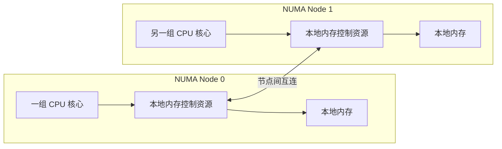

# NUMA 从零入门：它是什么、为什么需要它、什么时候值得优化

> 面向读者：第一次接触 NUMA，希望理解服务器性能、Linux 资源分配及容器部署的人。  
> 整理日期：2026 年 11 月 13 日。  
> 阅读方式：先读第 1～6 节建立概念，再按需要阅读 Linux、虚拟机与 Kubernetes 部分。  
> 范围：以常见 Linux 服务器上的 CPU 与主内存为主。文中命令用于学习，未在你的实际服务器上执行；所有示意输出和假设数字均不代表实测结果。

## 目录

1. [先理解 NUMA 解决什么问题](#overview)
2. [用两个办公室理解本地与远端](#analogy)
3. [从 CPU、内存控制器到 NUMA 拓扑](#hardware)
4. [一次内存访问实际如何发生](#mechanism)
5. [“开启 NUMA”究竟指什么](#enable)
6. [常见适用场景与收益](#scenarios)
7. [为什么配置后反而可能变慢](#tradeoffs)
8. [Linux 如何决定内存放在哪里](#placement)
9. [先动眼：Linux 只读检查](#inspection)
10. [再动手：理解绑定与分配策略](#policies)
11. [如何设计一次可信的对比实验](#experiment)
12. [虚拟机、容器与 Kubernetes](#virtualization)
13. [排查问题时怎么推理](#diagnosis)
14. [常见误区与术语速查](#faq)
15. [学习路线、自测与记录模板](#learning)
16. [官方参考资料](#references)

<a id="overview"></a>

## 1. 先理解 NUMA 解决什么问题

**NUMA，全称 Non-Uniform Memory Access，通常译为“非统一内存访问”或“非一致内存访问”。它描述的是：同一台机器上，CPU 访问不同位置的内存，成本可能不同。** 这里的“不一致”指访问延迟、带宽等性能特征不同，并不表示读出来的数据不一致。[^kernel-numa][^intel-numa]

先记住三个概念：

| 概念 | 小白可以这样理解 |
| --- | --- |
| 本地内存（Local Memory） | 与当前执行线程的 CPU 属于同一个 NUMA 节点的内存 |
| 远端内存（Remote Memory） | 属于其他 NUMA 节点的内存；一般仍在这台机器里 |
| NUMA 节点（NUMA Node） | 操作系统描述 CPU、内存等资源亲近关系的单位；常见节点包含一组 CPU 和一部分内存 |

常见服务器允许 CPU 访问其他节点的内存，但远端访问通常需要经过额外互连，延迟和可用带宽会受到影响。特殊机器还可能存在没有 CPU 或没有内存的节点，入门时先理解“CPU 与附近内存组成一个节点”的常见情况即可。[^kernel-numa]

### 1.1 NUMA 的作用有两个层面

**硬件层面：让一台服务器能够扩展更多 CPU、内存容量和内存通道。** 多组计算资源可以分别使用附近的内存子系统，再通过互连合作。[^intel-hardware][^kernel-numa]

**软件层面：让系统知道资源的位置，尽量把工作安排在数据附近。** 操作系统和应用可以利用拓扑，减少不必要的跨节点数据移动。[^acpi-numa]

因此，讨论 NUMA 性能时，要同时考虑三个问题：

1. 线程在哪些 CPU 上运行？
2. 这些线程频繁访问的数据实际放在哪些内存节点？
3. 线程与数据之间需要多少跨节点通信？

这是本文组织配置与排查步骤的思路，不是某个系统参数。

<a id="analogy"></a>

## 2. 用两个办公室理解本地与远端

想象一家公司有 A、B 两个办公室：每个办公室都有员工、文件柜，两个办公室之间有走廊。

| 生活里的东西 | 对应到计算机 |
| --- | --- |
| 员工 | 执行任务的 CPU 核心 |
| 员工正在做的工作 | 线程 |
| 文件柜 | 内存 |
| 文件 | 程序使用的数据 |
| 办公室 | NUMA 节点 |
| 走廊 | 节点间互连 |

A 办公室的员工可以去 B 办公室取文件，但如果每处理一笔业务都要往返一次，就会增加等待和走廊拥堵。

你可以想出几种改善办法：

- 把工作交给文件所在办公室的员工。
- 把经常使用的文件搬到处理它的员工附近。
- 把业务分组，让两边员工分别处理各自的文件。
- 如果所有员工都要大量读取不同文件，也可以把文件分散到两边，利用两个文件柜的服务能力。

这些办法分别对应线程放置、内存迁移、数据分区和跨节点分配等思路。**类比用于理解距离与分工，不表示缓存、内存或线程真的按“整个文件柜”移动。** Linux 通常以页管理内存放置，CPU 缓存则有另外的粒度。[^memory-policy][^intel-hardware]

<a id="hardware"></a>

## 3. 从 CPU、内存控制器到 NUMA 拓扑

### 3.1 先分清 Socket、Core、CPU 编号与 NUMA Node

| 名称 | 含义 | 容易混淆的点 |
| --- | --- | --- |
| Socket | 处理器插槽；服务器中常说的“一路、两路”与它有关 | 一个插槽里的处理器可以有很多核心 |
| Core | 物理计算核心 | 一个核心可能支持多个硬件线程 |
| Logical CPU | 操作系统可以调度的逻辑 CPU | Linux 的 CPU 0、CPU 1 通常指这个编号 |
| NUMA Node | 描述资源局部性的节点 | 不保证与 Socket 一一对应 |
| Kubernetes Node | Kubernetes 集群中的工作机器或虚拟机 | 与一台机器内部的 NUMA Node 是不同层次 |

Linux 的 `lscpu` 可以展示逻辑 CPU、核心、插槽和 NUMA 节点的对应关系。不要仅凭“CPU 编号连续”推断它们属于同一个物理核心或 NUMA 节点。[^lscpu][^ubuntu-affinity]

**双路服务器不一定只有两个 NUMA 节点；单路服务器也可能有多个 NUMA 节点。** 例如 AMD EPYC 的部分型号支持通过 NPS（NUMA Nodes Per Socket）设置，把一个插槽划分为多个 NUMA 域；具体可用设置取决于型号和平台。[^amd-nps]

### 3.2 再认识几个会反复出现的词

| 词语 | 初学者可以这样理解 |
| --- | --- |
| CPU 缓存 | CPU 附近用于保存部分数据的小容量高速存储，减少反复访问主内存 |
| 内存控制器 | 接收和安排内存读写请求的硬件部分 |
| 内存通道 | 控制器与内存之间的数据通路；多条通道可以提供并行传输能力 |
| 内存页（Page） | 操作系统管理内存映射和分配时使用的基本块；常见大小有 4 KiB，但依架构和机制而异 |
| 缺页（Page Fault） | 当前地址映射不能直接满足一次访问，需要内核处理的事件；按需分配内存也会触发，并不必然表示程序故障 |

这些是帮助阅读后文的简化解释。尤其要分清：CPU 缓存中的数据块、操作系统管理的内存页，以及整条内存条，是不同层次的单位。[^intel-hardware][^hugetlb][^ubuntu-affinity]

### 3.3 两节点机器的简化结构

下面是假想的两节点服务器；图中的“每节点一组内存控制资源”是教学简化，具体芯片内部结构因平台而异。[^kernel-numa][^intel-hardware]



如果阅读器不能渲染 Mermaid，可以直接记为：Node 0 的 CPU 访问 Node 0 的内存是本地访问，访问 Node 1 的内存是远端访问；对 Node 1 的 CPU 来说则相反。本地与远端取决于访问者的位置。[^kernel-numa]

### 3.4 为什么不让所有 CPU 访问内存都一样快？

UMA（Uniform Memory Access，统一内存访问）描述的是：从体系结构的角度，各处理器访问主内存的成本基本一致。这里不意味着每一次真实访问耗时完全相同，缓存命中和拥塞仍会影响结果。[^acpi-slit][^intel-hardware]

当计算规模扩大，内存接口、通道和互连的带宽都需要扩展。NUMA 用分布在不同位置的内存资源支撑扩展，同时把“距离不同”的事实暴露给软件。它带来的取舍是：**系统拥有更多可并行利用的资源，但软件需要更关注数据在哪里。**[^kernel-numa][^intel-hardware]

### 3.5 操作系统怎么知道资源的位置？

在使用 ACPI 的平台上，固件可以通过 SRAT 描述处理器和内存的归属，通过 SLIT 描述节点间的相对距离。Linux 再把这些信息组织成可以查询和使用的拓扑。节点编号只是标识，不代表距离：Node 2 不一定比 Node 7 更接近 Node 1。[^acpi-numa]

<a id="mechanism"></a>

## 4. 一次内存访问实际如何发生

### 4.1 先看缓存，再讨论主内存

CPU 不会每次读变量都直接访问内存条。可以先用下面的简化路径理解：[^intel-hardware]

```text
线程在某个 CPU 上执行
        ↓
从 CPU 缓存寻找数据
        ↓ 缓存无法满足时
经过内存与一致性互连，取得需要的数据
        ↓
可能来自本地内存、远端内存，或其他核心的缓存
```

因此，一个大部分工作都能在缓存中完成的程序，未必对 DRAM 的 NUMA 放置非常敏感；大量访问超出缓存的数据、并反复等待这些数据的程序，更值得检查内存局部性。实际影响仍取决于访问模式和瓶颈。[^intel-hardware]

### 4.2 NUMA 与缓存一致性不是一回事

常见服务器采用 ccNUMA，即 Cache-Coherent NUMA。硬件负责维护缓存一致性，让多个 CPU 能够协同访问共享内存。**NUMA 的“非统一”是距离与性能概念；缓存一致性关注共享数据的可见性与协调。**[^kernel-numa]

即使数据最终放在“正确”的内存节点，如果不同节点上的线程频繁写同一条缓存行，仍可能发生大量一致性通信。还有一种情况叫伪共享：线程修改的是不同变量，但变量恰好在同一缓存行里，相互干扰。此时需要检查数据布局和共享方式。[^false-sharing]

### 4.3 为什么远端访问会拖慢程序？

主要关注两类成本：

| 成本 | 含义 | 更可能敏感的访问方式 |
| --- | --- | --- |
| 延迟 | 发出请求后，等多久拿到数据 | 一次读取结果决定下一次读取地址，例如追踪链表或树 |
| 带宽 | 单位时间内能传多少数据 | 多线程扫描、复制或处理大量数据 |

远端路径会使用额外互连；并发访问产生的负载还会影响排队与带宽。因此应分别测量延迟、带宽以及真实业务表现。[^intel-mlc]

### 4.4 一个只用于理解的计算例子

**假设**一台教学机器的本地内存读取平均为 100 ns，远端为 160 ns，且先忽略缓存、并行访存和排队：

```text
50% 本地 + 50% 远端：0.5 × 100 + 0.5 × 160 = 130 ns
90% 本地 + 10% 远端：0.9 × 100 + 0.1 × 160 = 106 ns

这个简化模型中的单次访问平均耗时下降约 18.5%。
```

这是人为设定条件下的算术示例，**不能据此宣称业务延迟也会下降 18.5%**。业务还包含计算、锁、网络、磁盘及其他等待；真正收益要通过实验测量。

<a id="enable"></a>

## 5. “开启 NUMA”究竟指什么

日常沟通中，这句话可能指下面几个不同操作。先问清具体层级，才能判断配置是否合理。[^dell-bios][^sysctl][^numactl][^libvirt]

| 所在层级 | 实际在做什么 | 主要影响 |
| --- | --- | --- |
| BIOS / UEFI | 暴露 NUMA 拓扑，或调整节点划分与交错方式 | 操作系统看到的硬件资源关系 |
| Linux 自动 NUMA 平衡 | 内核采样访问情况，尝试改善内存局部性 | 运行期间的自动优化及其开销 |
| 应用 / 启动命令 | 指定线程可运行的 CPU、内存分配策略 | 某个程序的执行和分配位置 |
| 虚拟化平台 | 向虚拟机提供 vNUMA，并安排宿主机资源 | 虚拟拓扑与物理资源的匹配 |
| Kubernetes kubelet | 协调 CPU、内存及设备的拓扑约束 | 容器资源分配和准入结果 |

Kubernetes 层面的功能需要相关 Manager 配合，后文单独说明。[^k8s-topology][^k8s-memory]

### 5.1 BIOS：通常是让系统看见拓扑

不少服务器通过 `Node Interleaving`（节点交错）控制相关行为。例如 Dell 某些 PowerEdge 平台的官方指南说明，关闭 Node Interleaving 后，支持 NUMA 的操作系统可以识别内存分布并据此优化分配。[^dell-bios]

所以，看到下面这种配置时，不要被字面误导：

```text
Node Interleaving = Disabled
```

在这些平台上，它往往正是保留 NUMA 局部性信息的配置。**这不是所有厂商、所有型号都通用的菜单规则，实际操作以对应服务器手册为准。**[^dell-bios]

另外，跨 NUMA 节点交错与一个节点内部跨内存通道交错是不同层次。AMD 的 NPS1 示例中，一个插槽仍可作为一个 NUMA 节点，同时在该插槽的多个内存通道间交错。不能把所有带 `Interleaving` 的选项都理解为“应关闭”。[^amd-nps]

### 5.2 Linux：自动 NUMA 平衡是独立功能

自动 NUMA 平衡会对内存访问进行采样，在适合时迁移页面以改善局部性。采样触发的缺页处理和迁移本身也有成本，所以不是对所有负载都必然有利。[^sysctl]

只读查看：

```bash
sysctl kernel.numa_balancing
```

当前内核文档把该值定义为可组合的位标志：`0` 表示关闭，`1` 表示普通 NUMA 平衡，`2` 表示内存分层相关模式，组合值可以包含多个模式。旧内核的支持情况可能不同，应结合目标内核文档理解。**不要把所有非 0 值都简单当成完全相同的模式。**[^sysctl]

关闭自动平衡，并不意味着硬件 NUMA 消失；系统仍可能识别多个节点，也仍可使用本地分配或显式策略。已经精细放置 CPU 和内存的负载，应单独评估是否需要自动平衡，尤其不要把某个专用负载的选择直接推广到整台混合负载机器。[^kernel-numa][^sysctl]

### 5.3 应用：绑定 CPU 和绑定内存是两件事

下面两个要求相互独立：

- “线程只在 Node 0 的 CPU 上运行。”
- “内存只从 Node 0 分配。”

只设置第一个，不会自动把此前已经分配到 Node 1 的页面搬回来。启动时设置正确的策略，比程序运行很久之后只修改 CPU 亲和性更容易得到预期结果。[^ubuntu-affinity][^memory-policy]

<a id="scenarios"></a>

## 6. 常见适用场景与收益

下面分清两个决策：**保留 NUMA 拓扑供系统使用**，以及**进一步手动优化某个负载**。前者是平台配置问题；后者需要业务证据。[^dell-bios][^intel-numa]

### 6.1 场景一：多路或单路多 NUMA 节点的服务器

当机器存在多个 NUMA 域，暴露拓扑能让系统识别资源之间的亲近关系。进一步优化的价值取决于程序是否频繁跨节点访问、是否受内存或互连限制。机器有多个节点，只能说明“存在需要考虑的拓扑”，不能单独证明需要手动绑定。[^acpi-numa][^intel-numa]

### 6.2 场景二：数据库、缓存、搜索与索引服务

这类服务可能频繁读取较大的内存数据结构，因而值得检查热点线程与热点数据的位置。但“属于数据库或搜索服务”并不能直接推出某个 NUMA 参数最优。以下是基于局部性原理设计的检查思路，具体产品要结合自身指南和实测。[^intel-hardware][^ubuntu-affinity]

以一个假想搜索服务为例：

```text
机器有两个 NUMA 节点。
每个节点都有足够的 CPU 和内存容纳一个搜索实例。
服务能够按索引分片拆成两个相对独立的实例。
```

可以测试让实例 A 的线程和分片数据放在 Node 0，实例 B 放在 Node 1。若实例间通信少，这种分工可能减少跨节点数据移动；但拆实例也可能复制缓存、增加路由和运维成本。这里是待验证的方案，不是对任何具体搜索产品的配置结论。

### 6.3 场景三：科学计算、批处理和内存带宽密集任务

当任务能被划分为多个相对独立的数据块，让各组线程在对应节点上初始化和处理数据，有机会同时利用多个节点的内存带宽。反过来，如果所有数据由一个线程集中初始化，其他节点的工作线程可能持续远程读取。[^intel-hardware][^ubuntu-affinity]

这类任务的优化目标可能是“整机处理量最大”，而不只是“某个线程所有访问都本地化”。因此，使用多个节点常常是正常且必要的。[^intel-hardware]

### 6.4 场景四：低延迟网络与 DPDK

高性能网络处理还涉及设备位置。DPDK 官方文档建议，让处理核心、网卡队列使用的缓冲区和相应 PCIe 网卡尽量保持局部性。[^dpdk]

可以把路径理解为：

```text
网卡 → 内存缓冲区 → 处理数据包的 CPU
```

除了 CPU 和内存，设备连接在哪个节点也值得检查。只优化其中一段，仍可能让其他数据路径跨节点。[^dpdk]

### 6.5 场景五：大型虚拟机与有性能要求的容器

大型虚拟机可能覆盖多个物理 NUMA 节点，虚拟机内部的 vNUMA 拓扑与宿主机 CPU、内存放置需要共同考虑。容器场景中，则需要结合实际允许的 CPU、内存节点和 kubelet 的资源管理策略。[^libvirt][^cgroup][^k8s-topology]

### 6.6 好处应该用什么指标证明？

以下是建议的评估目标，不是对收益的保证：

| 想改善什么 | 优先比较什么 |
| --- | --- |
| 查询响应 | 同负载下的 P50、P95、P99 延迟及错误率 |
| 吞吐能力 | 满足同一延迟目标时可持续的 QPS / TPS |
| 批任务效率 | 同一数据集的完成时间、单位时间处理量 |
| 内存利用 | 每节点内存分布、回收、分配失败情况 |
| 多实例部署 | 整机总吞吐，以及各实例是否相互干扰 |

P99 可以先理解为“99% 的请求耗时不超过这个值”，用于观察较慢的一部分请求。这里选择这些指标，是为了把硬件层面的优化与实际业务目标联系起来。

### 6.7 我现在到底需不需要专门配置？

可以按下面的顺序做决定。这是基于前文原理的判断框架，不是适用于所有产品的默认参数：

| 你目前的情况 | 建议从哪里开始 |
| --- | --- |
| 刚开始学习，还没有具体性能问题 | 理解拓扑并执行只读查询，不急着修改 |
| 多 NUMA 节点服务器，运行支持 NUMA 的现代系统 | 按硬件指南保留正确拓扑，先建立默认配置的性能基线 |
| 有明显延迟或吞吐问题，而且内存访问可能是瓶颈 | 检查线程与热点数据的位置，再设计对照实验 |
| 应用能清晰地按实例或数据块分区 | 评估每组计算与数据是否可以放在合适的节点 |
| 一份任务需要的 CPU 或内存超过单节点能力 | 研究合理的多节点使用方式，不把单节点绑定当成目标 |
| 瓶颈已经明确在磁盘、网络接口调用或其他环节 | 优先处理已证明的瓶颈 |

硬件拓扑、默认性能基线和业务实测分别对应平台指南与调优文档中的关注点。[^dell-bios][^ubuntu-affinity][^intel-numa]

<a id="tradeoffs"></a>

## 7. 为什么配置后反而可能变慢

### 7.1 过度绑定，失去可用的 CPU 和内存带宽

把程序限制在一个节点，可能减少远端访问，也同时减少了它可使用的 CPU 和内存通道。如果负载本来能有效利用多个节点，强行收缩到一个节点可能损失吞吐。需要同时比较局部性和并行能力。[^ubuntu-affinity][^intel-hardware]

### 7.2 严格绑内存，导致局部资源耗尽

`--membind` 会限制受该策略约束的内存分配只能使用指定节点；这些节点无法满足需求时，不会像宽松的首选策略那样自然退回其他节点。分配可能失败，即使整机其他节点还有空闲内存。[^numactl]

教学例子：

```text
Node 0：可用于该任务的内存已经不足
Node 1：仍有大量空闲内存
程序策略：只允许从 Node 0 分配

结果：整机的“还有内存”不等于该程序的“还能分配”。
```

这说明严格局部性与容量弹性之间存在取舍。具体故障还可能涉及 cgroup 限额、回收、页面大小等因素，不能只凭一次失败就认定是 NUMA。[^cgroup][^hugetlb]

### 7.3 大量跨节点共享写入

两个节点的线程反复修改共享状态，可能让缓存行在核心之间频繁转移。把页面放在某个节点，并不能消除共享写入的通信需求；需要考虑分区、降低共享频率或调整数据布局。[^false-sharing]

### 7.4 自动迁移也会花时间

自动平衡的收益需要覆盖采样和页面迁移的成本。对于短任务、变化频繁或已经安排好资源位置的任务，应通过对比判断，而不是把自动平衡理解成没有代价的加速。[^sysctl]

### 7.5 任务的瓶颈可能根本不在这里

如果绝大部分时间消耗在远程接口、磁盘或业务锁上，NUMA 调整可能几乎不改变用户体验。先测量真实热点，再选择优化方向，是比单看服务器规格更可靠的办法。[^intel-numa][^intel-hardware]

<a id="placement"></a>

## 8. Linux 如何决定内存放在哪里

### 8.1 两个相互独立的决定

Linux 需要决定“线程在哪执行”，也需要决定“新页面从哪里分配”。CPU 亲和性和内存策略分别影响这两件事，而且还受 cpuset 等管理约束限制。[^ubuntu-affinity][^memory-policy]

默认情况下，对适用的普通分配，系统倾向于使用当前执行 CPU 附近的内存；本地无法满足时，可能按允许的范围回退到其他节点。默认策略不等于所有页面都会永久留在本地。[^kernel-numa]

### 8.2 First Touch：谁先实际触发分配，很重要

程序申请一段虚拟地址，并不总意味着所有物理页面立即准备好了。对常见的匿名内存，首次触发实际物理页分配的访问，会影响页面按默认策略放到哪里，这常被称为 First Touch。[^ubuntu-affinity]

入门时，可以重点理解“由哪个线程第一次写入并初始化”。仅仅读取新匿名内存可能使用共享零页等机制，所以“调用分配函数”或“读过地址”并不总等于已经获得了独立的本地物理页。[^thp]

教学场景：

```text
步骤 1：主线程在 Node 0 运行。
步骤 2：主线程写入并初始化整个大数组。
步骤 3：工作线程分别在 Node 0、Node 1 处理数组。

可能的结果：大量数组页面留在 Node 0，Node 1 的工作线程远程访问。
```

一种可测试的改进是让工作线程先就位，再各自初始化随后负责的数据区域，使初始化与实际使用的分工一致。要实现这种效果，仍需保证线程放置和分配策略符合预期。[^ubuntu-affinity][^intel-hardware]

First Touch 也不是所有内存的统一规则。文件映射、共享页、已经存在的页面、应用自己的内存策略以及大页机制，都可能让实际行为有所不同。[^memory-policy][^hugetlb]

### 8.3 页面可以搬家，线程也可以换位置

自动 NUMA 平衡可以尝试改善页面和任务的局部性。与此同时，修改某个任务的默认内存策略，主要影响后续分配；已有页面不会仅因为策略改变而全部自动搬迁。[^ubuntu-affinity][^memory-policy]

所以观察一个进程时，要分清：

- 允许它去哪运行、去哪分配。
- 它最近实际在哪运行。
- 它现在的页面实际分布在哪里。
- 它此刻最频繁访问哪些页面。

这四个问题需要不同证据，不能用一条配置命令互相替代。

<a id="inspection"></a>

## 9. 先动眼：Linux 只读检查

本节命令面向 Linux。工具不存在时，通过目标系统的软件包管理器安装 `numactl`、`util-linux` 或 `procps` 等对应工具包；包名以发行版为准。涉及其他用户进程的信息，可能需要相应读取权限。以下示例不修改绑定或系统参数。[^numactl][^lscpu][^taskset][^procps]

### 9.1 看 CPU 与 NUMA 拓扑

```bash
lscpu
lscpu -e=CPU,NODE,SOCKET,CORE,ONLINE
numactl --hardware
```

`lscpu -e` 展示对应关系；`numactl --hardware` 展示节点、CPU 列表、内存容量及距离等信息。虚拟机内看到的拓扑，通常反映来宾系统的配置，不等于完整的宿主机拓扑。[^lscpu][^numactl]

下面是**人为构造、略去其他行的教学输出**：

```text
available: 2 nodes (0-1)
node 0 cpus: 0 1 2 3
node 0 size: 32768 MB
node 0 free: 20000 MB
node 1 cpus: 4 5 6 7
node 1 size: 32768 MB
node 1 free: 18000 MB
node distances:
node   0   1
  0:  10  21
  1:  21  10
```

从这个示例可以读出：CPU 0～3 属于 Node 0，CPU 4～7 属于 Node 1，两个节点各有一部分内存。

距离中的 `10`、`21` 是拓扑相对距离值，**不是 10 ns、21 ns 的实测延迟**。以 ACPI SLIT 为例，本地距离归一化为 10；不能据此断言当前业务跨节点访问一定精确慢 2.1 倍。[^acpi-slit]

### 9.2 看进程的 CPU 允许范围和线程位置

假设目标进程 PID 为 `12345`，请替换成真实 PID：

```bash
# 读取该进程所有线程的 CPU 亲和性
taskset -a -c -p 12345

# 观察各线程最近在哪个逻辑 CPU 上执行
ps -L -p 12345 -o pid,tid,psr,comm
```

`taskset` 的 `-a` 用于查看所有线程；这里没有提供新的 CPU 列表，所以是查询。`PSR` 是线程最近执行过的逻辑 CPU 编号，需要结合 `lscpu -e` 映射到 NUMA 节点。一次快照不代表它一直在那里运行。[^taskset][^procps]

### 9.3 看进程内存落在哪些节点

```bash
numastat -p 12345
head -n 20 /proc/12345/numa_maps
```

`numastat -p` 按节点展示进程驻留内存分布，带选项时的显示单位与默认裸 `numastat` 不同，应阅读输出标题。`numa_maps` 则按映射展示策略和页面分布。[^numastat][^numa-maps]

假设某行含有下面内容：

```text
N0=1000 N1=500 kernelpagesize_kB=4
```

其中 `N0`、`N1` 表示该映射在对应节点上的页数。这个例子使用 4 KiB 页；真实系统还可能涉及其他页面大小，不能一律按 4 KiB 换算。[^numa-maps][^hugetlb]

**这些工具主要回答“页面在哪里”，没有直接回答“这些页面被哪个 CPU 访问了多少次”。** 若线程通常运行在 Node 0、页面却大量位于 Node 1，只能形成远端访问的怀疑；还要确认热点页面、实际访问和业务影响。[^numastat][^numa-maps]

### 9.4 看各节点的内存状态

```bash
numastat -m
cat /sys/devices/system/node/node0/meminfo
cat /sys/devices/system/node/node1/meminfo
```

最后两条仅适用于确实存在 Node 0、Node 1 的机器。`numastat -m` 提供按节点拆分的内存状态，适合发现分布不均或某一节点承压的线索。[^numastat]

### 9.5 正确理解 numa_hit / numa_miss

```bash
numastat
```

这些计数描述内存**分配**是否符合期望，而不是每一次 CPU 读写内存的命中统计。内核文档给出的关键含义如下：[^numa-stat]

| 字段 | 该节点上的计数含义 |
| --- | --- |
| `numa_hit` | 原本希望在此节点分配，实际也分配在这里 |
| `numa_miss` | 原本希望在其他节点分配，最终分配到了这里 |
| `numa_foreign` | 原本希望在此节点分配，最终分配到了其他节点 |
| `local_node` | 分配时，执行分配的 CPU 与实际分配内存属于同一节点 |
| `other_node` | 分配时，执行分配的 CPU 与实际分配内存属于不同节点 |

裸 `numastat` 的传统统计使用页为单位；观察累计值还应考虑采样间隔内的增量和系统运行时长。**不要用 `numa_miss / (numa_hit + numa_miss)` 直接声称得到了业务的远端访存比例。**[^numa-stat][^numastat]

### 9.6 看容器或进程被允许使用什么

```bash
cat /proc/12345/status
cat /proc/12345/cgroup
```

重点关注 `status` 中的 `Cpus_allowed_list`、`Mems_allowed_list`，再结合 `cgroup` 确认资源管理范围。多线程程序可有不同的线程 CPU 亲和性，因此仍要结合前面的逐线程检查。[^proc][^taskset]

在启用了 cpuset 控制器的 cgroup v2 环境，还可以查询目标 cgroup 的 `cpuset.cpus.effective`、`cpuset.mems.effective`；具体路径要根据实际挂载点和进程所属 cgroup 定位。`effective` 表示实际获准使用的集合，可能受到父 cgroup 限制。[^cgroup]

容器里看见某些宿主机硬件信息，不代表该容器有权使用全部资源。[^cgroup]

<a id="policies"></a>

## 10. 再动手：理解绑定与分配策略

本节是**在测试环境中启动新进程的示例**。`./your_program` 是占位程序名，需要替换；示例假设目标节点存在、可访问且资源足够。`numactl` 不会绕过容器或 cpuset 的限制，应用也可能自行设置更具体的策略。[^numactl][^memory-policy]

### 10.1 只限制 CPU

```bash
numactl --cpunodebind=0 ./your_program
```

把程序限制在 Node 0 的可用 CPU 上运行。它没有同时设置严格的内存节点策略，也不意味着独占这些 CPU。[^numactl][^ubuntu-affinity]

### 10.2 CPU 固定，内存优先本地但允许回退

```bash
numactl --cpunodebind=0 --preferred=0 ./your_program
```

CPU 使用 Node 0，内存优先选择 Node 0；该节点无法满足时，允许在其他获准节点分配。适合用来评估“尽量本地化，同时保留容量回退”的效果。[^numactl]

另一个相关选项是 `--localalloc`，它偏好执行分配的 CPU 所在节点，并允许回退；如果线程跨节点运行，它与始终首选固定 Node 0 的策略并不相同。[^numactl]

### 10.3 CPU 与内存都限制在一个节点

```bash
numactl --cpunodebind=0 --membind=0 ./your_program
```

对受该策略约束的分配，只允许从 Node 0 获取内存。适合测试资源需求明确、单节点容量足够的负载，但要为峰值、运行时和额外分配留下余量。[^numactl]

这条命令并不保证进程映射中的每一页都来自 Node 0：已有的共享页、文件映射和应用内部策略等，仍需按实际语义分析和观察。[^memory-policy]

### 10.4 跨节点交错分配

```bash
numactl --interleave=0,1 ./your_program
```

让适用的页面分配在指定节点间交错。它的目标可以是分散内存负载、利用更多节点的资源，但不会保证每个线程访问的页面都在本地，也没有限制线程在哪些 CPU 上运行。[^numactl][^memory-policy]

可以把它理解为按页把数据分布到两个节点，而不是把同一份数据复制两份。Linux 的这种进程级分配策略，也不同于 BIOS 的跨节点内存交错。[^memory-policy][^dell-bios]

### 10.5 快速比较

| 选项 | 主要约束 | 容量不足时的特点 |
| --- | --- | --- |
| `--cpunodebind=0` | CPU 运行范围 | 没有设置额外的内存策略 |
| `--physcpubind=2,3` | 指定逻辑 CPU 编号 | 同上；名字里的 physical 不表示选择完整物理核心 |
| `--preferred=0` | 首选内存节点 | 允许回退到其他获准节点 |
| `--localalloc` | 首选执行分配的 CPU 所在节点 | 允许回退 |
| `--membind=0` | 限定内存分配节点 | 指定范围无法满足时可能失败 |
| `--interleave=0,1` | 将分配分散到节点集合 | 不是严格单节点局部性策略 |

具体选项和约束以上游手册及安装版本为准。[^numactl][^ubuntu-affinity]

查询当前启动上下文的策略可以使用：

```bash
numactl --show
```

它展示调用上下文的策略，**不会自动查看任意另一个业务 PID 的完整状态**。检查已有业务进程，仍应组合使用亲和性、`numa_maps` 和内存分布信息。[^numactl][^numa-maps]

<a id="experiment"></a>

## 11. 如何设计一次可信的对比实验

这里提供实验设计，不提供虚构的性能结论。目的有两个：先确认策略确实影响了放置，再确认变化是否改善业务。Intel 的性能工具和调优资料也强调测量真实运行负载。[^intel-mlc][^intel-hardware]

### 11.1 先记录基线

建议记录：机器型号、NUMA 拓扑、内核、业务版本、启动命令、CPU / 内存限制、数据量、线程数、自动平衡状态、预热方式和业务指标。

业务测试期间尽量保持请求速率、数据集和并发量一致；每组使用新进程并完成相同预热，记录多次运行的波动。避免只选一次最好成绩。

### 11.2 用两组实验隔离“内存远近”的影响

在节点 0 和 1 都可用、测试内存能放入任一节点的前提下，保持相同的 CPU 约束和线程数：

```bash
# 实验 L：CPU 在 Node 0，适用的新内存分配在 Node 0
numactl --cpunodebind=0 --membind=0 ./your_program

# 实验 R：CPU 仍在 Node 0，适用的新内存分配改到 Node 1
numactl --cpunodebind=0 --membind=1 ./your_program
```

第二组是故意构造远端放置的对照。命令语义来自 `numactl`；是否真的形成预期放置，要在运行中用 `numastat -p` 等工具确认。[^numactl][^numastat]

以下是实验设计时需要控制的因素：

- 两组使用相同数据量、线程数和业务请求。
- 注意自动 NUMA 平衡和应用自带策略是否影响实际放置，并在各组保持一致。
- 数据规模应能暴露你关心的内存访问；若几乎全部命中缓存，实验可能主要测到缓存表现。
- 对文件映射、共享缓存或多进程服务，需要确认测试对象确实受启动策略影响。
- 微基准只能说明该访问模式的表现，最终仍需真实业务验证。

这些控制项来自前文机制的推导，目的是减少“同时改变很多条件”带来的误判。

### 11.3 再比较真实部署策略

| 测试组 | 用来回答的问题 |
| --- | --- |
| 原始默认配置 | 当前实际表现是什么？ |
| 单节点 CPU + 首选本地内存 | 宽松本地化有没有收益？ |
| 单节点 CPU + 严格本地内存 | 更强约束有没有进一步收益，容量够不够？ |
| 多节点运行 + 合理数据分区 | 能否保留局部性并利用整机资源？ |
| 多节点运行 + 交错分配 | 对共享或带宽型负载，分散页面是否更好？ |

不要把“原来用整机 CPU”与“后来只用半台机器”简单当成纯 NUMA 延迟对照。那同时改变了计算资源和内存通道。评估部署方案时可以比较，但需要明确比较的是整体方案。

### 11.4 什么结果才值得保留？

建议同时满足：业务指标有可重复的改善、错误率没有恶化、资源峰值能承受、整机其他负载没有明显受损，并且维护成本可以接受。NUMA 调优的最终目标由业务决定，页面分布“看起来整齐”本身不是验收标准。

进一步需要测量节点间延迟和带宽时，可研究 Intel MLC 等工具，并核对其硬件支持、权限要求和运行行为；部分测试会产生大量负载或调整测试相关设置，适合放在专用测试环境。本文没有运行这些基准。[^intel-mlc]

<a id="virtualization"></a>

## 12. 虚拟机、容器与 Kubernetes

### 12.1 虚拟机：vNUMA 是给来宾系统看的拓扑

虚拟化平台可以向虚拟机提供虚拟 NUMA 节点，同时在宿主机上分别配置 vCPU 运行范围和内存放置。以 libvirt 为例，来宾 NUMA 拓扑、`vcpupin` 和 `numatune` 属于相关但不同的设置。[^libvirt]

要理解这条链：

```text
虚拟机中的线程
    → 虚拟 CPU / 虚拟 NUMA 节点
    → 宿主机上的物理 CPU 与实际内存页面
```

根据这套机制可以推导：来宾系统看到“本地”，并不自动证明宿主机上的资源放置也合理。因此，较大的虚拟机需要同时检查来宾拓扑和宿主机映射。虚拟机能否放进单个物理节点，要同时考虑 CPU、内存和其他负载需求。[^libvirt][^lscpu]

### 12.2 容器：资源额度与资源位置是不同问题

容器的 CPU 配额、内存额度，描述“能使用多少”；cpuset 等机制可以进一步限制“允许在哪里使用”。这两个维度需要分开检查。[^cgroup]

例如，一项工作负载获得了某个 CPU 数量，并不能仅凭这个数量判断这些 CPU 是否来自同一 NUMA 节点；还需要查看实际 CPU 集合及其拓扑。[^lscpu][^cgroup]

### 12.3 Kubernetes：三个 Manager 的职责

下表聚焦 Linux 上的常见机制，部署时应查阅与集群版本对应的文档。[^k8s-cpu][^k8s-memory][^k8s-topology]

| 组件 | 主要职责 |
| --- | --- |
| CPU Manager | 管理容器 CPU 分配；`static` 策略可为满足条件的容器分配专用 CPU |
| Memory Manager | 管理内存 NUMA 放置相关信息与预留；Linux `Static` 策略面向符合条件的 Guaranteed Pod |
| Topology Manager | 汇总 CPU、内存、设备等提供的拓扑提示，协调资源对齐和准入 |

CPU Manager 的常见专用 CPU 分配条件包括：容器属于 `Guaranteed` Pod，并提出整数 CPU 请求。**仅看到 `requests.cpu: 4`，不能直接认定已经获得四个独占 CPU，更不能认定它们和内存已经 NUMA 对齐。**[^k8s-cpu]

同样，设置 Topology Manager 并不能替代 CPU、内存和设备各自的配置；真正能协调哪些资源，取决于参与的提示提供者和工作负载条件。[^k8s-topology][^k8s-memory]

### 12.4 single-numa-node 为什么会让 Pod 准入失败？

`single-numa-node` 要求能够为对应范围找到单 NUMA 节点的资源对齐方案。如果找不到，kubelet 会拒绝该 Pod 的准入。`container` 与 `pod` scope 的范围不同：前者分别考虑容器，后者按整个 Pod 协调。[^k8s-topology]

教学例子：

```text
Node 0：还可分配 4 个 CPU
Node 1：还可分配 4 个 CPU
容器需要：6 个可按策略分配的 CPU
要求：资源必须满足单 NUMA 节点对齐
```

整台机器合计有 8 个 CPU，并不意味着存在一个可以容纳 6 个 CPU 的 NUMA 节点。这个假设例子说明“总量够”与“拓扑约束下能分配”是不同问题。

这类问题发生在 kubelet 的资源分配与准入阶段，不应与普通调度资源不足混为一谈。严格拓扑策略下，要检查准入事件、Manager 配置及实际拓扑。[^k8s-topology]

<a id="diagnosis"></a>

## 13. 排查问题时怎么推理

下面是一套基于前文机制整理的检查顺序。每一步都用于缩小假设范围，不能单独作为根因结论。

### 13.1 现象：CPU 增加了，吞吐却没有增加

先确认增加的线程是否跨到了其他 NUMA 节点，再检查热点数据有没有一起分区。也要考虑内存带宽、共享写入和其他串行瓶颈。线程更多而数据仍集中在一个节点，是可以检验的假设之一。[^intel-hardware][^false-sharing]

### 13.2 现象：绑核后延迟变差

检查新 CPU 位置与已有页面是否分离；再比较可用 CPU 数量是否减少、线程是否过量，以及局部节点是否承压。修改 CPU 亲和性不会直接迁移已有页面，这是常见的排查起点。[^ubuntu-affinity]

### 13.3 现象：整机有空闲内存，程序仍分配失败

依次检查：

1. 是否存在 `membind` 等节点范围约束。
2. cgroup 内存额度和允许的内存节点是否满足需求。
3. 指定节点是否有可用内存；若使用 HugeTLB，目标节点的对应大页资源是否足够。
4. 是否有相关回收或分配失败证据。

这些限制分别来自内存策略、cgroup 和大页资源管理；它们可以在整机仍有剩余资源时限制特定任务。[^numactl][^cgroup][^hugetlb]

### 13.4 现象：numa_miss 很大

先确认它是分配统计，查看采样期间增量、策略和节点压力，再与业务问题发生时间关联。不要把一个历史累计值直接翻译成“此刻所有业务都大量远端读内存”。[^numa-stat]

### 13.5 证据能说明到哪一步？

| 观察结果 | 可以支持的判断 | 还不能直接证明 |
| --- | --- | --- |
| 系统存在多个 NUMA 节点 | 软件需要考虑多节点拓扑 | 当前业务一定有 NUMA 瓶颈 |
| CPU 亲和性限制在一个节点 | 线程允许的执行范围受限 | 所有内存都本地化 |
| 进程页面分布在多个节点 | 驻留内存分布跨节点 | 热点访问的远端比例是多少 |
| `numa_miss` 增长 | 一部分分配没有落在期望节点 | CPU 实际访存延迟增加了多少 |
| 对照实验反复改善业务指标 | 在当前条件下，该方案有实测价值 | 对所有业务、负载和机器都有效 |

表中证据边界依据相关工具和策略的语义整理。[^taskset][^numastat][^numa-stat][^memory-policy]

<a id="faq"></a>

## 14. 常见误区与术语速查

### 14.1 常见误区

| 说法 | 更准确的理解 |
| --- | --- |
| NUMA 就是一个加速开关 | NUMA 首先是内存访问拓扑；软件要合理利用它 |
| 关掉 NUMA，物理距离就没有了 | 某些平台隐藏拓扑或交错内存，并没有消除硬件路径 |
| 一个 Socket 必定是一个 NUMA Node | 节点划分取决于架构、型号和固件配置 |
| 自动平衡关闭了，NUMA 就关闭了 | 自动优化功能与硬件拓扑是不同层次 |
| 绑 CPU 就等于绑内存 | 两种策略分别控制执行位置与分配位置 |
| 绑得越死越好 | 还要考虑容量、并行能力、带宽和其他负载 |
| 使用远端内存说明机器异常 | 这是 NUMA 系统支持的正常访问方式，只是成本不同 |
| NUMA distance 是实测纳秒数 | 它通常是归一化的相对拓扑距离 |
| `numa_miss` 是远端访存次数 | 它是内存分配相关统计 |
| NUMA 优化能解决所有内存问题 | 它不能代替容量规划、数据布局和瓶颈分析 |

相关依据分别见内核、平台手册和工具文档。[^kernel-numa][^amd-nps][^dell-bios][^sysctl][^numactl][^acpi-slit][^numa-stat]

### 14.2 NUMA 与大页有什么关系？

两者关注不同维度：NUMA 关注页面放在哪里；大页关注地址转换和内存管理所用的页面大小。HugeTLB 大页还可能有按节点管理的资源池，因此“大页总量足够”不代表指定节点的大页资源足够。[^hugetlb]

THP（透明大页）与预留 HugeTLB 大页是不同机制，也都不能简单等同于“开启 NUMA”。[^thp][^hugetlb]

### 14.3 只看见一个 NUMA 节点说明什么？

它说明当前系统视角下只暴露了一个节点。可能是本来如此，也可能与固件配置或虚拟机呈现有关，不能仅凭这个结果反推完整物理拓扑。对当前环境而言，如果没有可区分的其他节点，就没有必要照搬双节点绑定示例。[^lscpu][^dell-bios][^libvirt]

### 14.4 术语速查

| 术语 | 含义 |
| --- | --- |
| Locality | 局部性；经常合作的计算、数据或设备在拓扑上靠近 |
| Affinity | 亲和性；限定或偏好某些 CPU / 资源位置 |
| Memory policy | 内存分配策略；决定适用的新页面从哪些节点分配 |
| First Touch | 首次触发实际分配的访问对页面位置产生影响的行为 |
| Page migration | 把内存页面从一个节点迁移到另一个节点 |
| Interleave | 在节点集合间交错分配 |
| Working set | 某段时间内程序活跃使用的数据集合 |
| ccNUMA | 带硬件缓存一致性支持的 NUMA |
| vNUMA | 虚拟化平台向来宾系统呈现的 NUMA 拓扑 |

这些概念的正式定义和具体实现，可继续阅读下方内核、Ubuntu 与 libvirt 文档。[^kernel-numa][^memory-policy][^ubuntu-affinity][^libvirt]

<a id="learning"></a>

## 15. 学习路线、自测与记录模板

### 15.1 建议分三轮学习

第一轮读第 1～8 节，能画出两个节点之间的访问关系，能解释 CPU 放置和内存放置的区别即可。

第二轮在有权限的 Linux 测试环境执行第 9 节只读命令，尝试把“CPU 编号 → NUMA 节点 → 进程页面分布”串起来。暂时不必修改系统配置。

第三轮选择一个可以控制输入和线程数的测试负载，按照第 11 节设计对比，把预期、真实放置、性能结果和局限一起记录。

### 15.2 自测：能解释这六题，就建立了基本认识

1. 为什么同一块内存，对某个 CPU 是本地，对另一个 CPU 是远端？
2. 为什么主线程初始化大数组，可能影响其他节点的工作线程？
3. 为什么程序绑到 Node 0 后，内存仍可能位于 Node 1？
4. 为什么整机还有空闲内存，严格绑定的程序却可能分配失败？
5. 为什么 `numastat -p` 显示跨节点分布，并不能直接证明业务很慢？
6. 为什么只看 QPS 上升，还不足以判断一次线上服务优化成功？

参考要点：访问者位置、首次实际分配、CPU 与页面独立放置、分配允许范围、页面位置不等于访问热点，以及延迟 / 错误率 / 资源成本需要共同评估。前五题对应前文技术机制，第六题用于检查实验是否符合业务目标。

### 15.3 后续学习记录模板

```markdown
## 我的 NUMA 观察记录

- 日期：
- 机器型号 / CPU 型号：
- 物理机还是虚拟机：
- 系统与内核版本：
- NUMA 节点数量：
- 每节点 CPU 列表与内存容量：
- 业务 / 程序版本：
- 数据规模与线程数：
- CPU / 内存 / cgroup 限制：
- 自动 NUMA 平衡状态：

### 现象和假设

- 观察到什么问题：
- 为什么怀疑与 NUMA 有关：
- 其他可能原因：

### 对比方法

- 基线启动命令：
- 对照组启动命令：
- 保持不变的条件：
- 如何预热和重复：
- 如何确认线程与页面实际位置：

### 结果

| 指标 | 基线 | 对照 | 波动与备注 |
| --- | --- | --- | --- |
| QPS / 完成时间 | | | |
| P95 / P99 | | | |
| 错误率 | | | |
| 各节点内存与压力 | | | |
| 对其他实例的影响 | | | |

### 判断

- 结果支持什么：
- 还有什么没证明：
- 是否保留该方案：
- 下一步：
```

<a id="references"></a>

## 16. 官方参考资料

以下资料在整理时查阅。建议先读 Linux 的概念说明，再读工具手册；涉及 BIOS、内核或 Kubernetes 配置时，应选择与实际硬件和软件版本相符的文档。厂商历史材料在这里用于说明原理或特定平台，不表示其硬件数字适用于当前所有机器。

[^kernel-numa]: Linux Kernel：[What is NUMA?](https://docs.kernel.org/mm/numa.html)——硬件与 Linux 视角、ccNUMA、本地分配和回退。
[^intel-numa]: Intel：[NUMA optimization overview](https://github.com/intel/optimization-zone/blob/main/hardware/NUMA/README.md)——多插槽 / 多芯片拓扑、局部性和按工作负载验证收益。
[^intel-hardware]: Intel：[Hardware and Software Approach for Using NUMA Systems](https://www.intel.com/content/www/us/en/developer/articles/technical/hardware-and-software-approach-for-using-numa-systems.html)——缓存、数据移动、并行分工与真实负载验证；历史示例中的容量和速度不作为本文性能基准。
[^memory-policy]: Linux Kernel：[NUMA Memory Policy](https://docs.kernel.org/admin-guide/mm/numa_memory_policy.html)——策略作用范围、默认分配、绑定、交错及已有页面的语义。
[^acpi-numa]: UEFI Forum：[ACPI — NUMA Architecture Platforms](https://uefi.org/specs/ACPI/6.5_A/17_NUMA_Architecture_Platforms.html)——SRAT、SLIT、节点亲近关系与固件信息。
[^acpi-slit]: UEFI Forum：[ACPI — System Locality Information Table](https://uefi.org/specs/ACPI/6.5/05_ACPI_Software_Programming_Model.html#system-locality-information-table-slit)——相对距离及本地距离归一化。
[^lscpu]: util-linux：[lscpu 手册源码](https://kernel.googlesource.com/pub/scm/utils/util-linux/util-linux/+/master/sys-utils/lscpu.1.adoc)——CPU、核心、插槽与 NUMA 拓扑查询，虚拟化环境的展示边界。
[^ubuntu-affinity]: Ubuntu Server：[CPU affinity, NUMA placement, and isolation](https://ubuntu.com/server/docs/explanation/performance/perf-tune-affinity-numa/)——CPU 与内存位置、First Touch、绑定与隔离的区别。
[^amd-nps]: AMD：[HPC Tuning Guide for AMD EPYC 7002 Series](https://docs.amd.com/api/khub/documents/NchgnTD~sMQ5tO~e9OckPg/content)——以该系列的 NPS1 / NPS2 / NPS4 说明一个插槽可以有多个 NUMA 域；具体支持依型号而定。
[^false-sharing]: Linux Kernel：[False Sharing](https://kernel.org/doc/html/latest/kernel-hacking/false-sharing.html)——缓存行共享写入、伪共享及分析方向。
[^intel-mlc]: Intel：[Memory Latency Checker](https://www.intel.com/content/www/us/en/developer/articles/tool/intelr-memory-latency-checker.html)——节点间延迟、带宽与负载影响的测量方法。
[^dell-bios]: Dell：[PowerEdge BIOS Performance and Workload Tuning Guide for 16G](https://www.dell.com/en-us/infohub/articles/poweredge-bios-performance-and-workload-tuning-guide-for-16g)——该平台 Node Interleaving 的含义。
[^sysctl]: Linux Kernel：[kernel.numa_balancing](https://docs.kernel.org/admin-guide/sysctl/kernel.html#numa-balancing)——自动平衡、模式标志、采样及成本。
[^numactl]: numactl 上游：[numactl 手册源码](https://github.com/numactl/numactl/blob/master/numactl.8)——CPU 绑定、首选、严格绑定、交错等选项。
[^numastat]: numactl 上游：[numastat 手册源码](https://github.com/numactl/numactl/blob/master/numastat.8)——系统 / 进程内存分布及单位。
[^numa-stat]: Linux Kernel：[NUMA policy hit/miss statistics](https://docs.kernel.org/admin-guide/numastat.html)——各类分配计数的精确定义。
[^proc]: Linux Kernel：[The /proc Filesystem](https://www.kernel.org/doc/html/latest/filesystems/proc.html)——进程状态与允许资源集合。
[^numa-maps]: Linux man-pages：[proc_pid_numa_maps(5)](https://man7.org/linux/man-pages/man5/proc_pid_numa_maps.5.html)——每个映射的策略、节点页数与统计边界。
[^taskset]: util-linux：[taskset 手册源码](https://github.com/util-linux/util-linux/blob/master/schedutils/taskset.1.adoc)——查询与设置线程 CPU 亲和性。
[^procps]: procps-ng：[ps(1) 手册（man7 发布版）](https://man7.org/linux/man-pages/man1/ps.1.html)——线程查询与 PSR 字段定义。
[^cgroup]: Linux Kernel：[Control Group v2](https://docs.kernel.org/admin-guide/cgroup-v2.html)——CPU / 内存约束、cpuset 及 effective 资源集合。
[^thp]: Linux Kernel：[Transparent Hugepage Support](https://docs.kernel.org/admin-guide/mm/transhuge.html)——透明大页与匿名映射零页机制。
[^hugetlb]: Linux Kernel：[HugeTLB Pages](https://docs.kernel.org/admin-guide/mm/hugetlbpage.html)——大页、TLB 与按 NUMA 节点管理的大页资源。
[^dpdk]: DPDK：[Poll Mode Driver — Logical Cores, Memory and NIC Queues Relationships](https://static.dpdk.org/doc/guides/prog_guide/ethdev/ethdev.html)——处理核心、网络缓冲区与网卡的局部性。
[^libvirt]: libvirt：[Domain XML format](https://libvirt.org/formatdomain.html)——来宾 NUMA 拓扑、CPU pinning 与 numatune。
[^k8s-cpu]: Kubernetes：[Control CPU Management Policies on the Node](https://kubernetes.io/docs/tasks/administer-cluster/cpu-management-policies/)——CPU Manager static 策略和专用 CPU 条件。
[^k8s-memory]: Kubernetes：[Control Memory Management Policies on a Node](https://kubernetes.io/docs/tasks/administer-cluster/memory-manager/)——Memory Manager、Guaranteed Pod 与 NUMA 内存资源管理。
[^k8s-topology]: Kubernetes：[Control Topology Management Policies on a Node](https://kubernetes.io/docs/tasks/administer-cluster/topology-manager/)——资源拓扑提示、scope、single-numa-node 与准入。
